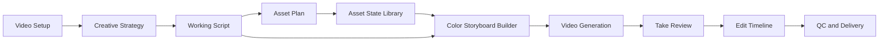

# AI Industrial Video Generation Workflow

## Purpose

Build a traceable, reviewable production system for commercial video. The goal
is not to let several agents write successive prompts. The goal is to turn
creative direction, a script, reusable visual states, color storyboards, video
takes, and an edit into one connected production chain.

> Every video shot starts from an approved color storyboard frame. Every color
> storyboard frame explicitly references locked character, prop, environment,
> and UI states. The video model animates an already-defined shot; it does not
> invent the world, cast, or brand.



## Guiding principles

1. **Structure before generation.** A good prompt cannot repair an undefined
   character, space, prop, or camera relationship.
2. **Image-first, video-second.** Verify character identity, layout, light,
   props, and composition in a color storyboard before running image-to-video.
3. **Asset state, not one-off imagery.** A 2x2 grid or turn-around is an asset
   source; its panels are individually addressable visual states.
4. **One source of truth per decision.** Video Setup defines market and
   language; the Script defines the story; the Asset Plan defines needed
   ingredients; the Storyboard defines exact shots; the Edit defines the cut.
5. **Human decisions at expensive or irreversible boundaries.** Users confirm
   setup, asset plan, color storyboard frames, selected takes, and final edit.
6. **Generation history is never silently overwritten.** Regenerated frames and
   takes remain available in Library and lineage.

---

## 0. Video Setup

Video Setup defines who the commercial is for and how it should communicate.
Creative Strategist may propose values automatically, but the user confirms
them before a new or revised script is generated.

| Field | Example |
|---|---|
| Target market | Korea |
| Target audience | Female mobile-game players, 18-34 |
| Video type | Mobile game performance ad |
| Format | 9:16 / 30 seconds / 720p or 1080p |
| Visual style | Cozy Korean lifestyle plus stylized 3D game world |
| Spoken language | Korean |
| Subtitle language | Korean |
| Platform | TikTok, Reels, Shorts |
| Conversion goal | App install |
| Content mode | Live-action-like, CG narrative, gameplay capture, or hybrid |

Rules:

- Setup is stored as structured Production data, never buried in `raw_script`.
- The latest user instruction determines output language. Country or language is
  never inferred from older productions.
- Later agents must consume confirmed Setup rather than guessing market,
  dialogue language, platform, or deliverable format.

---

## 1. Creative Strategist

Creative Strategist determines what to adapt from a reference and what the new,
original commercial should become. It does not write final image prompts and it
does not replace the Screenwriter.

### Required report sections

#### 1. Reference Video Analysis

Evidence-based analysis of:

- narrative structure and the first one-to-three-second hook;
- character relationships, emotional turns, setting, cultural context,
  wardrobe, and performance;
- camera language, shot scale, pacing, transitions, lighting, color, UI, and
  music mood;
- elements observed in reference media versus inferred ideas;
- transferable techniques and protected elements that must not be copied.

Reference media informs narrative rhythm, camera language, and commercial
structure. It must not be used to clone a face, outfit, product, UI, brand, or
spoken line.

#### 2. Recommended Video Direction

An original campaign proposal specifying:

- audience insight and product benefit;
- hook and narrative premise;
- character relationship;
- visual and performance direction;
- recommended pace and shot rhythm;
- what should be treated as CG, real gameplay capture, image-to-video, or a
  deterministic post-production layer.

#### 3. Designer Reference Frames

Reference frames are timestamped screenshot-backed notes. Each includes:

- timestamp and source media;
- narrative purpose;
- compositional, emotional, or camera technique to adapt;
- original-work boundary.

They are semantic guidance, never direct image-generation source material.

#### 4. Confirm Asset Plan

The Asset Plan is the only upstream source for Script bindings and Designer
Packs.

```json
{
  "asset_key": "char_florist_kr",
  "category": "character",
  "name": "Korean Florist",
  "purpose": "Lead performer in flower-shop narrative scenes",
  "visual_mode": "photorealistic",
  "source_status": "ai_generated",
  "priority": "required",
  "required_scenes": ["scene_01", "scene_02", "scene_05"],
  "continuity_notes": "Same face, green apron, linen shirt, low ponytail"
}
```

Allowed source status values:

| Status | Meaning |
|---|---|
| `required` | The commercial cannot be made without it. |
| `optional` | Improves quality but can be omitted. |
| `brand_supplied` | Uploaded client asset; must be used. |
| `ai_generated` | Designer creates it and the user chooses a state. |
| `missing` | Required material is unavailable; the system must not pretend it exists. |

Asset categories include Character, Prop, Environment, Product, UI, Logo/Store
Badge, Motion Graphic, and Transition/Bridge Asset.

#### 5. Video Architecture

The Strategist provides an executable beat plan, not generic labels such as
“Hook” or “Product proof.” Each beat defines timing, intent, continuity group,
asset needs, and the bridge into the following beat.

```text
Beat 1 · 0-4s
Purpose: Establish the product benefit through a real bouquet and reaction.
Continuity group: flower_shop_live_action_a.
Next connection: The florist raises a phone; camera pushes toward the screen.

Beat 2 · 4-8s
Purpose: Reveal the game mechanism on the phone.
Continuity group: flower_shop_live_action_a.
Next connection: Phone screen fills frame and transitions into game world.
```

#### 6. Guardrails

Guardrails cover originality, model limitations, brand requirements, and
production constraints. They include no copied faces/UI/brands, no fabricated
precise UI or logo text, and no complex physical interactions in a single AI
video shot.

---

## 2. Senior Screenwriter

Senior Screenwriter converts confirmed Setup, Direction, and Asset Plan into an
editable Working Script. It may not silently invent a required protagonist,
prop, or environment not present in the Asset Plan; it must instead request a
new asset.

Each scene is structured so it serves user review, storyboard composition,
Director prompt compilation, subtitles, sound direction, and QC.

```json
{
  "scene_id": "scene_02",
  "title": "The game mechanism reveal",
  "duration_seconds": 4,
  "setting": "Sunlit flower shop counter",
  "visual_action": "Florist hands the bouquet to the customer and raises a smartphone.",
  "camera_direction": "Medium shot; slow push toward the phone screen.",
  "dialogue": [
    {
      "speaker": "florist_kr",
      "language": "Korean",
      "text": "비결은 바로 이 게임이에요!",
      "on_camera": true,
      "voice_description": "Young Korean woman, warm and playful"
    }
  ],
  "on_screen_text": ["비결은 바로 이 게임이에요!"],
  "sound_direction": "Gentle guitar and paper-rustle texture.",
  "continuity_notes": "Same counter, bouquet, apron, and daylight direction as scene_01.",
  "asset_bindings": [
    "char_florist_kr",
    "char_customer_kr",
    "prop_bouquet_pink",
    "prop_phone_game",
    "env_flower_shop_counter"
  ]
}
```

Working Script is deliberately more detailed than a video-model prompt. It may
include full dialogue and story detail; the Director later extracts a concise,
model-appropriate visual prompt.

---

## 3. Asset Plan Review

Before any image generation, the user confirms the Asset Plan. This prevents a
script from using an asset the Designer did not create, duplicate definitions of
one person, or late-stage discovery that a key prop or UI is missing.

The user can:

- retain, remove, or add asset requirements;
- designate an item as AI-generated, client-supplied, or missing;
- attach brand images, logo files, product shots, gameplay recording, or
  character references;
- add continuity notes and scene requirements.

The confirmed plan freezes stable `asset_key` values used by Script, Design,
Storyboard, and Review.

---

## 4. Production Designer and Asset State Library

Designer creates reusable visual states, not a pile of unrelated final images.

| Pack | Output |
|---|---|
| Character Pack | Identity board, turn-around, appearance and action states |
| Prop Pack | Product, bouquet, phone, gift box, etc. |
| Environment Pack | Location angles, lighting, spatial layout |
| UI Pack | Gameplay UI, logo, download badges, CTA composition |
| Mascot / CG Pack | Mascot, 3D character, campaign key art |
| Scene Pack | Complete color storyboard scene composed from locked states |

### 2x2 and turn-around rules

A contact sheet is a source container, not a single indivisible asset. Every
panel becomes an independently addressable Library asset.

```text
Florist Pack
├── florist_A_front
├── florist_B_side
├── florist_C_back
└── florist_D_arranging_bouquet
```

All generated panels are available in Library. A panel is not automatically
used in a video; a user chooses the required state when building a color
storyboard frame.

For a character, a frame may reference an identity set rather than one image:

```text
Florist identity set
- A: front facial identity
- B: profile, hairstyle, wardrobe confirmation
- D: required working action
```

This allows an image model to preserve identity, wardrobe, and action together.

### User-authored packs

Users may create a custom Pack, write an exact prompt, upload multiple source
images, set a target ratio, and link it to scenes. A user-authored prompt is
never augmented with default Pack-type wording, neutral backgrounds, or hidden
constraints.

---

## 5. Color Storyboard Builder

Color Storyboard Builder is the core production stage between Design and Video
Generate. It turns reusable visual states into complete, reviewable shot images.

```text
Design Asset Library
        ↓
Color Storyboard Builder
        ↓
Video Generate
```

### Frame structure

Every frame has:

- its linked Working Script Scene;
- start time and duration;
- a complete color storyboard image;
- exact asset-panel bindings;
- camera and composition instructions;
- continuity group and rules;
- optional End Scene;
- Director Veo Prompt.

```json
{
  "frame_id": "frame_02",
  "script_scene_id": "scene_02",
  "duration_seconds": 4,
  "continuity_group": "flower_shop_live_action_a",
  "start_scene_asset_id": "scene_02_start",
  "end_scene_asset_id": "scene_02_end",
  "asset_bindings": [
    {
      "role": "primary_character",
      "asset_ids": ["florist_A_front", "florist_D_bouquet_action"]
    },
    {
      "role": "secondary_character",
      "asset_ids": ["customer_A_front"]
    },
    {
      "role": "prop",
      "asset_ids": ["pink_bouquet_A", "phone_game_A"]
    },
    {
      "role": "environment",
      "asset_ids": ["flower_shop_counter_A"]
    }
  ],
  "storyboard_scene_asset_id": "generated_color_frame_02"
}
```

### User workflow

1. System creates an empty Frame for every Script Scene.
2. User selects characters, props, environments, and UI states from Library.
3. User sets composition, action, and camera direction.
4. User clicks **Generate color frame**.
5. System generates one complete 9:16 or 16:9 storyboard image.
6. User accepts, regenerates, edits sources, or changes the composition.
7. The resulting color storyboard image becomes a Library asset and the
   Frame’s Start Scene.

Storyboard canvas should primarily show complete color frames, timing, compact
script summary, and Start/End Scene. Exact Pack and Panel lineage is shown in
an inspector or expanded Shot Recipe, not cluttered across the board.

### Scene generation modes

#### New composition

Use for new locations, cutaways, gameplay inserts, CTA frames, time jumps, or
intentional hard cuts.

#### Continue from previous Frame

Use for a continuous action in the same world. The preceding complete color
frame is used as a visual source; the user changes only action, position, or
shot scale.

```text
Frame 1 color storyboard
        ↓ reference
Frame 2 changes action / camera only
        ↓
Frame 2 color storyboard
```

This is more reliable than independently sampling every shot.

---

## 6. Lightweight 2D Continuity Rules

No 3D director stage is required. The system needs a lightweight 2D
description of the world state for each frame.

| Dimension | Example |
|---|---|
| Scene | `flower_shop_counter_a` |
| Continuity group | `shop_sequence_a` |
| Character screen position | left / center / right |
| Facing | left / right / camera |
| Shot scale | wide / medium / close-up |
| Prop ownership | bouquet is in florist’s hands |
| Light | warm window light from left |
| Camera | counter height, slow push right |
| Previous connection | continue from bouquet center |
| Next target | phone screen fills the frame |

Before video generation, the system checks:

- identity, wardrobe, and prop consistency in a continuity group;
- unreasonable left/right position changes;
- light, background, or lens discontinuity;
- first/last-frame movement that is too large for the requested duration;
- multi-person or multi-object physical interactions that exceed model limits.

If unsafe, the system recommends one of the following rather than generating a
bad interpolation:

1. Add a Bridge Frame.
2. Use Cut or Match Cut.
3. Reduce movement distance.
4. Generate an End Scene by continuing from the previous Frame.

---

## 7. Director Prompt Compilation

Director does not freely reinvent characters, spaces, or brand elements. It
compiles a concise English Veo prompt from locked Script, color storyboard,
Start/End Scene, asset bindings, continuity rules, and Video Setup.

Director prompt includes:

- visible scene and subjects;
- one primary action;
- camera movement;
- essential performance direction;
- continuity conditions;
- eligible spoken dialogue and subtitle instruction.

Director prompt excludes:

- XML tags;
- target resolution and ratio;
- long copied Script passages;
- repeated sound fields;
- generated logos, exact store badges, or precise UI text;
- several complex sequential actions.

Example:

```text
A continuous medium-close shot inside the same warm Korean flower shop.
The florist in a light linen shirt and green apron gently hands the same pink
bouquet across the wooden counter to the male customer in a beige knit sweater.
She then raises a smartphone slightly toward him. The camera makes a slow,
natural push-in toward the phone while keeping both characters in frame.

The florist speaks warmly in Korean: "비결은 바로 이 게임이에요!"
Show the Korean subtitle at the lower center in white with a black outline.
Keep the counter, window light, wardrobe, bouquet colors, and character identity
consistent with the provided start scene. One continuous action; no cuts.
```

Users may edit and save each Director Prompt, or ask Director to improve only
one Frame. Every user-created storyboard Frame automatically appears in Video
Generate.

---

## 8. Video Generate

Video Generate uses complete color storyboards as the visual source of truth.
For each Frame, the user can view Start Scene and End Scene, preview them,
choose four/six/eight seconds, edit the saved Director Prompt, generate a Take,
regenerate it, and retain all previous Take history.

### Generation modes

| Mode | Use case |
|---|---|
| Start-frame I2V | Single action, gentle camera movement |
| First/last-frame I2V | Same space, same cast, small controlled movement |
| Bridge-frame I2V | Larger but still continuous change |
| Cut / Match Cut | New space, live action to game world, object close-up |
| Real gameplay footage | Exact UI, input behavior, numbers, real mechanics |
| Post-production overlay | Logo, store badges, CTA, subtitle, exact copy |

### Motion budget

Every AI-generated video shot has one primary action.

| Safer | High risk; split into shots |
|---|---|
| Turn head, take a few steps, hand over an object, slow push-in | Multi-person physical interaction, weapon hit, exact phone UI operation |
| Expression, bouquet close-up, environment shot | Long sequence of actions, precise text, rapid multi-person movement |
| CG mood and light effects | Full gameplay simulation or precise physical collisions |

---

## 9. Game-video strategy

Game ads must explicitly choose a content mode.

### CG Narrative Mode

Best for mascot, character world, atmosphere, reward reveal, garden/town
imagery, and the emotional feeling of a game.

```text
Assets → Color Storyboard → I2V CG shots → Edit
```

### Gameplay Proof Mode

Best for exact UI, controls, numbers, planting/order/combat mechanics, and the
actual product experience.

```text
Real gameplay capture → Storyboard → Edit → subtitle / CTA overlays
```

Do not ask a video model to fabricate exact UI, button behavior, Korean text,
or gameplay physics.

### Hybrid Mode

Usually best for performance game advertising:

```text
Live-action-like or CG hook
→ phone/screen transition
→ real gameplay proof
→ CG mascot and brand CTA
```

---

## 10. Gemini Take Reviewer

Take Reviewer audits generated takes but never silently edits user work. It
reviews each take against its frame, Start/End Scene, asset bindings, brand
constraints, and adjacent-shot continuity.

It checks for:

- identity and wardrobe drift;
- disappearing or changed props;
- malformed movement, penetration, or hard cuts;
- unreadable generated text;
- incorrect brand or UI;
- audio issues;
- incompatibility with neighboring shots.

Example output:

```json
{
  "take_id": "take_03_b",
  "score": 72,
  "verdict": "trim",
  "reasons": [
    "First two seconds preserve identity and bouquet continuity.",
    "Phone shape distorts after 2.8 seconds."
  ],
  "flags": ["bad_motion"],
  "suggested_trim_in_seconds": 0,
  "suggested_trim_out_seconds": 2.7
}
```

Reviewer may score, flag, recommend trim or regeneration, and generate an
editable Timeline JSON draft. It may not select a Take, delete a video,
generate a replacement, or render an edit without user action.

---

## 11. Edit Timeline

Edit takes selected video assets, not abstract script text, and supports
non-destructive editing:

- preview and compare Takes;
- select a Take for each Frame;
- include or skip a Frame;
- Trim in / Trim out;
- Cut / Fade / Match Cut;
- reorder when intentionally changing story order;
- inspect Take Reviewer recommendations;
- inspect linked Start/End Scene;
- add deterministic brand overlays.

### Deterministic overlays

Exact brand elements do not belong in model-generated pixels. Edit adds:

- official Logo;
- App Store and Google Play badges;
- CTA copy;
- subtitles;
- disclaimer copy;
- product screenshots;
- real gameplay screenshots or UI.

### Editable Timeline JSON

The visual timeline has a portable JSON representation:

```json
{
  "version": 1,
  "apply_to_render": true,
  "clips": [
    {
      "shot_id": "frame_01",
      "take_id": "take_01_b",
      "include": true,
      "trim_in_seconds": 0,
      "trim_out_seconds": 3.6,
      "transition": "cut"
    },
    {
      "shot_id": "frame_02",
      "take_id": "take_02_a",
      "include": true,
      "trim_in_seconds": 0.2,
      "trim_out_seconds": 3.8,
      "transition": "match_cut"
    }
  ],
  "overlays": [
    {
      "kind": "subtitle",
      "text": "비결은 바로 이 게임이에요!",
      "start_seconds": 4.1,
      "end_seconds": 6.5,
      "position": "bottom_center"
    }
  ]
}
```

Users can edit visually or edit JSON directly. JSON is applied only when
`apply_to_render` is explicitly set to `true`.

---

## 12. Export QC and Delivery

Before export, QC checks:

| Check | Expected behavior |
|---|---|
| Missing Take on an included Frame | Block export |
| Deleted Asset reference | Block export |
| Reviewer rejects selected Take | Warning and user review |
| Generated unreadable text | Warning; recommend overlay replacement |
| Generated logo/store badge | Warning; recommend deterministic overlay |
| Skipped Frames | Explicitly report |
| Final duration vs project target | Show delta |
| Black frames, duplicate shots, missing audio | Check and report |
| Unsafe first/last-frame pair | Flag before video generation |

Delivery contains:

- Final MP4;
- selected Takes;
- complete color storyboards;
- editable Timeline JSON;
- overlay manifest;
- asset lineage;
- QC report.

---

## Final production chain

```text
Direction
  → Video Setup + Creative Contract

Script
  → Structured Working Script

Design
  → Reusable Asset State Library

Color Storyboard
  → Complete, reviewed scene images linked to exact asset panels

Video Generate
  → I2V video takes from color storyboard scenes

Edit
  → Selected takes, trims, transitions, overlays, subtitles

Deliver
  → QC-reviewed MP4 plus editable production data
```

The central workflow change is simple:

> Do not generate multiple independent videos directly from a script. Build a
> locked asset library, then complete color storyboards, then animate those
> storyboards, then edit the selected takes.
