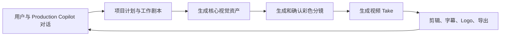

# Linglong Lab：AI 工业化视频生成流程与产品改版方案

> 本文同时定义两件事：一是用户完成一条广告视频的生产流程；二是 Video 产品应如何从当前“多个页面 + 底部输入框 + 表单式工作流”，改为“一个持续对话的制片助手 + 可视化创作工作台”。

## 先看最终体验

用户不应学习 Agent、Prompt、节点图或内部交接流程。用户进入 Video 后看到的是：

```text
左：Linglong Lab 全局导航
中：当前阶段的 Production Board（计划 / 资产 / 分镜 / 视频 / 剪辑）
右：贯穿项目的 Production Copilot
```

用户始终能够回答三个问题：

1. **现在在做什么？**——顶部阶段导航明确显示当前阶段与下一步。
2. **当前成果是什么？**——中央区域始终展示可见的图、分镜、视频或时间线，而不是只展示长文本。
3. **下一步由谁决定？**——右侧 Copilot 给出建议和确认卡；用户可确认、编辑或跳过。

这不是 ComfyUI 式自由节点画布。底层仍保留完整的资产谱系和工作流状态，但默认界面是一个固定、易理解的广告生产流程。

## 当前产品实现约定（2026-07）

以下约定已进入 Video 的项目状态和交互层，作为这份流程的最小可用落地：

- **单一 Copilot 入口**：页面右侧固定为 Production Copilot；它会按当前阶段调用内部能力，但不会在界面上要求用户理解 Strategist、Screenwriter、Designer 或 Director 的交接。
- **先确认再改动**：当缺少产品/目标等必要信息，或用户的要求可能同时改动多个已确认结果时，Copilot 只展示确认卡，不会猜测或直接覆盖结果。用户可选择直接应用、建立安全分支或保持现状。
- **Project State 版本与分支**：每次保存都会记录轻量版本；`Branch` 会复制整个项目状态并保留原项目、素材和 Take，适合测试新方向或大范围改动。
- **Take 永不静默删除**：替换 Start/End Scene 或修改 Veo Prompt 后，旧 Take 会保留并标记为 `outdated`；用户可以比较、继续用于既有剪辑，或仅重生成该 Frame。
- **首尾帧可行性预检**：有 End Scene 的 Frame 会显示 `continuous`、`match cut` 或 `bridge` 建议。需要 Bridge 的组合禁止直接提交给视频模型，避免用“硬插帧”掩盖空间或人物不连续。
- **音频时长预估**：每个 Frame 保存对白/声音时长估计，用于选择 4/6/8 秒 Take 和后续剪辑；这不是对模型唇形同步能力的承诺。
- **受约束 Canvas**：Canvas 从同一份 Project State 派生 `Plan → Assets → Frame → Take → Edit` 关系。它允许拖动排版、查看依赖和跳转编辑，不允许任意连线破坏线性生产语义。

## 一句话定义

Linglong Lab 不应是一串互相交接、各自猜测上下文的 Agent。

它应该是一个贯穿项目始终的 **Production Copilot（AI 制片助理）**：用户始终只和同一个 Chat Agent 对话；它根据当前任务加载剧本、分镜、设计、审核等 Skill，调用图片和视频模型，并把每次确认的结果保存为项目状态。



核心原则：

> 一个对话入口；一份项目状态；按需加载 Skill；每次只处理用户当前确认的下一步。

---

## 1. 核心产品结构

### 1.1 一个 Production Copilot，而不是多个串行 Agent

Production Copilot 使用 `gemini-3.8-flash`，是用户从创意到成片唯一持续对话的对象。

它可以在同一会话里完成：

- 分析参考视频、图片和品牌素材；
- 和用户一起确定广告方向；
- 写、改、拆分剧本；
- 提出需要哪些人物、道具、场景、UI；
- 设计镜头和分镜；
- 生成图片和视频 Prompt；
- 解释生成失败、建议重生成或补镜头；
- 审核视频 Take，帮助用户剪辑与交付。

它不是“什么都靠一个超长 Prompt 完成”。基础系统职责应保持短小；当用户发出明确任务时，Copilot 才加载对应 Skill。

| 用户意图 | Copilot 加载的能力 |
|---|---|
| “分析这个参考视频” | Reference analysis skill |
| “帮我写 30 秒广告剧本” | Screenwriting skill |
| “拆成镜头和分镜” | Storyboard skill |
| “生成花艺师和花店” | Visual design skill |
| “这个镜头不连续，怎么改” | Continuity / shot-repair skill |
| “挑最好的 Take 并剪成片” | Take review / editing skill |

这样保留专业能力，但不再把项目拆成 Strategist → Screenwriter → Designer → Director 四个容易断链的独立人格。

### 1.2 一份 Project State，而不是 Agent 间长文本转交

所有阶段读写同一份结构化项目状态。Copilot 每次先读取状态，再根据用户当前要求更新其中一个部分。

```text
Production
├── Brief 和用户最新要求
├── 视频设置：市场、语言、比例、时长、风格
├── Working Script
├── Shot List
├── Visual Library：人物、道具、环境、UI、彩色分镜
├── Storyboard：镜头顺序、首帧、尾帧、Prompt
├── Video Takes
└── Edit Timeline：剪辑、字幕、Logo、CTA、QC
```

任何修改都必须有明确作用范围：

- 修改台词：更新 Script、字幕和相关镜头 Prompt，不自动替换已生成视频；
- 换主角外观：按影响等级标记依赖分镜为“建议复核”或“必须重建”，不自动废弃已选 Take；
- 修改一个 Frame：只影响该 Frame 和明确选择“从上一帧延续”的后续 Frame；
- 重新生成一个 Take：保留旧 Take，用户重新选择。

“建议复核”不能等同于“全部作废”。每一项修改应首先计算影响范围与修复策略，见第 13 节。

### 1.3 产品界面：固定生产轨道 + 自适应工作台

Video 工作区采用三栏布局。它的重点是让“当前创作物”占据最大面积，而不是让聊天记录或复杂表单占据屏幕。

```text
┌─────────────────────────────────────────────────────────────────────────────┐
│ Linglong Lab · Video   项目名称 / 时长 / 比例 / 输出质量 / 新建项目           │
├───────────┬──────────────────────────────────────────────┬──────────────────┤
│ 全局导航  │ Plan → Assets → Storyboard → Video → Edit →  │ Production       │
│           │ Deliver                                      │ Copilot          │
│ Home      ├──────────────────────────────────────────────┤                  │
│ Image     │ 当前阶段的 Production Board                  │ 对话记录         │
│ Video     │                                              │ 建议             │
│ Library   │ 计划、素材墙、彩色分镜、Take 或时间线         │ 确认卡           │
│ Usage     │                                              │ 下一步行动       │
└───────────┴──────────────────────────────────────────────┴──────────────────┘
```

#### 左侧：只保留 Linglong Lab 的全局导航

左侧只负责在 Home、Image、Video、Library、Usage 之间切换。**不再在 Video 内部叠加第二个复杂 Sidebar**，也不在这里堆放节点库、工作流工具栏或历史对话。

#### 顶部：项目上下文和六阶段轨道

顶部第一行放项目选择器、`30s · 9:16 · 720p` 等全局设置与新建项目。第二行只放用户可理解的六步：

```text
Plan → Assets → Storyboard → Video → Edit → Deliver
```

阶段有三种状态：

- `current`：当前正在编辑；
- `ready`：满足进入条件，可继续；
- `needs attention`：有未完成的必要内容，例如某个 Frame 没有 Scene 或已选 Take 不可用。

阶段导航不是硬性“闸门”。用户可以回到任意阶段修改内容；系统只提示这会影响哪些下游成果。

#### 中间：Production Board，不是自由节点画布

中间主区根据阶段显示相应创作物：

| 阶段 | Production Board 的主内容 | 用户的主要动作 |
|---|---|---|
| Plan | Brief、参考素材、Production Plan、Working Script | 讨论、确认、改写剧本 |
| Assets | 资产建议和可复用视觉资产墙 | 生成、上传、编辑、复用 |
| Storyboard | 彩色分镜序列 | 绑定场景图、排序、补桥接镜头 |
| Video | Start/End Scene、导演 Prompt、多个 Take | 生成、比较、重生成、选片 |
| Edit | 可播放时间线 | 修剪、跳过、转场、字幕、Logo、导出 |
| Deliver | QC 结果和导出包 | 修复问题、导出 |

除了 Board View，专业用户可主动打开 **Canvas View**：它展示 `参考素材 → 核心资产 → 分镜 → Take → 成片` 的关系，并允许受约束的画布编辑。它是审阅、调整、批量组织和排错工具，不是新手默认操作方式。Canvas View 的完整规则见第 12 节。

#### 右侧：持续存在的 Production Copilot

Copilot 固定在右侧，宽度约 360–420px。它不是底部一块很大的 Composer，也不应挤压主要画面。

右栏从上到下包括：

1. 当前阶段的简短状态，例如“7 / 7 分镜已选择”；
2. 最近对话，旧消息可折叠；
3. 当前建议及其理由；
4. 需要用户决策时出现的确认卡；
5. 一个紧凑输入框，可直接提出修改要求。

示例确认卡：

```text
Frame 03 从真人花束特写进入游戏画面。
两张画面的人物与空间不同，连续运动风险较高。

推荐：Match cut
[采用 Match cut] [创建 Bridge scene] [仍然硬切]
```

确认卡可在当前步骤内完成，不把用户带离主界面；只有“从 Library 选择多张素材”或“删除项目/素材”才使用抽屉或 Modal。

#### Prompt 的展示原则

Prompt 是高级控制，不是页面主角。

- 在 Assets 中，图片 Prompt 位于单个资产卡的可展开区域；
- 在 Storyboard 中，Director Prompt 位于选中 Frame 的折叠面板；
- 在 Video 中，Veo Prompt 默认可见且可编辑，因为此时它直接决定下一次生成；
- 在 Edit 中，用户看到剪辑与覆盖层，而非模型 Prompt。

这样既允许专业用户精修，又不会让普通用户一进入页面就面对大段英文或技术字段。

---

## 2. 用户可感知的简化流程

用户不需要理解复杂的 Agent 编排。界面只呈现六个自然步骤：

```text
1. Plan       和 Copilot 对话，定创意和剧本
2. Assets     生成需要反复出现的人物、道具、场景、UI
3. Storyboard 生成并确认完整彩色分镜
4. Video      将分镜变成一个个视频 Take
5. Edit       选择 Take、加字幕/Logo、剪成成片
6. Deliver    质检和导出
```

这六步是用户体验，不代表六个 Agent。

---

## 3. Plan：对话式创意、分析与剧本

### 3.1 Copilot 的工作方式

用户可以直接说：

> “参考这个韩国手游广告，帮我做一个面向韩国女性的 30 秒竖版广告。品牌素材里有游戏 Logo、花店角色和一段录屏。”

Copilot 分析参考和品牌素材后，先给出一份可编辑的 **Production Plan**，而不是分别弹出 Strategist 报告和 Screenwriter 报告。

Production Plan 包含：

1. 广告目标和受众；
2. 推荐创意方向；
3. 需要保留的参考节奏和需要避开的复制风险；
4. 视频结构；
5. 初版 Working Script；
6. 初步资产清单；
7. 已知风险和缺失素材。

用户可以直接继续对话：

- “改成日语台词”；
- “不要真人，全部做可爱 3D”；
- “前 3 秒更夸张”；
- “删掉男性角色”；
- “把游戏机制展示得更清楚”。

Copilot 只更新受影响部分，并告诉用户变更会影响哪些镜头或素材。

### 3.2 Working Script

剧本仍然必须结构化，但在 UI 中以易读文字呈现。

```text
[00:00–00:04] 花店柜台的快速包花
场景：阳光花店木质柜台。
画面：花艺师麻利系好粉色丝带，顾客惊讶地看着花束。
镜头：手部特写，拉到两人中近景。
台词（男顾客，韩语，年轻、惊喜）："벌써 다 됐어요?"
字幕：벌써 다 됐어요?
声音：轻松的吉他与包装纸摩擦声。
连续性：花艺师绿色围裙；花束保持粉色包装；左侧窗光。
```

代码层面，每个 Scene 同时保存：

- `setting`、`visual_action`、`camera_direction`；
- `dialogue[]`、`spoken_language`、`on_screen_text[]`；
- `sound_direction`、`continuity_notes`；
- 所需的角色、道具、场景和 UI Key。

这样同一份剧本既给用户阅读，也给分镜、视频和后期使用。

---

## 4. Assets：只先生成“反复出现、必须一致”的东西

不要一开始生成十几个 Pack。只生成后续需要稳定复用的核心视觉资产：

| 优先级 | 应先生成的资产 |
|---|---|
| 必须 | 主角、反复出现的配角、英雄道具、主场景 |
| 需要时 | 游戏角色、吉祥物、关键 UI、CTA 背景 |
| 后期制作 | Logo、商店徽章、精确文字、免责声明 |

### 4.1 Asset Pack 的作用

Asset Pack 的作用是锁定视觉状态，而不是直接生成最终视频镜头。

```text
角色 Pack：正面、侧面、背面、工作动作
花束 Pack：标准花束外观
场景 Pack：花店柜台角度、门口角度
UI Pack：游戏画面、进度条、奖励界面
```

2×2 Grid 会自动拆为可引用的 Panel：

```text
Florist Pack
├── florist_A_front
├── florist_B_side
├── florist_C_back
└── florist_D_arranging_bouquet
```

所有 Panel 自动进入 Library。用户不需要做“批准四张图”的额外步骤；在生成场景时直接选择要使用的状态即可。

### 4.2 Copilot 如何生成资产

1. Copilot 从 Working Script 识别需要保持一致的元素。
2. 它给用户一个精简资产建议，例如：

```text
这个 30 秒广告建议先生成 4 组核心资产：
1. 韩国花艺师：身份和包花动作
2. 男顾客：惊喜反应
3. 粉色花束：实物奖励证明
4. 阳光花店柜台：前三个真人感镜头的固定空间
```

3. 用户可删、改、补充或上传参考图。
4. Copilot 用 `gemini-3.8-flash` 生成图片方案和 Prompt。
5. 系统调用 `gemini-3.1-flash-image` 生成图。
6. 用户从 Library 选择所需 Panel。

### 4.3 自定义资产

用户可随时说：

> “我还需要一张人物手里抱着同款花束的特写。”

Copilot 可创建一个自定义资产或场景请求。用户自定义的 Prompt 必须原样使用，不得被系统自动追加“中性背景”“三视图”等描述。

---

## 5. Storyboard：先生成完整彩色分镜，再生成视频

这是整个流程最重要的质量门。

用户不直接拿 2×2 的人物、道具和场景图去生成视频，而是先把它们组合成完整的 **Color Storyboard Frame**。

### 5.1 一个 Frame 是什么

一个 Frame 是一张完整的、接近最终视频首帧的彩色镜头图。它包含：

- 对应的剧本段落；
- 选用的角色、道具、场景和 UI 状态；
- 构图、镜头和动作；
- 时间和时长；
- Start Scene；
- 可选 End Scene；
- 供 Veo 使用的 Director Prompt。

```json
{
  "frame_id": "frame_02",
  "script_scene_id": "scene_02",
  "duration_seconds": 4,
  "bindings": {
    "characters": ["florist_A_front", "florist_D_bouquet_action", "customer_A_front"],
    "props": ["pink_bouquet_A", "phone_game_A"],
    "environment": ["flower_shop_counter_A"],
    "ui": []
  },
  "start_scene_asset_id": "color_storyboard_02"
}
```

### 5.1.1 Storyboard 的默认界面：彩色镜头板，而不是表单

Storyboard 是整个 Video 产品最重要的可视化工作台。它应像专业彩色分镜，而不是目前“选中一个镜头后，下面出现很多输入框”的界面。

默认布局为横向或可缩放的分镜序列，每张卡片表示一个 Frame：

```text
Frame 01          → Frame 02          → Frame 03
┌───────────┐       ┌───────────┐       ┌───────────┐
│ Scene 图   │       │ Scene 图   │       │ Scene 图   │
│ 00:00 · 4s│       │ 00:04 · 4s│       │ 00:08 · 5s│
├───────────┤       ├───────────┤       ├───────────┤
│ 包花钩子   │       │ 递花和揭晓 │       │ 游戏玩法   │
│ 花艺师·花束│       │ 花艺师·手机│       │ 游戏UI     │
└───────────┘       └───────────┘       └───────────┘
       Match cut              Cut
```

每张 Frame 卡片默认只显示：

- 当前 Start Scene 的大缩略图；
- Frame 编号、起始时间与时长；
- 一行镜头标题；
- 一到两行可读的 Working Script 摘要；
- 已绑定资产 chips，例如 `花艺师 · 花束 · 花店`；
- 与下一镜的连接方式；
- Start / End Scene 是否已设置。

以下内容在点击卡片后打开侧面详情或下方详情面板，不常驻占位：完整 Working Script、完整 Director Prompt、资产谱系、连续性字段、生成历史和高级生成设置。

这确保用户首先判断“故事是否顺、画面是否好、分镜是否完整”，再进入 Prompt 和技术设置。

### 5.1.2 Storyboard 的操作

用户可直接在分镜板上完成：

- 新增空白 Frame，或从一个 Script Scene 创建 Frame；
- 复制已有 Frame 后仅改动作、构图或台词；
- 删除 Frame；
- 拖拽排序；系统重新计算起始时间；
- 选择一个 Scene Builder 图片作为 Start Scene；
- 可选地添加 End Scene；
- 选择与下一镜的连接策略；
- 请求 Copilot “补一个过渡镜头”“把这两个镜头合并”“把第 3 镜拆成两镜”；
- 单独或批量生成 Director Prompt。

Frame 的顺序以已锁定的 Working Script 为默认起点，但用户可在 Storyboard 中增删分镜。发生变化时，Copilot 应同步提示：

```text
你新增了一个 3 秒 Bridge Frame。
总时长将从 30 秒变为 33 秒。
[压缩其他镜头以保持 30 秒] [保留 33 秒] [取消]
```

### 5.1.3 资产与分镜的绑定关系

资产不是“贴在画面上的标签”，而是 Scene 的可追溯配方。每个 Scene 记录：

```text
Scene 02：递花给顾客
├── Character：florist_D_arranging_bouquet、customer_A_front
├── Prop：pink_bouquet_A、phone_game_A
├── Environment：flower_shop_counter_A
├── UI：无
└── 来源：由上述资产组合生成的 color_storyboard_02
```

在 Asset Library 查看某个资产时，反向显示：

```text
花艺师 D 正在用于：Frame 01、Frame 02、Frame 05
```

这种“正向配方 + 反向 Used in”已经提供了 LibTV 节点图最有价值的可追溯性；普通用户无需拖拽连线。

### 5.2 Storyboard 生成流程

1. Copilot 根据剧本创建初始 Shot List。
2. 用户可以增删、复制和排序 Frame。
3. 用户为每个 Frame 选择已有资产 Panel。
4. Copilot 基于剧本、所选资产和构图要求，生成彩色分镜方案与图片 Prompt。
5. 系统调用 `gemini-3.1-flash-image` 生成完整场景图。
6. 用户从候选图中选择一个作为 Start Scene。
7. 这张场景图进入 Library，并记录它使用了哪些资产。

主 Storyboard 画板只需要显示：

- 完整彩色分镜图；
- Frame 编号、时长和 Script 摘要；
- Start / End Scene；
- 少量资产标签，例如 `Florist · Bouquet · Shop`。

点击 Frame 后再查看完整剧本、Prompt、资产来源和连续性状态，避免画板过于复杂。

### 5.3 两种分镜生成方式

#### New composition

用于新场景、游戏世界、UI 插入、CTA 或明确需要切镜的位置。

#### Continue from previous Frame

用于同一场景、同一机位或相近机位、人物与道具仅有小幅变化的连续动作：包花 → 递花 → 顾客反应。

它不是“把两张任意好看的图交给视频模型，模型就会可靠插值”的承诺。若两张图之间的空间透视、人物姿态、道具归属、深度关系或人物位移差异过大，强制首尾帧生成极易出现溶幻、形变、瞬移或硬切。系统必须先通过第 13.1 节的可行性评估。

上一张完整分彩色分镜会成为下一张的参考图。用户只修改动作、人物位置或景别，而不是重新抽一张完全不同的图。

```text
Frame 1：花艺师包花
       ↓ 以前一张图为参考
Frame 2：花艺师递花给顾客
       ↓ 以前一张图为参考
Frame 3：顾客拿花惊喜反应
```

这比独立生成三张图片更容易保持人物、花束、光线和空间关系一致；但它只能降低风险，不能取代镜头拆分和正确的剪辑策略。

### 5.4 轻量连续性信息

不做 3D 导演台，但每个 Frame 保存最少必要信息：

| 信息 | 示例 |
|---|---|
| 连续性组 | `flower_shop_sequence_a` |
| 人物位置 | 花艺师左，顾客右 |
| 人物朝向 | 两人相对 |
| 道具归属 | 花束在花艺师手中 |
| 光线 | 左侧暖色窗光 |
| 景别 | 中近景 |
| 镜头 | 柜台高度、轻微推近 |

当下一帧与上一帧在位置、服装、道具、光线或镜头上相差太大时，Copilot 不应默认继续生成，而应建议：

- 增加 Bridge Frame；
- 采用 Cut 或 Match Cut；
- 缩短人物位移；
- 从上一 Frame 继续生成新的 End Scene。

### 5.5 镜头连接策略必须显式选择

不要把“转场”藏在一行 Prompt 里。每个相邻 Frame 保存一个 `transition_strategy`，让用户和 Copilot 共同决定：

| 策略 | 适用场景 | 系统行为 |
|---|---|---|
| `cut` | 场景、时间或风格明显变化 | 独立生成并在 Edit 中直接切镜 |
| `match_cut` | 两镜有相同主体、形状或构图，如花束特写 → 游戏花园 | Director Prompt 描述匹配对象；Edit 以短切点连接 |
| `continuous_motion` | 同空间、人物小步移动、同机位延续 | 要求首尾图位置差小；以单镜头连续动作为目标 |
| `bridge_scene` | 首尾场景差异过大但仍需柔和过渡 | 新增一个短的 Scene/Frame 作为转场素材 |
| `end_frame_handoff` | 已生成上一 Take，下一镜需继承其结束状态 | 提取上一 Take 尾帧，校准下一镜 Start Scene 或生成 Bridge Scene |

Copilot 应检查相邻 Scene 的人物、空间、道具、光线、景别和位移。如果 `continuous_motion` 的风险过高，应提出建议，而不是照常生成并让用户承担硬切或瞬移结果。

**默认策略应是 `cut`。** 只有在可行性评估为低风险时，才默认推荐 `continuous_motion`；`match_cut` 适用于存在明确视觉锚点的镜头；`bridge_scene` 是可选补镜，不应被用来掩盖任何两镜都无法合理连接的问题。

### 5.6 Audio Timing Preflight：先确定节奏，再确定镜头时长

商业广告不是先生成若干固定时长视频、最后再把声音“贴上去”。对白长度、旁白节奏、音乐重音和转场位置应在生成 Take 前参与镜头时长决策。

每个包含声音的 Script Scene 保存：

```text
dialogue_duration_estimate_seconds
voiceover_duration_estimate_seconds
music_cue_in / music_cue_out
beat_anchor_seconds（可选）
audio_timing_status：estimated / previewed / locked
```

工作规则：

1. 没有对白的氛围镜、产品特写和转场镜可使用 4 / 6 / 8 秒默认时长；
2. 有对白或旁白的镜头，先估算语速和停顿，生成推荐时长，而不是盲选 4 秒；
3. 若项目接入并确认使用 TTS / 配音供应商，可生成临时语音预览并获得实际音频时长；若尚未接入，只能标记为 `estimated`，不能假装已实现口型同步；
4. 视频模型原生音频、后期 TTS、BGM、字幕是不同层：是否生成原生音频、是否需要口型同步、是否使用后期配音必须作为 Video Setup 的显式决定；
5. 进入 Edit 时，Timeline 以实际选定音轨时长为准；当视频长于台词，优先剪掉无效尾部、补反应镜或使用 B-roll，而不是机械慢放人物说话镜头。

在 Storyboard 中，Frame 卡应显示一个简短节奏提示，例如：`Dialogue 2.3s · Recommended take 3s`。这让用户在生成之前就能发现“4 秒镜头配 1.2 秒台词”的问题。

---

## 6. Video：从彩色分镜生成短视频

Video 阶段只处理已确认的彩色分镜。

每个 Frame 自动出现在 Video Generate 中。用户可以：

- 预览 Start Scene 与 End Scene；
- 选择 4 / 6 / 8 秒；
- 编辑 Prompt；
- 让 Copilot 改善 Prompt；
- 生成或重生成 Take；
- 保留所有历史 Take；
- 选择最好的 Take。

### 6.1 Director Prompt 的作用

Copilot 在需要生成视频时加载导演能力，把 Working Script 和已确认的 Frame 编译为简洁英文 Prompt。

Prompt 应包含：

- 当前画面和人物；
- 一个主要动作；
- 镜头运动；
- 表演方式；
- 需要保持的连续性；
- 合法对白和字幕要求。

Prompt 不应包含：

- 大段复制的剧本；
- XML 标签；
- 画幅和分辨率；
- 反复的声音描述；
- 让模型画精确 Logo、商店徽章或 UI；
- 多个复杂连续动作。

### 6.2 首帧、尾帧和接力

- Start Scene 是首帧锚点，确保视频从 Storyboard 图开始。
- End Scene 仅用于同一空间、同一人物、小幅连续动作的受控结束状态，且必须先通过可行性评估。
- 如果首尾图差异大，模型可能硬切、隐移或形变；系统应拒绝默认插值，改为 `cut`、`match_cut`、拆镜头或由用户明确创建 Bridge Frame。

对于需要连续的相邻镜头：

```text
生成 Take A
  → 提取 Take A 的尾帧和最后 0.5–1 秒的“尾部片段”作为可审阅派生素材
  → 用尾帧创建 / 校准 Frame B 的 Start Scene 或 Bridge Scene
  → 生成 Take B
```

这里必须区分两件事：

- **尾帧抽离**是可实现的素材管理动作：从已有 Take 截取静态尾帧，并保存尾部片段供用户审阅、剪辑和作为后续图片参考；
- **将最后 0.5 秒直接输入下一次视频生成**是否可行，完全取决于当前模型 API 是否官方支持视频上下文、多帧参考或视频到视频输入。

因此实现不得假设任意 `context_frame`、`last_frame`、尾部视频或“弱参考帧”参数存在。只能调用当前官方文档明确支持的首帧、尾帧和参考图能力；若不支持连续视频上下文，则使用尾帧 + 图片编辑生成 Bridge Scene，或在 Edit 中采用 Cut / Match Cut。

### 6.3 一镜一主要动作

| 可直接生成 | 应拆分 |
|---|---|
| 转头、表情、走两三步、递出物体、慢推镜头 | 多人复杂互动、攻击命中、精确手机操作 |
| 花束特写、环境镜头、CG 光效 | 长动作链、精确文字、快速多人物位移 |

例如“拔剑 → 挥砍 → 命中 → 收招”必须拆为多个 Frame，而不是要求一个四秒镜头完成全部过程。

---

## 7. 游戏广告的简化策略

游戏广告不要试图让视频模型模拟完整游戏引擎。

| 内容 | 推荐方式 |
|---|---|
| 角色世界观、吉祥物、氛围、奖励感 | CG 彩色分镜 + I2V |
| 精确 UI、点击、数值、真实玩法 | 客户录屏或真实 Gameplay 素材 |
| Logo、商店徽章、CTA、精确文字 | Edit 覆盖层 |

最佳实践通常是混合模式：

```text
CG 或真人感 Hook
→ 手机 / 屏幕转场
→ 真实 Gameplay Proof
→ 吉祥物与下载 CTA
```

---

## 8. Take Review：帮助用户挑片，而不是替用户决定

Copilot 在用户请求或生成完成后，加载 Take Review Skill 审核视频片段：

- 人物是否换脸或换服装；
- 道具是否消失或变形；
- 是否穿模、硬切、动作失败；
- 是否有乱码、错误 UI 或品牌风险；
- 是否适合连接前后镜；
- 推荐可用的裁剪区间；
- 哪些镜头建议重生成。

示例：

```json
{
  "take_id": "take_03_b",
  "score": 72,
  "verdict": "trim",
  "reasons": [
    "前两秒人物和花束连续性正确。",
    "2.8 秒后手机形状开始失真。"
  ],
  "suggested_trim_in_seconds": 0,
  "suggested_trim_out_seconds": 2.7
}
```

Reviewer 只能提出建议，不能自动替换 Take、删除视频、生成新视频或直接导出。

---

## 9. Edit：把已选 Take 变成成片

Edit 是非破坏性时间线，用户可以：

- 预览和比较 Take；
- 选择、Include 或 Skip Frame；
- Trim in / Trim out；
- Cut / Fade / Match Cut；
- 必要时调整顺序；
- 查看 Review 建议；
- 添加真实品牌覆盖层。

### 9.1 品牌与字幕覆盖层

精确元素不交给模型生成，统一在 Edit 添加：

- 官方 Logo；
- App Store / Google Play 徽章；
- CTA；
- 字幕；
- 免责声明；
- 产品图或游戏 UI；
- 真实 Gameplay 录屏。

### 9.2 Editable Timeline JSON

可视化时间线有对应 JSON，供高级用户精确调整：

```json
{
  "version": 1,
  "apply_to_render": true,
  "clips": [
    {
      "shot_id": "frame_01",
      "take_id": "take_01_b",
      "include": true,
      "trim_in_seconds": 0,
      "trim_out_seconds": 3.6,
      "transition": "cut"
    }
  ]
}
```

只有用户显式设置 `apply_to_render: true` 时，JSON 才覆盖可视化时间线。

---

## 10. Deliver：导出前质检

导出前检查：

| 检查 | 行为 |
|---|---|
| Included Frame 缺少 Take | 阻止导出 |
| 引用已删除 Asset | 阻止导出 |
| 已选 Take 被标记 Reject | 警告，要求用户确认 |
| 可能存在乱码 | 警告，建议改为字幕或覆盖层 |
| 使用模型生成 Logo / 徽章 | 警告，建议改为真实素材 |
| 有 Skip Frame | 明确显示 |
| 最终时长偏离目标 | 显示差值 |
| 黑帧、重复片段、无音轨 | 检查并报告 |

交付内容：

- Final MP4；
- 已选视频 Takes；
- 完整彩色分镜；
- 可编辑 Timeline JSON；
- Overlay 清单；
- Asset Lineage；
- QC Report。

---

## 11. 从当前产品迁移到新方案的修改流程

本节定义产品与代码的改造顺序。目标不是重写所有生成能力，而是先把已有能力重新组织成一个连续、可理解、可回退的生产体验。

### 11.1 现状问题与对应修改

| 当前问题 | 造成的体验 | 新方案中的修改 |
|---|---|---|
| Strategist、Screenwriter、Designer、Director 是多个可见入口 | 用户不知道该和谁说话，上下文容易断裂 | 合并为一个 Production Copilot，按任务加载 Skill |
| Direction / Script / Design / Storyboard 各自像独立页面 | 用户只看到表单，不能理解成片怎样形成 | 改为 Plan / Assets / Storyboard / Video / Edit / Deliver 的生产轨道 |
| Chat Composer 位于页面底部且面积很大 | 主画面被压缩；对话不连贯 | 移到右侧固定 Copilot 栏 |
| Assets 只显示 2×2 Grid 和“批准”步骤 | 用户不知道资产如何进入最终镜头 | 自动拆分 Panel 并进入 Library；由 Scene 配方绑定资产 |
| Storyboard 强调逐镜表单和“Preview needed” | 看不到完整广告结构，也无法先判断画面 | 改为彩色分镜板；先选/生成 Scene 图，再生成视频 |
| 视频生成只看单张首帧与长 Prompt | 相邻镜头容易硬切、人物瞬移 | 显式保存连接策略、End Scene、Bridge Scene 和连续性组 |
| Edit 只是最终拼接 | 用户无法控制选择、裁切、转场和品牌层 | 以可播放时间线为核心，并提供 Take Review 建议 |

### 11.2 Phase 0：稳定项目状态与兼容旧项目

在 UI 重构之前，先确保数据不会再次散落在 `raw_script`、不同 Agent 输出和临时状态中。

必须完成：

1. 为 Production 增加统一 `project_state_version`；
2. 保留旧的 direction/script/design 数据，提供迁移适配层，不删除历史项目；
3. 为每个 Script Scene 创建稳定 `scene_id`；
4. 为每个 Storyboard Frame 保存 `script_scene_id`、`start_scene_asset_id`、`end_scene_asset_id`、`transition_strategy`；
5. 每个 Asset 保存 `asset_kind`、`source_asset_ids`、`used_by_frame_ids`；
6. 每个 Video Take 保存来源 Frame、来源 Prompt 版本、Start/End Scene、生成参数与审核结果；
7. 所有更新为非破坏性：重生成、改 Prompt、换图都创建版本或保留旧引用。

验收标准：刷新页面、重启服务后，用户仍可从任意 Frame 追溯到 Script、资产、Scene、Prompt、Take 和 Edit Clip。

### 11.3 Phase 1：先重构页面骨架，不改生成能力

目的：让用户即使使用现有后端，也能看懂流程。

实施项：

1. 把当前 Video 页面顶部阶段名称改为：

   ```text
   Plan → Assets → Storyboard → Video → Edit → Deliver
   ```

2. 移除 Video 内嵌的第二 Sidebar、底部大 Composer 和面向开发者的内部术语；
3. 新增右侧 `Production Copilot` 固定栏；
4. 将既有聊天记录迁移到右栏；中间只保留当前阶段成果；
5. 顶部显示项目名、时长、比例、输出质量、保存状态和下一个推荐动作；
6. 每个阶段有明确空状态、完成状态与“下一步”按钮。

验收标准：第一次使用的非专业用户，在不阅读文档的情况下能说出自己当前处于哪个阶段、已经有什么成果、下一步点击什么。

### 11.4 Phase 2：将多个 Agent 改为一个 Copilot + Skills

目的：在不丢失专业能力的前提下，消除多个 Agent 之间的上下文断裂。

实施项：

1. UI 中不再展示 Creative Strategist、Screenwriter、Designer、Director 为独立角色；
2. 保留底层对应能力，但改为 Copilot 的内部 Skill：参考分析、剧本、资产方案、分镜、导演 Prompt、Take Review、剪辑建议；
3. 每次 Copilot 请求必须携带当前 Project State 的摘要，而不是从上一 Agent 的自然语言报告中猜；
4. 每次变更返回明确的变更集：

   ```text
   已更新：Scene 02 的韩语对白、字幕、Director Prompt。
   未修改：已生成 Take、Frame 顺序、其他 Scene。
   建议复核：Frame 02 的 Scene image。
   ```

5. 长报告改为可以展开的计划卡，不作为用户必须阅读的页面主体；
6. 对于模型输出不完整、缺资产、语言不清晰等情况，Copilot 必须提问或显示确认卡，不能伪造完成状态。

验收标准：用户只需在一个会话内说“把所有台词改成韩语、但保留当前人物和画面”，系统能够准确说明并执行影响范围。

### 11.5 Phase 3：Assets 和 Scene Builder 改为“素材墙 + 场景配方”

目的：让用户看到 2×2、人物三视图和道具图如何进入真正的视频场景。

实施项：

1. 资产卡显示封面、类型、来源、版本、Used in；
2. 2×2 图生成后自动识别/裁剪 A、B、C、D Panel 并全部进入 Library；
3. 移除用户必须逐张 `Keep / Approve` 的冗余门槛；用户在创建 Scene 时直接选择多个 Panel；
4. 新增 Scene Composer：选择人物、道具、环境、UI 与参考图，输入一个镜头意图，生成完整 Scene 图；
5. 自定义 Pack 的 Prompt 必须原样使用；系统不得追加中性背景、身份板或其他未被要求的 Prompt；
6. 自定义资产可从本地上传或 Library 选图；所有 source asset 可单独移除，不影响原始 Library 文件；
7. 每张 Scene 图显示其“配方”和来源，供 Storyboard 直接选用。

验收标准：用户能够从花艺师 A、花束 B、花店环境 C 生成“递花给顾客”的完整 Scene，并在分镜中一键使用。

### 11.6 Phase 4：重做 Storyboard 为彩色分镜工作台

目的：让分镜成为视频生成之前最清楚的质量门。

实施项：

1. 用横向可缩放卡片序列替代当前大段表单；
2. 每张 Frame 默认展示 Scene 图、时间、时长、镜头摘要、资产 chips、连接策略；
3. 通过 `Choose Scene` 打开只显示 **Scene Builder 输出** 的 Library Modal，不混入角色 Pack、2×2 Sheet、普通 Image 工具输出；
4. 支持新增、复制、删除、拖拽排序 Frame；
5. 支持选择 End Scene，并可放大 Start/End 缩略图；
6. 支持直接新增 Bridge Frame；
7. “Generate all Director Prompts”只为已有 Frame 批量生成，不改动 Frame 顺序、选图或已生成视频；
8. Prompt 编辑器折叠在 Frame 详情中；工作剧本左侧/详情可读，Prompt 右侧/详情可编辑；
9. 显示总时长并在增删镜头后要求用户确认是否压缩到目标时长。

验收标准：用户可在单屏理解 30 秒广告的完整故事；不打开任何表单也能看出每一镜的图片、时长、前后关系和是否已准备好生成。

### 11.7 Phase 5：Video Generate 以 Frame 为唯一来源

目的：确保每次生成都使用最新的分镜、首尾图和导演 Prompt。

实施项：

1. Video 页面每行对应一个 Frame，而非模糊的 Shot 记录；
2. 显示 Start Scene、可选 End Scene、当前时长（4 / 6 / 8 秒）、连接策略和 Prompt 版本；
3. Prompt 默认来自 Director Prompt，且可直接编辑；保存后仅影响该 Frame 的下一次生成；
4. Storyboard 修改 Start/End Scene、时长或 Prompt 后，将对应 Video 行标记为 `outdated`，显示：

   ```text
   Storyboard changed after this Take was generated.
   [Refresh from storyboard] [Keep this Take]
   ```

5. 不刷新或替换旧 Take；用户必须主动选择；
6. 如果选择 `continuous_motion` 或 `end_frame_handoff`，在生成前检查首尾画面差异和人物位移；风险高时建议拆镜头或创建 Bridge Frame；
7. 生成失败只影响当前 Frame；其余 Frame 的生成按钮和状态不能被全局禁用。

验收标准：用户在 Storyboard 更换 Frame 03 图片后，Video 页面能明确看到旧 Take 已过期，并能一键更新到新图再生成。

### 11.8 Phase 6：Edit 变成真正的非破坏性剪辑时间线

目的：把“生成一堆片段”变成“可交付成片”。

实施项：

1. 横向时间线展示所有 Frame / Take；
2. 每个 Take 可播放、全屏预览、比较和选择；
3. 支持 Include / Skip、Trim in / Trim out、重排序、Cut / Fade / Match Cut；
4. 真实 Logo、App Store / Google Play 徽章、精确字幕、CTA、免责声明作为覆盖层；
5. 对每个 Take 运行 Gemini Take Reviewer，输出评分、问题、建议裁切和是否建议重生成；
6. Reviewer 只输出可编辑建议与 Timeline JSON，绝不自动删除或替换用户内容；
7. 导出前运行 QC：漏镜、时长差、黑帧、无音轨、乱码风险、重复片段、已删除资产引用。

验收标准：用户不需要离开 Linglong Lab，即可选择最佳 Take、跳过失败镜头、加上真实品牌元素并导出最终 MP4。

### 11.9 推荐交付顺序

为了尽快得到可用产品，同时避免再次大范围破坏已有数据，按以下顺序发布：

```text
P0 统一 Project State 与旧项目兼容
P1 三栏布局 + 固定 Copilot + 阶段改名
P2 Assets 自动入库 + Scene Composer
P3 彩色 Storyboard 工作台 + 资产绑定 + 连接策略
P4 Video 与 Storyboard 的版本同步和过期提示
P5 Edit 时间线、Take Review、覆盖层和 QC
P6 可选 Advanced Production Map
```

每个阶段都应保留一次可恢复的数据迁移和端到端验收案例：一个 30 秒、7–10 Frame、含角色/场景/UI/CTA 的广告项目。

---

---

## 12. Canvas View：简单画布编辑方案

### 12.1 设计目标

Canvas View 的目标不是复制 ComfyUI 或 LibTV 的任意节点编程，而是让用户在一个屏幕内直观看到广告项目如何从素材变成成片，并在必要处自由调整。

它要解决四件事：

1. **关系可见**：人物、道具、场景如何组成某一张 Scene；Scene 如何变成 Frame、Take 和成片；
2. **局部编辑**：用户可以换素材、补镜、复制分镜、插入 Bridge Scene、挑选 Take；
3. **批量管理**：用户可以框选一组 Frame 批量生成 Scene 或 Video；
4. **不丢正确性**：画布操作必须更新同一份 Project State，且不会绕过资产绑定、版本、审计和 QC。

### 12.2 Board View 与 Canvas View 的关系

两种视图不是两套工作流，而是同一项目的两种投影：

| 视图 | 默认用户 | 最适合做什么 | 不适合做什么 |
|---|---|---|---|
| Board View | 所有用户 | 线性完成当前阶段、确认结果、阅读剧本、选择图片和视频 | 同时查看全项目复杂依赖 |
| Canvas View | 需要全局控制的用户 | 看资产关系、批量选片、拖动排版、插入镜头、排查来源 | 承担每一次普通编辑的主界面 |

用户从顶部视图切换器选择：

```text
[Board view] [Canvas view]
```

切换视图不创建副本、不改变任何资源、也不重置用户当前选择。选中 Frame 03 后切换到 Canvas，应自动聚焦 `Frame 03` 及其资产、Scene 和 Take。

### 12.3 画布布局：有泳道的自由，而不是从空白开始

Canvas 默认按从左到右的生产关系自动排布：

```text
Inputs        Assets              Storyboard             Video              Edit
──────────    ───────────────     ──────────────────     ──────────────     ───────────
Brief         Florist Identity    Frame 01 / Scene 01    Take 01-A/B        Timeline
Reference     Bouquet             Frame 02 / Scene 02    Take 02-A          Overlays
Brand asset   Flower shop         Frame 03 / Scene 03    Take 03-A/B        QC / Export
               Game UI            Bridge Frame
```

用户可以在每个泳道内拖动、排列、折叠、放大、缩小和分组；但系统不要求用户从一张空白画布搭建完整生产链。

默认提供：

- 拖动画布、滚轮缩放、适配全图；
- 小地图；
- `Auto layout`：恢复为系统推荐结构；
- `Focus selection`：只聚焦选中对象及一度上下游；
- `Focus current frame`：聚焦当前 Frame、所用资产、Start/End Scene、Take；
- `Show only selected sequence`：隐藏不属于当前故事线的试验结果；
- 普通分组和命名分组，例如“花店真人段”“游戏玩法段”“CTA 段”。

### 12.4 画布节点类型

Canvas V1 只支持与视频生产直接相关的六类节点，避免变成任意文本/模型/代码节点编辑器。

| 节点 | 内容 | 可做的操作 |
|---|---|---|
| Input | Brief、参考视频、品牌素材、上传素材 | 查看、替换、发送到资产或 Scene |
| Asset | Identity Set、道具、环境、UI、Logo | 打开 Library、换版本、查看 Used in |
| Scene | 完整彩色场景图及其配方 | 编辑素材配方、重生成、设为 Start/End Scene |
| Frame | Working Script 段落、时长、连接策略 | 改顺序、复制、删除、拆镜、加 Bridge Scene |
| Take | 某 Frame 的视频版本 | 播放、比较、加入 Edit、重生成、标记不用 |
| Edit | 已选 Take 时间线和覆盖层 | 打开 Edit、查看时长与 QC |

节点卡片必须以可见的创作成果为核心：

- Asset 节点显示封面、名称、类型、使用次数；
- Scene 节点显示完整画面缩略图、场景标题和配方摘要；
- Frame 节点显示时间、时长、Script 摘要、连接策略与状态；
- Take 节点显示可播放视频缩略图、评分、版本与是否入选；
- Edit 节点显示时间线摘要、总时长、QC 状态。

不能把长 Prompt、原始 JSON 或内部模型参数直接铺在节点正面。

### 12.5 连线：有明确语义和类型限制

连线代表项目数据关系，而不是装饰。每条边必须保存 `edge_type`、`source_id`、`target_id`、创建来源和版本。

| 连线类型 | 起点 → 终点 | 语义 |
|---|---|---|
| `reference_for` | Input / Asset → Asset / Scene | 该对象作为视觉或语义参考 |
| `used_in` | Asset → Scene | Scene 的配方使用该资产 |
| `visualizes` | Script Scene / Frame → Scene | Scene 是该剧本镜头的视觉实现 |
| `start_frame_for` | Scene → Frame / Take | Scene 作为视频首帧 |
| `end_frame_for` | Scene → Frame / Take | Scene 作为可选视频尾帧 |
| `sequence_next` | Frame → Frame | 时间顺序与连接策略 |
| `generated_from` | Frame / Scene → Take | Take 的生成来源 |
| `included_in` | Take → Edit | Take 被选入最终时间线 |

规则：

- 不能把 Take 连接回 Asset 或改写 Script；
- 一个 Frame 只能有一个当前 Start Scene，但可保留历史 Scene 版本；
- 一个 Frame 可以有零或一个当前 End Scene；
- 一个 Scene 可使用多个 Asset；
- 一个 Asset 可用于任意多个 Scene；
- 一个 Frame 可有多个 Take；
- 一个 Take 可被多个 Edit 草稿引用，但最终交付时间线只能使用显式选定版本；
- 不合法的端口不显示可连接状态，不能等用户连接后才报错。

### 12.6 自动连线优先，手动连线只处理真实创作决定

系统应在以下动作后自动创建正确边：

- 从 Asset Library 选择人物、花束和环境生成 Scene；
- 将 Scene 设为 Frame 的 Start / End Scene；
- 从 Frame 生成 Take；
- 将 Take 加入 Edit Timeline；
- Copilot 新增或拆分 Frame。

用户手动拉线只用于高价值操作：

- 把一个 Asset 添加到 Scene 配方；
- 把参考图添加为 Asset / Scene 的参考；
- 为 Frame 连接 Start 或 End Scene；
- 将上一镜尾帧交给下一镜的 Bridge Scene；
- 将选中的多个 Take 加入 Edit；
- 将一组 Frame 放入命名组。

当用户尝试删除边时，系统必须显示影响提示。例如：

```text
移除“花艺师 A → Scene 02”不会删除花艺师图片，
但 Scene 02 将失去该人物绑定，当前 Scene 和后续 Take 会标记为需要复核。

[仅移除绑定] [取消]
```

### 12.7 画布快捷操作与右侧 Inspector

画布支持：

- 单击选中；
- `Shift` 多选；
- 框选；
- `Cmd/Ctrl + C/V` 复制节点；
- `Cmd/Ctrl + D` 创建副本并保留可复用配方；
- `Delete` 删除前弹出影响确认；
- `Cmd/Ctrl + Z`、`Cmd/Ctrl + Shift + Z` 撤销/重做；
- `G` 建组；
- `L` 自动布局；
- `F` 聚焦选中节点。

点击节点后，右侧 Copilot 切换到 Inspector 模式，显示与该对象相关的最少必要信息：

| 选中对象 | Inspector 默认内容 |
|---|---|
| Asset | 来源、版本、Used in、替换/编辑入口 |
| Scene | 画面、资产配方、Prompt 折叠区、重生成入口 |
| Frame | Working Script、Start/End Scene、连接策略、Director Prompt |
| Take | 播放器、评分、失败原因、加入 Edit / 重生成 |
| Edit | 已选 Clip、时长、覆盖层、QC 与导出 |

用户仍可以在 Inspector 内和 Copilot 对话，例如：“把这个 Scene 中的花束换成粉色包装 B”，系统先展示即将改变的配方和受影响节点，再请求确认。

### 12.8 Canvas 与 Copilot 的协作方式

Copilot 不应只返回文字，而应生成可预览的画布变更集：

```text
用户：第 2 镜人物移动太大，补一个过渡镜头。

Copilot：建议插入 Frame 02B：
- 继承：花艺师、花束、花店环境；
- Start Scene：Frame 02；
- End Scene：Frame 03 的花束局部；
- 策略：Match cut；
- 时长：2 秒。

[预览画布变化] [确认插入] [编辑建议]
```

只有用户确认后，Copilot 才写入 Project State，并让 Canvas 增加节点、连线和时长变化。所有动作应支持撤销。

### 12.9 Canvas 的阶段视图

Canvas 不需要在每个阶段都展示全部节点。提供聚焦模式：

| 模式 | 展示对象 |
|---|---|
| Asset map | Input、Asset、Scene；用于检查资产配方与一致性 |
| Story map | Asset、Scene、Frame；用于安排彩色分镜与过渡 |
| Video map | Frame、Start/End Scene、Take；用于重生成与版本对比 |
| Edit map | Take、Edit、Overlay；用于选片和剪辑 |
| Full production map | 全部对象；用于高级审阅、排错和项目交接 |

默认打开时应根据当前 Board 阶段进入对应聚焦模式，而不是一次抛出全项目所有节点。

### 12.10 不把画布做成第二套数据的技术约束

Canvas 的节点位置、折叠状态、分组和视图偏好可以存为 UI 元数据，例如：

```json
{
  "canvas_node_id": "frame:frame_03",
  "domain_type": "frame",
  "domain_id": "frame_03",
  "position": { "x": 1320, "y": 410 },
  "group_id": "gameplay_sequence",
  "collapsed": false
}
```

但内容本身仍以 Production 的领域对象为唯一真相来源：

```text
Script Scene / Asset / Scene / Frame / Take / Edit Timeline
```

画布删除节点时，系统必须区分：

- `从画布隐藏`：仅删除 UI 布局元数据；
- `移除项目关系`：删除绑定边，保留原素材；
- `删除项目对象`：必须展示下游影响、要求二次确认；
- `删除素材文件`：单独操作，不应因删除画布节点而发生。

### 12.11 推荐实现顺序

项目已有 `@xyflow/react`，因此前端的拖拽、缩放、小地图、选择、连线和自动布局不需要从零开发。真正的工作重点是领域模型同步和交互安全。

```text
C0  定义 Canvas 节点/边 schema，并映射现有 Project State
C1  实现只读 Canvas View：自动布局、缩放、小地图、节点 Inspector
C2  开放安全编辑：拖动位置、分组、Focus、选择、画布状态持久化
C3  开放受约束连线：Asset → Scene、Scene → Frame、Take → Edit
C4  加入 Copilot 变更预览、Undo/Redo、影响确认
C5  加入批量动作、版本比较、Production Map 分享与导出
```

最小可用版本不需要开放任意节点创建和任意模型选择。只要用户能在 Canvas 中看清素材关系、替换 Scene 资产、插入 Bridge Frame、选择 Take 进入 Edit，就已经提供了大部分真实价值。

---

## 13. 模型物理边界、版本分支与级联修改控制

### 13.1 生成前的 Motion Feasibility Gate

视频生成模型不是可靠的三维动画插值器。即使 Start Scene 和 End Scene 各自优秀，只要两者的几何、人物姿态、镜头透视、道具归属或空间位置不一致，首尾帧生成也可能出现溶幻、撕裂、形变、手部错误、物体消失、瞬移或硬切。

因此在调用首尾帧能力之前，系统先进行 `motion_feasibility` 评估。它可由规则、视觉分析和 Copilot 的结构化判断共同输出，但最终必须是可解释的字段，而非一句模糊评论：

```json
{
  "from_frame_id": "frame_02",
  "to_frame_id": "frame_03",
  "risk_level": "high",
  "risks": [
    "人物位置差约为完整画面宽度的 60%",
    "花束从店员手中变为顾客手中，存在复杂交接",
    "场景从真人花店切换为等轴游戏 UI"
  ],
  "allowed_strategies": ["cut", "match_cut", "bridge_scene"],
  "blocked_strategies": ["continuous_motion", "end_frame_handoff"],
  "recommendation": "以花束中心为视觉锚点使用 match cut"
}
```

评估维度至少包括：

| 维度 | 低风险 | 高风险 |
|---|---|---|
| 空间 | 同一场景、同一背景、视角接近 | 直接换场景或背景透视冲突 |
| 主体位置 | 位移不超过数步或画面小范围 | 角色跨越大半画面或忽然换边 |
| 姿态 | 同一动作的相邻姿态 | 坐/站变化、手脚方向大幅改变 |
| 道具 | 同一人持续持有 | 两人交接、消失、形状变化 |
| 镜头 | 景别和运动相近 | 特写到航拍、静机到大幅摇移 |
| 视觉风格 | 同一风格、光线一致 | 真人到游戏、日景到夜景 |

策略规则：

- `low`：允许 `continuous_motion` 或 End Scene；
- `medium`：默认推荐 `cut` 或 `match_cut`，用户可明确选择尝试连续生成；
- `high`：阻止首尾帧插值，要求选择 `cut`、`match_cut` 或新增 Bridge Frame；
- `critical`：提示拆成独立镜头，不建议用一个生成任务完成复杂多人交互或长动作链。

这不是为了限制用户，而是把模型已知的失败模式前置，减少无效消耗。

### 13.2 Bridge Scene 的成本边界

Bridge Scene 不是自动修复所有硬切的魔法按钮。每增加一个 Bridge Scene 都增加：一张图的生成成本、一个视频 Take 的成本、故事时长和剪辑复杂度。

系统应按以下优先级建议：

```text
能直接 Cut → 直接 Cut
有共同形状/主体 → Match cut
同空间小动作 → Continuous motion
确实需要时空过渡且价值足够 → Bridge Scene
复杂动作或跨世界逻辑 → 拆成独立镜头 + 后期剪辑
```

每次建议新增 Bridge Frame 时，Copilot 都应显示新增成本与时长影响，而不是静默补镜。

### 13.3 级联修改：按影响等级，而不是“一改全废”

上游修改必须先分类，再决定处理方式：

| 修改类别 | 示例 | 默认动作 | 是否需要重生成视频 |
|---|---|---|---|
| 后期覆盖层 | Logo、字幕、CTA、免责声明 | 只更新 Edit Overlay | 否 |
| 局部外观 | 衣服颜色、局部背景色、轻微亮度 | 建议局部图像/视频修复或调色；保留原 Take | 不自动 |
| 单 Scene 构图 | 花束位置、人物表情、背景布局 | 仅标记关联 Frame 和 Take | 用户决定 |
| 角色身份 | 主角换脸、发型、服装体系整体更换 | 标记相关 Scene/Take 为必须复核 | 通常需要 |
| 故事结构 | 删除/插入镜头、改变剧情、调换顺序 | 更新后续时间线与连接策略 | 只影响相关镜头 |

若供应商和模型已经正式支持局部图像编辑、视频局部修复或局部重渲染，Copilot 可以将其列为首选修复方案；若当前能力未接入或不支持，必须明确说明，只提供现有的图片编辑、调色、覆盖层或局部重新生成选项。不能承诺无依据的“视频 Inpainting”。

### 13.4 版本快照与分支

当修改可能影响多个已生成 Scene、Take 或 Edit Clip 时，系统不应直接污染当前成片分支。

触发条件：

- 替换主角、核心产品、整体视觉风格；
- 重写超过一个 Story Act 的 Script；
- 修改多个 Frame 的顺序或连接方式；
- 用户在 Edit 阶段要求大范围回溯。

交互：

```text
这项修改会影响 6 个已选 Take 和当前 Edit Timeline。

[在当前草稿继续修改]  保留旧 Take，但标记为过期
[创建 Draft B 分支]    复制当前 Project State 与 Timeline，安全尝试新版本
[取消]
```

分支规则：

- 源分支永远保留；
- Asset、Scene、Take、Edit Timeline 都有不可变版本和创建时间；
- 用户可比较 Draft A / Draft B 的 Frame、Take、时间线和导出结果；
- 合并分支不是自动行为；用户只能显式选择某一版本作为当前使用版本。

### 13.5 Copilot 的上下文隔离：UI 是一个聊天，后端不是无限聊天

“一个 Copilot”是用户体验原则，不代表后端把所有自然语言历史永久塞给模型。

每次 Copilot 调用应构造最小、最新且可审计的上下文：

```text
固定系统规则
+ 当前阶段所需 Skill 指令
+ 已确认 Video Setup
+ 当前 Project State 的结构化摘要 / 必要字段
+ 当前用户请求
+ 少量相关最近对话
```

阶段切换（Plan → Assets → Storyboard → Video → Edit）时：

1. 生成并存储一个不可变 `stage_summary`；
2. 将过期聊天压缩为摘要，不再全文携带；
3. 新阶段只读取相关对象，例如 Video 阶段读取 Frame、Scene、Take 和视频设置，而不是早期所有讨论；
4. 对 Project State 的写入采用结构化 patch 和 schema 校验，禁止模型输出直接覆盖整份 JSON；
5. 写入后验证不相关字段未丢失，并记录变更日志与可撤销版本。

这使 Copilot 在用户眼中保持连续，但在工程上保持短上下文、明确输入和受控写入。

---

## 14. Board / Canvas 双视图的一致性原则

Board View 的 Storyboard 是线性叙事序列；Canvas View 是该序列及其资产、Scene、Take 和 Edit 关系的可视化投影。两者绝不能变成相互竞争的真相来源。

### 14.1 单一真相来源

```text
Project State（唯一真相）
  ├── Frame order / transition strategy
  ├── Asset bindings
  ├── Start / End Scene
  ├── Take versions
  └── Edit timeline

Board View  = Project State 的阶段式线性视图
Canvas View = Project State 的关系图视图 + 受限命令入口
```

Canvas 上拖动节点只修改画布布局元数据；不能因此改变故事顺序。要改变顺序，用户必须执行明确命令：`Reorder Frame`，系统更新 `frame_order` 后再同步刷新 Board 与 Canvas。

### 14.2 禁止任意拓扑编辑

Canvas 不允许用户把 Frame 03 任意连到 Frame 01，也不允许把不兼容 Asset 连到 Take。用户看到的可拖端口由领域规则决定。

| 用户意图 | Canvas 命令 | 对应 Project State 操作 |
|---|---|---|
| 改变镜头顺序 | Reorder Frame | 更新线性 `frame_order` 与相邻连接策略 |
| 换 Scene 图片 | Replace Start Scene | 更新某 Frame 的 `start_scene_asset_id` |
| 加人物/道具 | Add Asset to Scene | 更新 `scene.asset_bindings` |
| 补转场 | Insert Bridge Frame | 新增 Frame 并重算时长 |
| 选择视频片段 | Include Take in Edit | 更新 `edit_timeline.clips` |
| 解除素材关系 | Remove Asset Binding | 删除 `used_in`，并标记 Scene 需复核 |

所有命令通过同一套 API、校验与版本记录执行。Canvas 连线只是命令的图形化入口。

### 14.3 并发与冲突处理

每个 Project State 更新带 `revision`。Board、Canvas 和 Copilot 请求写入前必须携带读取时的版本：

- 版本一致：应用 patch，生成新 revision；
- 版本不一致：拒绝静默覆盖，重新拉取受影响对象；
- 两处同时编辑：显示冲突摘要，让用户选择保留哪个值或重新应用操作；
- 画布拖动位置可最后写入，因为仅影响 UI 元数据；
- 资产绑定、Frame 顺序、Scene 选择、Timeline 等领域数据不允许最后写入覆盖。

---

## 最终的最小可行生产链

```text
用户与 Production Copilot 对话
  ↓
Production Plan + Working Script
  ↓
只生成必要的核心资产
  ↓
资产组合成完整彩色分镜
  ↓
彩色分镜生成视频 Takes
  ↓
用户挑选 Take，Copilot 提供审核建议
  ↓
Edit 添加剪辑、字幕、Logo、CTA
  ↓
QC + Export
```

最关键的变化：

> 不再让多个 Agent 各自写一段内容再交接。用户始终与一个 Production Copilot 对话；所有专业能力按需加载；所有生成都围绕同一份项目状态和已确认的彩色分镜进行。
