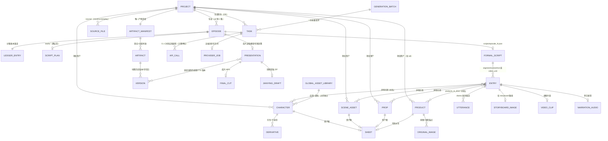
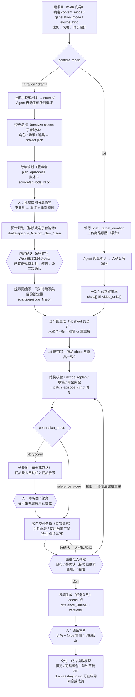

# ArcReel 源码研究 · 第 01 章：产品、领域模型与端到端流程

- **本章范围**：ArcReel 是什么、给谁用；三种创作类型的差异；`CONTEXT.md` 定义的领域概念及其在代码中的落点；操作者从建项目到交付的完整流程（人做什么 / Agent 做什么 / 每步落盘什么 / 哪里有审核闸门）；与 Linglong parity ledger（P-01..P-14）的映射；对 Linglong 的设计启示。
- **不在本章**：供应商抽象与计费细节、生成队列与恢复的内部实现、前端视觉系统（另见其他章节）。
- **读过的资料**（均位于 `ArcReel/`）：`README.md`、`README.en.md`、`PRODUCT.md`、`CONTEXT.md`（全文）、`AGENTS.md`、`CONTRIBUTING.md`（仅架构相关段落）、`agent_runtime_profile/CLAUDE.{narration,drama,ad}.md`、`agent_runtime_profile/.claude/references/{workflow-plan,generation-modes,generation-results}.md`、`agent_runtime_profile/.claude/skills/video-workflow/SKILL.{ad,drama}.md`、`website/docs/guide/{workflows,getting-started,jianying-export}.md`、`website/docs/dev/architecture.md`、ADR 0033/0034/0036/0041/0055/0061/0064/0066/0072/0080（节选）；为核对概念与代码的对应关系，浏览了 `lib/project`、`lib/episode`、`lib/script`、`lib/workflow`、`lib/artifacts`、`lib/generation`、`lib/db/models`、`server/services/{project,presentation}`、`frontend/src/app-routes.ts` 与 `frontend/src/components/canvas/`。

> 本文为基于 ArcReel 源码的研究笔记，遵循 docs/linglong-arcreel-parity-method.md：不含复制的代码、提示词或 schema。

---

## 0. 一页结论

1. ArcReel 的核心不是“一键出片”，而是一条**由服务端判定状态、可中断恢复、每一步都能人工审改的生产流水线**。Web UI 和内嵌 Agent 看的是同一份服务端“制作计划”（workflow plan），里面只有一个 `next_action`。Agent 不自己推断进度。
2. 项目由三条互相独立、**创建后都不能改**的轴决定：创作类型 `content_mode`（narration / drama / ad）、生成模式 `generation_mode`（storyboard / reference_video）、源文件类型 `source_kind`（novel / screenplay）。另有一个可随时切换的装配开关 `grid_storyboard`（多宫格分镜）。三类创作类型乘两种生成模式，共得到 6 种流程形态，由 `lib/workflow/workflow_rules.py:30` 的一张步骤表统一表达。
3. 领域模型的主心骨是四个“唯一真相”：**分集账本**（每集的身份和原文范围）、**正式脚本**（每集的内容）、**产物清单**（artifact manifest，记录每个付费产物是否存在、是否还与当前输入一致）、**剪辑时间线 / 成片读取模型**（最终怎么剪）。其余概念都是它们的派生或投影。
4. 成本保护贯穿整个设计：任务开始执行后不能取消；重启后只有带供应商任务号的视频任务会自动续跑，其余任务直接标失败、等人工重试；批量视频在建任务前做一次“全有或全无”的准入判定；已付费产物即使过期（stale）也照常可用，系统从不自动重生成。
5. 对 Linglong 最重要的三个差异：（a）ArcReel 只有“剧情演绎 + 分镜图生视频”组合能在应用内合成成片，其余组合都依赖剪映草稿或下载片段。剪映在 Linglong 被排除，所以 Linglong **必须为所有模式提供应用内的最终渲染**；（b）ArcReel 的 ad `brief` 只是一段短的自由文本，没有受众、市场、声明合规这类结构化字段，Linglong 的 P-02 要比它更丰富；（c）ArcReel 的全局资产库是“复制进项目后两边各自独立”，而 Linglong 的 P-13 要求“引用、不复制文件”，两者方向相反，需要有意识地做出取舍。

---

## 1. 产品是什么

### 1.1 定位与用户

- **一句话**：开源、自托管的 AI 视频生产工作台，输入可以是小说、成品剧本或商品素材，产出角色一致、过程可控、成本可追踪、交付后还能继续编辑的短视频（`README.md` 开头）。
- **主要用户**：自己部署、一个人走完全程的**个人创作者**。部署形态是单管理员账号，目前没有多人协作和权限体系，但结构上预留了“不止一个人用”的可能（`PRODUCT.md` Users 节；DB 模型带 `UserOwnedMixin`，见 `lib/db/models/task.py:13`）。
- **成功的定义**：一名创作者独立走完从源文件到成片（或剪映草稿）的全链路，并且在每个阶段都能看到当前进度、改动产出、查看实际花费（`PRODUCT.md` Product Purpose）。

### 1.2 价值主张（按 PRODUCT.md 的重要性排序）

1. **Agent 贯穿全流程**：脚本规划、资产、分镜、生成、成片，每一步都可以交给 Agent 编排，用较低的上手门槛换较高的自动化程度。
2. **供应商自由接入**：文本、图像、视频、TTS 四类能力各自选供应商和模型，内置供应商与用户自建的自定义供应商并存（含声明式端点和 ComfyUI workflow）。
3. **自托管 + 剪映交付**：数据留在用户自己的机器上，产出可以导出为剪映草稿继续人工精修。

### 1.3 产品原则（`PRODUCT.md` Product Principles，意译）

| 原则 | 含义 | 在代码 / 契约中的体现 |
|---|---|---|
| 审核优先于自动 | 自动化的产出默认可见、可改、可单独重做 | 内容确认闸门；动作间确认协议；逐条重做 |
| 代价先于执行 | 花钱的操作提交前先展示影响范围和预估费用，批量操作尤其如此 | 整批准入判定的“待确认”分支按档位列出费用 |
| 服务端判定即状态 | 进度、阻断、产物状态都以服务端判定为准，界面不按文件是否存在自行推断 | 制作状态 / 制作计划 / 产物清单 |
| 术语一致 | 同一概念在界面各处用同一个词；`CONTEXT.md` 的中文术语就是 UI 用词，`_Avoid_` 列出的说法禁止出现在界面上 | 术语表 + i18n 一致性测试 |
| 单人可完成 | 所有关键路径都能由一个人独立走通 | 无协作 / 审批角色 |

### 1.4 明确“不是”什么

- **不是多人协作平台**：没有角色权限；PostgreSQL 部署也不提供用户隔离，官方提醒不要让互不信任的人共用一个实例（`getting-started.md` 2.3 节）。
- **不是云服务 / SaaS**：市场功能也只依赖 GitHub 仓库形式的市场源，不依赖任何中心服务（`CONTEXT.md:112`）。
- **不做 CapCut 承诺**：只面向中国大陆版剪映，CapCut 兼容性没有验证，界面只写“剪映”（`PRODUCT.md` Operating Context）。
- **不编造宣传材料**：客户名单、用户数、案例研究、定价等在设计中按空缺处理，不写占位文案（`PRODUCT.md` Evidence on Hand）。
- **不做“一键跳过审核”**：官方文档明确说优势在于把审核放在返工成本低的位置，而不是省掉审核（`workflows.md` 第 7 节）。
- **ArcReel 的费用只是参考**：展示的是按单价估算的“参考费用”，不代替供应商账单（`CONTEXT.md:264-270`）。

---

## 2. 三条正交轴与三种创作类型

### 2.1 轴的定义

| 轴 | 取值 | 决定什么 | 可变性 | 代码 |
|---|---|---|---|---|
| 创作类型 `content_mode` | `narration` / `drama` / `ad` | 脚本怎么组织；Agent 用哪份 profile 变体（`CLAUDE.<mode>.md`） | 创建后不可变 | `lib/project/project_manager.py:410`（创建时按 mode 物化 profile） |
| 生成模式 `generation_mode` | `storyboard` / `reference_video` | 视频由什么驱动：单张分镜图驱动（i2v），还是一组资产参考图驱动（r2v） | 创建后不可变。这一点靠结构保证：任何 PATCH 模型里都没有这个字段（ADR 0055） | `lib/workflow/workflow_rules.py:89` |
| 源文件类型 `source_kind` | `novel` / `screenplay` | 走“改编式创作”还是“提取优先、只补缺”（剧本里能听见的内容要逐字保留） | 创建后不可变（ADR 0036） | 创建向导 `WizardStep1Basics.tsx` |
| 多宫格分镜 `grid_storyboard` | 布尔 | 分镜图是逐张生成，还是多格合成一张大图后再切开；只在 storyboard 下生效，ad 不开放 | 用户可在设置页随时切换，Agent 没有写权限 | ADR 0055 |

**骨架**（skeleton）由前两轴派生，决定脚本条目数组的形态：narration+storyboard → `segments[]`，drama+storyboard → `scenes[]`，ad+storyboard → `shots[]`，任意类型+reference_video → `video_units[]`（`lib/script/script_skeleton.py:129`，ADR 0045）。生成入队时，如果项目模式与剧本骨架对不上，会直接拒绝（`ensure_route_skeleton`，`script_skeleton.py:254`）。

### 2.2 三种创作类型端到端对比

| 维度 | 旁白/解说 narration | 剧情演绎 drama | 广告/短片 ad |
|---|---|---|---|
| 内容组织 | 连续的旁白 / 解说为主线，画面配合讲述 | 角色行动、对白、剧情场面 | 围绕一条成片的传播目标（带货、品牌或独立创意短片） |
| 创作输入 | 小说或剧本上传到 `source/` | 小说或剧本上传到 `source/` | 项目级 `brief`（短文本）+ `target_duration`（秒）+ 可选商品（多张原图、卖点） |
| 集 | 多集，需要分集规划 | 多集，需要分集规划 | **固定只有一集**，界面隐藏集的概念；以后“一个商品多个变体”打算用“每集一个变体”来扩展（ADR 0033） |
| 独有步骤 | 旁白配音（按段 TTS） | 可在应用内合成成片（`compose-video`，ffmpeg，可加 BGM） | 起草卖点；商品 sheet 过目（软门禁）；商品保真拦截 |
| 跳过的步骤 | — | — | 资产盘点、分集规划、脚本规划、内容确认（ad 一步直接生成正式脚本） |
| storyboard 下的条目 | `segments[]`：一段朗读（`novel_text`）配一个画面 | `scenes[]`：画面 + 按顺序排列的发声条目 `utterances`（台词或画外音） + 对应原文 | `shots[]`：带带货框架段落标签 `section`（hook、痛点、商品亮相、卖点、演示、信任、价格、CTA 八类）和一等口播文案 `voiceover_text` |
| 时长规划 | 单条按模型 `supported_durations` 取；项目偏好 `default_duration`（null 表示由 AI 按节奏决定），可选单集目标时长 `episode_target_duration` | 同 narration | 没有单条偏好，按 `target_duration` 总时长分配；reference_video 下每个单元是正整数的编排时长，预检时再映射到供应商支持的档位 |
| 宫格 | 可用 | 可用 | 禁用（单格分辨率低，和商品高保真相冲突） |
| 默认交付 | 剪映草稿（字幕 = 原文；可叠加 TTS） | 应用内成片或剪映草稿（字幕 = 台词 + 画外音） | 剪映草稿 / 无配音导出，配音在导出后完成；应用内合成对 ad **不适用** |
| 重点审核项（`workflows.md` 3.x） | 单段旁白长短、专有名词发音、画面是否只是在复述旁白 | 每集的目标与情绪、服装连续性、空间关系、视线与运动方向 | 商品外形 / Logo / 颜色是否真实、卖点有无事实依据、首屏价值、结尾 CTA、平台规范 |

几条值得记下的模式规则：

- **ad 的通用短片分支**：`products` 为空就是通用短片，没有显式的子模式开关。是带货还是通用短片，由用户的诉求决定；如果用户想推某个商品但还没登记，先引导上传（`CLAUDE.ad.md` 通用短片节）。
- **真人面孔风险**：部分供应商会拒收含真人面孔的参考图。ad profile 要求提前提醒用户，并优先用手部、背影、商品特写这类构图。如果人脸就在商品原图里，改构图没用，要换图（`CLAUDE.ad.md` 真人出镜节）。
- **视频提示词避免“编辑类祈使动词”**：有些模型会根据措辞判断任务类型，而误判要到异步阶段才报错，那时已经计费。所以只描述目标画面，不写“把 X 改成 Y”这类说法（三个 profile 共有的规则）。
- **视频提示词自动追加排除项**：不要 BGM、字幕、水印。BGM 统一留到后期处理。

---

## 3. 领域模型

### 3.1 概念关系图（自绘）

读图要点：产物（sheet、分镜图、视频、配音、字幕、呈现描述）都通过**产物清单**登记，并有自己的时效状态。脚本条目只按名称引用资产，资产的完整定义只存在 `project.json` 里（“数据分层原则”，三个 profile 都有这一节）。

### 3.2 核心术语表

> “代码位置”给出的是便于追溯的文件路径和行号；CONTEXT 行号指 `ArcReel/CONTEXT.md`。

#### A. 项目、集与源文件

| 术语 | 含义（自述） | 与其他概念的关系 | 代码位置 |
|---|---|---|---|
| 项目 project | 一项完整的视频创作，是目录形态的数据：`project.json` 加各类媒体子目录 | 拥有源文件、资产、集、脚本、产物；三条轴在创建时锁定 | `lib/project/project_manager.py:299`（`ProjectManager`）、`:410`（`create_project`）、`:2326`（`create_project_metadata`）；CONTEXT:324 |
| 数据根 data root | 一次部署存放全部运行数据的目录，项目只是其中一类数据 | 解析顺序为 `ARCREEL_DATA_DIR` → 旧变量 → 默认 `projects/` | `architecture.md` 第 9 节；ADR 0088；CONTEXT:328 |
| 集 episode | 项目里一个连续的内容单元 | ad 恒为 1 集；集的元数据在保存剧本时同步写入 | `project.json` 的 `episodes[]`；`lib/episode/`；CONTEXT:332 |
| 分集账本 episode ledger | 记录每集身份和原文范围的唯一真相；磁盘上的 `source/episode_N.txt` 只是它的派生物 | 字段包括 `source_range`、`hook`、`outline`（drama）、`ledger_status`，另有顶层 `planning_cursor` | `lib/episode/episode_ledger.py:75`（`SourceRange`）、`:109`（`PlanningCursor`）；ADR 0031；CONTEXT:526 |
| 集规划状态 ledger_status | `planned`（还没有下游产物）/ `consumed`（已有下游产物）/ `stale`（重新规划前已有产物，新旧错位） | 只描述规划和产物的关系，与产物时效里的 stale 是两回事 | CONTEXT:530 |
| 分集规划 plan / 重置 reset | 服务端从游标开始读一个源文窗口，一次规划出其中所有剧情弧完整的集；重置可以全量或从某集号开始 | 波及已消费的集时必须带显式确认（`confirm_consumed`），产物本身不删除 | `lib/episode/episode_planner.py:390`、`episode_reset.py`；ADR 0032；CONTEXT:538-542 |
| 源文件类型 source_kind / 小说 / 剧本 | 小说要改编；剧本已写好剧情和对白，要优先保留能听见的内容 | 是与创作类型、生成模式都正交的第三轴 | ADR 0036；CONTEXT:446-456 |
| 附加指令 instructions | 只对本次规划或生成生效的额外要求；反复出现的要求由 Agent 记忆承载 | 不持久化；长篇分批规划时，每一批都要重复带上 | CONTEXT:534 |
| brief / target_duration / 卖点 selling_points | ad 的创作输入：诉求短文本、总时长、商品卖点列表 | 卖点会被注入带货框架里的卖点段和演示段 | `project.json` 顶层与 `products`；`CLAUDE.ad.md` |

#### B. 脚本与条目

| 术语 | 含义（自述） | 与其他概念的关系 | 代码位置 |
|---|---|---|---|
| 脚本 script（正式脚本） | 从源文件或 brief 整理出的结构化创作内容。内容确认之后，它就是该集内容的唯一真相 | 条目数组按骨架区分；revision 用于乐观并发控制 | `scripts/episode_N.json`；`lib/script/script_models.py:301`（Narration）、`:543`（Drama）、`:707`（Ad）、`:851`（Reference）；CONTEXT:442 |
| 骨架 skeleton | 条目数组的四种形态，由创作类型和生成模式派生 | 见 2.1 | `lib/script/script_skeleton.py:56`；ADR 0045；CONTEXT:406 |
| 脚本规划 script_plan | 步骤名，也指它的产出：确认前那份可检查、可修改的**内容层**草稿（边界、出场资产、逐字口播、原文锚、时长） | 确认后变成只读；ad 没有这一步 | `drafts/episode_N/script_plan_*.json`；`lib/script/script_plan_entries.py`；CONTEXT:470 |
| 内容确认 review gate | 阻塞式闸门：确认时把脚本规划**整份**机械地转成正式脚本，所有条目标为待编写 | 该集已有正式脚本时，确认就等于覆盖。必须列出将被移除的条目和产物，并取得明确同意 | `server/services/project/script_review.py`、`lib/script/script_review.py:463`（`FormalScriptOverwrite`）、`frontend/.../timeline/ScriptReviewGate.tsx`；ADR 0041/0080；CONTEXT:506 |
| 提示词编写 prompt_authoring | 为待编写条目补出**视觉层**（`image_prompt` / `video_prompt`），输入是正式脚本本身，不再读脚本规划 | 默认只补待编写条目；`entry_ids` 表示显式重写 | `lib/script/script_generator.py`；ADR 0080；CONTEXT:474 |
| 待编写 pending authoring | 条目级的显式标记：视觉层还没补 | 内容确认或手动新增时置上，编写完成后清除 | `pending_authoring` 字段（`script_models.py`）；CONTEXT:510 |
| 待修复草稿 / 可编辑草稿 | 生成结果违反约束、需要修正的草稿；或从正式内容取出、交给 Agent 修改的草稿 | 草稿存在期间，内容确认和生成入口一律拒绝 | `lib/script/draft_quarantine.py:125`；CONTEXT:514-519 |
| 软违约 soft violation | 不阻断落盘、但要随产物一起呈现的降级提示（例如角色没配参考音频） | 不计入待修复草稿的判定 | CONTEXT:522 |
| 分镜 segment / scene / shot | 分镜图驱动视频时，脚本里可以单独编辑和生成的一条内容；数量就是 storyboard 项目的规模 | 拥有分镜图、视频片段、可选尾帧、转场、`segment_break` | `script_models.py:234`（`NarrationSegment`）、`:440`（`DramaScene`）、`:641`（`AdShot`）；CONTEXT:426 |
| 视频单元 video_unit | reference_video 路线下的最小生成、计费和成片归属单位：**一段自由文本正文 + 一个编排时长** | 参考图、发声、说话人都在读取时从正文派生，不落盘；一个单元只能有一种发声归属 | `script_models.py:809`（`ReferenceVideoUnit`）、`lib/script/reference_video/`；ADR 0064；CONTEXT:434 |
| 引用语法 writing_syntax | 正文里的 `@[名称]`、`@[角色/衍生]`、`@[名称]{台词}`、`{画外音}` 这几种记号 | 派生出声明引用；同名资产按商品 → 角色 → 场景 → 道具的顺序归属 | `lib/script/storyboard_mentions.py`、`script_references.py`；CONTEXT:438 |
| 声明引用 / 可用参考图 | 正文中声明的资产引用，以及其中此刻确实能随请求发出图片的那部分 | 只按“名字已登记”不能判断带没带参考图 | CONTEXT:246 |
| 发声条目 utterance | drama 场景里“说出来的话”的统一单元：台词（有说话人）或画外音（无说话人），按顺序排列 | 替代原先无序的对白和画外音两个字段 | `script_models.py:401`；ADR 0040；CONTEXT:458 |
| 对应原文 source_text | 条目所依据的原文片段，只用于对照来源 | 写入时服务端会校验它是本集源文的逐字子串 | CONTEXT:462 |
| 分镜图 storyboard_image | 为一个分镜确定构图和起始画面的图，也是该分镜视频生成的输入 | 宫格模式下由宫格大图切出 | `storyboards/`、`grids/`；CONTEXT:430 |
| 尾帧 end_frame_image | 用户为某个分镜指定的收束画面，属于用户意图，不是生成产出 | 只作用于 storyboard 路线的 i2v 请求 | `server/services/project/end_frame.py`、`timeline/EndFramePicker.tsx`；CONTEXT:466 |
| 提示词模版 / 生成环节 / 负向提示词 | 每个固定调用位置对应一份内置提示词模版；排除项按媒体类型共享 | 能力数值（时长、分辨率）不写死在模版里，由编排层注入 | `lib/prompts/`；ADR 0077；CONTEXT:478-500 |

#### C. 资产

| 术语 | 含义（自述） | 与其他概念的关系 | 代码位置 |
|---|---|---|---|
| 资产图 sheet | 为资产确定标准视觉形象的图，本质是后续生成的条件输入；角色是正面、侧面、背面三视图，其余资产是单张 | 用于某次生成时就充当该次的参考图；本身也是产物，有时效状态 | `characters/` `scenes/` `props/` `products/`；ADR 0066；CONTEXT:336 |
| 角色 character / 本体 base look | 可以跨条目复用的身份资产；本体是它常驻的外观 | 有名字、描述、`voice_style`、资产图 | `lib/project/asset_types.py:78`；CONTEXT:340-346 |
| 衍生 derivative | 角色的另一套持续外观（换装、变身、年龄跨越），与本体共享名字、声音和身份 | **没有原图、不能上传**；它的资产图是对本体资产图做一次图片编辑得到的；本体重新生成后衍生判为 stale | `lib/project/asset_derivatives.py`、`lorebook/CharacterDerivativeSheet.tsx`；ADR 0072；CONTEXT:348 |
| 场景 scene / 道具 prop | 可复用的环境资产、关键物件资产 | 早期统称为“线索 clue”，现在已拆开 | `asset_types.py:99/110`；CONTEXT:352、376 |
| 商品 product | ad 中需要准确呈现的资产。**用户原图是保真验收锚点**，标准化 sheet 只是可选的派生参考 | storyboard 路线中，商品镜头注入全部商品参考，非商品镜头一张都不注入；视频层不再重复注入 | `asset_types.py:121`；ADR 0034；CONTEXT:364 |
| 原图 vs 参考图 | 原图是用户上传的源图，只作为生成资产图的输入（商品例外）；参考图是某次生成时的角色，而不是图片的永久类型 | 原图不能顶替缺失的资产图（ADR 0073：生成入口要求资产已登记且有 sheet） | CONTEXT:238-244 |
| 项目资产 / 全局资产库 | 项目自己拥有的资产；跨项目复用的资产库（角色、场景、道具，衍生随角色整套进出） | 从库里**应用到项目等于复制**，之后两边修改互不影响；商品暂时不进库 | `lib/db/models/asset.py:11`（`Asset`、`AssetDerivative`）、`pages/AssetLibraryPage.tsx`；CONTEXT:356-362 |
| 资产重命名 | 以名字作为身份的资产改名，是一次原子的级联事务，所有引用一次改齐 | 名字就是身份，所以改名是个重操作 | ADR 0057；CONTEXT:368 |
| 风格模版 style_template | 预置的整段画风文本，选中时以快照形式写进项目风格 | 与风格参考图互斥 | ADR 0023；CONTEXT:372 |

#### D. 生成、任务与费用

| 术语 | 含义（自述） | 与其他概念的关系 | 代码位置 |
|---|---|---|---|
| 生成任务 task | 为一次媒体生成而排队、被追踪的工作单元；图像、视频、音频三条通道各自控制并发 | 一个任务对应 0 到多次供应商调用 | `lib/db/models/task.py:13`、`lib/generation/generation_queue.py:332`；CONTEXT:130 |
| 生成批次 generation batch | 一次“批量生成”请求落库后的记录，关联它创建的全部任务，可以整体查看和取消 | 术语表里没有单列（待确认是否算正式术语） | `lib/db/models/task.py:72`、`lib/generation/generation_batch.py` |
| 供应商调用 api_call | 对外部模型的一次请求，是记账的最小单位；也可以不挂在任务下单独发生（剧本生成、助手会话等） | 使用记录是它的投影 | `lib/db/models/api_call.py:13`；ADR 0076；CONTEXT:134 |
| 供应商任务 provider_job | 供应商那边为提交后轮询型生成建立的远端异步操作 | 状态由供应商写入，和本地任务状态同名但不是一回事 | CONTEXT:138 |
| 执行检查点 execution_checkpoint | 视频任务首次提交前冻结下来的“这次付费请求的身份和实际输入” | 为续跑和审计服务，不是入队快照 | CONTEXT:146 |
| 取消 / 孤儿任务 / 续跑 | 只能取消还在排队的任务；服务重启后留下的孤儿任务里，只有持有供应商任务号的视频任务会续跑，其余标失败、等人工重试 | 设计动机：重新提交会被二次计费 | `lib/generation/restart_recovery.py`、`video_resume.py:72`；ADR 0006/0007；CONTEXT:150-162 |
| 整批准入判定 batch_admission | 批量视频建任务前的一次性判定，结论有三种：放行 / 待确认（跨档费用等用户拍板）/ 受阻（一个任务都不建） | 只判断这一批能不能建，不预言执行结果 | `lib/generation/batch_admission.py:39`、`server/services/admission/`；ADR 0061；CONTEXT:142 |
| 任务类型 generation_type | t2i / i2i / i2v（首帧驱动）/ r2v（参考图驱动） | 与媒体类型正交；t2i 还是 i2i 要到执行时才能确定 | ADR 0001；CONTEXT:186 |
| 图片编辑 image_edit | 按编辑指令改一张已有的图，产出新版本，但**不改写**原提示词 | 用于局部修改；如果要推翻构图，就重新生成 | ADR 0050；CONTEXT:202 |
| 旁白配音 / 旁白交付 | 独立的 TTS 语音素材；每次发起视频请求时逐次选择“后期配音”或“使用当前 TTS”，**不持久化** | 选 TTS 时要先生成并试听，再重查计划 | `lib/speech/narration_delivery.py`；CONTEXT:294；`workflow-plan.md` |
| 生成有声视频 / 声音一致性档位 | 视频模型同时生成声音；按模型有无音轨、生成模式、角色声音绑定方式三者派生出 native / soft / none 三档 | 角色声音绑定方式有两种：提示词软约束，或挂参考音频 | CONTEXT:298-320 |
| 生成费用 / 参考费用 / 使用记录 | 按单价估算的费用：提交前显示预估，完成后记录实际；使用记录是调用时间线，外加“需要关注”的异常 | 多币种分开统计，不做折算 | `lib/billing/`；CONTEXT:264-286 |

#### E. 产物、状态与交付

| 术语 | 含义（自述） | 与其他概念的关系 | 代码位置 |
|---|---|---|---|
| 产物 artifact | 一次生成落进项目的正式文件，连同它和生成依据之间的关系。可以理解为“用户已经付费拥有的东西” | 种类包括资产图、脚本规划、脚本、宫格、分镜图、视频、音频、字幕、呈现描述 | `lib/artifacts/artifact_manifest.py:63`（`ArtifactKind`）；CONTEXT:548 |
| 产物清单 artifact_manifest | 登记每件正式产物的身份、位置和依据摘要的唯一真相；**不扫目录** | 项目根目录下的隐藏清单文件；迁移时一次性补录 | `artifact_manifest.py:219`、`:53`；ADR 0062；CONTEXT:552 |
| 产物时效 artifact currency | `current` / `stale`（比当前输入旧但仍可用，可参与成片和导出）/ `missing` / `blocked`（读不出来，**绝不**当作缺失去自动付费重做） | 默认批量生成只补 missing | `artifact_manifest.py:77`、`artifact_currency.py:120`；CONTEXT:556 |
| 版本 version（≈ take） | 同一资源每次付费产出都会保留一个版本，可以切回任意版本作为当前版本 | 当前版本才参与成片；界面上有版本时光机 | `lib/artifacts/version_manager.py:127`、`:400`（`add_version`）、`:1217`（`restore_version`）、`timeline/VersionTimeMachine.tsx` |
| 制作状态 workflow status | 以清单为口径，对某个目标集给出的权威判定：所在步骤、阻断项、闸门、各类产物的四态明细、下一步 | 系统里唯一的进度口径 | `lib/workflow/workflow_state.py:411`（`WorkflowStateService`）；CONTEXT:576 |
| 制作计划 workflow plan | 状态之上的有序步骤视图：每步有 state、是否必需、受控动作、产物桶、在途任务、准入结论；**只有一个 `next_action`** | Web 和 Agent 消费同一份 | `lib/workflow/workflow_plan.py:223`、`workflow_rules.py:30`、`server/services/project/workflow_planner.py`；CONTEXT:580 |
| 项目摘要 project summary | 制作状态的跨集聚合投影，供项目列表和剧集卡使用；分逐件核对和只看登记两种口径 | 列表页用轻口径 | `workflow_state.py:238`（`ProjectSummary`）；CONTEXT:584 |
| 项目事件 project event | 服务端推给浏览器的“哪个实体发生了什么”，浏览器据此刷新 | 走 SSE；通知只是它的一种呈现 | `server/services/project/project_events.py`；ADR 0085；CONTEXT:380 |
| 项目迁移 / 迁移失败判定 | 启动或导入归档时，把项目目录逐级升级到当前 schema；失败时留下持久的裁决，项目可以打开，但所有生成入口拒绝 | 阻断时只允许少数几个修复类写入 | `lib/project/project_migrations/`、`project_migration_failure.py`；ADR 0022；CONTEXT:564-574 |
| 剪辑时间线 edit timeline | 一集的剪辑决策（选哪个视频版本、顺序、入出点、转场、音轨、字幕），是成片形态的唯一真相 | 术语表里已定义，但代码中**没有检索到同名实现**；目前承担这一角色的是“成片读取模型”（待确认） | CONTEXT:590 |
| 成片读取模型 presentation | 固定已选视频版本、可选 TTS 版本、实际媒体时长、原音开关、字幕时序；浏览器预览、可编辑包下载、剪映草稿三个入口**消费同一份** | 物化结果写入 `subtitles/`、`presentations/` 并登记进清单；手动上传、来源不明的视频走 raw-only 分支 | `server/services/presentation/presentation_read_model.py:121`；`architecture.md` 第 13 节 |
| 成片 final cut / 剪映草稿 | 由剪辑决策渲染出的一集视频文件 / 交给剪映精修的导出形态 | 应用内成片目前只支持 drama + storyboard（`compose-video` skill） | `server/services/presentation/jianying_draft_service.py`；CONTEXT:598-604 |

#### F. Agent 运行时（只列与流程相关的）

| 术语 | 含义（自述） | 与其他概念的关系 | 代码位置 |
|---|---|---|---|
| ArcReel Agent | 内嵌的对话式创作 Agent（基于 Claude Agent SDK）；主 Agent 只负责编排 | 编排 skill 加聚焦的子智能体（资产分析、三种脚本规划、剧本生成、资产生成） | `server/agent_runtime/`、`agent_runtime_profile/.claude/agents/`；CONTEXT:608 |
| Agent 工具集 | 内嵌 Agent 和外部 Agent 共用同一套工具；区别只在项目由什么决定，以及结果是同步拿到还是先拿回执 | 受同样的迁移判定和准入约束 | ADR 0087；CONTEXT:616 |
| Agent 运行 profile / 物化 | 按创作类型选定变体，物化进项目目录；用户改过的文件会被保留 | 三份 `CLAUDE.<mode>.md` | `lib/agent/profile_manifest.py`；CONTEXT:676-682 |
| Agent 记忆 | 跨会话的自然语言笔记，分项目级和用户级两层；只记从项目数据推不出来的偏好和纠正 | 不是正式数据，不进归档 | ADR 0074；CONTEXT:640-654 |

### 3.3 非核心术语简表（Linglong 基本不需要）

| 分组 | 术语（CONTEXT 行） | 为什么对 Linglong 次要 |
|---|---|---|
| 供应商与模型 | provider、backend、model、credential、内置 / 自定义供应商、调用端点、声明式端点、ComfyUI 端点、节点绑定、端点测试、连通性检查、api_model_name、两栖模型、生效凭证、Agent 凭证（9-107） | Linglong 只用 Vertex Gemini / Veo，模型 ID 和 location 归用户所有，不需要多供应商配置层 |
| 市场 | 市场、市场源、市场条目、安装（112-126） | 没有端点分发需求 |
| 解析 | 供应商解析、ProviderModel、文本任务档位、任务类型桶、执行模型（166-196） | 单一供应商下可以退化成“按用途选模型”的配置，但“执行模型只求值一次、估算和执行同源”这条原则值得保留 |
| 尺寸 | 比例、分辨率、尺寸、可选时长、端点固定维度、时长联动约束、偏好时长（208-234） | 概念可以直接沿用，尤其是“比例和分辨率分开”“时长只取模型声明的集合” |
| 参考图压缩 | 参考上传副本、压缩、裁剪（250-260） | 实现细节；“超过上限去尾丢弃、并给出可见警告”值得借鉴 |
| 认证 | 会话 JWT、API Key、下载 token、浏览器原生请求、自带认证端点（694-712） | LinglongLab 已有自己的认证体系 |

### 3.4 持久化分布

- **文件系统（项目目录）**：`project.json`（项目元数据、资产定义、分集账本、风格、ad 的 brief / 时长 / 商品）、`source/`、`drafts/episode_N/`（脚本规划）、`scripts/episode_N.json`（正式脚本）、`characters/`（含 `derivatives/`）、`scenes/`、`props/`、`products/`（含 `refs/` 原图）、`storyboards/`、`grids/`、`videos/`（storyboard 路线）、`reference_videos/`（reference 路线）、`audio/`、`thumbnails/`、`subtitles/`、`presentations/`、`output/`、`versions/`（版本快照和版本索引）、产物清单隐藏文件，以及物化的 `.claude/` 与 `CLAUDE.md`。
- **数据库（SQLAlchemy，SQLite 或 PostgreSQL）**：生成任务、批次、worker 租约、供应商调用、全局资产库、会话和会话事件、凭证、自定义供应商和端点、市场安装、API Key（`lib/db/models/`）。
- **设计取舍**：内容与产物放文件系统（方便备份、归档、在外部查看），运行态和账务放 DB。两者要“共同备份”（`architecture.md` 第 18 节）。代价是需要一整套项目 schema 迁移框架，以及产物清单补录（ADR 0022/0062/0075）。

---

## 4. 端到端操作流程

### 4.1 流程图（自绘，覆盖 6 种模式组合）

### 4.2 逐阶段拆解

步骤 ID 取自 `lib/workflow/workflow_rules.py:30` 的有序步骤表（括号内是 checkpoint 名）。“人”指操作者，“Agent”指内嵌 ArcReel Agent。Web 上也能完成大部分动作，Agent 只是其中一个入口。

| # | 步骤 ID | 适用组合 | 人做什么 | Agent / 系统做什么 | 落盘内容 | 闸门 |
|---|---|---|---|---|---|---|
| 1 | `project_input`（PROJECT_INPUT） | 全部 | 在 Web 向导里填名称、创作类型、源文件类型、生成模式、比例、源语言、ad 总时长、默认时长、模型和风格（`create-project/WizardStep{1,2,3}`）；上传源文或商品原图 | 系统建目录、写 `project.json`、按创作类型物化 profile；上传后 Agent 生成项目概述；ad 的 brief 为空时 Agent 通过对话补齐 | `project.json`、`source/`、`products/refs/`、`.claude/` | 三轴一旦创建即锁定；Agent 不能代传图片 |
| 2 | `selling_points`（SELLING_POINTS） | 仅 ad（有商品时） | 确认或修改卖点 | 根据 brief、商品描述和原图起草卖点列表 | `products[].selling_points` | 对话确认 |
| 3 | `asset_inventory`（ASSET_INVENTORY） | narration / drama | 核对角色是否重复或遗漏、群演是否被误建成角色、关键道具是否需要固化 | `analyze-assets` 子智能体读原文，把资产写进 `project.json`（空结果也算合法完成） | `project.json` 的 characters / scenes / props | 动作间确认（继续 / 重做 / 跳过） |
| 4 | `episode_plan`（EPISODE_PLAN） | narration / drama | 看每集的首尾原文，核对边界；提出意见后触发重置 | 服务端一次处理一个窗口，写账本并派生分集文件；返回核对材料（集数、体量中位数等）。用户已自行拆好集时跳过这一步 | 账本字段 + `source/episode_N.txt` | 批级审阅；重置波及已消费的集时要二次确认 |
| 5 | `script_plan_content`（SCRIPT_PLAN_CONTENT） | narration / drama（ad 没有） | —— | 由计划返回的 `preprocessor` 指定子智能体（split-narration-segments / normalize-drama-script / split-reference-video-units），调用服务端工具产出结构化的内容层草稿 | `drafts/episode_N/script_plan_*.json` | —— |
| 6 | `script_plan_review`（SCRIPT_PLAN_REVIEW） | narration / drama | 在 Web 的审核页编辑后确认，或在对话里明确同意 | 确认时整份物化为正式脚本，全部条目标为待编写，脚本规划变成只读 | `scripts/episode_N.json` | **硬闸门**：没确认就不会进入提示词编写；覆盖旧脚本时须列出移除项并取得明确同意 |
| 7 | `final_script`（FINAL_SCRIPT） | 全部 | 按需修改台词、正文、时长；调整顺序要在 Web 上做 | narration / drama 补视觉层；ad 一次生成（按带货八段框架和总时长配比，偏离目标时长只提醒不拒绝） | 正式脚本（带 revision） | 修改走带 `base_revision` 的有序批量 patch，冲突就重读 |
| 8 | `asset_sheets`（ASSET_SHEETS） | 全部（ad 可以跳过，只靠商品参考和风格） | 逐个审资产图；想局部修改就用图片编辑，想推翻就重生成；ad 要过目商品 sheet 是否与真品一致 | 按类型、只为缺 sheet 的资产（与计划点名取交集）生成；衍生由本体 sheet 编辑而来 | 资产图 + 版本 + 清单登记 | 生成入口要求引用的资产已登记且有 sheet（ADR 0073）；商品 sheet 是软门禁 |
| 9 | `script_structure`（无 checkpoint） | 全部 | 按提示修改条目 | 计划给出 `repair_video_units` / `patch_episode_script` / `fix_input` 等受控动作 | 正式脚本 | 草稿存在期间阻断 |
| 10 | `storyboard`（STORYBOARD） | 仅 storyboard | 抽样审构图、景别、竖屏安全区；ad 审商品保真 | 单张或宫格生成；商品镜头自动注入商品参考 | `storyboards/`、`grids/`、版本 | “先确认图片，再生成视频”（成本控制） |
| 11 | `narration_delivery`（无 checkpoint） | 全部（含叙述旁白时） | 每次视频请求都要二选一；选 TTS 就先试听 | 选了 TTS 却没配 TTS 时，默认走后期配音，不催用户去配置 | `audio/`（选 TTS 时） | 选择不持久化，每次重查计划都要带上 |
| 12 | `video`（VIDEO） | 全部 | 在“待确认”时确认申请档位和费用；逐条审片，点名重做 | 整批准入 → 建任务 → 队列执行 → 逐 ID 分账（成功 / 失败 / 受阻 / 跳过） | `videos/` 或 `reference_videos/`、`thumbnails/`、`versions/`、DB 任务和调用记录 | 全有或全无；不允许拆成小批“先跑能过的那一半”；重做须点名 + `force` |
| 13 | `export`（EXPORT_READY） | 全部 | 在 Web 上选集、声音版本（原音 / TTS 叠加）、剪映版本、草稿目录，下载 ZIP；drama 可以在应用内合成 | 成片读取模型物化字幕和呈现描述；stale 产物照常可导出，导出不覆盖旧媒体 | `subtitles/`、`presentations/`、`output/`、ZIP | 完成定义见 `workflows.md` 第 10 节 |

横跨各阶段的机制：

- **动作间确认协议**：每个子智能体返回后，主 Agent 展示摘要，并给出“继续 / 重做（附修改要求）/ 跳过”三个选项。只有用户明确授权“全自主”时才能连续推进（`SKILL.drama.md` 动作间确认协议节）。
- **灵活入口 / 可恢复**：计划总是定位到第一个未完成的动作。用户说“生成分镜图”也只是一个意图：如果和 `next_action` 不一致，Agent 不执行，而是说明计划当前要求做什么。
- **stale 纪律**：输入变了，产物就变成 stale，但它照常可用；要不要重做由用户决定。修改提示词后工具**不会**自动作废旧图，Agent 要紧接着点名重新生成，否则会留下“新提示词 + 旧画面”。
- **四条状态轴分开汇报**：步骤进度、队列任务状态、供应商检查点（是否已提交、是否可能已计费）、产物时效，四者互相独立，汇报时不能互相翻译。例如“任务成功”不等于“产物是最新的”（`generation-results.md`）。
- **迁移失败时整体阻断**：只能读，外加少数几个修复类写入，修完后重试迁移（`workflow-plan.md` 数据升级失败节）。

### 4.3 审核闸门清单

| 闸门 | 类型 | 由谁判定 | 不通过时 |
|---|---|---|---|
| 分集边界批级审阅 | 流程约定（对话） | 人 | 重置到最早受影响的集，然后重新规划 |
| 内容确认 | **系统硬闸门** | 服务端状态（`gates.script_plan_review`） | 停在确认步骤；覆盖旧脚本要走 danger 确认 |
| 资产依赖 | 系统硬闸门 | 生成入口（ADR 0073） | 计划返回 `generate_dependency` |
| 商品 sheet 过目 | 软门禁（工作流约定，不是状态机） | 人 | 重新生成 sheet |
| 分镜保真拦截 | 流程约定 | 人 | 在产生视频费用前重做分镜图 |
| 旁白交付选择 | 系统必填 | 人 | 工具报错，一个任务都不入队 |
| 整批准入 | **系统硬闸门** | 服务端 | 待确认：逐档位确认费用；受阻：修好后整批重来 |
| 迁移失败判定 | 系统硬闸门 | 服务端 | 修复后重试迁移 |

---

## 5. 与 Linglong parity ledger 的映射

| ArcReel 阶段 / 机制 | Ledger ID | Linglong 范围 | 说明 |
|---|---|---|---|
| 项目列表、项目摘要（轻口径）、新建向导 | P-01 | 纳入 | 列表的状态和计数来自服务端的摘要投影，不扫目录 |
| `project_input`、ad 的 brief / 时长 / 商品、`selling_points` | P-02 | 纳入 | Linglong 需要**比 ArcReel 更结构化**的 brief（受众、市场、声明、约束、CTV / 修复意图）；ArcReel 这些只停留在指南的建议层 |
| 小说上传、项目概述、`asset_inventory`（从小说抽取）、`episode_plan`、重置、`source_range` / 账本游标 | —— | **排除**（小说导入与改编） | 按方法文档，这些要记录为“排除”，不能换个名字重做 |
| screenplay 的“提取优先”（逐字保留可听内容） | P-04 | 部分纳入 | 适用于“用户提供的原创剧本”；与小说相关的分支不做 |
| 制作状态、制作计划、单一 `next_action`、灵活入口、项目事件 SSE | P-03 | 纳入 | Linglong 的阶段是 direction → script → design → storyboard → generate → edit → delivery，可以用同样的“服务端步骤表”来表达 |
| `script_plan_content` → 内容确认 → `final_script`（提示词编写）；`script_structure`；revision 批量 patch | P-04 | 纳入 | Linglong 的“锁定进入分镜”大致对应内容确认 |
| 资产（角色 / 本体 / 衍生、场景、道具、商品双锚点）、`asset_sheets`、图片编辑 | P-05 | 纳入 | 品牌资产（Logo、字体、色板）在 ArcReel 里**没有对应物**，要自己设计 |
| 分镜条目（`segments` / `scenes` / `shots`）、视频单元、分镜图、宫格、尾帧、转场 / `segment_break` | P-06 | 纳入（宫格可选） | Linglong 的 shot 需要显式的机位、动作、台词 / 文案、时长和绑定资产；ArcReel 把机位等信息放在 `image_prompt` / `video_prompt` 的结构里（`Composition` 等，`script_models.py:123`） |
| 分镜图 / 视频生成、任务、供应商任务、执行检查点、整批准入、生成批次 | P-07 | 纳入 | Veo 的长时操作名就是供应商任务号，所以能沿用“只续跑有任务号的视频”这条规则 |
| 旁白配音、旁白交付、口播文案、机械字幕、BGM 排除 | P-08 | 部分纳入 | ArcReel **没有**确定性叠加层（Logo、商店徽章、法务条）；字幕只在导出时机械分配 |
| 版本 / 切回、stale 不自动重生、点名 + force、图片编辑产出新版本 | P-09 | 纳入 | ArcReel 的“选定 take”就是版本管理里的当前版本；Linglong 要求所有 take 可见，并由操作者显式选择 |
| 成片读取模型、应用内成片（仅 drama + storyboard）、可编辑包下载 | P-10 | 纳入（不含剪映） | ArcReel **没有 QA 报告和交付清单**；Linglong 必须为所有模式提供应用内最终 MP4 |
| 剪映草稿导出 | —— | **排除**（P-10 明确排除外部编辑器草稿） | 只作为“成片读取模型要被多个出口共享”的设计参考 |
| 只能取消排队任务、孤儿任务、续跑、入队中断、重取产物（`retry_artifact_download`）、迁移失败 | P-11 | 纳入 | 刷新后可见，靠的是 DB 任务 + 计划里的在途任务观察 |
| 供应商调用、使用记录、参考费用、需要关注、来源 purpose | P-12 | 纳入 | ArcReel 的“确认档位”**只绑定在单次请求上**，是否有持久化的操作者确认日志（待确认）；Linglong 要显式记录 |
| 全局资产库（复制式应用）、衍生随角色整套进出 | P-13 | 纳入，但**语义不同** | Linglong 要求“挂接不复制文件、能追溯来源”，与 ArcReel 的复制后各自独立相反 |
| （前端视觉） | P-14 | 不在本章 | —— |

---

## 6. 对 Linglong 的启示

### 6.1 建议采纳的概念与机制

1. **服务端权威的制作计划和单一下一步**（P-03、P-11）：UI 和 Agent 都只读一份计划：有序步骤、每步状态、阻断项、在途任务、唯一的 next action。好处是刷新和恢复天然成立，Agent 也不会跑出第二套状态机。Linglong 可以用自己的步骤 ID 实现一张数据驱动的步骤表（按意图决定哪些步骤适用），不要在前端或提示词里各写一份。
2. **产物清单 + 四态时效**（P-07、P-09、P-12）：每个付费产物登记它的直接输入依据，并判定 current / stale / missing / blocked。关键纪律有三条：stale 仍然可用；绝不自动重生；blocked 不当作缺失处理（否则一次数据损坏会变成一次重复计费）。这正好落实 Linglong 的“不静默覆盖”。
3. **批量视频整批准入**（与“昂贵步骤须人工确认”直接对应）：先对整批做一次纯判定，结论为放行、待确认（按档位列费用）或受阻（零任务），确认之后才建任务。入队以后按条目逐个报告结果。Linglong 的“确认”应当复用这个三结局的外壳。
4. **任务语义以成本为中心**（P-11）：只能取消排队中的任务；已提交的请求照常跑完并落成产物；重启后只续跑持有 Veo 操作名的任务，图像任务一律标失败、等人工重试；供应商侧已生成、只是没取回来的，走“重新取件”而不是重新生成。
5. **内容层和视觉层分开，中间放硬闸门**（P-04）：先确认“拍什么”（镜头边界、出场资产、台词和文案、时长），再花钱让模型补视觉提示词。确认后只维护一份正式脚本，规划稿变成只读。这是 ArcReel 在 ADR 0041 之后又在 0080 里自我修正的结论：两份内容同时持久化会互相吞改动。Linglong 起步就可以直接采用“一份正式脚本 + 待编写标记”的方案。
6. **商品双层锚点**（P-05，对商业广告尤其关键）：用户原图永远是保真验收的依据，标准化商品图只是可选派生；商品参考注入是二元的（商品镜头全量注入，非商品镜头零注入），没有“弱注入”；分镜图已经承载商品一致性的，视频层不再重复注入。另外还有一道“视频花钱前的保真拦截”。
7. **角色衍生 = 子身份**（P-05，原创短剧）：换装、变身不要登记成新角色，而是挂在角色下，共享声音和身份；衍生的资产图由本体资产图编辑得到，本体重做后衍生判为 stale。
8. **有序发声条目**（P-04、P-08）：短剧里台词和画外音放在同一个有序列表里，每条标注有没有说话人，下游的 TTS、字幕、声音绑定都从这里派生。
9. **多出口共享一份“成片选择”**（P-09、P-10）：预览、下载、最终渲染都消费同一份已选版本、时长和字幕时序，任何出口都不各自推导。Linglong 的 edit revision 应该就是这个对象，而且要由它**渲染 MP4**。
10. **四条状态轴分开呈现**（P-07、P-11 的 UI 设计）：工作台上把“步骤进度 / 任务状态 / 供应商是否已提交（可能已计费）/ 产物是否最新”分开表达，避免用一个“成功”徽章掩盖 stale 或重复计费的风险。

### 6.2 建议改名或对齐的概念

| ArcReel | 建议的 Linglong 用词 | 理由 |
|---|---|---|
| content_mode（narration / drama / ad） | 生产意图 intent（commercial_ad / short_drama / remediation / ctv） | Linglong 的范围锁按意图划分；narration 可以并入广告的口播，或者不做 |
| 分镜 segment / scene / shot + 视频单元 video_unit | 统一用 **Shot**，另加一个“生成输入类型”字段（keyframe-i2v / reference-r2v） | Linglong 已有 shot 模型；ArcReel 四种骨架是历史演化的结果，Linglong 不必重复 |
| 资产图 sheet | 设计参考 / design pack 中的 approved reference | 对齐 Linglong 现有的 design pack 用词 |
| 版本 version | take（视频）/ variant（图片） | 对齐 P-09 |
| 内容确认 review gate | 脚本锁定 script lock | Linglong 已有“lock-to-storyboard” |
| 产物清单 artifact manifest | 产物登记 artifact registry（可以落在 DB 里） | Linglong 走 Cloud SQL，不需要文件型清单 |
| 旁白交付 narration_delivery | 配音方式 voice plan | 放进 P-08 的音频计划 |

### 6.3 建议简化的部分

- **供应商层**：只接 Vertex Gemini / Veo，不需要 provider 解析层级、自定义端点、ComfyUI、市场、多凭证切换。但 ArcReel 的“**能力数值只有一个真相源**”要保留：Veo 支持哪些时长、分辨率、参考图上限，由配置或能力表统一声明，提示词和 UI 都不写死。按 CLAUDE.md 的规定，模型 ID 和 location 是用户所有的真值，Linglong 不改。
- **生成路线锁定**：ArcReel 在项目级锁定 storyboard / reference（ADR 0055），理由是保证估算和执行走同一条路。Linglong 可以先同样按项目锁定，也可以按 shot 锁定，但无论哪种，**估算和执行都必须读同一个字段**（这是一个需要明确做出的决策）。
- **宫格**：ArcReel 对 ad 禁用宫格。Linglong 以商业广告为主，第一版可以不做。
- **集**：ad 恒为单集；短剧如果从 brief 或剧本出发，集可以只是一个有序列表（标题 + 钩子 + 大纲），不需要原文范围、规划游标和 `ledger_status` 这一套。
- **名字即身份**：ArcReel 以资产名作为身份，因此需要原子的级联改名（ADR 0057）。Linglong 建议用**稳定 ID + 显示名**，改名就不再是一次事务。
- **Agent 运行时细节**（沙箱、profile 物化、会话分支、SDK transcript）与本产品流程无关，另章评估。

### 6.4 应当舍弃的部分（范围锁）

- 小说导入、资产盘点里“从小说抽取”的路径、分集规划和重置、对应原文与小说的逐字校验、`planning_cursor` 等（排除项：小说导入与改编）。但“用户提供剧本时，台词逐字保留”可以留下作为短剧的约束。
- 剪映草稿导出（P-10 排除）。

### 6.5 ArcReel 没有、Linglong 必须自己补的部分

1. **所有意图都能在应用内渲染最终 MP4**（ArcReel 只有 drama + storyboard 能在应用内合成，ad 依赖剪映）。
2. **结构化 brief**：受众、市场、语言、时长、比例、宣传声明、禁用表述、品牌规范、源素材。ArcReel 的 ad 只有一段 brief 文本加卖点。
3. **确定性叠加层**：Logo、商店徽章、法务文案、字幕样式，和生成媒体分开审核（P-08）。
4. **QA 报告和交付清单**，以及源素材清单（P-10）。ArcReel 的“完成定义”只是文档里的一张清单，系统层面不存在。
5. **持久化的操作者确认日志**：哪次确认了哪一档费用、选了哪个 take（P-12）。ArcReel 的确认只绑定在单次请求上（待确认是否另有落库）。
6. **视频修复（remediation）和 CTV 的交付规格**（安全区、响度、16:9 母版等），ArcReel 完全没有对应。
7. **挂接式资产复用**（P-13）：Linglong 要能追溯来源、不复制文件，这是与 ArcReel 复制式资产库有意识的背离。

### 6.6 待确认项汇总

- 剪辑时间线在代码里是否已有实体实现，还是目前只由成片读取模型承担（CONTEXT:590 有定义，但检索不到同名代码）。
- 生成批次（`GenerationBatch`）是不是对外暴露的正式概念（术语表里没有单列）。
- ad 模式在应用内能否为 `voiceover_text` 合成 TTS：指南说 ad 的配音在导出后完成，而步骤表对 ad 又适用 `narration_delivery`，需要再读 `lib/speech/` 确认。
- 待确认档位的用户确认，除了随请求传递之外，有没有在调用或任务记录里留下审计痕迹。
