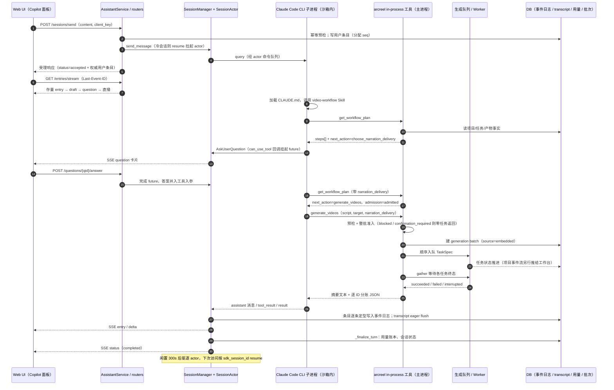

# ArcReel 源码研究 · 02 · AI Agent 运行时：Agent 如何驱动生产

- **范围**：ArcReel 内嵌创作 Agent 的会话生命周期（创建 / 运行 / 流式推送 / 持久化 / 恢复 / 分叉 / 取代）、工具集与 MCP、子智能体与 skill、安全护栏、Agent 记忆、transcript 与审计；最后给出与 Linglong 平价台账 P-xx 的映射和对 Linglong 的启示。
- **不在范围**：生成队列 worker 内部、供应商 backend、剧本 schema 细节（另见其它章节）。
- **读过的源码 / 文档**（均位于 `ArcReel/` 下）：
  - `server/agent_runtime/`：`service.py`、`session_manager.py`、`session_actor.py`、`options_assembler.py`、`agent_access_policy.py`、`event_log.py`、`entry_pipeline.py`、`session_branch.py`、`sdk_transcript_adapter.py`、`models.py`、`sdk_tools/`（全部 adapter）
  - `server/tool_runtime.py`、`server/media_tools/`（`definition.py`、`context.py`、`videos.py` 相关段）、`server/remote_mcp.py`、`server/routers/assistant.py`、`server/routers/agent_config.py`、`server/routers/agent_memory.py`、`server/app.py`（启动段）
  - `lib/agent/`：`profile_manifest.py`、`agent_profile.py`、`agent_memory_paths.py`、`agent_memory_index.py`、`agent_memory_store.py`、`agent_provider_catalog.py`、`agent_session_store/`（`store.py`、`models.py`、`prefix_fork.py`）；`lib/project/project_manager.py`（profile 物化调用点）；`lib/generation/generation_queue_client.py`（`batch_enqueue_and_wait`）；`lib/workflow/workflow_plan.py`；`lib/config/service.py`（`build_anthropic_env_dict`）
  - `agent_runtime_profile/`：`CLAUDE.{narration,drama,ad}.md`、`.claude/settings.json`、`.claude/agents/*`、`.claude/skills/*`、`.claude/references/*`（只读结构与职责，未摘录文本）
  - `skills/`：`README.md`、`video-workflow/`、`setup-arcreel-skills/`
  - ADR：0003、0005、0006、0007、0017、0025、0026、0027、0028、0029、0030、0032、0041、0046、0048、0052、0058、0061、0062、0065、0069、0074、0080、0083、0087、0088（仅引用处）
  - `docs/research/agent-memory-definition-and-practice.md`、`docs/research/agent-auto-memory-under-sdk.md`
  - ArcReel 仓库内开发态规则 `.claude/rules/agent-runtime.md`

本文为基于 ArcReel 源码的研究笔记，遵循 docs/linglong-arcreel-parity-method.md：不含复制的代码、提示词或 schema。

---

## 0. 要点速览

1. **运行时 = Claude Agent SDK（Python `claude_agent_sdk`）+ 每会话一个 `ClaudeSDKClient` 子进程**。ArcReel 没有自己写 agent loop，而是把 Claude Code 的整套能力（preset `claude_code` 系统提示、Skill、Task 子智能体、auto memory、hooks、内核沙箱）当作宿主，自己只做：会话编排、options 装配、访问围栏、事件日志、transcript 镜像。
2. **业务能力全部以 in-process MCP 工具（服务名 `arcreel`，38 个工具）暴露**，跑在 server 主进程内、不在沙箱里；Agent 对 `project.json` / `scripts/` / `drafts/` 的裸写入被"内核沙箱 + PreToolUse hook"双层拒绝，只能走工具（ADR 0003 / 0026）。
3. **"下一步做什么"由服务端算**：`get_workflow_plan` 返回有序 `steps[]` 与唯一 `next_action`，编排 skill 只按 `next_action.type` 路由，不在 prompt 里维护第二个状态机。这是 ArcReel 可恢复进度（P-03）的核心。
4. **UI 时间线与 Agent 记忆彻底分离**：SDK transcript 逐条镜像进 DB 只服务 SDK resume（ADR 0029）；另起一张带单调 `seq` 的会话事件日志作为 UI 唯一读源，SSE 的事件 id 就是 seq，可断线续传（ADR 0048）。
5. **消息改写 = 应用层"前缀分叉"**：把锚点前的 transcript 行复制到新会话、旧会话标 `superseded_by`，不用 SDK 原生 `fork_session`（ADR 0058）。
6. **人类确认大部分是"软"的**：服务端硬门禁只有三处（内容确认 `confirm_script_review`、跨档费用确认 `confirmed_request_durations`、`narration_delivery` 必填）；"每个子智能体返回后问用户"与"测试连接前回问"都写在 skill 里靠 Agent 自觉。ADR 0065 明确服务端不校验额外的人类凭据。这是 Linglong 必须强化而不是照搬的地方。

---

## 1. 选型与会话生命周期

### 1.1 选型

- SDK：`claude_agent_sdk` 的 `ClaudeSDKClient` / `ClaudeAgentOptions` / `create_sdk_mcp_server` / `tool` / `HookMatcher` / `SystemPromptPreset`（`server/agent_runtime/options_assembler.py:39-40`）。SDK 缺失时服务照常起，但新会话直接报结构化启动错误（`SDK_AVAILABLE` 判定）。
- 系统提示：preset `claude_code` + `append` 段（`options_assembler.py:352-356`）。项目 cwd 下物化好的 `CLAUDE.md` 通过 `setting_sources=["project"]` 由 SDK 自动加载（`session_manager.py:335`）。
- 模型与网关：Agent 的 LLM 凭证是"Anthropic 兼容网关"凭证，独立成表、可多条、手动激活一条（ADR 0017）；`lib/agent/agent_provider_catalog.py` 预置了若干 Anthropic 兼容供应商（含非 Anthropic 厂商的兼容端点）。`build_anthropic_env_dict`（`lib/config/service.py:70`）把 base URL、主模型、haiku/sonnet/opus 别名、子智能体模型等映射成子进程 env。**媒体生成凭证与 Agent 凭证完全分开**。
- 规模参数：默认最大并发会话 5（`agent_max_concurrent_sessions`），闲置驱逐延迟 300 秒（`agent_session_cleanup_delay_seconds`），巡检周期 300 秒，`ASSISTANT_MAX_TURNS` / `assistant_max_turns` 可限轮数，SSE 心跳默认 20 秒（`session_manager.py:1385-1476`、`service.py:125`）。
- CLI stdout 单行缓冲调到 32 MiB，原因是图片附件与读图结果会走同一条 NDJSON 行（`options_assembler.py:49`）；图片附件上限 5 张、单张按 1.5 MB 源计（`routers/assistant.py:40-47`）。

### 1.2 模块分工（ADR 0046 拆解后的边界）

| 模块 | 文件 | 职责 |
| --- | --- | --- |
| `AssistantService` | `server/agent_runtime/service.py` | 对外门面：会话 CRUD、发送/新建（含幂等键）、改写编排、SSE entry 流、skill 列表 |
| `SessionManager` | `server/agent_runtime/session_manager.py` | 会话表、容量驱逐、巡检、send-first 建会话、冷会话 resume、`can_use_tool` 回调、问答卡片、轮次收尾与用量记账 |
| `SessionActor` | `server/agent_runtime/session_actor.py` | 每会话一个 asyncio task 独占 `ClaudeSDKClient`，query/interrupt/disconnect 全走命令队列（ADR 0028） |
| `OptionsAssembler` | `server/agent_runtime/options_assembler.py` | 允许 I/O：从 DB 取凭证、拼 append prompt、构造 hooks、编译沙箱、挂 MCP server、签发嵌入式 JWT |
| `AgentAccessPolicy` | `server/agent_runtime/agent_access_policy.py` | 零 I/O：「Agent 能碰什么」的单一规则源，投影成沙箱 settings 与 hook 裁决 |
| `SessionEntryPipeline` / `EventLogService` | `entry_pipeline.py` / `event_log.py` | 事件日志写入点定型、流式 draft 累积、历史懒生成、改写锚点解析 |
| `SessionBranchService` | `session_branch.py` + `lib/agent/agent_session_store/prefix_fork.py` | 前缀分叉与补偿撤回 |
| `DbSessionStore` | `lib/agent/agent_session_store/store.py` | 实现 SDK 的 SessionStore 协议，把 transcript 镜像进 DB |
| `SseChannel` | `server/sse_channel.py` | 订阅/广播/心跳/溢出，会话流与项目事件流共用 |

### 1.3 创建：send-first，先发再建行（ADR 0030）

`SessionManager.send_new_session`（`session_manager.py:560`）的顺序：

1. `_ensure_capacity`：满额时驱逐最久未活动的非 running 会话；全部 running 则拒绝（`:1407`）。
2. 以临时 id（uuid hex）装配 options：凭证注入、hooks、沙箱、MCP server、`can_use_tool` 回调（回调持有一个可变引用，挺过后续 key swap）。
3. 启动 actor（进入 `ClaudeSDKClient` 的 async context），**先**挂 done-callback、**先**起 inbox 处理 task，再投递首条 query——避免漏消息与竞态。
4. 登记"待回放用户消息"：CLI 以 `replay-user-messages` 模式运行（`options_assembler.py:361`），会把 stdin 收到的用户消息带 uuid 回放到 stdout；服务端靠这张登记表识别回放副本、不重复入日志，并顺带把"事件日志条目 uuid ↔ transcript uuid"配对落库（供改写锚点使用）。
5. 等 init 系统消息带回 `session_id`（默认 60 秒超时）。收到后在 inbox task 内：建会话元数据行 → 状态置 running → **首条用户消息作为 seq 0 写入事件日志** → 把内存会话表的 key 从临时 id 换成 sdk_session_id → 放行等待者（`_on_sdk_session_id_received`，`:1588`）。
6. 失败路径统一 `_cleanup_on_error`：有界等待优雅断开、超时取消 actor、清空回显登记、把启动阶段收集的 stderr 包进 `AgentStartupError`（SDK 自身会把子进程 stderr 写成占位符，所以要自己收集，`options_assembler.py:256`）。

后果：首条消息 init 回来之前会话不可寻址；对外身份只有 `sdk_session_id` 一个。

### 1.4 运行：单 actor 串行 + inbox 异步后处理（ADR 0028）

- `SessionActor._command_loop`（`session_actor.py:94`）：取命令 → `query` 时调 `client.query` 后立刻标记 accepted 释放 HTTP 请求，再进入 `_drive_query` 用 `asyncio.wait` 交错消费"消息流下一条"与"命令队列下一条"，因此 interrupt 不必等整轮流式结束；流进行中又来一个 query 时暂存一个、第三个直接拒绝（"会话忙"）。
- actor 的 `on_message` 回调在 actor task 内同步执行：回显去重 → 给 `result` 消息打上推导出的 `session_status` → 广播给订阅者 → 丢进 inbox（顺序有意义，见 `session_manager.py:496-529`）。
- inbox task（`_process_inbox`，`:786`）做异步部分：捕获 sdk_session_id、经 `SessionEntryPipeline` 把消息定型写入事件日志、遇 `result` 调 `_finalize_turn`。
- `_finalize_turn`（`:1188`）：清回显登记与未决问答 → 定终态（completed / error / interrupted …）→ **把本轮 token 与 SDK 报的 USD 费用补录进统一用量账本**（`call_type=text`、purpose 为 assistant session、带 session_id 与最后一条用户 prompt，`:1223-1259`）→ 更新元数据状态 → 非 running 即排程闲置驱逐。
- 用户中断的一轮记为 cancelled 而非 failed，但费用照实保留（`:1234-1241`）。

### 1.5 推送到前端：POST 受理 + SSE entry 流

REST 面（`server/routers/assistant.py`）：

| 端点 | 作用 |
| --- | --- |
| `POST /sessions/send`（:146） | 新建或续发；带 `client_key` 幂等键；返回服务端分配身份的权威用户条目 |
| `POST /sessions/{id}/rewrite`（:191） | 改写某条历史用户消息（分叉，见 1.7） |
| `GET /sessions`、`GET/DELETE /sessions/{id}` | 列表（标题取 SDK summary）、详情、删除（连带 transcript 与事件日志） |
| `GET /sessions/{id}/entries?after=` （:320） | 冷读事件日志 |
| `GET /sessions/{id}/entries/stream`（:341） | SSE；游标优先级 `Last-Event-ID` > `?after=` |
| `POST /sessions/{id}/interrupt`（:382） | 中断 |
| `POST /sessions/{id}/questions/{qid}/answer`（:400） | 回答 AskUserQuestion 卡片 |
| `GET /skills`（:440） | 列出项目 cwd 内可用 skill |
| `/messages`、`/snapshot`、`/stream` | 旧协议，统一返回 410 |

SSE 序列协议（`service.py:704` `stream_entry_events`）：

1. 非 running 会话：吐完 cursor 之后的存量条目 + 一个终态 `status` 即结束。
2. running 会话：先在 `stream_messages()` 上下文里拿到"订阅已建立"屏障（`SubscriptionReady`），**然后**补库读存量条目（重复投递靠 seq 门槛过滤，是身份比对不是内容比对）→ 一帧 `draft`（服务端内存里的流式累积态 + rev 门槛）→ 未决 `question` 若干 → 直播 `entry` / `delta` / `question` / `status`。
3. 收到 SDK `result` 不立即收尾，而是等 inbox 串行序上的"本轮条目已全部广播"信号再发终态；心跳作兜底，防 inbox 停摆悬挂。
4. 消费循环每次醒来都查 `request.is_disconnected()` 主动退出，接口是 async 上下文管理器，确保注销确定发生（ADR 0005 的教训：不赌框架的取消注入与 GC）。

前端投影层（`frontend/src/utils/entry-projection.ts`）把连续 assistant 合并、tool_result 回填、task 就地更新做成纯函数；子智能体消息按 `parent_tool_use_id` 归组成可折叠卡片（`components/copilot/chat/SubagentCard.tsx`）。

### 1.6 持久化、驱逐与恢复（ADR 0029）

- transcript：`DbSessionStore` 把 SDK 的每条 transcript entry 写一行（按 project_key / session_id / subpath / seq 定位，uuid 唯一），另有 SDK `fold_session_summary` 维护的会话摘要表；`ARCREEL_SDK_SESSION_STORE=off` 退回 SDK 本地 jsonl。默认 eager flush——逐条落库换取崩溃后 resume 不丢上下文。启动时一次性把本机历史 jsonl 迁移入库（`server/app.py` 引用 `migrate_local_transcripts_to_store`）。
- 驱逐：非 running 会话在延迟后关闭 actor 与 CLI 子进程；巡检每 5 分钟兜底清理闲置超过 2 倍延迟的会话。驱逐时若仍是 running 则落 interrupted，防止重启后卡在 running 拒收新消息（`session_manager.py:1366-1379`）。
- 恢复：`get_or_connect`（`:873`）按会话锁防并发连接，用元数据里的 sdk_session_id 作为 `resume` 重新拉起 actor；冷恢复会按当前请求的 locale 重建语言段（resume 会用当前 options 重建系统提示）。
- 进程重启：`AssistantService.startup` 把 DB 里所有 running 会话批量改成 interrupted（`service.py:148`）——**不自动续跑**。
- 已发出的生成任务不随 Agent 会话生死：任务在独立生成队列里，执行中的任务不可取消、总是跑到终态（ADR 0006）；重启后孤儿任务不重新触发生成，只对"提交-轮询型"视频按供应商 job_id 恢复轮询（ADR 0007）。

### 1.7 改写、分叉与取代（ADR 0058）

- 需求：回到某条历史用户消息之前，用改写后的内容重发。SDK 原生 `fork_session` 会丢掉 sidechain（子智能体历史）并重新分配 uuid，因此被否决。
- 做法（`service.py:420` → `SessionBranchService.branch`）：
  1. 先做便宜的拒绝：会话已被取代则只允许同 `client_key` 的幂等重放；空内容拒；锚点必须是主线真用户消息（映射表优先，否则按"事件日志 uuid 与 transcript uuid 恒等"回退）；存在未决问答卡片拒。
  2. 中断运行中轮次并轮询等其落到终态（上限 30 秒）。
  3. 把锚点之前的 transcript 前缀（含 `subagents/` 子路径）原样复制到新 session_id（uuid 不重映射），建新元数据行，旧会话写 `superseded_by` 指针（条件更新：仅当尚未被取代）。新会话同时记 `fork_parent_session_id` 与 `fork_anchor_uuid`，这是不可变的血统事实。
  4. 以 `resume=新id` 拉起 actor，改写后的消息作为新会话首个输入；改写的是第一条消息时前缀为空，改用"预指定 session_id 开全新会话"。
  5. 任何一步失败整体撤回：清指针、删新 transcript（含子路径）、删新元数据；这是**补偿式发布**而非事务。
- 会话列表隐藏被取代者；删除链中某个分支时前身指针改指其后继。
- **改写不回滚文件与项目数据副作用**——已付费的生成产物、已写的剧本都留着（ADR 0058 Consequences）。

### 1.8 中断与 Agent 提问

- 中断：置 `interrupt_requested`、取消未决问答、给 actor 投 interrupt 命令；终态由 SDK 的 result 推导为 interrupted（`session_manager.py:1087`）。
- AskUserQuestion：走 `can_use_tool` 回调（`:1486`）——生成 `question_id`、挂一个 future、广播 `ask_user_question` 事件，前端回答后 future 完成，把 answers 并入工具入参放行。卡片**只活在内存**：会话被驱逐或进程重启即取消。
- 轮次失败不自动重放原消息，避免重复执行已发生的工具操作（ADR 0052）。

### 1.9 会话状态

`SessionStatus` 取值 idle / running / completed / error / interrupted / closed（`models.py:9`）；元数据另有 `superseded_by`、`fork_parent_session_id`、`fork_anchor_uuid`。running 时再发消息直接报"会话忙"（`session_manager.py:1029`），但幂等键命中既有条目时优先返回成功。

---

## 2. 工具集

### 2.1 Agent 实际拿到的工具

**SDK 内置**（`SessionManager.DEFAULT_ALLOWED_TOOLS`，`session_manager.py:319`）：`Skill`、`Task`（派发子智能体）、`Bash` / `BashOutput` / `KillBash`（沙箱内自动放行）、`Read` / `Write` / `Edit` / `Grep` / `Glob`（受 hook 围栏）、`WebFetch`（ADR 0069 加入；`WebSearch` 不加）、`AskUserQuestion`。另加通配 `mcp__arcreel__*`（`options_assembler.py:332`）。Windows 回退时 Bash 系列被剥离出 allowed_tools，改由 `can_use_tool` 做前缀白名单裁决。CLAUDE.*.md 里还提到 TodoWrite 跟踪进度（不在 allowed 列表中，是否可用（待确认））。

**ArcReel in-process MCP 工具**（目录真相源 `ARCREEL_MCP_TOOL_IDS`，`server/agent_runtime/sdk_tools/__init__.py:82`；每会话由 `build_arcreel_mcp_server` 构建，`:186`）：

| 分组 | 工具 | 一句话作用 |
| --- | --- | --- |
| 项目入口 | `list_projects` | 列出可寻址项目 |
| | `create_project` | 创建项目并写入完整元数据（创作类型、源类型、生成模式、宫格、画幅、时长、brief） |
| | `upload_source` | 把文本源规范化为 UTF-8 写入当前项目 |
| 计划与只读 | `get_workflow_plan` | 只读完整工作流计划：有序步骤、阻断、活动任务、视频准入、唯一下一动作 |
| | `get_project_content` | 读项目创作内容与 canonical revision |
| | `list_source_files` / `get_source_text` | 源文列表 / 源文正文 + revision |
| | `get_episode_script` | 读剧本正文与 revision（供 patch 的 `base_revision`） |
| | `get_script_plan_content` | 读某集当前正式脚本规划 |
| | `list_project_files` / `read_project_file` | 白名单内业务文本文件的诊断读取 |
| | `get_prompt_preview` | 预览某条目最终送进图/视频模型的提示词，与执行同一渲染出口、无费用 |
| | `get_video_capabilities` | 查视频模型能力与项目偏好（含参考生视频的两套时长档位） |
| | `list_pending_assets` | 列出缺设计图的资产 |
| 媒体生成（花钱） | `generate_assets` | 角色/场景/道具/商品设计图入队 |
| | `generate_storyboards` | 分镜图入队 |
| | `generate_grid` | 宫格图入队并切块落格 |
| | `edit_images` | 在既有图上局部编辑（不改 description / image_prompt） |
| | `generate_videos` | 视频生成，整批准入（ADR 0061），`narration_delivery` 必填 |
| | `generate_narration_audio` | 旁白 TTS 入队 |
| | `get_generation_batch` / `cancel_generation_batch` | 查询批次终态 / 取消仍排队成员 |
| 文本生成（花钱） | `generate_script_plan` | 生成结构化脚本规划，支持 dry_run 只返回 prompt |
| | `generate_episode_script` | 提示词编写：只给"待编写"条目补视觉层，`entry_ids` 显式重写 |
| | `plan_episodes` / `reset_episode_planning` | 长篇源文分批分集规划 / 退回账本（小说路线） |
| 审核门禁 | `confirm_script_review` | 内容确认：把脚本规划物化成正式脚本；覆盖既有脚本时需回带用户同意过的 `overwrite_revision` |
| 草稿隔离区 | `open_draft` / `patch_draft` / `promote_draft` / `discard_draft` | 草稿读/按 revision 替换/全量校验后晋升/丢弃 |
| 受控编辑 | `patch_episode_script` | 按 revision 原子执行有序 update/insert/remove/split，整批预检、零写入失败 |
| | `patch_episode_meta` | 改分集标题（镜像到项目元数据） |
| | `patch_project` | 资产 upsert、顶层 settings、概述；返回"被忽略字段"诊断 |
| | `rename_asset` | 级联重命名资产及其所有引用与文件 |
| | `complete_asset_inventory` | 原子提交资产提取结果与来源版本事实（source revision 不符整笔拒） |
| | `complete_script_plan_rebuild` | 记录 stale 脚本规划重建完成的事实 |
| 修复 | `retry_project_migration` | 重跑项目数据升级链；升级失败期间生成与正式写入全部关闭 |

### 2.2 单源声明与两个宿主（ADR 0087）

- **宿主无关的 handler 层**：`server/tool_runtime.py` 定义了调用契约——`ToolRequest`、`ProjectScope`、`CallerContext`（`user_id` + `source ∈ {embedded, mcp}`）、`Services`（ProjectManager、WorkflowPlanner、ConfigResolver、GenerationQueue）、`ToolProblem`（稳定 `code` + detail + 可选 `action` / `params`）与 `ToolOutcome`（value 或 problem 二选一）（`tool_runtime.py:170-215`）。所有工具 handler 都返回 `ToolOutcome`。
- **媒体工具的单一声明**：`server/media_tools/definition.py:15` 的 `ToolDefinition`（名字、描述、JSON schema、handler）不 import 任何宿主 SDK；嵌入式 adapter（`sdk_tools/_media_adapter.py`，每个 `enqueue_*.py` 只有几行）与远程 adapter（`remote_mcp.py:242` `_RemoteMediaTool`）都从同一个定义投影。
- **两轴差异**：①项目如何确定——嵌入式由会话闭包绑定、schema 不暴露 `project`；远程每次显式传 `project`（`_remote_media_schema` 在 schema 前插一个必填 `project`）。②长任务是否等待——嵌入式在工具内等到终态；远程立即返回批次句柄，描述里追加"按 `poll_after_seconds` 轮询 `get_generation_batch`"。
- **结果信封**：同一个 `ToolOutcome` 编码成同一份 JSON；嵌入式拿到的是"摘要文本 + 这份 JSON"，而不是只有摘要（ADR 0087）。
- **观察到的代码现状（与 ADR 的差距，（待确认））**：媒体工具确已单源；但非媒体工具（`create_project`、`patch_project`、`get_workflow_plan` 等）在 `sdk_tools/*.py` 与 `remote_mcp.py` 里各自手写了注册、schema 与描述（嵌入式中文描述、远程英文 docstring），只是调用同一个 `tool_runtime` handler；迁移阻断集合 `MIGRATION_BLOCKED_TOOL_IDS` 仍是 `sdk_tools/__init__.py:141` 的手写 frozenset，远程侧则在 `invoke_media` 里调 `migration_gate`。ADR 说"阻断策略是声明的必填字段、集合由声明派生"，可能是迁移进行中或 ADR 描述的是目标态。

### 2.3 工具如何调到后端

- 工具跑在 **server 主进程**，因此可以读 DB、调供应商 HTTP，而不需要在沙箱的 `denyRead` / 网络清单上开洞（`sdk_tools/__init__.py:1-10` 的模块说明）。
- `ToolContext`（`server/media_tools/context.py`）把工具闭包绑定到一个项目名与数据根；入口类工具（list/create/upload）可以在同一数据根内寻址其它项目。
- **生成链路**（以 `submit_media_generation`，`tool_runtime.py:230` 为枢纽）：
  1. 工具先做预检（目标集合解析、能力与时长、资产是否登记且有设计图、TTS 状态、报价）。
  2. 整批准入（ADR 0061）：任一目标有问题 → 整批零任务，逐目标返回问题码与 `action`；跨档费用未确认 → `confirmation_required`，按档位聚合报价。
  3. 放行后建一个 **generation batch**（记 `source` 与 `user_id`），顺序入队 `TaskSpec`。
  4. 嵌入式：`batch_enqueue_and_wait`（`lib/generation/generation_queue_client.py:747`）顺序入队后 `asyncio.gather` 等每个任务终态；等待被打断（超时 / worker 离线）记 interrupted 而非 failed，防止下游盲目重试造成重复付费。远程：立刻返回持久批次句柄。
  5. 结果按 `requested / succeeded / failed / blocked` 逐 ID 分账；skill 要求把"workflow 步骤、队列任务、供应商 checkpoint、产物时效"四条轴分开汇报。
- **文本生成**同样走队列里的文本任务（`_submit_text_task`、`execute_queued_text_task`，`tool_runtime.py:426/1871`），模型取项目配置的文本 backend 档位，而不是 Agent 自己的 Claude 上下文——即"主 Agent 只编排、不在自己上下文里生成内容"（ADR 0041 Consequences、ADR 0032）。
- **结构化写入**：剧本批量编辑走 `ScriptBatchEditor`，在项目锁内复核 revision（乐观并发），整批预检后可补偿提交，失败返回 `operation_index` + 字段位置 + `next_action`（ADR 0003）。编辑不删除已有媒体、不改写 `generated_assets`，改 prompt 后需显式重生成。

### 2.4 服务端工作流计划

- `lib/workflow/workflow_plan.py` 是"无副作用地把权威事实投影成可执行计划"：步骤状态（completed / ready / active / blocked / pending / skipped）、阻断、活动任务、视频准入、唯一 `next_action`；一次性请求参数（目标集、`narration_delivery`、`confirmed_request_durations`）不持久化。
- 编排 skill 与 `.claude/references/workflow-plan.md` 的"受控动作表"把每个 `next_action.type` 映射到一个工具调用或一次子智能体派发；连"脚本规划该用哪个子智能体"都由计划的 `next_action.args.preprocessor` 给出，禁止 profile 侧再推一遍。
- 有活动任务时计划给出 `wait_for_task`，Agent 不入队新任务。
- 这使 Agent 与 Web UI 读的是同一份进度真相，也是"灵活入口 / 中断后恢复"的实现方式。

### 2.5 远程 MCP（`server/remote_mcp.py`，ADR 0065）

- FastMCP，streamable HTTP、stateless，挂在 `/mcp`（`server/app.py:684`），随应用 lifespan 启停（`RemoteMCPHost`，`remote_mcp.py:934`）。
- 认证：只接受既有 `arc-` 前缀 API Key 作为 Bearer（`ArcApiKeyVerifier`，`:125`），即使 WebUI 关闭认证也不接受匿名；调用者一律按默认用户、`source="mcp"`。
- 能力边界：远程清单不含供应商/Agent/API Key/系统凭证配置与删项目，结果不返回 secret；但 ADR 自己承认这是"创作能力边界而非安全权限边界"——同一 Key 仍有 REST 全权。无 project allowlist、无 scope、无配额；任意有效 Key 可查询或取消任意项目的任务。
- 长任务用 MCP progress 每 10 秒心跳（`_with_progress`）。
- 仓库 `skills/`（MIT 许可，镜像到公开仓库）提供给**外部 Agent 宿主**的两个 skill：`setup-arcreel-skills`（连接远程 MCP 并验证）与 `video-workflow`（外部版编排，每次调用显式带项目）。`adapt-custom-endpoint` 同时服务内嵌 Agent，源在 profile 里。

### 2.6 沙箱内调同源 HTTP API（ADR 0069）

为了让 `adapt-custom-endpoint` skill 能读任意供应商文档并调用端点校验/测试/保存 API，每次装配 options 时若认证开启，签发 15 分钟的会话 JWT 注入 `ARCREEL_API_TOKEN`，并注入 `ARCREEL_API_BASE`（`options_assembler.py:313-324`）；沙箱网络改为全域预放行 + 放通 loopback。ADR 明确接受两项风险：prompt injection 可在有效期内外传 token 或调用该 token 可达的全部 API；loopback 暴露整台宿主的本地服务。

---

## 3. 子智能体、skill 与 profile

### 3.1 编排模型

主 Agent 是"极轻量编排层"：只持有项目状态摘要与对话历史，负责查计划、按受控动作决策、向用户确认、派发子智能体。大上下文或推理任务交给**子智能体**（保护主上下文，源文不进主 Agent，只传文件路径）；确定性的 API 调用封装成 **skill**，多在子智能体内部调用。子智能体不能再派发子智能体，一个子智能体一个聚焦目标、完成即返回、不在内部做多步用户确认。

**子智能体**（`agent_runtime_profile/.claude/agents/`，frontmatter 只有 name / description，`create-episode-script` 额外预载 `generate-script` skill；未声明 `tools:`，按 Claude Code 默认应继承主会话工具（待确认））：

| 子智能体 | 职责 | 适用 |
| --- | --- | --- |
| `analyze-assets` | 从源文/剧本提取角色、场景、道具定义，与来源版本事实一起原子写入 | 全模式 |
| `split-narration-segments` | 旁白/解说单集拆成片段级脚本规划 | narration |
| `normalize-drama-script` | 剧情演绎单集规范化剧本（脚本规划） | drama |
| `split-reference-video-units` | 参考生视频单集拆成自包含视频单元 | reference_video 生成模式 |
| `create-episode-script` | 为正式脚本中待编写条目编写图/视频提示词 | narration / drama |
| `generate-assets` | 按主 Agent 给的任务清单逐条执行生成工具、失败继续、返回结构化摘要 | 资产图、分镜、视频、配音 |

注意 ADR 0041/0032 之后，脚本规划与分集规划的内容都由服务端工具内的文本模型产出，子智能体只编排调用、做校验与写回。

**Skill**（`agent_runtime_profile/.claude/skills/`）：

| Skill | 作用 |
| --- | --- |
| `video-workflow`（三个模式变体） | 端到端编排入口：查计划 → 路由 → 派发 → 确认 |
| `manage-project`（不可由用户直接调用） | 资产/设置/概述写入、级联重命名、能力查询的使用手册 |
| `generate-script`（不可由用户直接调用） | 提示词编写工具的使用手册，由 `create-episode-script` 调用 |
| `generate-assets` | 统一资产图生成，按类型或自动扫描缺图资产 |
| `generate-storyboard` | 分镜图生成 |
| `generate-grid` | 宫格分镜生成与切块 |
| `generate-video` | 视频生成：整集/单项/批量，处理准入拒绝与档位确认 |
| `generate-narration-audio` | 逐分镜旁白 TTS |
| `compose-video` | 用 ffmpeg 脚本把片段拼成单集并可选混 BGM（带 Python 脚本，drama 用；ad 不走） |
| `adapt-custom-endpoint` | 编写/验证/测试/保存"提交后轮询"型自定义视频端点定义（带 Python 脚本与格式参考） |

**参考手册**（`.claude/references/`）：`workflow-plan.md`（计划读法、受控动作表、旁白交付、整批准入、四条状态轴、stale 纪律）、`generation-modes.md`（模式矩阵）、`generation-results.md`（显式 ID vs 补缺、逐 ID 分账）。另有 `skill-optimization-workspace/` 存放 skill 触发准确率的评测集（`video-workflow-trigger-eval.json`、`evals/evals.json`）。

### 3.2 模式专属指令如何选择

- 源目录里凡是文件名形如 `X.<mode>.md`（mode ∈ narration / drama / ad）就是变体；`resolve_profile_files_for_mode`（`lib/agent/profile_manifest.py:115`）按项目 `content_mode` 只保留对应那份，并把逻辑名去掉 mode 后缀——于是 `CLAUDE.drama.md` 落成项目根的 `CLAUDE.md`，`SKILL.ad.md` 落成 `.claude/skills/video-workflow/SKILL.md`。
- 两条部署期校验：同一逻辑文件不能既有通用版又有变体；有变体就必须三种 mode 齐全，否则 `ProfileMisconfiguredError` 拒绝物化。
- 三份 `CLAUDE.*.md` 结构相同（身份、行为准则、视频规格、工具调用约定、路径规范、创作类型、生成模式、架构、可用 skill、工作流概览、目录结构、数据分层），差异在创作类型描述与工作流；ad 版没有分集与小说处理、带商品保真软门禁与真人出镜限制说明。
- **生成模式（storyboard / reference_video）不做 profile 变体**，由 `project.json` 顶层字段决定、创建后不可改，skill 按计划分支。

### 3.3 profile 如何装进会话工作目录

- 会话 cwd 就是项目目录（`options_assembler.py:341`），SDK 从 cwd 加载 `CLAUDE.md`、`.claude/agents`、`.claude/skills`、`.claude/settings.json`。
- 物化入口 `sync_profile_to_project`（`profile_manifest.py:671`）在这些时机调用：创建项目时（`lib/project/project_manager.py:442`，失败回滚整个目录）、服务启动时对所有项目批量同步（`project_manager.py:592` ← `server/app.py:446`；profile 缺失/为空/配置错时**全部中止**而不是当作空 profile 去清理）、导入归档时、以及"恢复内置 profile"端点（`server/routers/projects.py:911`）。
- 项目根有一个 manifest 文件记录每个物化文件的 sha256；15 行决策表覆盖 {profile 有/无} × {项目有/无} × {manifest 无/active/tombstone}：未改的内置文件随升级自动更新、用户改过的保留、用户删掉的不复活（tombstone）、上游删掉的移除未改副本。`content_mode` 与 manifest 记录不符 → 整树重置。
- 加锁用 `O_NOFOLLOW` 自开 fd，防止预置符号链接让加锁阶段截断项目外文件；写入前做路径逃逸检查。
- profile 自带的 `.claude/settings.json` 只有两个 worktree hook 的占位命令，权限、沙箱等**全部**由服务端 options 注入，不写在可被 Agent 读到的文件里；该文件本身还在敏感清单里被拒读。

### 3.4 系统提示装配

append 段由三部分拼成（`options_assembler.py:121`）：按 locale 渲染的语言规则模板；会话内不变的项目上下文（项目标识、cwd、"元数据按需读 project.json"、Bash 单行约束）；用户记忆段（见第 5 节）。**可变元数据（标题、风格、概述）刻意不烤进系统提示**，避免会话固定的 prompt 与实时数据漂移。

---

## 4. 安全与护栏

### 4.1 权限链

SDK 的判定顺序是：PreToolUse hooks → deny 规则 → permission mode → allow 规则 → `can_use_tool`。ArcReel 的放置：

- **PreToolUse（对所有工具）**：文件访问 hook；Bash 专用的密钥剥离 hook（只改写命令、不下权限决策，因为 hook 里的 allow 会短路后续步骤）；Write/Edit 专用的 JSON 预校验 hook。
- **PostToolUse（Write/Edit）**：JSON 后校验，坏了就用预校验时存下的备份回滚，并以 `additionalContext` 告诉 Agent（`options_assembler.py:616`）。预校验还专门拦截会破坏 JSON 的弯引号。
- **allow 规则**：`allowed_tools` 名单。Read/Glob/Grep 在这一步就被放行，**到不了** `can_use_tool`，所以文件围栏必须放在 hook 层（ADR 0026）。
- **`can_use_tool`（兜底、默认拒绝）**：处理 AskUserQuestion；Windows 回退下裁决 Bash 白名单；其余一律拒绝并给出"检查工具名 / deny 规则 / hook"的提示（`session_manager.py:1519`）。

### 4.2 `AgentAccessPolicy`：一份规则、两层投影

- **敏感清单**（`agent_access_policy.py:170`）：仓库 `.env` 与 `.env.*`、数据根的 DB 文件（含 WAL/SHM）与系统配置文件（含备份）、`vertex_keys/` 子树、profile 的 `settings.json`、日志目录整棵。命中一律拒，读写都拒。
- **读规则**（`:594`）：当前用户记忆目录放行；数据根下 `.arcreel/` 其余部分拒（别的用户记忆、内部状态）；项目 cwd 内放行；SDK 的 tool-results 与后台任务输出两个临时目录例外放行；数据根下其它项目子目录拒（跨项目隔离），根下直放文件放行；源仓库内参考资料放行；其余宿主路径（`~/.ssh`、`/etc` 等）拒。
- **写规则**（`:635`）：cwd 外拒（用户记忆目录除外）；受保护写路径表 `PROTECTED_WRITE_RULES`（剧本 JSON、`project.json`、`drafts/` 下正式脚本规划）拒并提示改用哪个工具；代码扩展名（py/js/ts/tsx/sh/yaml/yml/toml）拒——"Agent 不写代码"。
- 路径判定同时看"逻辑路径"与"resolve 后真实路径"，并枚举 cwd 的 raw 与 resolved 两种 base，挡住符号链接起点/终点两类绕过。
- **内核沙箱投影**（`build_sandbox_settings`，`:273`）：`denyRead` = 敏感清单 + 数据根 `.arcreel/` 整棵（比 hook 严一档，连当前用户记忆也不让 Bash 读）；`denyWrite` = `scripts/`、`project.json`、`drafts/`；用户记忆目录 `allowWrite`；`autoAllowBashIfSandboxed`；`allowUnsandboxedCommands=False`（禁止"沙箱失败就不带沙箱重试"）；网络全域 + loopback；Docker 内启用弱化嵌套沙箱。
- 两层覆盖面允许刻意不对称，但同源于一张表——新增受保护类别只加一行，两层同时生效。

### 4.3 沙箱可用性：fail-closed（ADR 0025）

启动期 `check_sandbox_available`（`server/app.py:165/351`）：macOS 缺 `sandbox-exec`、Linux 缺 `bwrap`/`socat` 或 bwrap 试跑失败 → **服务拒绝启动**。只有 Windows 例外：告警后关闭沙箱，Bash 只放行 skill 目录下 `scripts/*.py`、`ffmpeg`、`ffprobe` 三类前缀，且拒绝任何 shell 元字符与 `..` 路径段（`agent_access_policy.py:105-131`）。

### 4.4 凭证

- Agent 的 Anthropic 网关凭证每会话从 DB 读出注入 `ClaudeAgentOptions.env`，不写全局 `os.environ`；切换激活凭证只影响新会话（ADR 0017）。
- 供应商密钥三层围堵（ADR 0027）：①启动断言——宿主环境里出现任何登记过的供应商真密钥就拒绝启动；②Agent 子进程 env 里其余供应商变量一律空串覆盖（`options_assembler.py:52-71`）；③Bash 命令被包装成 `env -u …` 形式，按固定清单加 `*_API_KEY` / `*_AUTH_TOKEN` 等名字模式动态剥离。新供应商必须把变量名登记进 `lib/config/env_keys.py`。
- 媒体生成凭证从不进入 Agent 进程：生成工具在主进程内由 ConfigResolver 解析。
- 例外即 2.6 的嵌入式 JWT：它让 Agent 能以管理员身份访问同源 API（响应中的密钥为掩码）。

### 4.5 其它门禁

- **项目数据升级门禁**：项目 schema 迁移判定失败时，所有生成与正式写入工具在注册时被包一层，直接返回迁移问题与修复指引；只有 `patch_project` / `patch_episode_meta` / `rename_asset` 与 `retry_project_migration` 可用（`sdk_tools/__init__.py:141-183`）。
- **生成模式不可改、宫格开关 Agent 无写权**（CLAUDE.*.md 所述，由 `patch_project` 的可写字段白名单落实；被丢弃字段会显式告知 Agent，ADR 0003）。
- **故障观测**（ADR 0052）：启动失败与轮次失败共用"最小外壳 + 脱敏原始载荷"，只遮蔽 key/token/cookie/密码/签名 URL 参数；不推断根因、不维护上游错误枚举、不自动重放。

### 4.6 人类确认点（重点）

| 确认点 | 触发 | 强制方式 |
| --- | --- | --- |
| 内容确认（脚本规划 → 正式脚本） | 进入昂贵的提示词编写/视觉生成前 | **服务端硬门禁**：`confirm_script_review`；覆盖已有正式脚本时第一次调用返回 `script_overwrite_required` 与将被移除的分镜清单，必须带回用户同意过的 `overwrite_revision`（ADR 0041 / 0080）；Web 端同一服务、danger 确认框 |
| 跨档费用确认 | 视频请求档位与当前不同（变长/变短） | **服务端硬门禁**：整批准入返回 `confirmation_required` 与按档聚合报价，需带 `confirmed_request_durations` 重发（ADR 0061）；报价不全的档不显示合计以免低报 |
| 旁白交付方式 | 每次批量视频请求 | **半硬**：`narration_delivery` 必填、缺省或非法直接拒绝、不入队；但值由 Agent 填，是否真问过用户靠 skill |
| 每个子智能体返回后 | 编排的每一步 | **软**：编排 skill 的"动作间确认协议"要求用 AskUserQuestion 给出继续/重做/跳过 |
| 商品 sheet 过目、分镜保真审核 | ad 带货项目首次视频前 | **软**：skill 里的 soft gate |
| 测试连接 / 覆盖既有端点 | `adapt-custom-endpoint` | **软**：skill 要求回问；ADR 0069 明说"属于 Agent 行为约束，不是安全隔离" |
| 试听 TTS | 选择"使用当前 TTS" | **软** |

结论：一旦计划给出 `admitted`，嵌入式 Agent 调 `generate_videos` / `generate_assets` 等工具就会**直接入队计费**，服务端不要求人类点击或一次性确认令牌。ADR 0065 把这一点明确写成设计："用户显式授权全自主时可以继续；服务端沿用现有确认参数，不验证额外的人类凭据"。

### 4.7 Agent 被明确禁止的事

写或改代码文件；直改剧本 / 项目 JSON / 草稿；读敏感文件与其它项目；写 cwd 之外（记忆除外）；改生成模式与宫格开关；沙箱失败后无沙箱重试；自行估算字幕时序、静音供应商原音、替用户判断 TTS 是否必需；自动删除或重生已付费的 stale 产物（CLAUDE.*.md 与 skill 的职责边界，只作行为约束）。

---

## 5. Agent 记忆（ADR 0074，路径部分由 0088 修订）

- **两级**：
  - 项目记忆 = Claude Code 原生 auto memory，目录经 `ClaudeAgentOptions.settings`（flag settings 层，JSON 串，不落盘）重定向到 `<项目目录>/.arcreel/memory/`（`options_assembler.py:349`）。原生的写入指令、索引截断、后台提取都按"当前工作目录"设计，正适合项目级。
  - 用户记忆 = 自建，`<数据根>/.arcreel/users/<user_id>/memory/`（`lib/agent/agent_memory_paths.py`）；装配时读其 `MEMORY.md` 索引，按与原生相同的口径（200 行 / 25 000 字节，`agent_memory_index.py`）截断后注入 append prompt，并说明两级分流规则（跨项目成立的偏好写用户级、拿不准留项目级）；Agent 用 Read/Write/Edit 读写。
- **为什么放 `.arcreel/` 不放 `.claude/`**：`.claude/` 是 profile 物化树，manifest 失配或"恢复内置 profile"会整树删除；`.arcreel/` 被校验器跳过、归档导出不拷贝。
- **围栏**：用户记忆目录在 hook 层放行读写、在内核层加 `allowWrite`，但 Bash 读不到（内核 `denyRead` 整棵 `.arcreel/`）；`user_id` 必须是单一路径段，否则整段省略、围栏不放行（fail-closed）。
- **自检**：会话 init 消息上报的 `memory_paths.auto` 与预期不符只记 error、会话照开；围栏按预期路径编译，不追随子进程自述（`session_manager.py:1131`）。
- **UI**：`server/routers/agent_memory.py` 提供用户记忆与项目记忆两组对称的列表/读/写/删/清空 REST，列表同时报行数、字节与是否超限，与 Agent 实际读到的截断口径一致。
- **记什么**（`docs/research/agent-memory-definition-and-practice.md`）：对齐官方四类（user / feedback / project / reference），跳过能从数据推出的内容；**制作进度不进记忆**，由服务端步骤视图承载。CLAUDE.*.md 里的一个具体用法：用户反复提出的分集规划附加要求记入项目记忆，之后每批由 Agent 自行带上。
- **不是记忆的东西**：SDK transcript 是会话历史，只服务 resume；流式 draft 崩溃即丢。
- **已知缺口**：子智能体的 `memory: project` 会落到 `<cwd>/.claude/agent-memory/`，同样会被 profile reset 清掉，ADR 标注须另行考虑；非交互/SDK 模式下后台自动提取是否运行由上游灰度控制、本地不可配（`docs/research/agent-auto-memory-under-sdk.md` §2.3）。

---

## 6. Transcript 与审计

### 6.1 三类持久化，各司其职

| 存储 | 内容 | 服务对象 |
| --- | --- | --- |
| transcript 镜像（两张表：逐条 entry + SDK 折叠的会话摘要） | SDK 原样 transcript，含 `subagents/` 子路径 | 仅 SDK resume 与前缀分叉 |
| 会话事件日志（每会话单调 seq，append-only） | 写入点定型后的条目：用户、assistant（含 tool_use）、tool_result、system（中断、task 通知、问答答案、轮次失败、skill 调用只记名与入参）、子智能体消息带 `parent_tool_use_id` | UI 时间线唯一读源、SSE 续传、改写锚点 |
| 用户消息身份映射表 | 事件日志 uuid ↔ transcript uuid | 活跃路径上 POST 受理时先 mint 身份、事后由回显认领配对 |

- 事件日志是 transcript 的**物化视图**：旧会话首次访问时由 `ensure_backfilled` 从 transcript 懒生成；漂移的修复手段是重建，不做双向同步（ADR 0048）。skill 注入全文、CLI 中断回显等只在写入点识别一次，读端与渲染端不做语义嗅探、不去重。
- 用户消息"先写日志后回显"：POST 返回权威条目，前端不渲染本地合成消息；`client_key` 幂等——同键重试直接返回已有条目；新会话的幂等靠进程内 LRU（256）+ 事件日志跨会话查询兜底（`service.py:114-121`、`:326`）；投递失败会补偿删除已写条目。

### 6.2 能审计到什么

- **对话与工具调用**：每一次工具调用的入参（在 assistant 条目的 tool_use 块中）与返回（tool_result 条目）都持久化在事件日志；工具显示名在前端按 `tool_name_<id>` i18n（`sdk_tools/__init__.py:75-81`）。
- **成本**：每轮 Agent 的 token 与 SDK 报价写入统一用量账本（按项目、用户、会话、状态）；每个生成批次记录 `source`（embedded / mcp）与 `user_id`，任务成本按 ADR 0053 / 0076 由供应商调用投影（另章）。
- **确认**：内容确认与跨档确认体现在工具入参（`overwrite_revision`、`confirmed_request_durations`）与 AskUserQuestion 的 question_answer 条目里；**没有独立的"确认记录"实体**，也没有把确认与后续批次做外键关联（待确认）。
- **失败**：轮次失败定型为系统故障条目（带脱敏原始载荷）；启动失败以结构化 API 错误即时返回并写诊断日志，不跨刷新保留（ADR 0052）。
- **血统**：分叉会话保留 `fork_parent_session_id` / `fork_anchor_uuid`，原会话数据整体保留即是备份。

---

## 7. 一个典型轮次的时序（本文自绘）

场景：用户在项目工作区对 Agent 说"继续"，计划的下一动作是生成视频。

---

## 8. 与平价台账的映射

| 台账 | ArcReel 中对应的机制 | 备注 |
| --- | --- | --- |
| P-02 项目 intake | `create_project` 工具字段（创作类型、生成模式、画幅、时长、brief）；计划的 `collect_project_input` / `draft_selling_points` 动作 | ad 模式的商品原图与卖点是软门禁 |
| P-03 阶段与可恢复进度 | 服务端 `get_workflow_plan` 步骤状态 + 唯一 `next_action`；Agent 与 UI 同读；会话 resume；事件日志 seq 续传 | 最值得复刻的一条 |
| P-04 剧本与场景计划 | 脚本规划 → 内容确认 → 正式脚本（ADR 0041 / 0080）；`patch_episode_script` 带 revision 的有序批量编辑 | 小说分集部分被 Linglong 排除 |
| P-05 / P-13 可复用资产 | `analyze-assets` 子智能体、`patch_project`、`rename_asset` 级联、`list_pending_assets` | 生成入口要求资产已登记且有设计图（ADR 0073） |
| P-07 生成 | 生成工具 → 整批准入 → 批次 → 队列；逐 ID 分账；不静默覆盖、stale 产物保留 | 执行中不可取消、孤儿不重触发 |
| P-09 人工审核与取舍 | 内容确认硬门禁；子智能体间 AskUserQuestion；"不自动重生 stale 产物" | 取舍多为软约束 |
| P-11 失败、取消与恢复 | 会话中断、驱逐与 resume、重启置 interrupted、轮次失败不重放、`cancel_generation_batch` 只取消排队成员、等待中断记 interrupted 防重复计费、分叉补偿撤回 | |
| P-12 可审计性 | 事件日志（含工具入参/结果）、transcript 镜像、用量账本（Agent 轮次 + 生成）、批次 `source` / `user_id`、故障观测 | 缺独立的"操作员确认"记录 |
| P-10 交付 | 计划的 `export` 动作只引导用户去 Web 导出；Agent 不参与交付决策 | 与 Linglong "交付需人工确认" 一致 |

---

## 9. 对 Linglong 的启示

前提约束回顾：只用 Vertex 上的 Gemini / Veo（`CLAUDE.md` 规定文本走 `gemini-3.8-flash`，图像走 `gemini-3.1-flash-image`，均 `location=global`，且不得改动这些用户所有的配置）；每个昂贵步骤必须显式人工确认；Moloco AI 治理要求 Agent 工具访问最小必要、以托管服务形态运行。

### 9.1 运行时层：不能照搬，只借结构

- **Claude Agent SDK 路线在 Linglong 不成立**：ArcReel 的全部护栏（Skill、Task、auto memory、hooks、Seatbelt/bwrap 沙箱）都是 Claude Code CLI 的能力；Linglong 的文本模型是 Gemini。能否经 Vertex 使用 Claude（待确认，且属于要问用户/治理方的配置决策，不应自行假设）。默认假设：Linglong 若要对话式 Agent，就在服务端用 Gemini function calling 自建一个**薄**的工具循环。
- **可以借的是"外壳"而不是"引擎"**：会话 = 服务端对象 + 单写者串行（对应 SessionActor 的思想）；用户消息先落库再回显；SSE 以 seq 作事件 id、支持 `Last-Event-ID` 续传；进程重启把 running 会话标 interrupted、不自动续跑；轮次失败不自动重放。
- **Linglong 当前现状**：`apps/api/app/ai_video/chains/agents/` 是一组单次调用的分析/改写 agent，并无对话式会话运行时（待确认是否还有其它入口）。这意味着"先把服务端工作流计划与工具契约做对，再决定要不要对话壳"是可行顺序。

### 9.2 值得复刻（Linglong 自有实现）

1. **服务端工作流计划**（P-03 核心）：一个无副作用函数，把项目事实投影成有序阶段 + 阻断原因 + 唯一下一动作 + 活动任务；UI、Agent、自动化都读它。ArcReel 的教训是"步骤表只能有一份"，prompt/skill 里不许再推一遍。
2. **宿主无关的工具契约**：handler 统一返回"结果或（稳定问题码 + 说明 + 建议动作）"；UI 按钮、对话 Agent、未来的内部集成都调同一 handler。ArcReel 的 ADR 0087 自述两宿主各写一份声明一个月内就漂移，这是很有价值的反面证据。
3. **带 revision 的原子批量编辑**：读返回 revision，写必须回带 `base_revision`，整批预检、失败零写入、错误定位到操作序号与字段。
4. **整批准入**：批量生成前把目标集合整体评估，任一目标不合格则零任务；准入之后的执行才逐条成败。配合"等待被打断≠失败"的区分，防止重复付费。
5. **事件日志与 transcript 分离**：UI 时间线用自有、写入点定型的 append-only 日志；模型上下文另存。二者合表会让 UI 专有条目回灌模型。
6. **故障观测保留证据、不猜根因**（ADR 0052），并对 key/token/签名 URL 做脱敏。
7. **stale 产物保留、不自动重生、不静默覆盖**（与 P-07 / P-09 定义一致）。

### 9.3 必须强化（ArcReel 做得不够的地方）

1. **把人工确认做成服务端硬门禁**：ArcReel 大部分确认是 skill 里的软约束，ADR 0065 明确不校验人类凭据。Linglong 应让所有"花钱"工具（图/视频/TTS/批量文本生成、交付导出）要求一个由 UI 人工点击签发的一次性确认令牌，令牌绑定：目标集合、选项、报价、有效期、操作员 id。Agent 只能"提议"，不能"执行"。
2. **确认记录作为一等审计实体**（P-12）：把"谁在何时按什么报价确认了哪一批"存成独立记录，并与生成批次关联；ArcReel 只能从对话条目与工具入参间接还原。
3. **托管服务下的权限**：ArcReel 的远程 MCP 与嵌入式 JWT 都建立在"单用户、Key 即全权"之上（ADR 0065 / 0069），在 Moloco 托管环境不可接受。Linglong 的 Agent 调用应以当前登录用户身份、按项目授权执行，禁止 Agent 获得管理面 API 的任何令牌。

### 9.4 可以简化

- **不给 Agent shell 与文件系统工具**：Linglong 的 Agent 只拿类型化的业务工具。这样整套"内核沙箱 + hook 双层文件围栏 + Bash 密钥剥离 + Windows 白名单 + JSON 损坏回滚"都不需要——ArcReel 花大量复杂度弥补的正是"Agent 能碰文件系统"这一选择。这也最符合"最小必要工具访问"。
- **按阶段收窄工具集**：只读工具常开；变更工具按当前阶段开放；花钱工具只接受确认令牌。比 ArcReel 的"38 个工具全量 + 通配放行"更贴合治理要求。
- **不做 profile 物化**：ArcReel 把指令文件物化到每个项目目录、用 sha256 manifest 保留用户修改，是因为 Claude Code 从 cwd 读配置。Linglong 的模式指令（商业广告 / 原创短剧 / 修复 / CTV）直接作为服务端版本化模板按项目类型选择即可；不要把 ArcReel 的提示词文本搬过来，Linglong 自写。
- **记忆**：先不做自由文本 Agent 记忆；需要时用结构化的"项目偏好/约束"字段（可在 UI 编辑、可审计），进度严格留给工作流计划。
- **改写/分叉**：初期用"从某条消息开新会话、旧会话只读保留"即可；ArcReel 的前缀分叉依赖 SDK transcript 可拼装这一非官方用法，对 Gemini 自建循环没有对应物。

### 9.5 明确跳过

- 小说相关：`plan_episodes` / `reset_episode_planning`、`split-narration-segments`、按源文窗口的分集账本、以小说为输入的 `normalize-drama-script`（Linglong 只做原创短剧，从 brief 或提供的剧本出发）。
- `adapt-custom-endpoint` 与自定义端点 HTTP 访问：与"不得更改模型 ID / 端点 / 区域"的规则直接冲突。
- `WebFetch` 与沙箱全域网络、loopback 放通。
- Anthropic 网关凭证管理与预置供应商目录。
- 远程 MCP 对外暴露（除非另过治理评审）。
- 用 Bash 调 ffmpeg 的 in-app 拼接 skill：Linglong 的合成与 CTV 交付应是确定性的服务端任务，由人触发。

### 9.6 落地建议顺序

1. 先实现服务端工作流计划与阶段状态（P-03），UI 直接消费。
2. 抽出宿主无关的工具 handler 层，UI 按钮先用它（P-04 / P-05 / P-07）。
3. 生成入口加整批准入与确认令牌（P-07 / P-09 / P-12）。
4. 事件日志 + SSE 续传（P-11 刷新不丢状态）。
5. 最后才考虑 Gemini 对话壳：只做"读计划 → 提议下一步 → 请求 UI 确认"，不直接执行花钱动作。
