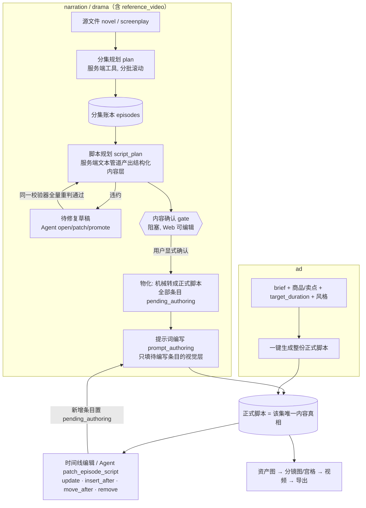
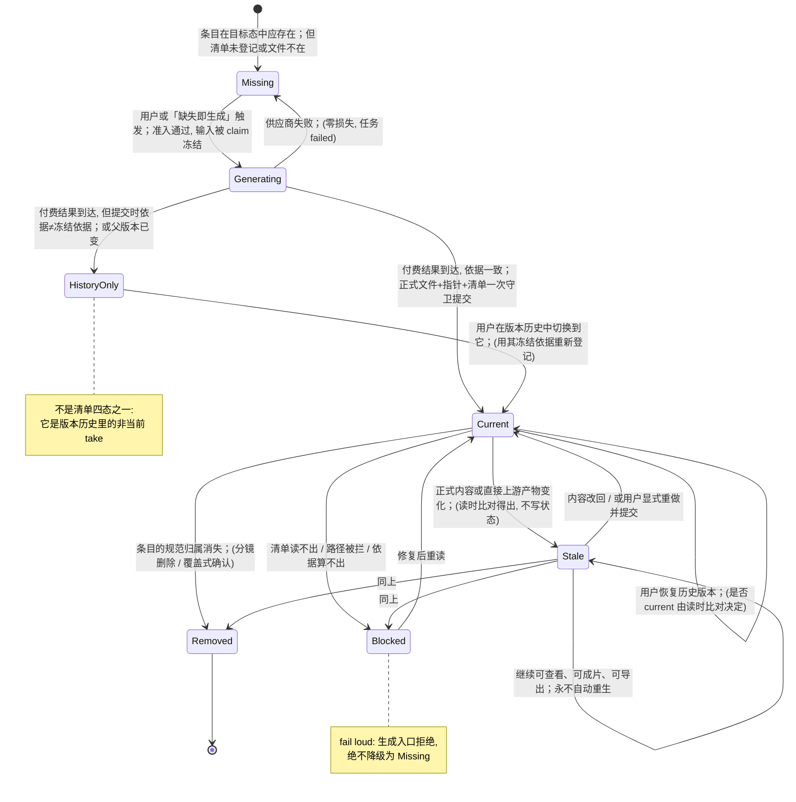

# 03 · 脚本、分集、分镜流水线与产物/版本模型

本文为基于 ArcReel 源码的研究笔记，遵循 docs/linglong-arcreel-parity-method.md：不含复制的代码、提示词或 schema。

- **范围**：ArcReel 从「源文件 / 创作构想」到「可生成的分镜或视频单元」的内容流水线（分集规划 → 脚本规划 → 内容确认 → 提示词编写），分镜/视频单元的数据形态（含宫格、尾帧），提示词渲染架构，以及贯穿全链路的产物清单（artifact manifest）、产物时效（currency）与版本历史。媒体生成队列、供应商适配、剪辑时间线与成片导出只在与本章交界处提及。
- **研究对象版本**：本地 `ArcReel/` 工作副本（2026-09 读取），schema 已到清单激活之后的版本（ADR 0062 文中写 `schema_version == 8` 为激活门，代码常量已继续演进，以 `lib/project/project_schema.py` 为准，具体数值（待确认））。
- **读过的源**：
  - 代码：`lib/script/`（`script_models.py`、`script_skeleton.py`、`script_review.py`、`script_document.py`、`script_generator.py`、`script_batch_edit.py`、`draft_quarantine.py`、`draft_violation.py`、`storyboard_sequence.py`、`storyboard_mentions.py`、`grid/*`、`reference_video/{text_parser,duration_slots,execution_checkpoint}.py`）；`lib/episode/`（`episode_ledger.py`、`episode_planner.py`、`episode_reset.py`、`episode_target_duration.py`）；`lib/workflow/`（`workflow_rules.py`、`workflow_state.py`、`workflow_plan.py`）；`lib/artifacts/`（`artifact_manifest.py`、`artifact_currency.py`、`artifact_input_claims.py`、`artifact_planner.py`、`artifact_provenance.py`、`visual_artifact_provenance.py`、`artifact_version_provenance.py`、`version_manager.py`、`video_artifact_commit.py`、`image_reference_snapshot.py`）；`lib/prompts/`（`prompt_builders*.py`、`prompt_utils.py`、`prompt_templates/engine.py` 及模版目录结构——只看结构不看措辞）；`server/draft_workflow.py`、`server/routers/{script_review,grids,end_frames,presentations,prompt_templates}.py`、`server/services/project/{script_review,end_frame}.py`、`server/services/grid/grid_split.py`、`server/services/tasks/generation_tasks.py`（选中逻辑片段）、`server/services/currency/artifact_version_restore.py`。
  - 前端（仅为理解行为）：`frontend/src/components/canvas/timeline/ScriptReviewGate.tsx`、`VersionTimeMachine.tsx`，以及同目录下 `EndFramePicker`、`GridPreviewPanel`、`ShotList` 等文件名。
  - ADR：0002、0023、0031、0032、0033、0034、0036、0040、0041、0045、0050、0055、0061、0062、0064、0070、0073、0077、0080、0086；`CONTEXT.md`「脚本与分镜」「产物与制作状态」两节。
  - 调研：`docs/research/arcreel-ad-section-timing-research.md`、`arcreel-prompt-best-practices-research.md`、`arcreel-asset-sheet-prompt-research.md`、`storyboard-to-video-industry-survey.md`。

---

## 0. 一页结论

1. **三根正交的项目轴决定一切形状**：`content_mode`（narration / drama / ad）、`generation_mode`（storyboard 分镜图生视频 / reference_video 参考生视频，创建即锁定）、`source_kind`（novel / screenplay，创建即锁定）。脚本条目数组的「骨架」由前两轴派生出四种：`segments / scenes / shots / video_units`，由一个零依赖的注册表统一分派（ADR 0045）。
2. **长文本走三段 LLM，广告走一段**：narration/drama 是「分集规划 → 脚本规划（内容层）→ 阻塞式内容确认 → 提示词编写（视觉层）」；ad 没有分集、没有脚本规划、没有内容确认 gate，一键按 brief + 商品 + 时长档位直接生成整份正式脚本，然后才进入逐条编辑。
3. **内容与视觉两层分离，并用工程手段而非 prompt 自觉保真**：视觉层 LLM 的输出 schema 只含对齐 ID + 视觉字段，后端按 ID 合并回已确认的内容层；台词、原文这类「可听见 / 可追溯」的字段根本不进视觉层 LLM 的输出。
4. **「确认即物化」**（ADR 0080）：内容确认那一刻把脚本规划机械转成正式脚本（所有条目标 `pending_authoring`），此后正式脚本是该集唯一内容真相，脚本规划只读。整集重做 = 重跑规划 + 覆盖式确认（danger 确认框列出将被移除的分镜与产物）。
5. **单一真相 + 读时派生** 是全仓的主旋律：分集账本是分集的真相（物理集文件是派生物）；视频单元的自由文本正文是真相（参考图、发声归属读时派生）；产物时效不落盘，读时比对「期望依据摘要」与「登记依据摘要」。
6. **产物四态** `current / stale / missing / blocked`；`stale` 仍可用、永不自动重生；生成配置（模型、分辨率、seed、渲染器措辞）不进依据，只有「改变成品内容」的东西进依据。
7. **所有付费结果都进版本历史**；视频只有在「提交时依据仍等于请求时冻结的依据、且父版本未变」时才自动成为 current，否则只进历史——没有静默覆盖，也没有因并发编辑而把旧内容的成片挂到新内容上。
8. 对 Linglong：脚本/分镜「内容层 vs 视觉层」分离、确认即物化、结构化与纯文本两种提示词形态 + 单一渲染出口、清单式时效四态、付费结果永不丢，这几条值得几乎原样（按自己的实现）复刻；分集账本、novel/screenplay 提取链路、宫格属于可跳过或简化项。

---

## 1. 脚本如何产出与组织

### 1.1 三根轴与四种骨架

- `content_mode` 在 `CONTEXT.md` 被定义为「内容如何组织」，与「视频怎么生成」无关；`generation_mode` 创建后没有任何写入面可以修改（PATCH 模型、Agent 白名单都不含该字段，ADR 0055），宫格被降为分镜路线内部的布尔开关 `grid_storyboard`。
- 骨架注册表（`lib/script/script_skeleton.py:68` 的 `SKELETONS`）以**骨架种类**为键，每行只声明两件结构事实：条目 ID 字段名、角色名单字段名（`video_units` 的角色字段明确为「无」，角色从正文引用里派生）。
- 两个解析器各答一个问题（ADR 0045）：
  - **规范解析** `resolve_declared_kind`（`script_skeleton.py:129`）：由项目两轴求「应该是什么骨架」，未知值 fail-loud，不做任何兜底。用于计分、计费、生成入队等「按声明办事」的消费方。
  - **取证解析** `resolve_script_kind`（`:150`）：看一份脚本 dict「现在长什么样」，用于编辑、归档、导出，因此与项目路线不符的历史脚本仍可查看与编辑。
  - **路线闸门** `ensure_route_skeleton`（`:254`）：生成入队前检查跨族失配（分镜族 vs 参考族），失配抛结构化错误并给「重拆」指引。
- ADR 0045 记录的动机很实际：此前约 45 处手写 `== "narration"` 二值分支，导致 ad 与 reference_video 项目的分镜级事件长期「静默为空」。新骨架出现时，由「遍历注册表键的穷尽性测试」让未处理的消费方逐个失败。

### 1.2 各骨架的条目内容（按字段语义归纳，非 schema 复述）

所有条目共享一组「非生成字段」：`transition_to_next`（cut / fade / dissolve）、`note`（用户备注，不参与生成）、`generated_assets`（产物路径绑定、宫格来源、状态）、`needs_replan`（需人工重规划）、`pending_authoring`（待编写标记）。这些字段在模型里被标为「不进 LLM 输出 schema」（`script_models.py` 广泛使用 SkipJsonSchema），LLM 永远写不到它们。

| 骨架 | 用于 | 内容层（可听 / 可追溯） | 视觉层 | 特有字段 |
| --- | --- | --- | --- | --- |
| `segments` | narration + storyboard | `novel_text`（逐字原文，同时是配音稿） | `image_prompt`、`video_prompt` | `segment_break`（场景切换点）、出场角色/场景/道具名单 |
| `scenes` | drama + storyboard | `utterances[]`（有序台词/画外音）、`source_text`（原文追溯锚，不朗读） | `image_prompt`、`video_prompt`（drama 变体不含 dialogue） | `scene_description`（视觉改编描述，隐藏字段，仅作提示词编写输入）、`segment_break` |
| `shots` | ad + storyboard | `voiceover_text`（一等口播文案，字幕/TTS 唯一来源） | `image_prompt`、`video_prompt` | `section`（带货段落标签）、`products_in_shot`（非空即商品镜头） |
| `video_units` | 任意 content_mode + reference_video | `text` 正文内的发声记号 | 同一段 `text` 正文 | `duration_seconds` 1–300 秒编排时长、`source_text` |

- 分镜类条目 `duration_seconds` 为 1–60 秒；生成期 schema 由 `build_episode_script_model` 按供应商 `supported_durations` 动态收成枚举（`script_models.py:1038`），所以 LLM 只能选模型支持的档位。
- 视频单元的时长是**编排时长**（创作意图），执行前由 `lib/script/reference_video/duration_slots.py` 按「容量语义」投影到供应商档位：取能装下基准的最小档位，超过最大档则按最大档，并把偏移（exact / up / down / unconstrained）作为 warning 呈现（ADR 0086 进一步要求报价、预检、执行共用同一次求值）。
- 结构化视觉字段的受控词表：景别 `shot_type`（9 值）与运镜 `camera_motion`（16 值）在 `script_models.py` 顶部以 Literal 定义，注释说明取值对齐主流供应商官方运镜词表、原文插值进视频提示词不再翻译。

### 1.3 narration / drama / ad 的结构差异

- **narration**：内容就是原文切片。`novel_text` 要求逐字保留（它就是后期配音稿），没有 utterances。分集账本条目是「薄」的：精确切分点 + 集尾钩子。
- **drama**：口播统一为一条**场景级有序判别式列表** `utterances`（ADR 0040）：每条要么 `dialogue`（必带 speaker），要么 `voiceover`（speaker 必为空），插入顺序即时序。它是三处下游的共同地基：字幕 spans 从它派生、说话量对时长的约束按它估算、脚本规划以它为结构化目标。
  - 说话量 → 时长是**单向约束**：保存期估算口播时长超过 duration 只 warn 不阻塞；生成期引导模型选「不低于口播估算」的档位；永远不机械改写已选时长（画面驱动、留白合法）。语速有单一真相源（项目覆盖 > 语言默认 > 全局默认，`lib/speech/speech_rate.py`）。
  - `dialogue` 进视频请求（供应商生成口型音轨），`voiceover` 不进视频提示词，留给字幕与 TTS。
  - `source_kind=screenplay` 时是「提取优先」：只对**可听见的内容**（台词文字、画外音文字）要求逐字保真，排版、舞台提示、泛指群演由 LLM 裁量（ADR 0036）。泛指 speaker（如「老人甲」）照填原称呼但不注册为角色资产。
- **ad**（ADR 0033）：恒单集（`episodes` 恒为一条），前端隐藏集语义；storyboard 路线用平铺 `shots[]`，reference 路线用自包含 `video_units[]`；**ad 不开放宫格**（宫格单格分辨率与商品高保真冲突）。
  - `section` 是 8 值「引导性」标签（hook / pain_point / product_reveal / selling_point / demo / trust / price_promo / cta），代码里不硬枚举，只作为 prompt 层的结构约束。
  - 整片时长 `target_duration` 由生成器就近映射到 15/30/60/90 四个审定档位（`prompt_builders_ad.py:36` 的 `AD_DURATION_TIERS`，等距时偏向 30 秒默认档），各档的段落配比写在共享模版片段 `shared/ad_pacing/tier/*` 里。
  - 总时长漂移超过 20% 只 warn（`AD_TARGET_DURATION_DRIFT_THRESHOLD`），不阻塞保存。
  - `products` 为空时自动分流到「通用短片」，不套带货框架。
  - reference 路线下八段式只作为内容规划的思路，不持久化为字段（`prompt_builders_ad.py` 模块说明）。

**段落时长调研的要点**（`arcreel-ad-section-timing-research.md`，只做概括）：hook 与 CTA 是「绝对时长段」，不随总时长等比放大；加长的秒数几乎全部给中段（卖点/演示），其次是信任背书；段落顺序不随时长改变，短档是「砍段」不是「乱序」；即使 hook 不是产品画面，产品也应尽早入画；单段过长要拆镜头，平均每镜 3–5 秒。调研诚实地标注了哪些秒数有直接出处、哪些是内插推断（尤其是逐段精确到秒的值和中文字数/秒换算）。这张表是 prompt 可执行性的归一化产物，不是行业标准。

### 1.4 分阶段流水线：脚本规划 → 内容确认 → 提示词编写

`lib/workflow/workflow_rules.py` 用一张数据驱动表描述每个 `(content_mode, generation_mode)` 组合的步骤序列（共 13 个候选步，`:30`）与「预处理器」（`:78`）：

- narration+storyboard → `split-narration-segments`；drama+storyboard → `normalize-drama-script`；任意+reference_video → `split-reference-video-units`；**ad 两条路线预处理器都为空**。
- ad 的适用步骤只有：项目输入 → 商品卖点 → 正式脚本 → 资产图 → 结构检查 → 旁白交付 → 视频 → 导出（`:62`）。其中「商品卖点」是 ad 独有步：任一商品缺 `selling_points` 即停在 `SELLING_POINTS` 并建议 Agent 起草（`workflow_state.py` 约 1410 行）。

要点：

1. **脚本规划只在服务端生成**（ADR 0041）：subagent 只负责编排调用，不在自己上下文里写内容。模型档位按项目配置解析。
2. **违约不重抽，走草稿修复**（`lib/script/draft_quarantine.py` 模块说明）：生成一次要付费，违约丢弃重抽既烧钱又不收敛。正式文件保持不动，违约产物连同逐条违约报告落为「待修复草稿」；Agent 用 `open_draft` 读、`patch_draft` 改、晋升工具用**同一个校验器**全量重判，通过才写正式文件。草稿只装「模型输出层的形状」，机器派生字段一律不进草稿。同一草稿位也作「编辑工位」：已定稿的脚本规划不能被 Agent 文件工具直改，必须取回草稿、改完走同一晋升通道（`server/draft_workflow.py:1068` 的 `DraftWorkflow`）。草稿在场期间，内容确认与生成入口一律拒绝。
3. **内容确认的真值只存一个指纹**（`lib/script/script_review.py:1-20` 说明、`:595` `review_status`）：确认时在 `episodes[i]` 上记录「确认时的内容指纹 + 时间」；`pending_review / confirmed` 读时比对 live 内容指纹派生。任何写入路径（重跑规划、Agent 晋升、Web 手改）只要改了内容，指纹自然漂移、自动回到待确认，无需各路径上报。存量项目没有指纹时，用「是否已有正式脚本」做 grandfather 放行，首次确认后自愈。
4. **确认即物化 + 覆盖保护**（ADR 0080；`server/routers/script_review.py:122`）：该集已有正式脚本时，确认请求必须携带「覆盖清单版本号」，否则 409 并返回将被移除的分镜与产物摘要；前端 `ScriptReviewGate` 在这种情况下把确认按钮换成 danger 样式并先列后果。
5. **提示词编写只补视觉层**（`script_generator.py:324` `generate`）：输入是正式脚本自身；默认只处理待编写条目；`entry_ids` 表示「显式重写这几条」（会覆盖手改）；没有待编写条目时不调模型、不写盘；写盘带乐观并发基线（编写开始前取正式脚本指纹，期间有人保存则冲突拒绝）。
6. **视觉层合并是工程保真**：narration/drama 的视觉 LLM 输出只含 `segment_id` / `scene_id` + `image_prompt` / `video_prompt`，后端按 ID（不是按列表顺序）合并，校验 ID 唯一且全覆盖；reference_video 的视觉层输出是与规划等长同序的正文列表，对齐靠「条数一致 + 逐位配对」，台词记号用逐字 diff 拦改写。
7. **内容确认后的修改在正式脚本上做**：时间线开放 `utterances` / `novel_text` / 单元正文的编辑，`source_text` 只读展示；Agent 可改 `source_text`，但服务端校验它必须是源文的逐字子串。

### 1.5 脚本写盘的守卫

- 结构校验前移到唯一写盘咽喉，采用「**不更坏**」语义（ADR 0002）：只有「改前合法 ∧ 改后非法」才拒绝，历史遗留的非法脚本照常可编辑；只写运行时字段的资产回写热路径跳过校验。
- 所有脚本模型 `extra="forbid"`：Agent 能在 dict 上补写字段，若 Pydantic 静默忽略未知字段，垃圾字段会长存且「不更坏」对比永远抓不到（`script_models.py` 顶部注释给出了这个推理）。
- 结构编辑事务（`lib/script/script_batch_edit.py`）：一个有序命令列表（update / insert_after / move_after / remove）先作用于内存候选、整体校验，再在集锁内比对乐观并发 revision，最后把脚本、项目索引与对应的清单条目作为一个可恢复操作提交。
- 分镜 `image_prompt.scene` 中的 `@[名称]` 只用于「指认本条引用字段里已声明的资产」，渲染时替换为参考图编号「图N」；指认了未声明的名字只产生 warning（`storyboard_mentions.py`）。

---

## 2. 分集账本：分集的单一真相源

### 2.1 它持有什么

`project.json` 的 `episodes[]`（`lib/episode/episode_ledger.py` 模块说明、ADR 0031/0032）：

- 每集：`episode`、`title`、`script_file`（绑定的正式脚本文件）、`source_range`（源文件相对路径 + 归一化坐标系内的起止偏移；narration 是精确切分点，drama 是软素材范围）、`hook`（集尾钩子）、drama 独有的 `outline`（故事节点 + 下集预告语）、`ledger_status`（planned / consumed / stale）、内容确认记录 `script_plan_review`。
- 顶层：`planning_cursor`（下一批规划起点）、`source_fingerprints`（按源文件记录归一化文本的 SHA-256，用于检测规划中途源文件被替换）。
- 物理 `source/episode_N.txt` 降级为**派生物**，由规划/重置工具在同一把项目锁内随账本重写，并清理账本之外的残留，不一致窗口为零。例外：用户手动上传已拆好的集文件而没有原文时，它们本身就是源文，账本按文件补建无 `source_range` 的条目（`register_orphan_episode_entries`，`episode_ledger.py:387`）。

### 2.2 如何更新

- **规划**（ADR 0032，`lib/episode/episode_planner.py`）：服务端 MCP 工具读一个源文窗口（默认约 3 万字、每批最多 20 集、最多 3 次尝试，`episode_planner.py:66-70`），调用项目配置的文本模型一次规划出窗口内所有「剧情弧完整」的集；cursor 只推进到最后一个高置信切分点，尾巴留给下一批。Pydantic schema 强约束，锚点存在性与范围连续性做机械校验，失败自动重试并把上一轮失败原因附给模型。主 Agent 只调一次工具收摘要。
- **审阅是批级的**：规划完成展示账本摘要供用户确认；调整意见走「部分重置到最早受影响的集 + 带意见重新规划」，重置前的集不受影响。
- **重置**（`episode_reset.py`）：波及已消费集需显式确认（`ResetConfirmationRequired`）；新规划与已消费范围重叠时，按磁盘下游产物探测自动标 `stale`——**标记而非删除**，重做沿版本机制替换，旧版可回滚。
- `ledger_status` 只是「咨询性」的：能否重造派生文件、能否续接规划，看的是 `source_range` 是否完整、源文件是否存在、范围是否在界内、指纹是否一致，而不是这个字段。「是否已有下游」以磁盘证据为准（`has_downstream_products`，`:371`）。
- 注意 `CONTEXT.md` 特意区分：账本的 `stale` 描述「规划与产物错位」，与产物时效的 `stale` 不是一回事。

### 2.3 为什么

- 旧流程以「文件存在」为真相、用滚动覆盖的剩余文件做进度指针：没有「第 N 集对应原文哪一段」的记录，选错文件无从对账，进度文件损坏即不可恢复。
- 不用独立账本文件或 DB 表：分集概念会裂成两处；ArcReel 的分层是「项目级数据一贯在文件系统」，便于导出/迁移/备份。
- 账本的 `hook` 与下集预告进入脚本生成输入，并作为集级元数据落入脚本（钩子设计落到成片末场）。

### 2.4 与 Linglong 的关系

分集账本几乎完全服务于「长篇源文 → 多集」的**小说改编**，属于 Linglong 范围外（Scope lock：novel ingestion、chapter extraction、novel-to-episode adaptation 均排除）。可借鉴的只有两条抽象：「位置真相必须显式记录、物理派生文件同锁重写」与「重规划只标 stale 不删产物」。Linglong 的原创短剧如果需要多集，可以只保留极薄的「集 = 标题 + 大纲 + 钩子」条目，不需要 `source_range` / 游标 / 指纹这一整套。

---

## 3. 分镜与镜头规划

### 3.1 一个分镜条目携带什么（对照 P-06 字段）

| P-06 要求 | ArcReel 分镜路线（segments / scenes / shots） | ArcReel 参考路线（video_units） |
| --- | --- | --- |
| frame intent | `image_prompt`：结构化形态 = 静态画面描述 `scene` + 构图（景别、光线、氛围）；或纯文本形态 | 正文里的画面描述行 |
| camera | `video_prompt.camera_motion`（受控词表）+ 构图 `shot_type` | 正文自由描述 |
| action | `video_prompt.action`（该时长内的动作）+ `ambiance_audio`（画内音） | 正文 |
| dialogue / copy | narration `novel_text`；drama `utterances`；ad `voiceover_text` | 正文内 `@[角色]{台词}` / `{画外音}` 记号 |
| transition | `transition_to_next` | 同 |
| timing | `duration_seconds`（供应商档位枚举） | 编排时长 1–300 秒，执行前投影到档位 |
| bound assets | `characters_in_*` / `scenes` / `props` / `products_in_shot` 名单 | 正文 `@[名称]` 首次提及顺序 |
| 附加 | `segment_break`、`end_frame_image`、`note`、`generated_assets` | `note`、`generated_assets`、`needs_replan` |

分镜的「资产绑定」是**按名字引用**（资产名即身份，改名走原子级联事务，ADR 0057）。生成入口要求被引用资产已登记且有资产图，否则整批阻断；编辑与保存只 warn（ADR 0073）——「别逼作者写作前补资产表」只约束写作，不约束花钱。

### 3.2 分镜图的顺序依赖与连续性

- `segment_break=true` 表示场景切换点。`group_scenes_by_segment_break`（`storyboard_sequence.py:189`）把连续条目按切换点分组；`build_storyboard_dependency_plan`（`:211`）让同组内每张分镜图依赖前一张（上一张分镜图作为连续性参考），切换点处重新起组。ad 的 `shots` 没有 `segment_break` 字段。
- 视频输入解析（`resolve_storyboard_video_inputs`，`:117`）只承认 `generated_assets` 里记录的绑定路径，不按同名文件猜；尾帧若存在必须位于规范路径，路径被篡改（软链等）即拒绝。

### 3.3 宫格（grid）

- **定位**：分镜路线内部的装配选项，不是第三条路线（ADR 0055）。判据是「喂给视频模型的输入契约」：宫格切出来仍是单张图走 i2v。`storyboard-to-video-industry-survey.md` 支撑了这个判断：调研的主流模型没有一家公开 API 原生接受「整张多格分镜板」一次出多镜头；业界可区分的只有 r2v 与首尾帧两种输入范式，各家名为 storyboard 的功能都是编排层（逐镜头调用再拼接）。
- **机制**（`lib/script/grid/models.py`、`server/routers/grids.py`）：按 `segment_break` 分组，每组合成一张 N 格联合图；超出单图格数上限切成多张，末张落到更小档并以占位格补齐；4×4 / 5×5 只在 4K 图像分辨率档放行（`grid/layout.py`）。`build_frame_chain`（`models.py:67`）为每格标注角色：首格、过渡格（记录前后分镜 ID）、占位格。切分时每个非占位格落为其「下一分镜」的起始分镜图（`server/services/grid/grid_split.py`）。
- **准入是整批的**：组内任一分镜引用有缺口或提示词待编写，整批拒绝并一次报全（`grids.py:96` 附近），避免健康分组先计费。
- **切分是唯一覆写分镜格的操作**，不设确认；覆写前旧文件补登版本、覆写后登记新版本，切坏可逐格回滚（`grids.py:375`）。已不在脚本内的分镜 ID 跳过并返回。
- 宫格图不适用「图片编辑」（它是中间产物，编辑需重切回填，ADR 0050）。

### 3.4 尾帧（end frame）

- `end_frame_image` 是**用户意图的持久属性**，不是生成产出，因此不进 `generated_assets`（`CONTEXT.md`；`server/services/project/end_frame.py`）。
- 两条设置通道（上传任意图 / 选项目内已有图，例如下一分镜的分镜图）归一为 PNG 后**快照复制**到固定路径，条目只存该路径——源图之后重生成、回滚、删除都动不到已定尾帧，结构上无悬空引用。通用脚本 PATCH 白名单刻意不含该字段，只能经尾帧专用端点写入（`server/routers/end_frames.py` 说明）。
- 在 i2v 请求中作为 end image；视频产物依据收录尾帧文件的摘要（`visual_artifact_provenance.py:313`），换尾帧会让已生成视频判 stale。ADR 0055 把首尾帧归为 i2v 内的关键帧子模式，是否升格独立建模未定。

### 3.5 「视频单元正文是唯一真相」（ADR 0064）

- 参考路线一个视频单元 = 一次视频生成调用 = 最小计费与成片归属单位。落盘只有**一段自由文本正文 + 编排时长**（外加转场、备注、产物、`needs_replan`、`source_text`、待编写标记）。
- 正文中的书写层记号：`@[名称]` 引用资产，`@[角色]{台词}` 该角色发声，裸 `{台词}` 画外音；`@[角色/衍生]` 引用角色衍生外观。参考图集合、发声条目、说话人绑定**全部读时从正文机械派生**（`lib/script/reference_video/text_parser.py`），不落盘、不经 REST 读写、不进 LLM 输出；预览端点按同一份正文现算。
- 理由：派生物一旦落盘就会与正文分叉，每条写路径（编辑器、批量编辑、Agent、迁移、归档导入）都得记得重派生，漏一处就用陈旧参考图渲染。移到读时，这个窗口在结构上不存在。
- 解析规则单一，不按资产类型分叉：首次提及顺序即参考图顺序（即提示词里「图N」编号）；同名多表登记按 product → character → scene → prop 归属；只出现在说话人位的角色只绑音色、不产生参考图。
- 前后端解析函数互为镜像，入口统一去 BOM、归一到 NFC，否则同一正文在编辑器与执行期会派生出不同参考图（`text_parser.py` 注释）。
- 旧的 `shots[]` 切分与可手工编辑的 `references[]` 列表被迁移删除：迁移把各镜头文本按顺序拼回正文、逐字保留「镜头N：」前缀（那是作者写的字）。改正文里的 `@` 引用才是改参考图的唯一方式。
- 视频依据只收正文的「画面行」，发声记号被剔除——改台词不让已生成视频过期（`visual_artifact_provenance.py:360`）。

### 3.6 商品保真（与分镜交界）

ADR 0034：商品的用户原图永远是验收锚点，标准化商品资产图可选。分镜路线下商品参考**二元注入**：`products_in_shot` 非空即商品镜头，商品参考全量注入、排序最前、附高保真要求；氛围镜头零商品图（「给图又求别太像」机制上自相矛盾）。商品一致性只在分镜图阶段烘焙，视频请求不再重复追加。参考路线下商品与其他资产同规则按提及顺序注入，不排最前。

---

## 4. 提示词构建架构

### 4.1 两种提示词形态（ADR 0070）

- 分镜的 `image_prompt` / `video_prompt` 可以是**结构化对象**或**纯文本**，两者都是正式内容。纯文本不是预览缓存，也不承诺两种形态可无损互换；不做「纯文本解析回结构化」。
- 结构化形态是 LLM 唯一允许输出的形状；纯文本形态被排除在 LLM 输出 schema 之外，是创作者在时间线上显式切换的编写方式（`script_models.py` 中 `PromptText` 的注释）。另有一个「待编写」空态，只由物化路径写入。
- 形态本身也是内容：两种形态之间切换会让对应产物 stale。

### 4.2 单一渲染出口

- 每种媒体一个出口：分镜图 `render_storyboard_image_prompt`（`lib/prompts/prompt_builders.py:70`），分镜生视频 `render_storyboard_video_prompt`（`lib/prompts/prompt_utils.py:215`）。执行路径、入队校验、批量准入、执行敏感摘要与预览接口共用它们，所以「预览所见即执行所得」在结构上成立。
- 出口负责注入系统派生内容：项目画风块、参考图类型声明（实际随请求发出的参考图序列决定「图N」编号，商品保真要求并入声明）、反向约束行、drama 的发声声明（台词与声音风格由 utterances 决定，按同一门控追加）。
- 对纯文本形态重复渲染必须幂等：已注入的块按行判重，不会叠出第二份（模版 frontmatter 显式开启「idempotent」，只给存在纯文本回贴形态的两份模版）。
- 结构化与纯文本共享同一个「投影函数」（`project_storyboard_image_prompt`，`prompt_utils.py:113`），它同时供渲染与时效依据使用；入队校验与渲染投影对「有效 scene」共用同一判据（`require_storyboard_scene`），提交时被接受的提示词一定能被渲染。

### 4.3 整段模版 + 命名变体片段（ADR 0077）

- 全仓 ~60 处提示词定义点收敛为：**一个生成环节 = 一份模版文件**，正文就是那次调用的完整提示词，只留数据槽位（`lib/prompts/prompt_templates/templates/`，分 text / asset / storyboard / reference_video / style 五类，另有 `partials/`）。
- 轴差异（源文件类型、资产类型、广告时长档位、内容类型的单行差异）用**命名变体片段**解析，模版内禁止比较轴值；条件只允许做「槽位有无」的真值判断（如集尾钩子、目标时长、附加指令、下集大纲）。允许的轴在引擎里是闭集（`engine.py` 的 `TemplateAxis`），模版所属制作步骤也是闭集。
- 引擎是沙箱化 Jinja + StrictUndefined：缺键 fail-loud；片段名必须是字面量（加载期可静态扫描）；循环只出现在列表片段；变体族按 `applies_to` 加载期校验齐全——「有意为空」要放空文件，不能靠文件缺失。
- 模版目录作为构造依赖注入（`builtin.py` 指向随包目录），测试可指向夹具目录；模版随核心库打包，不放进 Agent 运行 profile。
- 设置页只读地列出全部模版、源文与片段（`server/routers/prompt_templates.py` 只有 GET），目标是「把黑盒提示词变为用户可见」，并为将来用户改模版铺路。
- builder 函数（`prompt_builders_*.py`）退化为「槽位值生产者」：档位取整、时长约束、语速、商品信息块、候选名单等；取值差异留在代码，措辞差异进片段。
- 项目风格存的是模版展开后的**快照**（ADR 0023），模版升级不回写老项目，避免已出片项目风格突变；风格模版与风格参考图互斥。

### 4.4 与时效的交界

- 提示词模版与渲染器派生包装**不进产物依据**：模版措辞升级不会把既有产物判旧。
- 依据收的是「正式提示词内容 + 形态」；若需判断两次供应商请求是否完全相同（例如同档免费复用已生成视频），使用另一套「执行敏感摘要」，收实发文本与请求配置（`lib/artifacts/video_visual_provenance.py`），与清单依据互不共用。

### 4.5 调研要点（概括）

- `arcreel-prompt-best-practices-research.md`：跨供应商共识是「主体→环境→光线→镜头语言→风格」分层、具体可视化优于质量词堆砌、叙述句优于关键词；i2v 共识最强的一条是「首帧已给定画面时，提示词应描述运动与运镜，不复述静态画面」——这正是 ArcReel 把 `image_prompt`（静态）与 `video_prompt.action`（动态）拆开的依据。否定式处理在供应商间三分天下，无法一刀切；各家对「中文还是英文写提示词」均无官方口径。
- `arcreel-asset-sheet-prompt-research.md`：证据支持「参考图去背景」和「多角度应是多张独立图而非一张多格拼图」，多格拼图做 i2i 参考会让版式被下游继承；景别、视角、姿态、宽高比找不到一手证据，只能 A/B 实测；资产图比例会成为下游未指定比例调用的默认输出比例（ADR 0066 的「资产图布局按消费方决定」与此相关）。

---

## 5. 产物生命周期与版本模型

### 5.1 概念分层

| 概念 | 存在哪里 | 回答什么 |
| --- | --- | --- |
| 产物（artifact） | 项目目录中的正式文件 | 用户付过费拥有的东西 |
| 产物清单（manifest） | 项目内 sidecar JSON（`lib/artifacts/artifact_manifest.py`） | 每件产物的身份（`ArtifactKey`）、路径、**依据摘要**；不存状态 |
| 产物时效（currency） | 不落盘，读时计算 | current / stale / missing / blocked |
| 版本历史（versions） | `versions/versions.json` + 快照目录（`version_manager.py`） | 每个资源的全部付费结果、当前指针、每版的 prompt、来源、冻结事实 |
| 输入认领（input claim） | 任务内存/载荷 | 「这次生成到底用了哪份输入」 |
| 任务状态 / 批量准入 / 逐项结果 | 队列与回执 | 另外三条独立状态轴（ADR 0062 明令不合并） |

产物种类闭集（`ArtifactKind`，`artifact_manifest.py:63`）：资产图、集脚本规划、集正式脚本、宫格图、分镜图、视频、音频、字幕、演示物（presentation，即某个视频单元在「后期配音 / 使用 TTS」两种交付形态下的可预览、可下载打包，`server/routers/presentations.py`）。每个脚本条目最多拥有 7 个产物身份。

### 5.2 依据（basis）里收什么

依据 = 对「该产物直接消费的正式内容 + 直接上游产物」做 canonical JSON + sha256。划线标准是「**这一位是否改变用户拿到的成品内容**」，而不是「它填在配置页还是脚本里」（ADR 0062）：

- 分镜图：投影后的提示词（含形态）、画风、画面比例、实际按序发送的参考图（逻辑身份 + 角色 + 内容摘要，不含文件路径）（`visual_artifact_provenance.py:156`）。
- 分镜视频：视觉提示词（action + camera_motion 或纯文本）、比例、分镜图文件摘要、尾帧文件摘要；声音设计、台词、时长、执行选项**不进**（`:313`）。
- 参考视频：`unit_id`、正文的画面行、画风、比例、实际请求的参考资产（`:360`）。
- 广告正式脚本：brief、商品、目标时长、画风、资产名单、比例、语言等业务输入（`artifact_provenance.py:307`）。
- 旁白音频：正文 **加上** 供应商/模型/音色/语速——因为它们决定用户听到谁在念、念多快，属于成品内容。
- 明确不进：供应商与凭证、模型、像素分辨率、seed、音轨开关、渲染器版本、模版措辞。换模型不应该让整屋子画面集体判旧、暗示重复付费。

**传播是一跳的**（由依据收录「直接上游产物文件摘要」这一构造推出）：改了资产图描述 → 资产图 stale；分镜图依据收的是资产图**文件内容摘要**，所以在资产图被真正重生成之前，分镜图仍是 current；资产图重生成后分镜图变 stale；分镜图重生成后视频变 stale。stale 不会凭空级联，也不会触发自动重生。（此为依据构造的推论，ADR 只写「直接上游」，级联细节（待确认））

### 5.3 时效如何计算

- `TargetStatePlanner`（`artifact_planner.py:147`）只读地把 `project.json`、各集脚本、资产定义、宫格记录投影为完整的「期望目标态」；`ArtifactCurrencyResolver`（`artifact_currency.py:120`）对单个 key 先做准入（清单有无、路径是否安全），再比对期望依据与登记依据：一致 current、不一致 stale、未登记或文件不在 missing、清单读不出或依据算不出 blocked。
- 广度视图（项目列表）用另一个 `RegisteredArtifactResolver`（`:88`）：只看「已登记且文件在场」，不哈希、不投影，只会返回 current/missing/blocked。`CONTEXT.md` 称之为 `registered` 口径，对应详情页的 `verified` 口径。
- 不变式：登记路径与比对路径必须共用同一个 basis 构造器，否则整类产物会无故 stale（ADR 0062 Consequences）。

### 5.4 可用性与生成语义

- `usable = current ∪ stale`：stale 可查看、参与成片与导出、不阻断任何步骤。
- 不指定 ID 的生成只补 missing（「缺失即生成」）；重做 stale 必须用户显式选择。
- `blocked` 一律 fail-loud，绝不降级为 missing——否则一次读取故障会变成一次自动付费。
- 批量视频准入是整批的（ADR 0061）：任一目标有问题，整批零任务；放行后入队中途失败不撤销已建任务（它们已计费），没轮到的目标逐 ID 报 failed，下次「缺失即生成」正好补这些。三种结局（放行 / 待确认 / 受阻）都用 200 同一信封返回。跨档费用需确认，按档位聚合展示，报价不全的档位不显示合计。

### 5.5 输入认领与提交守卫

- 入队时把选中的输入产物冻结为 claim：key、路径、依据摘要、内容摘要（`artifact_input_claims.py:39`）。参考图在任务内快照成不可变字节，供应商与依据读同一批字节（`image_reference_snapshot.py`）。
- 调用付费供应商前，在项目元数据锁内重新校验 claim：依据变了（stale）或已不登记即拒绝（`:232` / `:268`）。
- 视频提交（`video_artifact_commit.py:30` `commit_paid_video_artifact`）：付费结果**无论如何先进版本历史**；只有当「提交时按当前内容重算的依据 == 请求时冻结的依据」且「父版本未被别人换掉」时，才在同一把锁内把正式文件、版本指针、清单登记作为一次守卫转移切为 current；否则只进历史。事实缺失或格式不对时同样只进历史，不从旧路径或 prompt 反推。
- 失败零损失：供应商失败时 current 文件与版本文件都不被触碰。

### 5.6 版本 / take 模型

`VersionManager`（`lib/artifacts/version_manager.py:127`）管理分镜图、视频、资产图、宫格图、音频等资源的历史：

- 每个资源有 `current_version` 与有序 `versions[]`；每版记录快照文件、生成它的 prompt、创建时间、来源（生成 / `image_edit` / `manual_upload`）、冻结的依据与媒体事实，以及「追加时的上一个 current」坐标。
- `commit_staged_paid_version`（`:729`）：已付费结果先持久化进历史，再在版本锁内按选择守卫决定是否成为 current；选择失败则恢复旧选择、把付费结果保留为非 current 历史版本。
- `reject_current_version`（`:894`）：把被拒的付费结果留在历史，恢复到它**追加时记录的上一个 current**（不是数字上相邻的版本——用户可能先回滚到旧版再重生成）。
- `restore_version`（`:1217`）：把指定历史版本复制回正式路径并移动指针；恢复时用该版本当时冻结的依据重新登记清单条目（`server/services/currency/artifact_version_restore.py`），于是恢复一张旧图后，它是否 current 由读时比对如实回答；没有可用依据的版本恢复后清单条目被移除（因此报 missing，行为细节（待确认））。
- 前端 `VersionTimeMachine.tsx`：按版本列出预览、时间、来源（图片编辑有标记）、prompt；非当前版本可「切换到此版本」，有只读模式（只预览/下载不暴露恢复）。
- 图片编辑（ADR 0050）是**图的分叉**：以当前图为唯一参考、编辑指令为唯一 prompt，新版本覆盖 current，旧图进历史；原 `image_prompt` 不回写，之后按原 prompt 重新生成会丢失编辑效果，只能从版本历史找回。
- 图片（资产图、分镜图）新生成默认成为 current、旧版进历史；视频按 5.5 的守卫选择（待确认：各图片入口是否也全部有依据守卫，代码显示部分入口 `select_current=False` 只归档）。
- 覆盖式内容确认移除旧分镜时，其产物按「分镜移除」口径处置：回收站落地前随分镜移除、不再显示（ADR 0080）。清单条目只在产物的规范归属消失或移动时删除，**依据变化只让条目 stale，不构成无主**；条目不设上限、不裁剪。

### 5.7 产物生命周期状态图（本文自绘）

### 5.8 激活、迁移与锁

- 清单对项目生效与否只看项目 schema 是否为当前版本；升级时「补录」一次性按迁移时刻投影登记既有产物，**补录一律 current**（升级本身不改变内容，凭空判旧会逼用户重付费），不引入「来历不明」第三态。迁移失败留下持久「迁移失败判定」：项目可打开、可看，所有生成入口拒绝，原因原样可见，并有无需手改 JSON 的重试入口。
- 清单锁是项目级、跨进程、全量替换（临时文件 + fsync + 原子 rename），超时报错不无限等；更粗的项目元数据锁包含清单锁，层级固定不反向嵌套。
- 已知成本被接受：百集 × 数十分镜的项目清单可达万级条目、数 MB，每次全量读写；出路是分片而不是裁剪条目。

---

## 6. 人工确认与审阅点

按流水线顺序（`workflow_state.py` 的 11 值制作状态与 `WorkflowActionType` 闭集，`:54` / `:103`）：

| 位置 | 性质 | 行为 |
| --- | --- | --- |
| 分集规划批级审阅 | 软确认（Agent 工作流内） | 展示账本摘要；调整走部分重置 + 重规划 |
| 重置波及已消费集 | 显式确认 | 未确认返回 `ResetConfirmationRequired`；下游产物只标 stale |
| 待修复草稿 | 硬阻断 | 草稿在场时内容确认与生成入口全部拒绝；只能经同一校验器晋升 |
| **内容确认（review gate）** | **硬阻断** | 结构化中间态在 Web 可见可编辑（drama：台词/画外音与原文；narration：原文）；显式确认才物化与放行提示词编写；已有正式脚本时 danger 覆盖确认 + 覆盖清单版本号 |
| 确认前视频模型能力 | 硬阻断 | 确认转出要按视频模型能力定时长档位，模型不可解析时前端提前拦下 |
| 商品卖点（ad） | 步骤阻断 | 缺卖点即停在该步 |
| 资产图就绪 | 生成入口阻断 | 被引用资产未登记或无资产图即阻断（商品原图例外） |
| 批量视频准入 | 整批阻断 / 待确认 | 跨档费用、TTS 状态、在途任务冲突等；`requires_confirmation` 的动作需用户同意 |
| 旁白交付方式 | 显式声明 | 批量入口必须声明「用当前 TTS」或「后期配音」，缺省即拒 |
| 版本选择 | 用户动作 | 历史切换、拒绝当前版本；stale 重做需显式选择 |

`WorkflowNextAction` 带 `requires_confirmation` 位，Web 与 Agent 消费同一份服务端权威的「制作状态 / 制作计划」（`workflow_plan.py`），Agent 不自行按文件推断下一步。

---

## 7. 映射到 Linglong parity ledger

| ID | ArcReel 对应机制 | 可对齐的行为 | 备注 / 范围 |
| --- | --- | --- | --- |
| **P-03** | 数据驱动步骤表（`workflow_rules.py`）+ 服务端权威制作状态/计划 | 每个 (类型, 路线) 组合的步骤序列、刷新不丢状态、下一步动作闭集 | 步骤状态与产物时效、任务状态分轴 |
| **P-04** | 脚本规划 → 内容确认 → 物化 → 正式脚本上的结构编辑（update / insert / move / remove，乐观并发） | 场景在媒体生产前可检查、重排、修正；确认后正式脚本是唯一真相 | ArcReel 的 ad **没有** 内容确认 gate；Linglong 的商业广告若要求「先审场景计划再出图」，需要自己补一个轻量 gate |
| **P-05** | 资产按名引用、资产图为产物、生成入口要求资产图、商品原图锚点 | 批准的视觉状态绑定到多个分镜；来源可见 | 详见资产章 |
| **P-06** | 分镜条目字段（见 3.1）、`segment_break`、尾帧、转场、时长档位；参考路线正文 | 有序分镜暴露画面意图、运镜、动作、台词/文案、转场、时长、绑定资产 | Linglong 审计显示缺「计划审批检查点」，可借 ArcReel 的「内容确认 + 待编写标记」形态 |
| **P-07** | 单一渲染出口、输入 claim、准入整批、提交守卫、失败零损失 | 显式输入、结果谱系、无静默覆盖 | 执行细节见生成章 |
| **P-09** | 版本历史 + 当前指针 + 拒绝/恢复 + 图片编辑分叉 + stale 可用 | 所有 take 可见、可回滚、改动不毁旧产物 | **差异**：ArcReel 的新结果默认（依据一致时）自动成为 current；Linglong 要求操作员显式选 take，不能照搬「自动选中」 |
| **P-11** | 待修复草稿、迁移失败判定、blocked fail-loud、入队中断逐 ID 报告 | 刷新后可继续处置 | — |
| **P-12** | 版本记录（prompt、来源、冻结依据、媒体事实）、确认指纹 + 时间、输入 claim、迁移报告 | 输入、输出、选择、确认可追溯 | ArcReel 的确认记录只存「最新一次」指纹，不是不可变决策日志；Linglong 需要真正的 append-only 审计 |
| P-08 | drama utterances → 字幕 spans；ad `voiceover_text` 一等口播；旁白音频依据含发声参数 | 口播与生成媒体分离 | 与音频章交界 |

**仅属小说改编、排除在 Linglong 范围外**（按 Scope lock 记为 excluded，不换名重建）：

- 分集账本的 `source_range` / `planning_cursor` / `source_fingerprints`、分批滚动分集规划、部分重置、孤儿集登记（ADR 0031/0032）。
- `source_kind=novel` 的改编链路：`split-narration-segments`、`normalize-drama-script` 的「源文 → 场景表」改编、narration 的 `novel_text` 逐字切片。
- `source_text` 作为「对应原文」的追溯锚与逐字子串校验（原创短剧没有被改编的原文；若 Linglong 接收「用户提供的剧本」，只需保留「可听内容逐字保真」这一原则，见下）。
- ADR 0036 的 screenplay 提取：**部分相关**。Linglong 范围内有「用户提供剧本的原创短剧」，其中「只对台词与画外音逐字保真、舞台提示可裁量」这一原则可复用；但「分集语义规划 + 逐集惰性消费十万字剧本」属于长篇处理，Linglong 可不做。

---

## 8. 对 Linglong 的启示

### 8.1 建议复刻（用 Linglong 自己的实现）

1. **内容层 / 视觉层两段式 + 工程保真**。商业广告与原创短剧都适用：先产出并审批「内容层」（场景/镜头边界、时长、台词/口播/字幕文案、出场资产、广告段落标签与卖点），再为「待编写」条目补「视觉层」（画面意图、构图、运镜、动作）。视觉层 LLM 的输出 schema 只含条目 ID + 视觉字段，后端按 ID 合并并校验覆盖——口播和品牌/合规文案绝不经过视觉层模型。这直接服务 Linglong 的 claims/constraints（P-02）与合规风险。
2. **确认即物化，之后只有一份真相**。Linglong 审计里的 P-04「hand edits to the raw working copy do not regenerate the structured scene data」正是 ArcReel 在 ADR 0080 前踩过的坑（两份内容互相对账）。建议：计划确认 → 生成唯一的分镜清单（全部标记待编写）→ 之后所有增删改排都在分镜清单上；整体重做 = 重新生成计划 + 带后果列表的覆盖确认。
3. **确认状态用「内容指纹」派生**，而不是在每个写入路径手动置 pending。任何修改自然让确认失效。Linglong 若要更强的审计，可在此之上追加 append-only 的确认事件（谁、何时、确认了哪个指纹）。
4. **条目级「待编写」显式标记**，替代「提示词为空即未写」的隐式判断；手动新增的镜头同样置位，由同一填充动作补视觉层。
5. **两种提示词形态 + 每种媒体单一渲染出口**。给操作员「结构化字段」与「整段手写」两种编辑方式，但预览、准入、执行都走同一个渲染函数注入品牌风格、参考图声明、禁用项；对手写文本重复渲染要幂等。
6. **清单式时效四态 + 「改变成品内容才进依据」**。Linglong 已有「source signatures / stale-take flags」（审计 P-07），建议对齐 ArcReel 的几个关键口径：状态读时计算不落盘；stale 可用不自动重生；换模型/分辨率/模版措辞不让既有 take 过期；对配音，音色/语速属于成品内容要进依据；blocked 永不降级为 missing。
7. **付费结果永不丢**：先进历史、再按守卫决定是否挂上；提交时依据已变就只进历史。结合 Linglong 的 P-09 要求，建议把「是否成为 current」完全交给操作员（生成结果一律进候选 take 列表，操作员显式 Select），ArcReel 的依据比对可降级为「提示该 take 基于旧内容」的标签。
8. **输入 claim + 付费前复检**：入队冻结输入身份（含参考图字节快照），调用供应商前在锁内复检。这是 P-07「explicit inputs、result lineage」和 P-12 的最小可证明实现。
9. **批量准入整批化**：一次报全缺口、零半成品计费；已入队的任务不因后续失败撤销。对 CTV 多版本交付的批量生成尤其重要。
10. **尾帧作为用户意图、快照复制**：若 Linglong 支持首尾帧（例如产品收束画面、CTV 片尾定帧），尾帧应是条目的持久意图字段，源图变化不影响已定尾帧，且进入视频依据。

### 8.2 建议简化

- **骨架种类**：Linglong 只有「广告」与「原创短剧」，建议统一为一种有序「镜头」条目（带可选的段落标签、口播/字幕文案、台词序列），而不是四种骨架。仍应保留「由项目声明求骨架」与「由数据取证骨架」分开的思想，避免二值兜底。
- **广告段落与时长**：可借鉴「hook 与 CTA 定长、中段伸缩、顺序不变、短档砍段」这一结构原则和就近档位映射，但段落配比数值要由 Linglong 自己的创意团队审定（ArcReel 的表格本身大量是内插推断，且面向带货短视频，不一定适合 CTV 15/30 秒标准时长）。
- **drama 口播**：保留「单一有序发声列表（有说话人 / 无说话人）」这一模型即可，它同时喂字幕、配音与时长估算；说话量对时长只做单向 warning。
- **待修复草稿**：Linglong 若没有 Agent 直接改文件的场景，可简化为「生成结果不达约束 → 保留为草稿并列出违约项 → 人工或助手修正 → 同一校验器重判后转正」，不必实现完整的信封/版本位。
- **清单存储**：ArcReel 用文件 sidecar + 跨进程文件锁，是为「项目级数据在文件系统」的自托管形态服务。Linglong 有数据库时，可用表 + 事务实现同样的「登记依据摘要、读时比对」语义，不必照搬锁协议。
- **参考路线**：若 Linglong 有 r2v 路线，「正文唯一真相、参考图读时派生、首次提及顺序即参考图编号」值得采用；但可以先只做分镜图路线（i2v），与现有 keyframe → take 链路一致。

### 8.3 建议跳过

- 分集账本的源文坐标、游标、指纹、分批规划与部分重置（小说改编，范围外）。
- novel 改编式脚本规划与 narration 骨架（范围外）。
- 宫格（grid）：ArcReel 自己对 ad 就关闭宫格（商品高保真冲突）；Linglong 以商业广告为主，建议不做，至多作为短剧分镜图一致性的后续优化项。
- 提示词模版的「系统设置页可见/可改」：ArcReel 是面向创作者的开源产品；Linglong 作为内部工具，可先把模版集中化（一个环节一份、变体片段、禁止轴值条件），暂不对操作员开放编辑。注意模版内容本身不得从 ArcReel 复制。
- 剪映草稿导出（Linglong P-10 已明确排除外部编辑器工程）。

### 8.4 需要在 Linglong 规格里明确回答的问题

1. 商业广告是否需要「内容确认 gate」？ArcReel 的 ad 没有；Linglong 的 P-04/P-06 与「expensive step keeps explicit human confirmation」规则倾向于需要。
2. 新 take 是否允许自动成为「当前」？按 Linglong scope lock（排除自动选 take），答案应为否。
3. 哪些字段进 take 依据：品牌 logo/商品原图的字节、口播文案、配音音色、画幅（CTV 16:9 与移动 9:16 是否算不同成品）等需逐一定义。
4. 确认记录是否需要不可变日志（P-12）：ArcReel 只保留最新确认指纹，不足以作审计证据。
