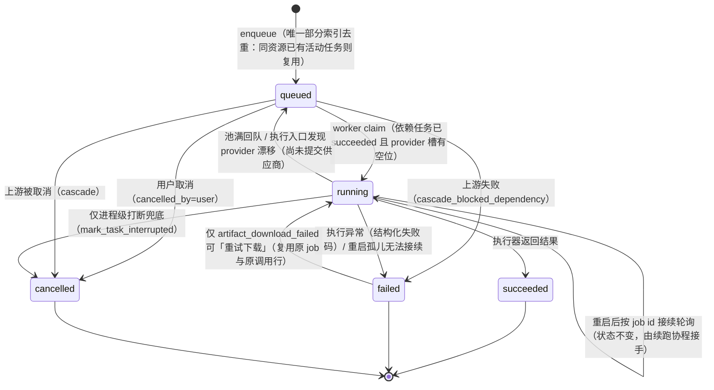
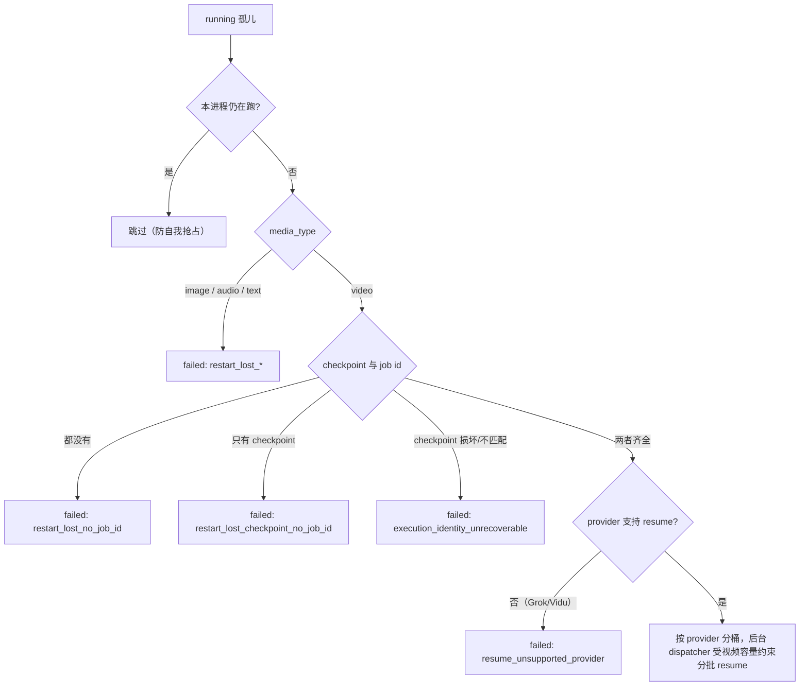
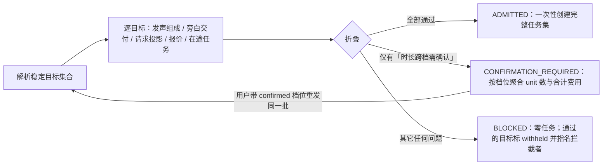
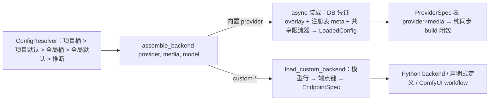

# 04 · 媒体生成管线、供应商、一致性、费用与交付

- **范围**：ArcReel 从「用户点生成」到「供应商产物落盘、记账、推送到界面」再到「成片 / 草稿 / 演示包导出」的整条链路；覆盖任务队列、供应商抽象、跨镜头一致性、费用与用量、交付物。
- **不含**：剧本拆解、Agent 编排、前端视觉细节（见其它章节）。
- **读过的源码**：`lib/generation/*`（全部 13 个模块）、`lib/db/repositories/task_repo.py`、`lib/backends/`（`providers.py`、`backend_runtime.py`、`video_backend_contract.py`、`backend_assembly/*`、`video_backends/gemini.py` 及各 registry）、`lib/config/registry.py`、`lib/custom_provider/`（`endpoints.py`、`discovery_formats.py`、`endpoint_test/*`）、`lib/billing/*`（ledger、call_failure、cost_calculator、pricing/types、usage_summary）、`lib/references/*`、`lib/speech/`（speech_composition、speech_presentation、narration_delivery、character_voice）、`server/services/tasks/generation_tasks.py`、`server/services/admission/cost_estimation.py`、`server/services/presentation/*`、`server/services/project/end_frame.py`、`server/routers/`（generate、tasks、providers、custom_providers、endpoint_tests、cost_estimation、reference_videos、comfyui_inference、assets、projects 导出段）、`agent_runtime_profile/.claude/skills/compose-video/SKILL.md`、前端 `hooks/useTaskRefresh.ts`、`hooks/useProjectEventsSSE.ts`。
- **读过的 ADR**：0001、0006、0007、0008、0009、0010、0012、0016、0027、0034、0039、0049、0050、0053、0054、0055、0056、0061、0062、0064、0066、0067、0072、0073、0076、0081、0083、0086。
- **读过的调研文档**：`docs/research/arcreel-video-api-protocol-research.md`、`arcreel-vendor-integration-research.md`、`arcreel-tts-narration-research.md`、`usage-record-row-linkage.md`（只做摘要）。

本文为基于 ArcReel 源码的研究笔记，遵循 docs/linglong-arcreel-parity-method.md：不含复制的代码、提示词或 schema。

---

## 0. 一页结论

1. **费用模型决定了队列的全部形状。** ArcReel 把媒体生成视为「按供应商调用次数计费、一旦发出就收不回」。由此推出三条硬规则：只有排队中的任务可取消（ADR 0006）；重启后的孤儿任务绝不重新提交，只有持久化了供应商 job id 的视频任务可以「接续轮询」（ADR 0007）；批量视频生成要么整批创建、要么一个都不建（ADR 0061）。
2. **状态机刻意很小**：`queued → running → succeeded | failed`，另有 `queued → cancelled`。没有 `cancelling`、没有 `paused`，失败原因用机器码结构化落库、读时再本地化。
3. **三条状态轴永不合并**：队列任务状态、供应商提交检查点（checkpoint + job id）、产物时效（current / stale / missing / blocked）。「任务成功」不等于「产物与当前内容一致」。
4. **执行身份在执行时才确定**，入队只存一个 advisory 的 provider_id 用于限流路由；视频任务在首次提交供应商之前写入一份不可变的 execution checkpoint，续跑只信它。
5. **记账是「供应商调用」的投影**（ADR 0076）：`api_calls` 每行一次真实对外请求，费用在调用结束时快照冻结；任务与调用一对多。
6. **交付物分两类**：服务端「演示」（presentation：选中的视频 + 可选旁白 + 机械分配的字幕）被剪映草稿导出与演示包下载共同消费；本地 ffmpeg 拼接只存在于 Agent 的 `compose-video` skill 里，且只支持一种剧本骨架。ArcReel 服务端没有「最终 MP4 渲染」服务。

---

## 1. 任务 / 生成队列架构（P-07、P-11）

### 1.1 组件与职责

| 组件 | 位置 | 职责 |
| --- | --- | --- |
| `GenerationQueue` | `lib/generation/generation_queue.py:332` | TaskRepository 的异步门面（进程内单例，见 `:771`）。所有入口（Web、Agent 工具、批量）都经 `enqueue_task`（`:367`）入队。 |
| `TaskRepository` | `lib/db/repositories/task_repo.py` | 唯一写状态的地方：enqueue/claim/mark_*/cancel/cascade，每条状态迁移都带 `WHERE status=...` 守卫。 |
| `GenerationWorker` | `lib/generation/generation_worker.py:424` | 单进程内唯一的消费者：持 DB lease、按 lane 认领、按 `provider × media_type` 限流、派发执行器。 |
| `RestartRecovery` | `lib/generation/restart_recovery.py:45` | 启动时孤儿分流、结算中断调用、后台分批派发可续跑视频。 |
| `VideoResumeRunner` | `lib/generation/video_resume.py:72` | 按已持久化的 job id 接续轮询 + 下载，并结算那条 pending 调用行。 |
| 准入 | `generation_admission.py`、`batch_admission.py`、`server/services/admission/*` | 单元级文件锁、整批准入折叠。 |
| 结果契约 | `generation_result.py`、`generation_batch.py` | 逐 ID 结果、批次读模型、下一步动作枚举。 |
| 终态事件 | `task_terminal_events.py` | 终态落库后推送项目事件（SSE）。 |
| Skill 客户端 | `generation_queue_client.py` | Agent skill 用的「入队并等待」、顺序入队、依赖链。 |

ADR 0083 记录了为什么不用 Celery / dramatiq / arq 等：要求「默认 SQLite、零额外服务、Windows 原生可跑」，且队列状态必须与业务状态同库、同时兼容 SQLite 与 PostgreSQL。

### 1.2 任务生命周期（自绘）

要点：

- **活动态只有 `queued` 与 `running`**（`generation_queue.py:323`、`task_repo.py:28`）。去重靠一个只覆盖活动态的唯一部分索引：同一 `(project, user, task_type, script_file, resource_type, resource_id)` 已有活动任务时，入队返回既有 task_id 并标 `deduped=true`（`task_repo.py:254-287`）。对视频 / TTS / 文本任务还比较「请求事实」（旁白交付方式等），不一致就抛 `ActiveTaskRequestConflict` 而不是静默复用（`generation_queue.py:58`、`:415`）。
- **依赖链**：任务可带 `dependency_task_id`；claim SQL 用自连接只放行「无依赖或依赖已 succeeded」的任务（`task_repo.py:508-524`）。上游失败时排队中的下游级联失败，失败码嵌套上游原因（`task_repo.py:729`）；上游被取消时下游级联取消。顺序依赖主要服务 Agent 批量生成（如分镜图依赖上一张分镜图，见 §3.2）。
- **批次**：批量请求会先建一条 batch 记录（requested 快照 + blocked 列表），再逐个把任务挂进来；批次成员状态多一个 `blocked`（`generation_batch.py:31`）。批次读模型给出建议轮询间隔（视频基数 10s、宫格 8s、TTS 4s，再按队列深度加，上限 30s，`generation_batch.py:271`）。

### 1.3 Worker 模型与并发

- **单进程、单 lease**：受支持部署只跑一个 uvicorn 进程，lifespan 内建唯一 worker（模块说明 `generation_worker.py:1-15`）。DB lease 的 TTL 10s、心跳 3s、空闲轮询 1s（`generation_queue.py:324-326`）。lease 只用于防止进程短暂重叠时重复认领，不代表支持多 worker；ADR 0007 明说若支持多进程需重审孤儿判定。
- **Lane**：`image / video / audio / text` 四条 lane（`:434`）。text lane 容量固定 1、每轮只认领一个（`:719`）。注意：ADR 0010 写的是「text 同步内联、不入队」，但当前代码已有 `text_*` 任务类型走队列（`generation_queue.py:52`）——以代码为准（待确认其覆盖范围）。
- **容量表与占用台账分离**（`CapacityTable` `:120`、`SlotTable` `:277`）：容量来自用户配置 > 注册表声明默认 > 全局默认（环境变量，默认 image 5 / video 3 / audio 10）；ComfyUI 协议的自定义供应商默认每 lane 1（一台 ComfyUI 通常一张卡，`:97`、`:168`）。容量 0 是内部哨兵「该 lane 不支持」，用户不能输入 0（ADR 0043）。reload 只换数字，不动在跑占用。
- **认领算法**（`_claim_tasks` `:621`）：每轮先算「已满 provider 黑名单」，交给 claim SQL 过滤（黑名单而非白名单，避免被删的自定义 provider 任务静默堆积，`task_repo.py:477-489`）。认领后再用当前配置重新投影 provider：容量 0 → 直接失败 `provider_unsupported_media`；仍满 → 刷新 advisory 列并回队，不标失败。
- **执行身份延迟确定**（ADR 0001、0049、0086）：图片走 t2i 还是 i2i 取决于开画那一刻有没有参考图，所以入队 / 认领只用「代表槽」估一个 provider 做限流。视频任务在执行入口按最新 project/script/unit 重新物化请求；若 provider 与认领时的槽不同，抛 `DispatchProviderChanged` → 回队到新槽，此时尚未调用供应商，不会重复扣费（`generation_worker.py:811-849`）。
- **一次解析**：执行时通过 `resolve_generation_context` 在一个 session 内解析全部所需 lane 并构造 backend（ADR 0049），避免「按 A 构造、按 B 查分辨率」的漂移。

### 1.4 取消规则（ADR 0006）

- 只对 `queued` 开放：单任务取消、取消预览、项目级「全部取消」、批次取消都只作用于排队中的任务；执行中的任务返回 409（单任务）或归入 `skipped_running`（批次，`generation_queue.py:546-588`）。前端只给排队中的任务显示取消按钮。
- 理由写得很直接：取消执行中的任务省不下已发出的调用费，反而要回滚已付费的产物。曾实现过 `cancelling` 中间态 + 协程取消 + 产物回滚「回执」，因维护成本和费用语义相悖被撤回。
- 服务关停不取消在跑任务，`stop()` 等它们跑完（`generation_worker.py:779`）。视频执行超时由各 backend 的轮询上限兜底（全局 `video_poll_timeout_seconds`，派发时写进任务字典，`:805`）。
- 进程级打断（事件循环拆除）仍会把任务从 running 落为 cancelled，只为避免下次被当成孤儿（`mark_task_interrupted`，`task_repo.py:950`）；ADR 自认其取消来源写成 user 不严谨。

### 1.5 重启恢复（ADR 0007）

启动拿到 lease 后只扫一次 `running` 行（`handle_orphans`，`restart_recovery.py:112`），按「能否不重复扣费地接续」分流：

- 关键不变式：**job id 必须在进入轮询前同步提交入库**；提交后若写库失败，任务立刻失败、不进入轮询，并打出稳定日志 token，以免形成「供应商在收费、本地既不能续也不能取消」的幽灵任务（ADR 0007 Consequences）。job id 通过 `ProviderJobIdPersistenceMixin` 统一落库（`backend_runtime.py:135`）。
- **execution checkpoint**：视频首次 submit 紧前写入的版本化、严格校验的快照，冻结坐标、能力桶、provider/model/backend、自定义端点协议、最终 prompt/时长/设置、已过闸的旁白事实，以及实际发送的媒体（首尾帧、参考图、音色参考）的逻辑身份与摘要。这些媒体先物化到任务私有的只读 staging，供应商只读 staging 字节。续跑只从 checkpoint 回放，当前项目只用来取凭证；若 provider/model/端点漂移，显式失败（`ResumeEndpointChangedError`，`video_backend_contract.py:37`）。续跑时还会用提交当时的 base_url 轮询，防止用户改域名后误判过期。
- 可续跑的视频孤儿交给后台 dispatcher，不阻塞启动（`dispatch_resumable` `:272`、`dispatch_provider_bucket` `:310`）；子任务先以 PENDING 登记到占用台账再抢信号量，避免主循环误判有空位。
- 孤儿处理之后再做「启动收口」：把没有存活任务的 pending 调用行结算成终态（`settle_interrupted_calls`，`restart_recovery.py:93`；账本侧机器码 `interrupted`）。顺序不能反。
- `requeue_running` 函数保留但不再被 worker 调用（`task_repo.py:1016`）。

### 1.6 视频续跑与「重试下载」

- `VideoResumeRunner.run`（`video_resume.py:86`）：校验 checkpoint → 调注入的续跑执行器（只轮询 + 下载，不 submit）→ 成功 / 各类失败（不支持、端点变更、过期、其它）→ 每个出口都结算那条 pending 调用行（`settle_unresumable_call` `:206`，失败/取消按零费用结算）。续跑不开新的记账括号，账是提交时记的。
- **重试下载**：若供应商已出片但下载耗尽重试，任务落 `artifact_download_failed`。用户点「重试下载」（`POST /tasks/{id}/retry-download`）时，仓储把任务从 failed 原地翻回 running，把原 `api_calls` 行重开为 pending（同一行、不新增计费），再经续跑派发只做取件（`task_repo.py:609-671`、`restart_recovery.py:297`）。资格条件包括必须有 job id 与 provider_id——状态一旦翻转就无回滚点。

### 1.7 失败编码

- 任务 `error_message` 存「`[code]` + 可选 JSON 参数」而非某种语言的句子（`task_failure.py:1-12`、`encode_failure` `:161`）。读接口按 `Accept-Language` 渲染；认不出的旧文本或供应商原文原样透传。
- 失败码是封闭登记表（`FAILURE_CODE_KEYS`，`:104`），分组：能力拒绝（如时长不支持、尾帧需首帧、参考图超限、prompt 过长）、参考投影阻断（资产缺失 / 未登记 / 能力变更）、旁白交付阻断（TTS 缺失 / 过期 / 视频短于旁白）、队列类（restart_lost_*、resume_*、cascade、dispatch 回队失败）、声明式端点与 ComfyUI 类、`provider_rejected`（上游确定性 4xx，状态码 + 脱敏截断原文，原文不进译文模板）、`artifact_download_failed`。CI 用 AST 扫描保证新 raise 点都登记了码。
- 异常 → 失败码的映射只有一处（`task_failure_encoding.py`），常规执行与续跑共用；编码本身失败时降级为通用码或原文，绝不能让任务卡在 running。
- 结果契约为每个失败 / 受阻目标给出封闭的**下一步动作**（`GenerationAction`，`generation_result.py:112`）：重试、修输入、先生成依赖、生成/重生 TTS、等待在途任务、重规划、确认时长档位、配置供应商、修复产物状态、重试下载。消费方（界面、Agent）无需解析自由文本。
- 调用行（账本）另有一套**独立**失败分类：`rate_limited / content_policy / timeout / download_failed / interrupted`（`lib/billing/call_failure.py`），按异常类型与结构化字段分类，不做文本猜测；与任务失败码刻意不共用枚举。

### 1.8 进度如何到达界面

- **没有百分比进度**。界面看到的是任务状态、排队/执行耗时（`TaskElapsedReadout`）与批次成员状态。
- **推送**：`GenerationQueue._task_repo` 上下文退出（事务已提交）后，把本次会话里落地的终态转成项目变更事件，走项目事件 SSE（`/projects/{name}/events/stream`）；事件标为非重要、无聚焦，只作刷新信号（`task_terminal_events.py:34-76`、`generation_queue.py:352-365`）。放在会话退出之后是为了不让前端读到未提交状态；因所有方法都经此入口，终态推送是结构性保证。
- 账本结算同样发 `usage_record / recorded` 事件（`ledger.py:57`），用量面板据此刷新。
- **轮询兜底**：前端 `useTaskRefresh` 有活动任务时 3s 轮询、空闲 30s（`frontend/src/hooks/useTaskRefresh.ts:10-12`）；SSE 发布失败只记日志。

### 1.9 准入控制

**单元级互斥**：`generation_admission_lock`（`generation_admission.py:26`）是一个按 `(project, resource_id)` 摘要命名的跨进程文件锁（非阻塞轮询获取，保证取消安全）。TTS、视频、参考视频入队都在此锁内进行，使「旁白音频恢复 / 选择」与「新视频任务准入」互斥。锁键故意不含剧本文件名。

**入队前的项目闸门**：项目迁移失败时 `enqueue_task` 直接拒绝，不建任务、不计费（`generation_queue.py:387-390`）。

**生成入口的引用准入**（ADR 0073，`lib/references/reference_admission.py`）：引用了未登记的资产名、或角色/场景/道具没有资产图，都在生成入口阻断（编辑 / 保存只警告）。商品例外，其原图就是验收锚点。

**批量视频整批准入**（ADR 0061，`lib/generation/batch_admission.py`）：

- 每个目标携带自己**全部**问题而非第一个；整批三种结局一律 HTTP 200 + 同一信封，调用方按 `decision` 分支（`reference_videos.py:735-750`）。
- 确认档：当请求的时长基准会被吸附到另一档（价格不同）时给出 `reference_duration_confirmation_required`；按档位分组显示合计，**档内报价不全或币种不一时不显示合计**，避免低报用户同意支付的金额（`batch_admission.py:158-186`）。
- 确认只绑定目标集合与选项，不冻结正文 / 供应商 / TTS；worker 仍按最新意图重投影（ADR 0056）。
- 准入之后顺序入队若中途失败，已创建任务照常执行（它们是完整、已计费的单元），没排上的目标以「入队中断」逐 ID 报失败（`generation_queue_client.py:570`）。
- 批量入口必须显式声明旁白交付方式（`use_tts` / `post_production`），缺省即拒绝。

---

## 2. 供应商抽象（P-07）

### 2.1 两族、一道门（ADR 0039）

- 统一入口 `assemble_backend`（`lib/backends/backend_assembly/assembler.py`）按 `is_custom_provider` 分流。内置侧是 `(provider_id, media_type) → ProviderSpec` 声明表（`specs.py`），build 闭包只读 `LoadedConfig` 信封、不查库、不 await，因此构造逻辑可脱离数据库单测；表的自洽性在 import 期校验（`specs.py:_validate_provider_specs`）。
- 自定义侧是 `ENDPOINT_REGISTRY`（`lib/custom_provider/endpoints.py:346`），与内置表对称但**刻意不合并**：两边凭证模型本质不同（ADR 0008 / 0037）。
- backend 实例缓存留在执行编排层，不下沉进这道缝。
- 模型选择按「能力桶」：图片 t2i / i2i，视频 i2v / r2v，各有单一默认 + 可选覆盖，项目优先（ADR 0054）。
- 模型元数据（显示名、媒体类型、能力 token、可选时长、分辨率↔时长约束、参考图时长约束、分辨率、定价、hidden、api_model_name）集中在 `PROVIDER_REGISTRY` 的 `ModelInfo`（`lib/config/registry.py:38-65`）。视频的输入模式 / 参考图上限 / 音轨形态**不**在注册表里声明，其唯一真相源是各 backend 的 `VideoCapabilities`（`video_backend_contract.py:196`），由单测守住「不许出现第二份手写能力声明」。

### 2.2 统一视频契约

- `VideoCapabilities`：是否支持纯文生、首帧、尾帧、参考图上限（>0 即可用 r2v）、参考音频模式 / 段数 / 总时长上限、音频是否逐图挂载、prompt 字符上限、首帧时是否只接受 adaptive 比例、成片音轨三态（恒开 / 恒关 / 可控）及 r2v 路径的单独音轨形态。
- `VideoGenerationRequest`：prompt、输出路径、比例、时长、分辨率（未设则不下发，ADR 0019/0086）、首帧、尾帧、参考图、参考音频及其目标下标、是否要音轨、轮询超时、task_id（用于 job id 落库）、一个「从此不可安全重提」的单向信号、供应商响应留痕回调、续跑用的原提交域名等。
- `VideoBackend` 协议：`generate` + 可选 `resume_video(job_id, request)`（默认 NotImplemented）。
- **付费前闸门**：`MediaGenerator.generate_video_async` 在打开记账括号之前先做能力校验（`gate_video_request`）、槽位规划、比例改写（`media_generator.py:871-918`）；不支持的请求硬失败且不留调用行。ADR 0056 要求这类判据只读「真正要发给供应商的字段」。
- 参考图压缩：只压上传副本、统一 JPEG 高质量、保守通用体积上限 + 被动 413 降档重试（ADR 0012，`lib/references/reference_compression.py`）；**job 句柄持久化之后或进入无法区分拒收/收单的黑盒调用之后，任何 413 都不再自动重提**（`media_generator.py:987-1041` 的 resubmit-unsafe 信号）。
- 通用运行时（`backend_runtime.py`）：提交 / 轮询重试判定（区分可重试 HTTP 状态、Retry-After）、`poll_with_retry`（`:377`）、产物下载带体积上限与重试（`with_artifact_retry` `:800`）、跨域重定向时的凭证作用域控制、供应商错误文本脱敏。

### 2.3 生成路线在创建时锁定（ADR 0055）

- 项目级 `generation_mode` 二选一且创建后不可改：`storyboard`（分镜图 → i2v，首帧驱动，可选尾帧）或 `reference_video`（资产参考图集 → r2v）。不可变性由「没有任何写入面包含这个字段」保证。
- 宫格（多镜头拼一张大图再切）只是分镜路线内的装配开关 `grid_storyboard`，随时可切，广告模式恒拒。
- 路线决定剧本骨架、视频能力桶、声音一致性档位、时长约束、费用估算与入队——**估算与执行读同一个项目字段**，不存在按两条路各算一遍的空间。参考路线项目调用逐条分镜视频端点会被直接拒绝。

### 2.4 自定义供应商与端点

- **凭证模型固定为 `api_key` + `base_url`**（ADR 0008）；需要多字段鉴权的协议（Kling JWT、Vertex 服务账号、火山 AKSK）只能做成内置供应商，或由中转站做协议转换。
- 模型发现格式：`openai / google / anthropic`，外加 `comfyui`（`lib/custom_provider/discovery.py:38-45`、`discovery_formats.py`）。发现格式只决定「如何列模型、如何测连通」，不决定调用协议；调用协议写在模型行挂接的端点上。
- 内置可挂接端点键（Python 实现）：OpenAI 兼容 chat / images（generations、edits）/ videos / tts，Gemini generate / image，Ark Seedance，Vidu，DashScope 图像与异步视频，MiniMax 图像，Kling 图像与视频（`endpoints.py:347-505`）。
- **声明式端点**（ADR 0067，`kind: declarative`）：一份 JSON 定义——请求结构模板 + 有限占位符 / 循环 / 守卫、JSONPath 受限子集做响应提取、状态映射字典——覆盖「JSON 进出 + 提交/轮询」流派的中转站。随版内置了若干定义（MiniMax 海螺系列、NewAPI 视频、v2 通用 generations，见 `lib/custom_provider/builtin_endpoints/*.json`）；MiniMax 视频这个内置供应商本身就走声明式定义（`specs.py:423`）。
- **ComfyUI 端点**（ADR 0081/0082，`kind: comfyui`）：一份 API 格式 workflow + 显式保存的节点绑定就是一个端点；一台 ComfyUI 服务是一个 `discovery_format=comfyui` 的自定义供应商，两者互为唯一配对，写入时校验。节点绑定由服务端推断出**候选**（带分数与命中信号），用户确认后才落盘（`server/routers/comfyui_inference.py`）。
- 自定义供应商的单价由用户在 DB 填（输入/输出单价 + 币种），不进静态注册表（ADR 0009）。

### 2.5 端点测试（三模式）

`lib/custom_provider/endpoint_test/`，HTTP 在 `server/routers/endpoint_tests.py`：

| 模式 | 是否外发 / 计费 | 回答的问题 |
| --- | --- | --- |
| 预览请求 `preview-request` | 否 | 按定义渲染将要发出的请求；凭证打码、素材换成体积摘要、轮询占位符保持原样；用运行时同一个渲染函数。 |
| 验证响应 `check-response` | 否 | 给一份真实响应，逐条报告提取路径命中情况与最终判定；复用运行时同一套提取规则。 |
| 测试连接 `trial-runs` | **是** | 真实提交并轮询到终态，走与生产完全相同的 backend 与轮询/下载路径，但在进程内跑、不进队列、产物不进项目；结果写到数据目录、24 小时清理。取消只停本地轮询，账本按失败结算（钱可能已花）。 |

不是每种 `kind` 都支持三模式（如 ComfyUI 无可配提取路径就不支持验证响应），支持矩阵集中在 `modes.py`。另有内置供应商与自定义供应商的「连通性测试」端点（`providers.py:1007`、`custom_providers.py:1062-1071`）。

### 2.6 凭证处理

- 内置供应商支持多套凭证，存在独立凭证表，每供应商至多一条活跃（部分唯一索引兜底），用户手动切换，不做自动轮换 / 负载均衡（ADR 0016）。多 secret 按注册表 key 命名的定型列存（ADR 0037）；Kling 以「凭证组二选一」表达（`registry.py:81-120`）。
- 读接口只返回打码值（`mask_secret`，`providers.py:303-308`）；Vertex 服务账号 JSON 走专用上传端点（`providers.py:688`）。
- **密钥禁入进程环境**（ADR 0027）：启动时若 `os.environ` 含任一供应商真密钥即拒绝启动；Agent 子进程 env 空串覆盖；Bash 命令被包装成先 unset 敏感变量。
- 端点测试与预览的返回体不含凭证。

### 2.7 已支持的供应商清单

内置（`lib/config/registry.py:375-1348`；媒体能力取自各 backend registry）：

| provider_id | 公司 / 地区 | 文本 | 图片 | 视频 | TTS | 备注 |
| --- | --- | --- | --- | --- | --- | --- |
| `gemini-aistudio` | Google（美） | ✓ | ✓ | ✓（Veo 3.1 系列） | – | API key；视频成片恒带音轨、无开关。 |
| `gemini-vertex` | Google Vertex AI（美） | ✓ | ✓ | ✓（Veo 3.1 / Fast，GA 型号） | – | 服务账号 JSON（`credentials_path`），可选 GCS bucket / RPM / 并发；Vertex 请求才下发音轨开关；Veo 可续跑。 |
| `ark` | 字节火山方舟（中） | ✓ | ✓（Seedream） | ✓（Seedance） | – | Seedance 支持参考音频等。 |
| `ark-agent-plan` | 字节火山方舟套餐（中） | ✓ | ✓ | ✓ | – | 未声明定价，按默认费率兜底并打日志。 |
| `dashscope` | 阿里百炼（中） | ✓（OpenAI 兼容） | ✓（Qwen-Image / 万相） | ✓（HappyHorse / 万相，含 r2v） | ✓（唯一内置 TTS） | 万相 3.0 另有独立域名配置。 |
| `minimax` | MiniMax 海螺（中） | ✓（OpenAI 兼容） | ✓ | ✓（声明式定义） | – | 默认国内站。 |
| `kling` | 快手可灵（中） | – | ✓ | ✓ | – | Bearer 或 AK/SK JWT 二选一。 |
| `vidu` | 生数科技（中） | – | ✓ | ✓ | – | 生成内联轮询、不落 job id，**不可续跑**。 |
| `grok` | xAI（美） | ✓ | ✓ | ✓ | – | 同步型，**不可续跑**。 |
| `openai` | OpenAI（美） | ✓ | ✓ | ✓（Sora 2） | 经自定义 `openai-tts` 端点 | 调研文档记载 Sora 2 官方退役日期在 2026-09（以官方为准）。 |
| `agnes` | 待确认 | ✓ | ✓ | ✓ | – | OpenAI 风格 Bearer。 |

另有：`anthropic`（Agent 运行时与文本发现，不做媒体）、`newapi`（中转站协议常量，经声明式端点接入）、自定义供应商（OpenAI / Google / Anthropic 兼容与 ComfyUI）。

**与 Linglong 的关系**：Linglong 只用 Vertex 上的 Gemini（图像 / 文本）与 Veo（视频）。对应 ArcReel 的只有 `gemini-vertex`（及同一 `gemini` backend）。ArcReel 注册表里的 model ID、默认模型、location 与 Linglong 无关——按 Linglong CLAUDE.md，Linglong 的模型名 / 端点 / location 由用户掌握，本研究**不**据此建议任何配置变更。其余全部中国厂商与中转站流派在 Linglong 范围外。

### 2.8 调研文档摘要

- **视频 API 协议调研**：15+ 中转站归纳出四个流派——OpenAI Sora 式 `/v1/videos`、NewAPI 自有 `/v1/video/generations`（国内自建中转事实垄断，vendor 参数塞 metadata 黑盒）、「单端点按 model 区分」的 v2 generations（本质是按 model 的判别联合）、动词式 create/submit（各家不统一）。结论驱动了「协议绑定到模型级」与声明式端点的设计。
- **厂商接入调研（百炼 / 可灵 / MiniMax）**：主要比较 R2V（参考生视频 / 角色一致性）能力、各家图像线与视频线分工和官方定价；属于 ArcReel 的中国供应商扩展依据，与 Linglong 无直接关系。
- **TTS 调研**：v1 选 DashScope Qwen-TTS（复用凭证、按字符计费、同步适配）+ 自定义 OpenAI 兼容 audio 通路；指出最大风险是「TTS 真实时长 ≠ 剧本计划时长」，业界做法是让音频驱动时间轴、视频不够长就冻帧拉伸而不加速旁白；本期只做「剪映附带旁白音轨，用户手动精调」。
- **使用记录行关联调查**：写于 ADR 0076 之前，记录当时 `api_calls` 无法回指任务（只有视频路径把调用 id 写进任务 payload）、文本调用没有来源字段等缺口；这些缺口后来由 0076 补上 `task_id / purpose / session_id` 列解决。

---

## 3. 跨镜头一致性（P-05、P-06、P-07、P-13）

### 3.1 资产模型

- 四类可复用资产：角色、场景、道具、商品；共享一个名称空间，以名字为身份，改名走级联重写（ADR 0057）。引用统一经 `ReferenceCatalog` 解析，重名时归属顺序固定为 商品 → 角色 → 场景 → 道具（`lib/references/reference_catalog.py`）。
- **资产图（sheet）是条件输入**，版式按下游消费定：场景 / 道具 / 商品单张，角色保留正面-正侧-背面三视图横排（ADR 0066，承认这与厂商官方建议相悖，依据是市面通行做法）。
- **角色衍生 = 子身份**（ADR 0072）：同一角色的换装 / 变身写成 `@[角色/衍生]`，共享名字、声音与说话人绑定；衍生没有原图、没有上传入口，其资产图只能由「本体资产图 + 变化描述」做一次图片编辑生成（任务类型为衍生资产图，必然 i2i，入队即精确路由，`generation_queue.py:321`）。本体重生后衍生判 stale、不自动重生。同一镜头里本体与衍生同现就各注入一张。
- **商品双层锚点**（ADR 0034）：用户原图永远是保真验收锚点，标准化商品 sheet 可选；商品镜头（`products_in_shot` 非空）全量注入商品参考且排在最前，氛围镜头零商品图，没有「弱注入」。分镜路线下商品只在分镜图阶段注入，不再二次注入视频请求。
- **生成入口硬阻断**（ADR 0073）：未登记引用、角色/场景/道具/衍生无资产图 → 阻断；原图只用于生成资产图。

### 3.2 分镜路线（i2v）的连续性装配

`collect_storyboard_references`（`server/services/tasks/generation_tasks.py:502`）按固定顺序装配分镜图的参考集：

1. 商品参考（sheet 在前、原图压阵，`:394`）；
2. 本镜头引用的角色 / 场景 / 道具资产图（每张都要通过产物清单的「可用」判定，`:218-298`）；
3. **上一张分镜图**收尾（`:301-354`）——这是镜头间画面连贯的主要手段，也是图片任务 t2i/i2i 只能在执行时确定的原因（ADR 0001）。

装配结果同时产出「供应商路径列表」与「同序的逻辑身份列表」，提示词渲染层据此把正文里的 `@[名称]` 换成「图N」。装配不看后端参考图上限，拿到 backend 后再按上限去尾裁剪，裁剪时写一条 warning 进任务结果，但产物依据仍按完整列表登记（`:466-499`）。预览与执行共用同一装配函数，保证提示词编号逐字一致。

视频阶段：分镜图作为首帧；可选**尾帧**是分镜的持久用户意图（上传或选项目内已有图，快照复制到固定目录，源图后续变动不影响，`server/services/project/end_frame.py:1-12`），作为 i2v 的过渡控制，要求首帧同在。

### 3.3 参考路线（r2v）

- 视频单元只落盘自由文本正文 + 编排时长；参考图、发声条目、说话人全部读时从正文机械派生（ADR 0064）。`@[名称]` 首次提及顺序即参考图顺序；只出现在台词说话人位的角色只绑定音色、不产生参考图。
- **声音一致性**：项目级 `character_voice_binding` 二选一——`prompt`（默认，把角色声线描述写进提示词做软约束）或 `reference_audio`（把角色已设的参考音频随请求挂给支持的视频模型，获得跨片段原生音色一致，`lib/speech/character_voice.py`）。参考音频顺序即提示词里「音频N」的指认顺序，编排层显式给出音频→参考图的对应关系，不依赖两个列表碰巧同序（`video_backend_contract.py:295-304`）。
- 每个单元的发声模式是互斥的：角色对白 / 旁白画外音 / 无声；混合即需要重规划（`lib/speech/speech_composition`）。

### 3.4 图片编辑、版本与「不静默覆盖」

- 图片编辑是**图的分叉**：只用当前图作唯一参考、用户指令即 prompt、不回写原 prompt；旧图进版本历史（ADR 0050）。
- 每次付费产出都经 `VersionManager` 登记新版本，新产物先写同目录临时文件，下载、记账、版本登记完成后才提升为正式文件（`media_generator.py:1051-1074`）；失败时正式文件与版本不受影响。版本可恢复（`server/routers/versions.py`）。
- **产物清单与时效**（ADR 0062）：清单只存每件正式产物的身份、路径与「生成依据摘要」，状态读时比对得出（current / stale / missing / blocked）。视觉产物的依据**只含正式内容**（正文、引用的资产图、上游分镜），不含供应商、模型、分辨率、seed——改配置不应让已付费画面集体变旧；旁白音频则把供应商 / 音色 / 语速纳入依据。stale 仍可用、照常进成片与导出；不指定 ID 的生成只补 missing；blocked 一律 fail loud。

### 3.5 全局资产库

`server/routers/assets.py`：从项目导入资产到全局库、从全局库应用到项目（冲突策略 skip / overwrite / rename）、衍生随角色整套进出。实现上两个方向都**复制文件**（`:90-95`、`:602-616`）。这一点与 Linglong P-13「不复制文件地挂接」的目标不同，Linglong 应走引用 + 溯源而非拷贝。

---

## 4. 费用与用量（P-12）

### 4.1 定价声明（ADR 0009）

- 定价作为 `ModelInfo.pricing` 并进注册表每个模型条目；计算策略按 `kind` 派发，不再有 `if provider == X` 链。已有形状：按 token、按图固定价、按图 × 分辨率、OpenAI 图像 token、按秒 × (分辨率 × 是否有声) 矩阵、按视频档位、按秒阶梯、视频按 token、按字符（TTS）、Vidu 委托计算（`lib/billing/pricing/types.py`）。
- 币种随供应商声明，USD 与 CNY 并存，**从不折算合并**。
- 改价 = 改声明 + 重部署；不做运行时 DB/UI 改价。理由：成本是快照（见下），且只用于预估与内部记账，精度诉求是「不离谱」。下线模型用 `hidden` 保留条目，兜住「入队后、结算前被下线」的边角。
- 自定义供应商价格来自 DB，计算器有独立早分支（`cost_calculator.py:47-58`）。`estimate_only` 仅用于预估，允许对缺失 usage 做近似；真实结算缺 usage 就按 0 如实记录，不用估算值掩盖。

### 4.2 生成前估算

- `GET /projects/{name}/cost-estimate`（`server/routers/cost_estimation.py:23`）→ `CostEstimationService.compute`（`server/services/admission/cost_estimation.py:230`）：对整个项目按集、按剧本条目给出「预估 + 已实付」，按路线（分镜 / 宫格 / 参考）和能力桶取模型，与执行同源。
- 单个视频请求有精确报价 `VideoRequestQuote`（金额、币种、provider、model、实际申请的时长档，`:91-166`），批量准入的确认档位与单条生成界面都用它。报价拿不到时给出「费用不可用」阻断而非放行。
- 若本次请求可复用同档已选视频，报价显示为零（`without_new_video_charge`）。

### 4.3 账本与使用记录（ADR 0076、0053）

- `api_calls` 只记录真实发生的对外请求，经可空 `task_id` 回指任务、经 `purpose` 说明来源（生成任务、剧本生成、分集规划、项目概览、风格分析、助手会话、端点试跑，`lib/backends/providers.py:44-57`）；「使用记录」页是读模型，进行中区来自任务、终态区来自调用。
- 调用状态：`pending / success / failed / cancelled`（取消零费用，与失败分开，免得污染失败率）。
- 三条记账通道（`lib/billing/ledger.py:1-27`）：
  - **记账括号** `record`（`:146`）：进入即落 pending 行；成功时由调用方递交 backend 结果对象；普通异常自动翻 failed 并落失败机器码；取消翻 cancelled；成功结算的写入若遭取消仍按真实花费落成功。
  - **续跑补账** `resume_success / resume_failed / resume_cancelled`：按 call_id 翻 pending，带幂等守卫。
  - **事后补录** `backfill`：Agent 会话用量一次写终态。
- 结算时刻才调用计费计算器，**费用快照冻结**在调用行；视频以 backend 回报的实际计费时长覆盖请求时长，TTS 以合成字符数计费（`_settlement_from_result`，`:76-109`）。聚合只读冻结值。
- 调用行还记录**输入谱系**：参考图、首尾帧、参考音频的项目相对路径与关键参数（`media_generator.py:959-973`），以及供应商 JSON 响应留痕（`record_provider_response`）——这是审计「这次付费用了哪些输入」的依据。
- **费用归属**（ADR 0053）：以调用行上冻结的记账 key（剧本条目 ID 或宫格 ID）为强证据；宫格费用按覆盖条目均摊（余数补最后一份）；同一 (key, 类型) 一次估算只认领一次；认领不到的归「未归属」，项目级全量汇总、能解析出集号的另在该集展示。已知并接受「条目 ID 不全局唯一」的限制。
- 用量汇总 `GET /usage/summary`（`lib/billing/usage_summary.py`）：KPI、按本地时区的日桶、按维度构成、「需要关注」（失败率用 Wilson 下界判定、末尾连续失败），主币种按金额选取。

---

## 5. 交付（P-08、P-10）

### 5.1 服务端「演示」（presentation）是交付的中心

- `lib/speech/speech_presentation.py` 把一个付费视频单元物化为一份与传输无关的演示：选中的视频轨（起止、时长、是否保留供应商原音及增益）、可选旁白轨、字幕 cue 列表、依据摘要、选中来源（current / 历史版本）与时效（current / stale）。
- 两种交付变体：`post_production`（不带旁白音频，留给后期配音）与 `use_tts`（仅旁白画外音单元可用，必须有 TTS 音频）。旁白长于视频直接报边界错误，不截断、不加速（`:399-406`）。
- **供应商原音**：保留时增益 1，不保留时增益 0（`:437-443`）；没有闪避、没有混音曲线。
- **字幕**是「机械时序」：以真实媒体时长为边界（有旁白用旁白时长，否则用视频时长），按每条台词的文本长度比例切分（`MechanicalSubtitleTiming`，`:116-160`），有版本号进入依据。没有强制对齐或供应商时间戳。
- 演示与字幕落盘为项目内派生文件（`subtitles/…`、`presentations/…`），同样进产物清单（`:37-50`）。

### 5.2 三种导出

| 出口 | 实现 | 内容 |
| --- | --- | --- |
| **演示包下载** `GET …/presentations/{type}/{id}/bundle` | `server/services/presentation/presentation_bundle.py` | 单个单元的 zip：选中视频（原样）、可选旁白音频、演示 JSON、字幕 JSON + WebVTT。两份字幕投影不一致则报错。 |
| **剪映草稿导出** `GET /projects/{name}/export/jianying-draft` | `server/services/presentation/jianying_draft_service.py`（依赖第三方草稿库） | 按集把各单元演示依次铺进草稿：视频轨（逐段按实际时长首尾相接，fade / dissolve 映射为编辑器转场）、字幕文本轨（竖横屏不同字号与位置）、旁白音频轨；媒体复制进草稿目录，路径改写为用户本地剪映目录；支持两个大版本。**Linglong P-10 明确排除。** |
| **项目归档** `POST /projects/{name}/export/token` → 下载 | `server/services/project/project_archive.py` | 项目 zip；`scope=full`（含全部版本历史）或 `current`（只含当前版本），先给出导出诊断；用短时效下载 token 鉴权（ADR 0071）。 |

### 5.3 本地 ffmpeg 合成只在 Agent skill 里

`agent_runtime_profile/.claude/skills/compose-video/`：单集、只支持 `scenes[]` 骨架；按剧本顺序拼接片段，先规范化为统一编码再 concat；按 `transition_to_next` 映射 fade / dissolve / wipe 的 xfade（固定 0.5s）或 cut；可选 BGM 固定音量混入；**不加 TTS、不加字幕、不改写源片段**，时长以实际媒体为准；stale 片段照常参与；输出落 `output/`。其它骨架（segments / shots / video_units）的成片被指引走剪映草稿导出。

### 5.4 结论：ArcReel 的「最终交付物」是什么

- ArcReel **没有服务端最终 MP4 渲染与交付检查清单**。可交付的是：各单元选中的视频文件、演示包（视频 + 旁白 + 字幕 JSON/VTT + 演示元数据）、剪映草稿（供外部编辑器完成成片）、项目归档（含版本历史与产物清单），以及可选的 Agent 本地拼接 MP4。
- 没有 QA 报告、没有面向交付的 source manifest（最接近的是产物清单 + 调用行输入谱系 + 演示 JSON）、没有 logo / 商店角标等确定性叠加层。

---

## 6. 映射到 Linglong 平价账本

| 账本 ID | ArcReel 对应能力 | 关键位置 | 备注 |
| --- | --- | --- | --- |
| P-05 资产 | 四类资产 + 资产图 + 角色衍生 + 商品双锚点 + 生成入口阻断 | ADR 0066/0072/0034/0073、`reference_catalog.py`、`reference_admission.py` | 可直接借鉴语义（不借实现）。 |
| P-06 分镜 | 参考集固定装配顺序、上一镜收尾、尾帧快照 | `generation_tasks.py:466-563`、`end_frame.py` | 「图N」编号与实发参考同源值得对标。 |
| P-07 生成 | 队列、执行时身份、checkpoint、能力前置闸门、版本登记、不静默覆盖 | §1、§2、`media_generator.py:785-1074` | 核心对标区。 |
| P-08 音频 / 字幕 / 叠加 | TTS 走队列、旁白两变体、机械字幕、原音开关 | ADR 0010、`speech_presentation.py` | 无 logo / 商店叠加，Linglong 需自建。 |
| P-09 审阅与选片 | 版本历史 + 恢复、产物四态 | `versions.py`、ADR 0062 | 本章只触及，详见其它章节。 |
| P-10 交付 | 演示包、归档；剪映草稿（排除） | §5 | ArcReel 无服务端最终 MP4 / QA 报告，Linglong 需超出参考实现。 |
| P-11 失败 / 取消 / 续跑 | 只取消排队中、孤儿不重提、job id 续跑、重试下载、结构化失败码 + 下一步动作 | ADR 0006/0007、`restart_recovery.py`、`video_resume.py`、`task_failure.py`、`generation_result.py:112` | 最值得照搬的设计区。 |
| P-12 用量 / 审计 | 调用即账本、费用快照、输入谱系、归属 key、准入报价与确认 | ADR 0009/0053/0076、`ledger.py`、`cost_estimation.py` | ArcReel 无「操作员确认」审计记录。 |
| P-13 资产库 | 全局资产库导入 / 应用 | `assets.py` | ArcReel 复制文件；Linglong 要求不复制。 |

---

## 7. 对 Linglong 的启示

### 7.1 值得采用（用 Linglong 自己的规格与代码实现）

1. **以费用语义定取消与恢复**：只允许取消尚未提交供应商的任务；执行中任务跑到终态。重启后绝不自动重提；只有已持久化供应商作业句柄（Vertex 长时操作名）的视频才接续轮询，其余一律标失败交人决定。这与 Linglong「每次昂贵生成都需人确认」天然一致：自动重提等于绕过确认再花一次钱。
2. **「句柄先落库、再轮询」不变式**：提交返回作业句柄后，先在独立事务里持久化，失败即判任务失败，不进入轮询；并打稳定日志标记。这是防幽灵计费的最小代价方案。
3. **提交前的不可变执行快照**：在首次调用 Vertex 之前冻结最终 prompt、模型、时长、分辨率与实际发送的参考媒体摘要；续跑只从快照回放，配置漂移时显式失败。它同时就是 P-07「明确输入 + 结果谱系」与 P-12 审计的最好数据源。
4. **三条状态轴分开**：任务状态、供应商提交状态、产物时效分别存、分别展示；「任务成功」不等于「产物仍对应当前 brief」。
5. **结构化失败码 + 封闭的下一步动作**：落库存机器码与参数，读时本地化；每个失败都给出「重试 / 修输入 / 先生成依赖 / 重试下载 / 配置供应商」之类封闭动作，满足 P-11「刷新后操作员仍能行动」。
6. **重试下载不重新计费**：区分「供应商已出片但取回失败」与「生成失败」，前者复用原作业与原调用记录。
7. **调用级账本 + 费用快照**：每次真实对外请求一行，结算时冻结金额与币种，记录输入谱系与来源（purpose）；任务与调用一对多。多币种不折算。
8. **能力闸门放在记账之前**：注定失败的请求（时长不支持、prompt 过长、参考图超限）在付费前硬拒，不产生调用行。
9. **整批准入**：批量生成先整体评估、要么全建要么不建，受阻结论逐目标给出原因。
10. **终态事件在事务提交后推送 + 轮询兜底**：结构上保证不会漏推、不会推未提交状态。

### 7.2 需要简化

- **单供应商**：Linglong 只有 Vertex Gemini / Veo，不需要自定义供应商、声明式端点、ComfyUI、端点测试三模式、多凭证切换、容量表的多 provider 黑名单认领。保留「按 media lane 的并发上限 + 单 worker lease」即可。供应商抽象只需留一个薄接口，方便测试替身。
- **定价**：只需 Vertex 图像 / Veo 的少数形状（按图 × 分辨率、按秒 × 分辨率 × 有无音频），代码声明即可；价格数值须来自 Google 官方或用户，不从 ArcReel 注册表取。
- **执行身份延迟确定**：ArcReel 为多供应商 / 多能力桶付出了大量投影与漂移处理；Linglong 可以在「人确认」那一刻冻结请求（因为确认本身就是冻结点），执行时只校验输入未失效，大幅减少回队分支。注意这与 ArcReel ADR 0061「确认不冻结内容」相反——Linglong 的人工确认要求更强，建议在规格里明确选择「确认即冻结、内容变更需重新确认」。
- **声音一致性**：Veo 路径不存在参考音频通道的多家差异，TTS / 旁白按 Linglong 自己的供应方案设计。
- **路线锁定**：可借鉴「一个项目只有一种视频输入契约」的思路（首帧驱动 vs 参考图驱动），但 Linglong 的商业广告 / CTV 场景可按 brief 类型定路线。

### 7.3 可以跳过

- 剪映草稿导出（P-10 已排除）、中国厂商与中转站协议、声明式端点语言、ComfyUI 节点推断、Agent 本地 compose skill、宫格分镜（除非 Linglong 另有需求）、多用户预埋、密钥禁入 Agent 子进程那一整套（Linglong 无内嵌 Agent 沙箱时）。

### 7.4 必须超出 ArcReel 的地方

- **人工确认要成为一等数据**：ArcReel 只有「跨档时长需确认」这一种服务端确认，其余靠界面展示费用 + Agent 指令约定。Linglong 每次昂贵生成与交付都需显式确认，应把「谁在何时对哪份冻结请求、以多少预估费用点了确认」写入审计（P-12），并让队列拒绝没有确认记录的付费任务。
- **服务端最终交付**：P-10 要求最终 MP4、QA 报告与 source manifest；ArcReel 没有服务端渲染与交付检查清单。可借鉴其「演示」模型（选中媒体 + 字幕 + 旁白 + 原音开关 + 依据摘要）作为渲染输入，由 Linglong 自己的确定性合成（含 logo / 商店叠加，P-08）产出成片与清单。
- **资产复用不复制文件**（P-13）：以引用 + 溯源实现，而不是 ArcReel 的拷贝入库 / 拷贝回项目。
- **字幕时序**：ArcReel 按文本长度机械分配；若 Linglong 的 CTV 交付对字幕精度有要求，需要更好的对齐方案（参考其 TTS 调研中「音频驱动时间轴、视频冻帧补长、不加速旁白」的思路）。

### 7.5 待确认

- `agnes` 供应商的公司与地区。
- text 任务入队的实际覆盖范围（ADR 0010 与当前代码表述不一致）。
- Vertex Veo 在 Linglong 部署下的作业句柄是否可跨进程重启轮询、句柄有效期多长——需按 Google 官方文档确认后再决定续跑策略；不得据 ArcReel 代码推断 Linglong 的模型或 location 配置。
