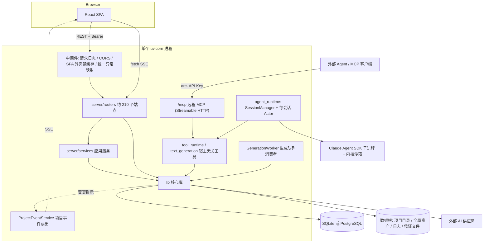
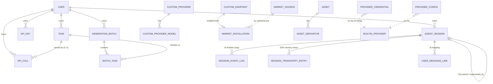
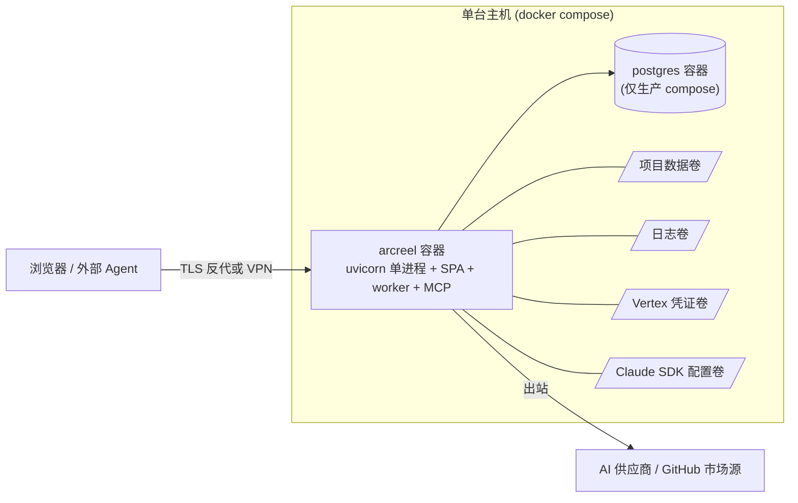

# ArcReel 源码研究 · 05 后端架构、API 面、数据层与部署

- **范围**：ArcReel 后端的进程模型与分层、全部 HTTP 路由、数据库实体与文件系统布局、认证/用户/API Key、配置与部署、测试与代码质量工具；最后给出对 Linglong Production 的取舍建议。Agent runtime 内部、生成 backend、剧本管线只在涉及边界时提及，细节归其他章节。
- **研究对象版本**：ArcReel `main` @ `10f640c3`（pyproject 版本 0.31.0，最新提交即 ADR 0088 文档）。
- **读过的源码/文档**：`server/app.py`、`server/auth.py`、`server/dependencies.py`、`server/cors_config.py`、`server/error_handlers.py`、`server/i18n.py`、`server/sse_channel.py`、`server/text_generation.py`（头部）、`server/remote_mcp.py`（工具注册部分）、`server/routers/*.py`（全部 42 个文件的路由声明与模块说明）、`server/services/**`（目录与关键模块头部）、`lib/db/{base,engine,__init__}.py` 与 `lib/db/models/*`、`lib/db/repositories/base.py`、`lib/project/{project_manager,resource_paths}.py` 与 `project_migrations/` 目录、`lib/infra/app_data_dir.py`、`lib/config/*`（模块头部）、`lib/market/*`（头部）、`lib/i18n/__init__.py`、`lib/generation/generation_worker.py`（头部）、`lib/artifacts/{version_manager,artifact_manifest}.py`（头部）、`alembic/versions/*`（全部 56 个文件名 + 抽读正文）、`pyproject.toml`、`Dockerfile`、`deploy/docker-compose.yml`、`deploy/production/docker-compose.yml`、四份 `.env.example`（只读键名）、`SECURITY.md`、`docs/security/threat-model.md`、`docs/api-docs/`、`docs/testing/mutmut-runbook.md`、`CONTRIBUTING.md`（测试/质量章节）、`.github/workflows/*`、`.pre-commit-config.yaml`、`website/docs/dev/architecture.md`；ADR 0005/0006/0007/0020/0021/0022/0025/0026/0027/0028/0029/0048/0053/0059/0062/0065/0069/0071/0074/0076/0078/0079/0083/0084/0085/0088。
- **LinglongLab 侧对照**：`docs/linglonglab-architecture.md`、`apps/api/app/ai_video/{config.py,core/db.py,core/database_url.py}`、`apps/api/requirements.txt`。

本文为基于 ArcReel 源码的研究笔记，遵循 docs/linglong-arcreel-parity-method.md：不含复制的代码、提示词或 schema。

---

## 0. 一页结论

1. ArcReel 是**单进程、单管理员、自托管**的 FastAPI 应用：一个 uvicorn 进程同时承担 REST API、两条 SSE 流、生成任务 worker、Agent 会话 actor、远程 MCP 端点，并托管 React SPA 静态产物。没有独立 worker 进程、没有消息中间件（ADR 0083 明确拒绝 Celery 等）。
2. **存储二分**（ADR 0020）：运行时状态（任务队列、调用账本、Agent 会话、配置/凭证、全局资产库索引、市场）进单一 SQLAlchemy 异步库（SQLite 默认 / PostgreSQL 生产）；**项目内容本身不在 DB**——`project.json`、剧本 JSON、媒体文件、版本记录、产物清单全部在文件系统的项目目录里。项目列表就是扫描目录。
3. 多用户只是**预埋**（ADR 0021）：表上有 `user_id`、仓储基类有 `_scope_query` 缝隙，但恒为默认用户；认证是单账号口令 + JWT + `arc-` API Key。SECURITY.md 明确不支持互不信任的多用户与公网直曝。
4. 实时通道是**"显式事件 + 快照差分"双源**的项目事件 SSE（ADR 0085），加上 Agent 会话 SSE（事件日志 seq 续传，ADR 0048）。任务状态本身靠前端轮询补充。
5. 可恢复性的关键设计：任务只能取消"排队中"（ADR 0006）；重启后孤儿任务标失败、不自动重跑，提交-轮询型视频按 `provider_job_id` 恢复轮询（ADR 0007）；项目 JSON 带 `schema_version` 并在启动时逐级迁移（ADR 0022）；迁移失败的项目只读、禁止生产写入。
6. 对 Linglong：应**复刻契约与不变量**（任务身份/去重、只取消排队中、重启恢复语义、调用账本与任务一对多、项目事件推送、路由级认证单点），但**存储与部署形态不照搬**——Linglong 已在 LinglongLab 内使用 Cloud SQL Postgres + GCS + Celery/Redis + Moloco SSO，项目内容应以 DB 行 + 对象存储为主，而不是本地目录。

---

## 1. 后端总体架构

### 1.1 框架与目录分层

- **框架**：FastAPI + Starlette（ASGI），Pydantic v2，SQLAlchemy 2.0 async，Alembic；运行于 Python 3.12，由 `uv` 管理依赖。
- **两个根包**（ADR 0084、`website/docs/dev/architecture.md` §6.1）：
  - `lib/`：核心库——领域逻辑与基础设施（project、script、episode、prompts、generation、backends、custom_provider、billing、artifacts、config、db、market、i18n、infra、agent 等 17 个包）。**不得 import `server`，也不得 import fastapi/starlette**，由 import-linter 契约在 CI 强制（`pyproject.toml` `[tool.importlinter]`）。
  - `server/`：交付层（routers、agent_runtime、media_tools、remote_mcp、tool_runtime）+ 应用服务 `server/services/`（admission、currency、grid、presentation、project、system、tasks）。
- 分层规则不是严格的三层：**路由可以直接调用 `lib`**；只有"同一用例被多个入口（HTTP / 内嵌 Agent 工具 / 远程 MCP）共用"或"需要跨领域包协调事务"时才下沉到 `server/services/`。`server/tool_runtime.py`（约 2.4K 行）与 `server/text_generation.py`（约 1.5K 行）是"宿主无关"的工具实现，被内嵌 Agent 与远程 MCP 两个入口共用。
- `lib` 需要 `server` 能力时走**装配处注入**：例如 `GenerationWorker` 的任务执行器与续跑执行器由 `server/app.py` 构造时传入（`server/app.py:687`）。

### 1.2 进程模型与启动序列

`server/app.py` 的 `lifespan` 是理解系统的最佳入口，启动顺序大致为：

1. **安全红线自检**：父进程环境里若存在任何供应商密钥即拒绝启动（ADR 0027，清单在 `lib/config/env_keys.py`）；探测内核沙箱（macOS Seatbelt / Linux bwrap+socat，并对 bwrap 试跑一次），不可用即硬失败（ADR 0025），仅 Windows 降级为命令白名单；检测是否在容器内。
2. 日志目录迁移 + 挂文件 handler；确保登录口令存在（为空则生成并回写 `.env`）。
3. `init_db()`：以编程方式调用 Alembic 升级到 head；若遇到"有业务表但无版本表"的旧库，先 stamp 再升级（`lib/db/__init__.py`）。
4. **文件侧迁移**：逐项目做源文件编码归一（UTF-8，带标记文件幂等）→ `project.json` schema 逐级迁移（当前链到 v15）→ 清理 7 天前的迁移备份。
5. 一次性数据迁移：本地 SDK transcript jsonl → DB 会话存储；旧 `.system_config.json` → DB；旧文本 backend 设置键 → 档位键（ADR 0051）；预置官方市场源。
6. 把 `agent_runtime_profile/` 物化到每个存量项目。
7. 启动共享 httpx 客户端、Agent 会话服务（含闲置驱逐巡检）、`GenerationWorker`、`ProjectEventService`，最后进入远程 MCP host 的生命周期。
8. 关停时：先停事件服务；worker **不取消在跑任务**，等其跑到终态；结算端点试跑账本；关闭 DB。

**并发模型**：受支持部署只有一个 uvicorn 进程、一个 worker（`lib/generation/generation_worker.py` 模块说明）。worker 仍通过 `worker_lease` 表抢租约，用于防止部署切换时进程短暂重叠造成重复认领，但**多 uvicorn worker 不是受支持形态**——孤儿任务判定依赖"只有进程重启才会产生孤儿"这一前提。调度按"供应商 × 媒体类型"分槽位：容量来自用户配置，占用由运行时台账记录。

### 1.3 前端如何被托管

- 前端是 Vite 构建的 React 19 SPA，Docker 多阶段构建把 `frontend/dist` 拷进镜像；FastAPI 在 `dist/index.html` 存在时挂载静态目录并以 `index.html` 兜底（`server/app.py:759-778`）。
- 深链统一在 `/app/...` 下，专门的路由处理"深链末段带扩展名"的情况，且对用户可控路径做越界降级。
- 自研纯 ASGI 中间件对所有 `text/html` 响应加禁缓存头，避免重新部署后旧外壳引用已删除的哈希资源导致白屏。
- 同源部署，CORS 默认通配且关闭 credentials；显式白名单才打开 credentials（`server/cors_config.py`）。

### 1.4 横切关注点

| 关注点 | 做法 | 位置 |
|---|---|---|
| 认证声明 | 只在 `include_router` 处挂依赖；同模块用第二个 router 对象（`public_router` / `self_auth_router`）承载公开或自带认证端点 | `server/app.py:579-676`，ADR 0059 |
| 迁移门禁 | 对生产写入类路由额外挂"项目迁移成功"依赖：GET 放行，写操作在项目 schema 迁移失败时拒绝 | `server/dependencies.py` |
| 异常映射 | app 级 handler 统一把领域异常/lib 异常映射到状态码，按请求语言翻译 detail，**不回传 `str(exc)`**（防泄露服务器路径）；并为兜底 500 手工补 CORS 头 | `server/error_handlers.py` |
| i18n | `lib/i18n` 按 zh/en/vi 分模块存文案表（assets、errors、events、providers、system、templates、validation、emails）；`server/i18n.py` 只负责从 `Accept-Language` 解析语言并注入 translator；默认中文 | ADR 0084 |
| 请求日志 | 对前端高频轮询的任务列表/统计端点，成功且快速时降为 DEBUG | `server/app.py:533-576` |

### 1.5 实时通道

ArcReel 有两条 SSE 流，共用 `server/sse_channel.py` 的参数化扇出组件（订阅注册表 + 广播 + 空闲心跳），差异全部通过参数表达：

| | 项目事件流 | Agent 会话流 |
|---|---|---|
| 端点 | `GET /api/v1/projects/{name}/events/stream` | `GET .../assistant/sessions/{id}/stream` 与 `.../entries/stream` |
| 服务 | `server/services/project/project_events.py` `ProjectEventService` | `server/agent_runtime/session_manager.py` |
| 溢出策略 | 队列满即移除订阅者，由消费方心跳自检发现断线 | 关键消息挤掉非关键消息；仍满则清空并结束流，前端以重连恢复 |
| 开场白 | 订阅时发初始快照 | 订阅屏障 + 从事件日志补读存量条目，SSE `id` 即 seq，断线按游标续传（ADR 0048） |
| 生命周期 | 首个订阅者启动该项目的后台扫描，最后一个退订时停止 | 会话 actor 独立于订阅者存在 |

项目事件的**双源**设计（ADR 0085）值得重点借鉴：
- **显式事件**：写入方（生成任务完成、上传、Agent 工具写盘）通过 `lib/project/project_change_hints.py` 的监听注册发出"变更提示/批次"，覆盖快照看不见的事实（同路径字节替换、任务语义）。
- **快照差分兜底**：有订阅者时约每 0.5 秒只读地读取 `project.json` + 各集剧本，按资产类型注册表**整条目**构造投影（`project_state_projection.py`），与上一份快照 diff 得出增删改；排除每次写盘都会变的 `metadata` 和只用于就绪判定的 `generated_assets`。
- 两路按 (实体类型, 动作, 实体 id) 去重，并有同义动作归一；读盘→结算基线→广播 这段用锁串行，防止慢读把旧快照写回基线而误报"已删除"。项目目录被删除时广播终止事件并正常结束流。
- 前端契约：每收到一批事件就整体重新拉取项目，Agent 一轮结束后不另行刷新。

SSE 认证（ADR 0071）：前端用 `fetch` 带 `Authorization` 头消费 SSE，**不再**把 JWT 拼进 query（原先 `?token=` 方案已删，认证测试对其断言 401）。

---

## 2. API 面（全部路由）

所有业务路由挂在 `/api/v1` 前缀下；源码中约 210 个路由装饰器。下表按领域分组。"迁移门禁"列标 ✓ 表示注册时额外挂了项目迁移成功依赖。未注明者均需认证。

### 2.1 项目与工作流

| 路由模块 | 职责 | 代表端点 | 门禁 |
|---|---|---|---|
| `projects.py`（1.9K 行） | 项目 CRUD、导入/导出、工作流状态与规划、剧本条目编辑、概述生成 | `GET/POST /projects`；`GET/PATCH/DELETE /projects/{name}`；`POST /projects/import`；`POST /projects/{name}/export/token` → `GET /projects/{name}/export`（自带认证，下载 token）；`GET .../export/jianying-draft`（剪映草稿导出）；`GET .../workflow-status`、`POST .../workflow-plan`；`GET .../video-capabilities`；`GET/POST .../agent-profile(/reset)`；`POST .../source`；`POST .../generate-overview`、`PATCH .../overview` | 编辑类端点在端点级挂 |
| 同上（剧本编辑子集） | 剧本条目批量编辑、插入、删除、重排、单条 PATCH、提示词预览 | `GET .../scripts/{file}`；`POST .../script-edits`；`GET .../script-items/{id}/prompt-preview`；`POST .../script-items/{id}/insert-after`；`DELETE .../script-items/{id}`；`PATCH .../script-scenes/{id}`、`.../script-shots/{id}`、`.../segments/{id}`；`POST .../script-shots/reorder`；`PATCH .../episodes/{n}` | ✓ |
| `script_review.py` | script_plan → 正式脚本的人工审阅门：查看、编辑内容、显式确认 | `GET/PUT .../episodes/{n}/script-review(/content)`；`POST .../script-review/confirm` | ✓ |
| `project_events.py` | 项目变更 SSE | `GET /projects/{name}/events/stream` | — |
| `presentations.py` | 成片/演示物统一预览与可编辑下载包 | `GET .../presentations/{type}/{id}`、`.../bundle` | — |
| `versions.py` | 产物版本历史查询与还原（含角色衍生） | `GET .../versions/{type}/{id}`；`POST .../versions/{type}/{id}/restore/{v}` | — |
| `files.py`（1.1K 行） | 上传、源文件、草稿、风格图、文件清单；**公开**媒体读取 | 公开：`GET /files/{project}/{path}`、`GET /global-assets/{type}/{file}`；受保护：`POST .../upload/{type}`、`GET/PUT/DELETE .../source/{file}`、`GET/PUT/DELETE .../drafts/{ep}/{stage}`、`POST .../style-image`、`GET .../files` | — |

### 2.2 项目内资产（角色 / 场景 / 道具 / 商品）

| 路由模块 | 职责 | 代表端点 |
|---|---|---|
| `characters.py`、`scenes.py`、`props.py`、`products.py` | 各 7 行，全部由 `_asset_router_factory.py` 按资产类型注册表生成 | `POST /projects/{p}/{subdir}`；`PATCH/DELETE .../{subdir}/{entry}`；`POST .../{entry}/rename`（级联改名，ADR 0057） |
| `_asset_derivatives.py` / `_asset_derivative_status.py` | 角色"衍生"（同一角色的子造型，ADR 0072）CRUD 与状态 | `POST/PATCH/DELETE .../derivatives/{name}`、`.../rename` |
| `_asset_prompt_preview.py` | 资产/衍生提示词预览 | `POST .../prompt-preview` |
| `assets.py` | **全局资产库**（跨项目复用） | `GET/POST /assets`；`GET/PATCH/DELETE /assets/{id}`；`POST /assets/{id}/image`；`POST /assets/from-project`（从项目入库）；`POST /assets/apply-to-project`（写回项目并落盘） |

工厂模式的启示：资产类型差异（URL 段、bucket 键、sheet 字段、PATCH 白名单）全部来自 `lib/project/asset_types.py` 的 `ASSET_SPECS` 注册表，新增一种资产只需一行启用。

### 2.3 生成、任务与批次

| 路由模块 | 职责 | 代表端点 | 门禁 |
|---|---|---|---|
| `generate.py`（1.1K 行） | 入队各类生成任务；TTS 与音色 | `POST .../generate/storyboard/{seg}`、`.../generate/video/{seg}`、`.../generate/tts(/{seg})`、`.../generate/{character,scene,prop,product}/{name}`、`.../generate/character/{c}/derivatives/{d}`；`POST .../edit/image`；`GET .../audio-backend/voices`；`POST .../characters/{n}/voice-sample(/confirm)` | ✓ |
| `grids.py` | 多宫格分镜图：生成、列表、重生成、切分、上传 | `POST .../generate/grid/{ep}`；`GET .../grid-capability`、`.../grids(/{id})`；`POST .../grids/{id}/{regenerate,split,upload}` | ✓ |
| `reference_videos.py` | "参考生视频"单元 CRUD、时长预检、提示词/剧本预览、单个与批量生成、上传成片 | 前缀 `/projects/{p}/reference-videos`：`.../episodes/{n}/units` CRUD + `reorder`；`.../units/{u}/duration-precheck`；`.../units/{u}/generate`（202）；`.../units/generate-batch` | ✓ |
| `shot_uploads.py` | 分镜级分镜图/视频手工上传，纳入版本管理 | `POST .../shots/{id}/upload/{kind}` | ✓ |
| `end_frames.py` | 分镜尾帧设置（上传或选已有图）/清除 | `POST .../shots/{id}/end-frame/{upload,select}`；`DELETE .../end-frame` | ✓ |
| `tasks.py` | 任务查询、统计、取消（含取消预览）、重试下载 | `GET /tasks`、`/tasks/stats`、`/tasks/{id}`；`GET /projects/{p}/tasks`；`GET /tasks/{id}/cancel-preview` + `POST /tasks/{id}/cancel`；`GET/POST /projects/{p}/tasks/cancel-all(-preview)`；`POST /tasks/{id}/retry-download` | — |
| `cost_estimation.py` | 生成前费用估算 | `GET /projects/{p}/cost-estimate` | — |

所有生成端点只做准入与入队，真正执行在 `GenerationWorker`；批量视频准入是"全有或全无"（ADR 0061），批次持久化为 `batches` + `batch_tasks`。

### 2.4 Agent / 助手

| 路由模块 | 职责 | 代表端点 |
|---|---|---|
| `assistant.py` | 项目内嵌创作 Agent 会话（前缀 `/projects/{p}/assistant`） | `POST /sessions/send`；`POST /sessions/{id}/rewrite`（从某条消息分叉改写，ADR 0058）；`GET /sessions`、`/sessions/{id}`、`/messages`、`/snapshot`、`/entries`；`GET .../entries/stream`、`.../stream`（SSE）；`POST .../interrupt`；`POST .../questions/{qid}/answer`（回答 Agent 提问）；`DELETE /sessions/{id}`；`GET /skills` |
| `agent_config.py` | Agent 用的 Anthropic 兼容凭证（多套、一键切换）与预设供应商目录、连通性测试 | `GET /agent/preset-providers`；`/agent/credentials` CRUD + `activate` + `test`；`POST /agent/test-connection` |
| `agent_memory.py` | 两级 Agent 记忆（用户级 / 项目级，ADR 0074）的文件读写 | `GET/PUT/DELETE /agent/memory/files/{f}`、`POST /agent/memory/clear`；项目级同形于 `/projects/{p}/agent-memory` |
| `prompt_templates.py` | 内置提示词模板只读浏览 | `GET /prompt-templates`、`/partials/{name}`、`/{id}` |
| `/mcp`（`remote_mcp.py`） | 远程 MCP：对外暴露约 30 个创作工具（列/建项目、上传源文、草稿 open/patch/promote/discard、生成剧本与规划、确认审阅、工作流计划、批次查询/取消、资产改名、读项目文件……） | 挂载于 `/mcp`，只认 `arc-` API Key（ADR 0065） |

### 2.5 供应商、模型与自定义端点

| 路由模块 | 职责 | 代表端点 |
|---|---|---|
| `providers.py`（1.1K 行） | 内置供应商列表、配置、多凭证（手动激活一条，ADR 0016）、Vertex 凭证文件上传、连通性测试、视频能力 | `GET /providers`、`/providers/video-capabilities`；`GET/PATCH /providers/{id}/config`；`/providers/{id}/credentials` CRUD + `activate`；`POST /providers/gemini-vertex/credentials/upload`；`POST /providers/{id}/test` |
| `custom_providers.py`（1.3K 行） | 用户自定义供应商及其模型、端点目录、模型发现、测试 | `/custom-providers` CRUD（含 PUT 整体替换）；`GET /custom-providers/endpoints(/{key}/definition)`；`POST .../discover`、`/discover-anthropic`、`/{id}/discover`；`POST .../test`、`/{id}/test` |
| `custom_endpoints.py` | 声明式"调用端点"定义 CRUD（导入即 POST、导出即 GET，零信封，ADR 0067），保存前 validate；内含两个子 router | `/custom-endpoints` CRUD；`POST /custom-endpoints/validate` |
| `endpoint_tests.py`（子 router） | 端点预览请求、校验响应、真实试跑（可取消，产物可取回） | `POST /custom-endpoints/{preview-request,check-response}`；`/trial-runs` 创建/查询/取消/取产物 |
| `comfyui_inference.py`（子 router） | 从 ComfyUI workflow 推断节点绑定候选（只出候选，用户确认后落盘，ADR 0082） | `POST /custom-endpoints/comfyui/infer` |

### 2.6 市场（Market）

**"市场"是自定义调用端点定义的分发渠道**，不是资产或模板商店（ADR 0078/0079）：
- 每个"市场源"是一个 GitHub 仓库（或等价 https 直链），仓库里放索引文件 + 每个条目一个目录（定义 + 图标）。官方源随版预置、可禁用不可删；第三方源 = fork 官方模板仓。**零服务端、零账号**：投稿即向官方仓提 PR，由 CI（`market-validate.yml` / `market-publish-index.yml`，调用 `python -m lib.market check`）校验并生成索引。
- 本地 `market_source` 表缓存最近一次成功抓取的索引原文、ETag、状态与错误；安装时把定义写成普通 `custom_endpoint` 行，另起一条 `market_installation` 记录来源源键、slug、安装版本与定义摘要。
- 已安装端点可原地编辑；状态是两条正交轴：市场轴（最新 / 可更新 / 不可用，只比较版本字符串）与本地轴（摘要不一致即"已修改"）。

| 路由 | 代表端点 |
|---|---|
| `market.py` + `_market_installations.py` | `/market/sources` CRUD + `PUT /order` + `POST /{id}/refresh`；`POST /market/refresh`；`GET /market/entries`；`GET /market/sources/{id}/entries/{slug}(/definition,/icon)`；`POST .../install` |

### 2.7 用量、系统、认证、引导

| 路由模块 | 职责 | 代表端点 |
|---|---|---|
| `usage.py` | 调用记录分页/详情与汇总（使用记录是供应商调用的投影，ADR 0076） | `GET /usage/records(/{id})`、`/usage/summary` |
| `system_config.py` | 系统设置白名单读写、模型候选、版本检查 | `GET/PATCH /system/config`；`GET /system/config/model-candidates`；`GET /system/version` |
| `system.py` | 诊断日志打包下载 | `GET /system/logs/download` |
| `api_keys.py` | `arc-` API Key 创建（明文只返回一次）、列表、删除；**用 API Key 身份调用这组端点会被拒** | `POST/GET /api-keys`；`DELETE /api-keys/{id}` |
| `auth.py` | 公开：认证状态、登录换 token；受保护：校验 token | `GET /auth/status`、`POST /auth/token`（公开）；`GET /auth/verify` |
| `onboarding.py` | 首次引导"已看过"标记（刻意与配置分开） | `GET /onboarding/status`、`POST /onboarding/seen` |
| app 级 | 健康检查、动态渲染的外部 Agent 安装指引 | `GET /health`、`GET /agent-installation-guide.md`（公开） |

公开面清单因此可以"一屏读完"：登录两端点、两条媒体读取、健康检查、安装指引；自带认证：导出下载两端点；远程 MCP 自己校验 API Key。

---

## 3. 数据模型

### 3.1 存储边界：DB 管"运行时状态"，文件系统管"项目内容"

ADR 0020 把原先三个同步 SQLite 库（任务队列 / 用量 / Agent 会话）硬切为一个异步 ORM 库，由单个 `DATABASE_URL` 选择 SQLite（默认，WAL + busy timeout + 外键）或 PostgreSQL（asyncpg，连接池）。**项目数据（`project.json`、剧本、媒体）仍留在文件系统**。结果是：

- DB 中**没有"项目"表**。任务、调用、会话等表用 `project_name` 字符串软关联到目录名。
- `GET /projects` 在线程池里遍历数据根下的目录，逐个读 `project.json` 与各集剧本，现场计算封面（视频缩略图 → 分镜图 → 场景图 → 角色图 的回退链）与阶段/产物计数（`server/routers/projects.py:543-625`）。服务端没有搜索、筛选、分页参数（前端侧处理，待确认）。
- 项目导出/导入是 ZIP 归档（`server/services/project/project_archive.py`，约 2K 行），导入路径也复用完整的 schema 迁移链与产物清单补录。

### 3.2 DB 实体（自绘 ER，概念级）

| 实体（表） | 含义（用自己的话） | 要点 |
|---|---|---|
| 用户 `users` | 预埋的用户表，恒有一个默认 admin | 多数运行时表通过公共 mixin 带指向它的 `user_id`，服务端默认值即默认用户 |
| 任务 `tasks` | 生成队列的一条任务：属于哪个项目、什么任务类型/媒体类型/资源、入队载荷、状态、结果、错误、来源（webui / agent / mcp）、依赖链、所选供应商、供应商侧 job id、提交时的协议与域名、冻结的执行检查点、各阶段时间戳 | **活跃任务唯一去重索引**：(项目, 用户, 任务类型, 资源, 剧本文件, 资源类型) 在 queued/running 状态下唯一——同一资源重复点击不会重复扣费 |
| 批次 `batches` + `batch_tasks` | 一次批量生成请求的持久化：请求了什么、被拦下了什么；成员表记录每个单元对应的任务以及是否被去重复用 | ADR 0061 全有或全无准入 |
| 租约 `worker_lease` | worker 名 → 持有者与到期时间 | 防进程重叠双认领 |
| 调用账本 `api_calls` | **每一次真实发出的供应商请求**：调用类型、模型、提示词、分辨率/时长/比例、状态与错误、输出路径、记账 key（剧本条目 id / 宫格 id）、关联任务、用途、会话、耗时、重试次数、费用与币种、各类 token、最后一次供应商响应 | 与任务一对多（ADR 0076）；费用按记账 key 归属到集与条目（ADR 0053） |
| API Key `api_keys` | 名称、SHA-256 哈希、前缀、过期、最近使用 | 明文只在创建时返回 |
| 内置供应商配置 `provider_config` / 系统设置 `system_setting` | 前者是 (供应商, 键) → 值 + 是否密钥；后者是实例级 k/v | 取代旧 JSON 配置文件 |
| 供应商凭证 `provider_credential` | 每个内置供应商多条凭证，最多一条激活；支持 api_key、凭证文件路径、base_url、AK/SK 类型化列 | ADR 0016/0037；**明文存库**，API 层掩码 |
| 自定义供应商 `custom_provider` + `custom_provider_model` | 用户接入的兼容供应商及其模型：发现格式、base_url、密钥、各媒体并发上限；模型行有端点、默认/启用、价格、支持时长、分辨率、能力覆盖 | 全局实体，无用户维度 |
| 自定义调用端点 `custom_endpoint` | 声明式端点定义整份 JSON 为唯一真相，其余列是写入时派生的只读镜像 | ADR 0067；ComfyUI 是第二种 kind（ADR 0081） |
| 市场 `market_source` / `market_installation` | 见 §2.6 | 安装记录与端点一对一 |
| 全局资产库 `assets` + `asset_derivatives` | 跨项目复用的角色/场景/道具条目：类型+名称唯一、描述、音色风格、图片/音频路径、来源项目；角色下挂衍生 | **文件本体在数据根的全局资产目录**，表只存索引与路径 |
| Agent 会话 `agent_sessions` | 会话 id、SDK 会话 id、项目、标题、状态、被谁取代、分叉父会话与锚点 | ADR 0058 分叉 |
| 会话事件日志 `agent_session_event_log` | 每会话单调 seq、append-only 的 UI 时间线条目；带用户消息幂等键 | ADR 0048 UI 唯一读源 |
| SDK transcript 镜像 `agent_session_entries` / `agent_session_summaries` | Claude SDK 会话记录逐条入库（定义在 `lib/agent/agent_session_store/models.py`） | ADR 0029；可用环境开关回退到本地 jsonl |
| 用户消息映射 `agent_session_user_message_links` | 事件日志中用户消息 id ↔ transcript entry uuid | 供分叉定位截断点 |
| Agent 凭证 `agent_anthropic_credentials` | 多套 Anthropic 兼容凭证（含各档模型映射），可一键切换激活 | 按会话注入子进程 env（ADR 0017） |

仓储层（`lib/db/repositories/`）以 Repository 类封装查询，基类提供空实现的 `_scope_query(stmt, model)`——商业版覆盖它注入 `user_id` 过滤。已知特例：任务认领用原生 SQL，绕过该缝隙（ADR 0021）。

### 3.3 文件系统布局

**数据根解析**（`lib/infra/app_data_dir.py`）：显式数据根环境变量 → 旧兼容变量 → 仓库内默认目录；相对路径以仓库根为基准；首次访问即创建。

**当前实现（平铺 + 前缀约定）**：数据根下直接是一个个项目目录；系统数据靠 `.`/`_` 前缀与项目区分——SQLite 库文件、全局资产目录、`.arcreel/users/<uid>/memory` 用户记忆等；`ProjectManager.list_projects()` 以"非 `.`/`_` 开头的目录"判定项目。日志与 Vertex 凭证目录放在仓库根（Docker 分别挂载）。

**ADR 0088（已接受，尚未落地）**：最新提交只新增了 ADR 文档，代码仍是平铺形态（`lib/project/project_manager.py:398-404`、`lib/db/engine.py` 仍引用旧名字）。目标形态是数据根分层：`projects/<名>/`、全局资产、`users/<uid>/memory/`、数据库文件、日志、Vertex 凭证、端点试跑产物、runtime 并列，且全部无前缀；"项目"唯一判定为 `projects/` 下名称合法且带 `project.json` 的目录；Agent 对数据根默认拒读，只放行当前项目与当前用户记忆；不支持降级。

**单个项目目录**（`ProjectManager.SUBDIRS` + `lib/project/resource_paths.py`）：

| 路径 | 内容 |
|---|---|
| `project.json` | 项目元数据：标题、内容模式（narration / drama / ad）、生成路线（创建即锁定，ADR 0055）、风格、比例、各类资产表、集台账（ADR 0031）、概述、`schema_version` 等 |
| `source/` | 用户上传的原文（统一 UTF-8） |
| `scripts/` | 每集正式剧本 JSON（条目按骨架可能是 segments / scenes / shots / video_units） |
| `drafts/` | 分集分阶段的中间稿（script_plan 等），未确认前不是正式内容 |
| `characters/`（含 `derivatives/`）、`scenes/`、`props/`、`products/` | 资产设计图 |
| `storyboards/`、`end_frames/`、`videos/`、`grids/`、`reference_videos/` | 分镜图、尾帧快照、分镜视频、宫格图（附 `grid_*.json` 记录）、参考生视频成片；文件名以资源 id 为主体，部分带固定前缀 |
| `audio/`、`subtitles/` | 旁白音频、字幕 |
| `presentations/`、`output/`、`thumbnails/` | 演示物、合成输出、缩略图 |
| `versions/`（含 `versions.json`） | 被替换产物的历史副本与当前版本指针（`lib/artifacts/version_manager.py`） |
| 产物清单文件 + 锁文件（项目根） | 每件产物的内容依据与时效判定（current / stale）的唯一口径（ADR 0062） |
| `.arcreel/` | 项目内部状态：Agent 项目记忆、按任务存放的供应商原始媒体、迁移标记与错误日志 |
| Agent profile 物化 | `agent_runtime_profile/` 按内容模式物化到项目，内嵌 Agent 以项目目录为 cwd |

`resource_paths.py` 是"资源类型 → 相对路径"的唯一真相源，生成写侧、版本回溯、导入修复、版本管理都从这里取路径形状，避免各自拼接漂移。

### 3.4 数据形状的两条迁移链

1. **DB schema**：Alembic，56 个迁移，启动时自动升级到 head；CI 在 PostgreSQL 16 上跑 upgrade/downgrade/幂等三步闭环，迁移测试一文件一迁移。
2. **项目文件 schema**：`lib/project/project_migrations/` 的 v0→v15 共 15 步纯函数迁移，启动时逐项目执行：迁移前备份、原子写回、级联迁移剧本；**单项目失败隔离**，失败项目写入失败记录，写路由经迁移门禁拒绝，MCP 提供 `retry_project_migration` 工具。

### 3.5 从 Alembic 历史看数据模型如何演进（2026-03 → 2026-09）

按创建时间归纳为以下主题（只看文件名与抽读正文，不复述结构）：

| 时间 | 主题 | 迁移（文件名要点） |
|---|---|---|
| 3 月初 | **初始库**：任务、任务事件、调用记录、Agent 会话、worker 租约五张表 | initial schema |
| 3 月 | 外部接入与账本基础：API Key；调用记录加币种/用量、费用列改名；统一时间戳并补外键；修复截断的时间值 | add_api_keys、provider_currency_usage_tokens、unify_timestamps_and_add_fk |
| 3 月中下旬 | **配置入库**：供应商配置 + 系统设置两表；SDK 会话 id 改唯一非空 | provider_config_and_system_setting |
| 3/24 | **多用户预埋**：users 表 + 各表 `user_id` | add_users_table_and_user_id |
| 3 月末–4 月 | **供应商抽象演进**：供应商改名；多凭证表；自定义供应商及模型表 + 外键；模型支持时长、分辨率；"端点"概念重构（api_format→discovery_format、media_type→endpoint） | provider_credential、custom_provider_tables、endpoint_refactor |
| 4 月 | 成本归属与可恢复：调用记录加记账 key；任务加"被谁取消"；**全局资产库** assets 表 | segment_id、cancelled_by、create_assets_table |
| 4 月末–5 月 | token 计费细化（OpenAI 图像 token）；**SDK transcript 入库**；默认图像 backend 按 t2i/i2i 拆分；回填模型时长；Agent Anthropic 凭证表 | session_store_tables、agent_anthropic_credentials |
| 5 月末 | 任务记录供应商列；去重扩展 | provider_columns_to_tasks、extend_dedup |
| 6 月 | 凭证 AK/SK 类型化列；自定义供应商分媒体并发上限 | access_key_secret_key、max_workers |
| 7 月 | **会话事件日志**建表并重建为带类型的 skill/subagent 条目；跨会话幂等索引；任务加资源类型参与去重；能力覆盖；**删除任务事件表**（改由项目事件/任务查询承担） | session_event_log、drop_task_events |
| 8 月 | 资产加音频路径；图像 backend 档位折叠；任务提交协议/域名拆分、执行检查点（续跑事实冻结）；会话分叉血统与取代指针、用户消息映射；**持久化生成批次** + 去重按用户作用域；**声明式自定义端点表**；最后一次供应商响应；拆分某供应商视频端点 | execution_checkpoint、agent_session_fork_lineage、add_generation_batches、create_custom_endpoint |
| 9 月 | **角色衍生表**；调用记录补"使用记录"列（task_id / purpose / session_id）；Agent 凭证 base_url 归一；**市场源 / 安装记录**；退役"取消中"任务状态（回到只取消排队中）；视频专属字段对非视频行留空 | asset_derivatives、usage_record_columns、market_source、retire_cancelling |

观察：演进的主线是（a）供应商从"内置几家"走向"声明式任意端点 + 市场分发"；（b）任务从"内存态"走向"可审计、可续跑、可批次追踪"；（c）Agent 会话从"SDK 本地文件"走向"DB 双写：UI 事件日志 + SDK 记忆镜像"；（d）调用账本从"费用计数"走向"每次请求的完整投影"。取消语义曾引入"取消中"状态后又退役，是 ADR 0006 的实践印证。

---

## 4. 认证、用户、API Key 与安全姿态

### 4.1 身份模型

- **单管理员**：登录用户名/口令来自环境变量；口令为空时首次启动自动生成并回写 `.env`（Docker bind mount 场景下原地写保 inode）；口令哈希比对，用户名不匹配也做哈希以防时序侧信道。
- **会话 JWT**：HS256，7 天；签名密钥可由环境给出，否则进程内随机生成（重启即全部失效）。无吊销表、无 RBAC、无 MFA、无登录限流（threat-model §9.1 明说）。
- **下载 token**：带 `purpose=download` 与项目绑定，5 分钟；一般会话认证会拒绝任何带 `purpose` 的 JWT，所以它不能当 Bearer 用（ADR 0071）。
- **API Key**：`arc-` 前缀随机串，只存 SHA-256；带进程内 LRU 正/负缓存（TTL 以 key 到期时间为上界）；异步更新最近使用时间；payload 的 sub 标成 `apikey:<名>`。API Key 可调用绝大多数业务与配置 API，**唯独不能管理 API Key**（靠 sub 前缀判断）。
- **内嵌 Agent**：会话启动时签发 15 分钟管理员 JWT 注入沙箱环境，Agent 可调用同源 HTTP API（ADR 0069）；沙箱网络放开到任意域名 + 本机回环，threat-model 明确把"提示注入借此窃取 token / 访问回环服务"列为已接受风险。
- **远程 MCP**：只认 API Key，即使整体关闭认证也不接受匿名（ADR 0065）；工具清单排除供应商、Agent、API Key、系统凭证配置与删除项目，但这只是"创作能力边界"，不是权限边界。
- **认证总开关**：可整体关闭认证（返回固定匿名 admin），仅用于有独立网络边界的本机环境；空值按"开启"处理，避免误写导致 fail-open。
- **多租户**：没有。`CurrentUserInfo.id` 恒为默认用户；所有资源实例级共享；DB 预埋 user 维度供商业版覆盖（ADR 0021）。

### 4.2 安全文档要点（SECURITY.md + docs/security/threat-model.md）

- **受支持部署边界**：本机单操作者；或私有远程单操作者且开启认证、有 TLS/VPN/隧道。**不支持公网直曝，也不支持互不信任用户共用实例。**
- 威胁模型 480 行，结构完整：部署档位与严重度修正、敏感资产、11 条安全不变量（管理授权、窄公开交付、不在同源执行不可信活动内容、路径约束、Agent 隔离、MCP 约束、出站访问受控、不可信处理有界、密钥最小化、Bearer 泄露影响、关闭认证的前提）、威胁角色、信任边界表、攻击面、严重度校准、非问题清单、评审规则、复评触发器。
- 已实施控制：路由级认证单点 + CI 从 OpenAPI 枚举所有操作断言未认证 401（`tests/integration/server/test_auth_enforcement.py`）；公开媒体路由在"路径不越界"之上再叠加"目录白名单 + 媒体扩展名"；ZIP 导入拒绝绝对路径/盘符/`..`/符号链接/加密条目并在临时目录暂存；供应商下载统一经过 `lib/backends/artifact_download_guard.py`（每跳 scheme 与目标校验、分媒体字节上限、`.part` 暂存原子改名）；Agent 双层文件防护（内核沙箱管 Bash 子进程树 + PreToolUse hook 管内置文件工具，ADR 0026）；父进程禁持供应商密钥 + Bash 执行前清洗 env（ADR 0027）。
- 公开承认的弱点：凭证明文存库（只做 API 掩码）；token 放 `localStorage`；静态媒体匿名可读是刻意决策（猜不到路径即看不到，ADR 0071）；自定义供应商 base URL 是有 SSRF 含义的管理能力；Docker 不视为第二层强沙箱（容器以 `seccomp:unconfined` / `apparmor:unconfined` + `NET_ADMIN` 运行以支持 bwrap）。

---

## 5. 配置与部署

### 5.1 配置面分三层

1. **环境变量（`.env`，只放部署级事实）**，类别：认证（用户名、口令、JWT 密钥、认证总开关）；网络绑定（仅直接运行入口生效）与 CORS 白名单；远程 MCP 公开 URL（只用于 OAuth 受保护资源元数据）；数据根与 Agent profile 目录；数据库 URL；SDK 会话存储开关；日志级别/目录/关闭文件日志；时区；生产 compose 另有数据库口令。前端另有构建期品牌覆盖变量（产品名、标语、描述）。**供应商密钥禁止出现在环境变量**，否则启动失败。
2. **DB 中的运行时配置**（WebUI 设置页读写）：内置供应商配置与多凭证、自定义供应商/模型/端点、Agent 凭证、系统设置（默认各媒体 backend、文本档位、并发、视频轮询超时等）。`lib/config/resolver.py` 每次调用从 DB 读、不缓存；`lib/config/registry.py` 是内置供应商/模型/定价/能力的声明式注册表（ADR 0009/0013/0038/0054）。
3. **项目级配置**：`project.json` 内的风格、比例、backend 覆盖、旁白音色、生成路线等，覆盖全局设置。

### 5.2 部署拓扑

- **镜像**：两阶段 Dockerfile——Node 构建前端 → Python slim 运行镜像，安装 ffmpeg、bubblewrap、socat、curl、tzdata，`uv sync --no-dev`，拷入 `lib/ server/ alembic/ scripts/ agent_runtime_profile/ public/` 与前端产物；单端口暴露，`/health` 健康检查；CMD 直接启动 uvicorn 单进程。CI 按 ISO 周刷新系统包缓存层；`docker-edge` / `docker-release` / Docker Hub 描述同步三条发布流水线，release-please 管版本。
- **默认 compose（`deploy/docker-compose.yml`）**：单服务 + SQLite；挂载 `.env`、项目数据目录、日志、Vertex 凭证目录、Claude SDK 配置目录（`/root/.claude`）；放宽 seccomp/apparmor 并加 `NET_ADMIN` 以让 bwrap 在容器内工作。
- **生产 compose（`deploy/production/docker-compose.yml`）**：增加 `postgres:18-alpine` 服务（数据卷 + `pg_isready` 健康检查），应用服务通过注入的 asyncpg URL 连接，并以 `depends_on: service_healthy` 启动。其余挂载相同。
- **DB 选项**：只有 SQLite 与 PostgreSQL（驱动 aiosqlite / asyncpg）。仓库中未发现 MySQL 支持；部分部分索引只为 sqlite/postgresql 两种方言声明 where 子句。
- **存储**：纯本地文件系统（bind mount），没有对象存储抽象；备份依赖运维同时备份数据目录与数据库（架构文档约束"项目文件和数据库状态可共同备份"）。
- **反向代理**：架构文档要求关闭 SSE 代理缓冲并设足够长读超时。

---

## 6. 测试策略与代码质量工具（简）

- **规模**：约 590 个测试文件（unit 约 398、integration 约 192，e2e 目录实际为空壳）。目录镜像源码顶层包；档位 marker 由 conftest 按路径自动注入，`uses_db` 与 `unit` 同时命中即收集期报错。CI 默认跑 `not e2e`，pytest-xdist 并行。
- **档位边界**：unit 禁真实 DB/子进程/网络；integration 允许真实 DB、文件系统、ffmpeg；e2e 依赖真实外部服务、本地按需。
- **替身纪律**（闸门）：真实对象优先 > 手写 fakes > 带 spec 的 Mock；**禁止 patch 生产代码私有符号**，需要控制内部行为时走显式参数注入的 seam（时钟、探测客户端、能力解析器等）；出站 HTTP 用 respx 在 transport 层断言；同一 patch 目标在 ≥3 个文件出现必须收编 fixture。
- **无意义测试判据**（闸门，零容忍无豁免）：断言全落在替身上、patch 被测单元自身步骤、零断言、同文件函数体等同——由 `scripts/audit_tests.py --check` 以 AST 扫描后端与前端测试，CI 独立作业执行。
- **覆盖率与变异测试是信号不是闸门**：Codecov informational；mutmut 按批次手动跑（runbook 在 `docs/testing/`）。
- **DB 兼容**：`postgres-compat` 作业在 PG16 上跑 alembic 升/降/幂等闭环与全部 DB 用例；DB fixture 统一派生自根 conftest 的唯一 engine 构造点并方言感知。
- **静态工具**：ruff（lint+format）、basedpyright、import-linter（分层与禁止依赖契约）、deptry（依赖卫生）、`uv lock --check`、Agent profile lint；前端 `pnpm check`（typecheck + eslint + vitest）；workflow 用 actionlint + zizmor；CodeQL；pre-commit 挂 ruff/basedpyright/frontend-eslint/actionlint/zizmor；另有 nightly 全量 CI。
- **供应商 API 文档**：`docs/api-docs/` 只存官方来源链接与代码入口索引，不镜像第三方文档正文（ADR 0060），测试 fixture 保持最小并注明来源。

---

## 7. 与 Parity Ledger 的映射

| Ledger | ArcReel 中的对应实现 | 研究结论 |
|---|---|---|
| **P-01 项目库** | `GET /projects` 扫目录 + 现场投影阶段/封面；`POST /projects` 创建；导入/导出 ZIP | ArcReel 没有项目表、没有服务端搜索/筛选/分页；"状态筛选"依赖读时计算的项目摘要投影（`summaries.get_project_summary`）。Linglong 用 DB 行实现更合理，但**阶段/状态应是从产物与任务派生的投影**，而非手工维护的字段。 |
| **P-03 状态与可恢复** | `project.json` + 剧本 JSON 为真相、每次写盘原子替换；`schema_version` 启动迁移 + 失败隔离 + 迁移门禁；`workflow-status` / `workflow-plan` 端点从当前状态无副作用地计算下一步；项目事件 SSE 双源推送；前端收到事件即整体重拉 | "刷新不丢状态"的根本是**服务端状态为唯一真相 + 前端无本地合成状态**（会话层同理：用户消息先由服务端写日志再回显，ADR 0048）。 |
| **P-11 失败、取消与恢复** | 只取消 queued（ADR 0006）+ 取消预览端点；重启孤儿任务标失败并写明原因，不自动重跑；提交-轮询型视频按 `provider_job_id` + 提交域名 + 执行检查点恢复轮询（ADR 0007）；活跃任务唯一去重；批次全有或全无；`retry-download` 端点处理"供应商已成功但下载失败" | 这是 Linglong 最该对齐的一组**语义**，与使用什么队列技术无关。 |
| **P-12 用量与可审计** | `api_calls` 记录每次真实请求（含提示词、输入、输出路径、费用、token、最后供应商响应），通过 `task_id` 一对多关联任务，`purpose`/`session_id` 标来源；费用按记账 key 归属到集/条目；任务 `source` 标 webui/agent/mcp、`cancelled_by` 记取消者；版本历史保留所有被替换产物 | 缺口：没有"人工选择/确认"的独立审计实体——审阅确认体现在剧本状态变化上。Linglong 的 P-12 要求记录 operator confirmation，需要自建决策日志。 |
| **P-13 资产库与复用** | `assets` / `asset_derivatives` 表 + 数据根全局资产目录；`from-project` / `apply-to-project` 在库与项目间**复制**文件与定义 | ArcReel 是复制语义，Linglong 定义要求"不复制文件而挂接"，应改为引用同一对象存储 key + 来源追踪。 |

---

## 8. 对 Linglong 的启示

先明确双方的平台差异（依据 `docs/linglonglab-architecture.md` 与 `apps/api/app/ai_video/`）：

| 维度 | ArcReel | Linglong（LinglongLab 内） |
|---|---|---|
| 部署 | 单主机 docker compose，单进程 | Cloud Run：`incept-api`（FastAPI，IAM 保护、无公网）+ `incept-web`（Next.js，公网，代理到 api） |
| 身份 | 单管理员口令 + JWT + `arc-` API Key | Google OAuth（NextAuth v5，限 moloco.com 域）→ web 以内部共享密钥 + 转发用户邮箱调用 api；角色由邮箱名单派生 |
| DB | SQLite 默认 / Postgres 可选 | `ai_video` 已接 Cloud SQL Postgres（Secret Manager JSON 组装 asyncpg URL），本地回退 SQLite |
| 文件 | 本地数据根目录 | GCS（复用 LinglongLab 资产桶），本地仅开发回退 |
| 队列 | 自研 DB 队列 + 进程内 worker | Celery + Redis（`task_executor_backend` 默认 celery） |
| 多用户 | 预埋不实装 | 天然多用户（公司内部员工） |

### 8.1 应当复刻（契约与不变量，自己实现）

1. **路由级认证单点 + 自动化 401 枚举测试**：在 `apps/api` 的 ai_video 路由注册处集中声明依赖（内部密钥 + 用户邮箱解析），并写一个从 OpenAPI 枚举所有操作、断言未带身份即拒绝的测试。这是一次投入、长期防漏的做法。
2. **任务语义**：活跃任务按 (项目, 资源, 任务类型, …) 唯一去重；**只允许取消排队中**，执行中跑到终态；重启/worker 崩溃后不自动重提交付费调用，提交-轮询型视频（Veo 等）凭持久化的供应商 job id 恢复轮询；"供应商成功但落盘失败"单独可重试。Celery 的 `acks_late` / 自动重试默认行为与此冲突，需要显式关掉并在 DB 任务行上做状态机（P-11）。
3. **调用账本与任务一对多**：每次真实供应商请求一行，记输入、输出 key、耗时、用量、费用、失败原因、关联任务、来源（web / agent）与操作者邮箱；使用记录页从账本投影，不在任务上焊费用（P-12）。
4. **项目事件推送 + 前端整体重拉**：借鉴"显式事件 + 兜底差分"的思想，但在 Linglong 里显式事件可以直接来自 DB 事务（任务终态、审阅确认、选片），不需要轮询读盘；Cloud Run 上 SSE 受请求超时（当前 api 配置 300s）与实例横向扩展影响，需要：前端自动重连 + 游标续传，或退化为短轮询 + ETag（P-03）。**事件跨实例扇出**需要 Redis pub/sub 或 Postgres LISTEN/NOTIFY，这是 ArcReel 单进程没有遇到的问题。
5. **审阅门与"草稿 vs 正式"分离**：剧本规划在确认前是草稿，确认才物化为正式内容；生成入口要求已登记资产与设计图（ADR 0073）。这直接支撑 Linglong 的"每个昂贵步骤都有人工确认"规则。
6. **产物时效（current/stale）由内容依据计算**而非状态字段（ADR 0062）：记录每个产物生成时依据的上游内容摘要，读时比对即可判断"素材改了、视频过期了"。
7. **异常映射单点 + 脱敏**：统一 handler，把领域错误映射为稳定错误码 + 可翻译 key，不回传内部异常字符串。
8. **数据形状演进有版本号**：如果 Linglong 的项目/剧本以 JSONB 存储，同样需要文档级 `schema_version` 与可重放的迁移器，并对迁移失败的项目"只读不可写"。

### 8.2 应当简化或改形

1. **项目内容进 DB，媒体进 GCS**：ArcReel 把项目放在目录里是为了自托管、易备份、Agent 可直接读写文件；Linglong 运行在无状态 Cloud Run 实例上，本地盘不持久（LinglongLab 文档已注明 Studio 的 SQLite/本地文件不跨重启持久）。建议：项目、集、场景、镜头、资产、产物版本、审阅决策都是 Postgres 行（可部分 JSONB），媒体以 GCS key 引用。项目库搜索/筛选/分页因此能在 SQL 层完成（P-01）。
2. **资产复用改为引用而非复制**（P-13）：全局资产与项目资产指向同一 GCS 对象，另存"来源项目/来源产物/审批人"血统。
3. **不照搬"单进程 + DB 租约队列"**：Linglong 已有 Celery/Redis，ADR 0083 的"保持自研"理由（不依赖外部服务、Windows 原生可跑、SQLite 单机）对 Cloud Run 不成立。保留的是它的状态机语义，而不是实现。
4. **多用户按真实需要落实**：ArcReel 的 `user_id` 只是预埋；Linglong 从第一天就是多用户，建议项目带 owner/团队字段，列表与写操作做真实的作用域过滤，而不是"`_scope_query` 空实现"。
5. **配置面收窄**：Linglong 的模型 ID、endpoint、location 按 LinglongLab CLAUDE.md 属于用户拥有的固定配置（Vertex AI、`location=global`），**不需要**ArcReel 那套可在 UI 中编辑的供应商/凭证/自定义端点/模型发现体系，也不应让前端可改。凭证交给 Cloud Run 服务账号与 Secret Manager，不存 DB 明文。
6. **i18n**：ArcReel 服务端也做多语言错误文案；Linglong 可让 api 只返回稳定错误码 + 参数，由 Next.js 端翻译。

### 8.3 可以跳过

- 市场（Market）与声明式自定义调用端点、ComfyUI 推断、端点试跑：服务于"任意第三方供应商接入"，与 Linglong 固定 Vertex 供应商的前提无关。
- 单管理员口令/自动生成口令/认证总开关/下载 token 等自托管认证细节：由 Moloco SSO + IAM 取代。下载可直接用 GCS signed URL（短时效），这与 ArcReel 的下载 token 思路一致但无需自建。
- 静态媒体匿名可读：**不应复制**——LinglongLab 内是公司数据，媒体应走签名 URL 或经 web 代理鉴权。
- 内核沙箱启动自检、Bash env 清洗、Agent 同源 JWT：这些是 ArcReel "内嵌 Claude Code Agent 可执行命令" 带来的安全成本；如果 Linglong 的 Agent 只调用受控工具（不给 shell），可整体省略，否则必须单独做安全评审（参考 `plugin-general:classify-ai-project` 的公司流程）。
- 远程 MCP 端点、剪映草稿导出（Linglong scope lock 已排除外部编辑器草稿）、novel 源文编码迁移（novel ingestion 在排除范围内）。
- Alembic 以外的文件级迁移链（若项目内容进 DB，则只需要 DB 迁移）。

### 8.4 需要额外补的（ArcReel 没有、Linglong 需要）

- **操作者确认日志**：谁在何时确认了哪一步、选中了哪个 take、依据什么版本——ArcReel 只有任务来源与取消者字段，不足以满足 P-12 的"operator confirmation"。
- **跨实例事件扇出与任务状态广播**（见 8.1-4）。
- **按用户/团队的配额与费用视图**：ArcReel 账本已有 `user_id` 列但恒为默认用户；Linglong 可以直接按 SSO 邮箱归属费用。

---

## 附：待确认事项

- 项目库的搜索/状态筛选是否完全在 ArcReel 前端完成（服务端 `GET /projects` 无相关参数）——待前端章节确认。
- ADR 0088 数据根分层的落地时间与迁移方式（本次研究的提交只含 ADR 文本）——待确认。
- `tests/e2e/` 是否在其他分支或本地保存用例（当前仅有包初始化文件）——待确认。
