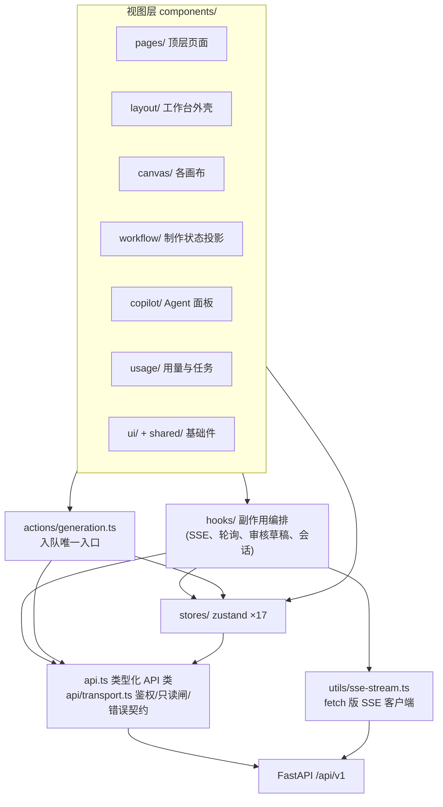
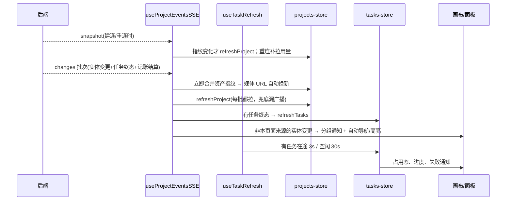
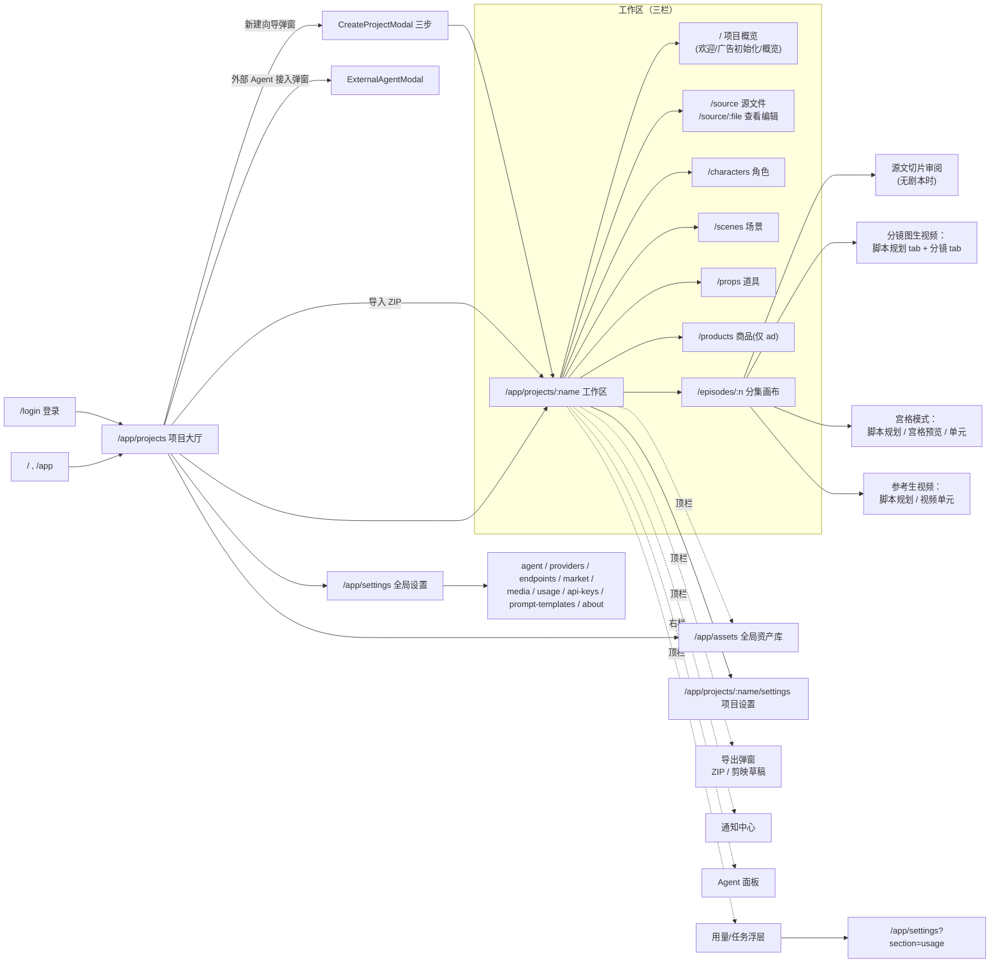
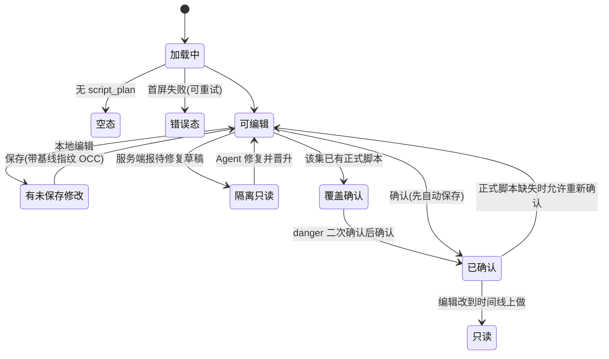

# ArcReel 源码研究 · 第 06 章：前端架构、信息架构与关键 UX 流程

- **本章范围**：ArcReel Web 前端的技术栈与分层（路由、状态、数据获取、实时更新、错误与加载、i18n、测试）；全部路由与页面的信息架构；十余个关键界面的布局、状态、交互与背后的 API / store；UI 如何落实“人工确认 / 审核闸门”和“产物时效（current / stale）”；设计系统的做法（只作描述）；每个界面与 parity ledger P-01..P-14 的映射及 Linglong 对应组件；对 Linglong 的启示。
- **不在本章**：后端 workflow plan 的求解规则、产物清单 basis 摘要的算法、供应商与计费内部实现（见其他章节）。
- **读过的资料**（均位于 `ArcReel/`）：`frontend/package.json`、`vite.config.ts`、`vitest.config.ts`；`frontend/src/` 下 `main.tsx`、`router.tsx`、`app-routes.ts`、`branding.ts`、`api.ts`（分节结构）与 `api/{transport,errors}.ts`、`utils/sse-stream.ts`；`stores/` 全部 17 个 store（逐个浏览接口与注释）；`hooks/` 中 `useProjectEventsSSE`、`useTaskRefresh`、`useScriptReviewDraft`、`useAssistantSession`、`useReferenceDurationGate`、`useTaskFailureNotifications`、`useScriptGenerationNotice`；`actions/generation.ts`；`types/{project,workflow,presentation,cost,asset}.ts`；`components/` 下 layout、canvas（timeline / reference / grid / lorebook）、workflow、copilot、usage、pages（含 settings、create-project）、assets、shared、ui 各区域（大文件按结构与注释浏览，关键组件逐段阅读）；`onboarding/`（steps、tour、demo-project）；`i18n/index.ts`（仅结构）；`index.css` 与 `components/ui/darkroom-tokens.ts`（仅设计方法）；`PRODUCT.md`、`CLAUDE.md`、`.claude/rules/frontend-*.md`、`.claude/rules/onboarding-anchors.md`、`.impeccable/config.json`；`website/docs/dev/architecture.md`、`website/docs/guide/getting-started.md`（任务 / 费用 / 合成导出段）；`docs/assets/screenshots/{hero,video-units,ad-mode}.webp`（观察布局）；ADR 0006、0035、0062（节选）。Linglong 侧只浏览了 `apps/web/components/video-production/`（HEAD 版本）与 `apps/web/components/ai-video/src/pages/aiStudio/` 的文件与导出名。

> 本文为基于 ArcReel 源码的研究笔记，遵循 docs/linglong-arcreel-parity-method.md：不含复制的代码、提示词或 schema。

---

## 0. 一页结论

1. **前端是“服务端判定的投影器”，不是业务推断者。** `PRODUCT.md` 的原则 3 与 `types/workflow.ts:1-10` 的注释都要求：进度、阻断、产物时效一律读服务端权威结果，界面不按“文件在不在”自行推断。整套工作流面板（`components/workflow/`）只复述后端 `WorkflowPlan`，连下一步提示都只查表翻译 `next_action.type`。
2. **技术栈刻意轻量**：React 19 + Vite 8 + TypeScript，路由用 `wouter`，状态用 `zustand`（17 个独立 store），**没有 React Query / SWR**；数据获取是手写 `API` 类 + store action 内做“在途合并 + 失败留旧 + AbortSignal 取消域”。这套并发纪律写成了仓库规则（`.claude/rules/frontend-async-race.md`），是前端最有价值、也最容易被低估的部分。
3. **实时更新走“事件驱动 + 兜底轮询”双通道**：项目事件 SSE（fetch 实现，可带鉴权头、指数退避重连、`Last-Event-ID` 续传）推送实体变更和任务终态；任务中间态（queued→running）没有事件，由 `useTaskRefresh` 按“是否有任务在途”在 3s / 30s 两档轮询。媒体 URL 用服务端下发的文件指纹（mtime）做缓存击穿。
4. **工作台是三栏壳**：左侧资产 / 分集导航，中间按路由切换的画布，右侧可拖宽、可收起的 Agent 对话面板；顶栏中间是 4 段阶段步进器，右侧是通知、用量 / 任务入口、导出、全局资产库、设置。分集画布顶部常驻一条可折叠的“制作状态”条（`WorkflowPanel`）。
5. **审核闸门在 UI 上有四种形态**：脚本规划的显式“确认”闸（`ScriptReviewGate`，确认前可编辑、确认后只读，覆盖已有正式脚本时要走 danger 二次确认）；批量视频的整批准入（放行 / 待确认 / 受阻三态，待确认时按时长档位与费用整批拍板）；单个视频入队前的时长档位确认弹窗；取消 / 删除 / 改名等破坏性操作的二次确认（改名带 dry-run 影响预览）。**所有花钱的动作都必须由用户按下**，stale 产物只提示“仍可用”，从不自动重生。
6. **版本即“时间机器”**：每个图片 / 视频 / 音频资源卡都挂 `VersionTimeMachine`，列出全部历史版本（带来源、时间、提示词、预览），用户显式“切换到此版本”才恢复——这就是 ArcReel 的“取景 / take selection”，但它是“单一当前版本 + 可回退历史”，**不是并排多 take 选择**。
7. **与 Linglong 的关键差异**：ArcReel 前端没有独立的“成片合成 / 交付检查”页面——导出只有项目 ZIP 与剪映草稿，成片合成只能通过 Agent 的 `compose-video` 技能（斜杠命令）触发；Linglong 的 P-10 需要自建交付页（`VideoDeliveryPage` 起点），剪映路径被排除。ArcReel 的视觉是深色 “Darkroom” 风格，Linglong 必须用自己的白 / 浅灰 / 炭黑 Image-module 系统，只借鉴信息层级与状态语义。

---

## 1. 技术栈与架构

### 1.1 构建与依赖

- **框架**：React 19（`react`/`react-dom` ^19.2），TypeScript 6，Vite 8，Tailwind CSS v4（`@tailwindcss/vite` 插件，主题 token 写在 CSS 的 `@theme` 块里，无 `tailwind.config`）。见 `frontend/package.json`。
- **路由**：`wouter`（轻量、hook 风格、支持 `nest` 嵌套路由）。
- **状态**：`zustand` ^5。
- **UI 基础件**：`@headlessui/react`（可访问的弹层 / 选择器）、`@floating-ui/react`（定位）、`lucide-react`（图标）、`@lobehub/icons`（供应商 logo）、`framer-motion`（动效）、`@tanstack/react-virtual`（长列表虚拟化）、`@visx/*`（用量趋势图）、`streamdown`（Agent 流式 Markdown 渲染）、`driver.js`（首次使用引导）、`eventsource-parser`（SSE 解析）。
- **开发代理**：`vite.config.ts` 把 `/api`、`/mcp`、`/agent-installation-guide.md` 代理到本机 FastAPI（端口 1241）。前端构建产物 `dist/` 由后端托管（单体自托管形态）。
- **质量闸**：`pnpm check` = typecheck + ESLint（含 jsx-a11y、react-hooks、testing-library 插件）+ knip（死代码）+ vitest。

### 1.2 分层

要点：

- **`API` 是一个大而扁平的静态类**（`api.ts`，约 3000 行、200+ 方法），按领域分节：系统配置、提示词模版、引导、项目、Agent 记忆、角色 / 衍生 / 场景 / 道具 / 商品、资产重命名、脚本规划内容确认、分镜（narration / ad / drama 各一组）、文件、尾帧、源文件、草稿、概述、生成、任务队列与取消、版本、风格图、Agent 会话、用量记录、API Key、供应商与凭证、自定义供应商、市场、自定义端点、费用估算、宫格、全局资产库、参考生视频（`api.ts:296` 起）。方法普遍接受可选 `signal`。
- **传输层**（`api/transport.ts`）统一注入鉴权头与界面语言、401 统一清凭证跳登录、以及一个**全站只读闸门**（`setApiReadOnly`，`api/transport.ts:71-77`）：演示项目期间任何非 GET 请求在发出前被拒，作为“漏掉某个写入口”的结构性兜底。
- **错误契约**（`api/errors.ts`）：后端错误体被解析为若干具名错误类——通用 `ApiRequestError`（`message` 可直接展示，`diagnostic` 供调用方按语境解读）、上传同名冲突 `ConflictError`（带建议新名）、TTS / 时长阻断 `NarratedVideoDurationError`、参考投影阻断 `ReferenceProjectionError`、脚本批量编辑失败、Agent 启动失败 `AgentFailureError` 等。UI 靠 `instanceof` 分派到不同的修复入口，而不是一句“失败了”。
- **入队动作层**（`actions/generation.ts:1-17`）：所有生成类入队（分镜图、视频、旁白、角色 / 场景 / 道具 / 商品图、衍生、声音样本、图片编辑、宫格、参考单元、参考批量）只能经这一层。每个动作固定做三件事：请求前在 tasks-store 打**乐观占用标记**（失败回滚、成功用返回的 task_id 兑现），调 API，按后端 `deduped` 标志弹“已在处理中”或成功提示。组件直调入队 API 会被 ESLint `no-restricted-syntax` 拦下（`.claude/rules/frontend-ui-conventions.md`）。

### 1.3 路由

`router.tsx` + `app-routes.ts` 定义全部路由（常量单一来源，`app-routes.ts:7-20`）：

- 顶层：`/login`；`/` 与 `/app` 重定向到 `/app/projects`；`/app/projects`（大厅）；`/app/settings`（全局设置，`?section=` 切分区）；`/app/assets`（全局资产库，`?tab=&q=`）；`/app/projects/:projectName/settings`（项目设置，全屏，必须声明在工作区嵌套路由之前）；`/app/projects/:projectName`（`nest` 嵌套工作区）；兜底 404。
- 工作区内层（`StudioCanvasRouter.tsx:626` 的 `<Switch>`）：`/`（项目概览）、`/source` 与 `/source/:filename`、`/characters`、`/scenes`、`/props`、`/products`（仅 ad）、`/episodes/:episodeId`；旧路径 `/lorebook`→`/characters`、`/clues`→`/scenes` 做重定向兼容。内层没有 404，所以引导模块用 `APP_PROJECT_WORKSPACE_PATTERN` 精确匹配已注册子路径。
- **路由守卫**：`AuthGuard`（`router.tsx:82`）登录态加载中显示居中 spinner，未登录带 `from` 参数跳回登录。`ConfigStatusLoader`（`router.tsx:47`）常驻路由根，登录后拉一次“配置完整性”（有带界退避重试），并据“内嵌 Agent 是否已配置”决定 Agent 面板默认开合。
- **项目生命周期**（`StudioWorkspace`，`router.tsx:116`）：进入项目先清空上一项目的 Agent 会话状态，先把 `currentProjectName` 落地（数据置空）以轮换取消域，再 `refreshProject`；演示项目则打开只读闸、从前端常量灌数据、不发请求。

### 1.4 状态管理（stores/）

| Store | 职责（用自己的话概括） |
| --- | --- |
| `projects-store` | 大厅列表；当前项目 `ProjectData` + 各集脚本 `currentScripts`；**项目快照修订号**（SSE 驱动递增）；**资产文件指纹表**（路径→mtime）；唯一刷新入口 `refreshProject`（在途合并、失败留旧、项目级取消域，返回 success / failed / cancelled 三态） |
| `tasks-store` | 任务列表与统计、连接状态、刷新作用域；**乐观占用集**（资源粒度与剧本文件粒度两类）；导出 `isResourceBusy`、`useActiveResourceIds` 等选择器；`selectNeedsFastPolling` 决定轮询档位 |
| `workflow-store` | 当前（项目, 集）的 `WorkflowPlan`；本次请求的旁白交付选择；已确认的时长档位；同目标合并、换目标作废 |
| `cost-store` | 项目费用估算（估算 / 实际，按集、按分镜、按类型、多币种），防抖拉取 |
| `usage-header-store` | 顶栏用量入口：本项目 summary、进行中调用、最近已结束 10 条、详情 |
| `usage-records-store` | 设置页全量用量记录：筛选（时间范围 / 项目 / 供应商 / 模型 / 媒体类型 / 分镜 / 状态）与 URL query 双向同步、分页 |
| `assistant-store` | Agent 会话列表、当前会话、时间线条目与 turn、流式草稿、输入框、发送 / 中断状态、待回答问题、技能列表、启动失败观察 |
| `app-store` | 全局 UI：toast、持久通知、工作区通知中心、Agent 面板开合与宽度（持久化）、用量浮层开合、**滚动定位目标 `scrollTarget`**（跨组件“跳到并高亮某分镜 / 资产”）、焦点上下文、源文件 / 宫格失效计数 |
| `reference-video-store` | 参考生视频单元列表缓存（按 项目::集 分桶）、选中单元、增删改排序 |
| `config-status-store` | 配置缺口列表、可用媒体类型、内嵌 Agent 是否就绪 |
| 其余 | `auth-store`（token 存 localStorage）、`onboarding-store`、`assets-store`（全局资产库）、`capabilities-store`（能力缓存失效计数）、`endpoint-catalog-store`（自定义端点目录与约束） |

**没有全局 normalized cache**：画布组件从 `projects-store` 读整份 `ProjectData` / 脚本，写操作后统一调 `refreshProject` 重拉（`StudioCanvasRouter.tsx:133-142`）。媒体变化则只更新指纹表，不必重拉 JSON。

### 1.5 数据获取与并发纪律

仓库把前端竞态防护写成了规则（`.claude/rules/frontend-async-race.md`），归纳为四条：

1. **跨函数的异步链用 AbortSignal 取消**，取消域按数据生命周期划分（项目级 vs 会话级不共用）；被作废方的 `finally` 不碰共享 loading；“作废了一次由一次性事件触发的拉取”必须补拉（取消与补偿成对）。参考实现 `useScriptReviewDraft`、`useAssistantSession`。
2. **多入口刷新同一份数据收敛为一个 store action 并在途合并**（`projects-store.refreshProject`、`usage-header-store.refresh`、`workflow-store.refreshPlan`）。
3. **hook 的函数型参数显式列入依赖**，要求调用方传稳定引用，不用 ref 豁免。
4. **被跳过的补偿动作要记账、事后补做**，保护状态按完整作用域（项目 × 会话）分桶计数。

另一个一致做法是“**提交时刻复核占用态**”：弹窗打开时校验一次，点击提交时再用 `isResourceBusy` 做一次新鲜读（`components/canvas/lorebook/assetBusyGuard.ts:5-14`），同一卡片的兄弟控件共享禁用态；卡片本地在途写请求（保存中 / 上传中 / 改名中）同样计入。

供应商配置则反向处理：**不缓存**，每次消费时重拉（ADR 0035），避免前端缓存成为漂移的第二真相源。

### 1.6 实时更新

- 项目事件流 `/projects/{name}/events/stream`（`api.ts:1917` 附近）由 `utils/sse-stream.ts` 消费：因为原生 `EventSource` 不能带 `Authorization`，改用 fetch 建连，自己实现退避重连与 `Last-Event-ID` 续传。
- `useProjectEventsSSE` 把一批变更拆成三类：**实体变更**（分镜 / 角色 / 场景 / 道具 / 商品 / 集 / 草稿 / 各类 ready 事件）、**任务终态**、**记账结算**。只有实体变更参与通知与“自动跳转”；来源是 Agent 或其他客户端（`source !== "webui"`）时才弹通知，草稿事件会自动导航到对应集的脚本规划页。跳转目标在刷新落定后才消费（快照比对防止拿未落库的目标导航）。
- 任务状态通道：终态靠 SSE、中间态靠轮询（`hooks/useTaskRefresh.ts` 注释写明了“按是否有任务在途而不是按 SSE 是否在线切档”的理由：SSE 可能静默失速）。
- 失败通知：`useTaskFailureNotifications` 观察任务转入 failed（含“首次出现即 failed”）后推**持久、可点击回跳**的通知；首个成功轮询建立基线，历史失败不刷屏。
- 工作流计划的刷新触发 = 项目快照修订号变化 或 本项目任务指纹变化（250ms 防抖合并），`WorkflowPanel.tsx` 顶部注释给了取值理由。

### 1.7 错误与加载模式

- **三态刷新结果**：success / failed / cancelled，cancelled 静默（项目已切走），failed 才提示。
- **失败留旧**：刷新失败不覆盖屏上已有内容；首屏无内容时才进错误态并给重试（`useScriptReviewDraft` 中“空态 vs 错误态”区分）。
- **反馈分级**：瞬时 toast（`app-store.pushToast`，入队同步失败、保存成功）；持久通知（后台任务失败、导出失败）；工作区通知中心（Agent 带来的实体变更，可点击跳转并闪烁高亮，`WorkspaceNotificationsDrawer`）；常驻条幅（数据迁移失败 `MigrationRepairBanner`、角色声音更新后的历史片段提示 `VoiceLegacyBanner`、演示只读条）。
- **加载占位**：`StudioCanvasRouter.tsx:617` 用 `projectDetailLoading` 而不是项目名判断详情是否到达，避免深链直开时把空集合渲染成可交互的“空项目”。
- **禁用有理由**：禁用按钮普遍带原因提示（如分镜导航在“未保存 / 重排在途 / 增删在途”三种原因下给不同提示，`ShotDetail.tsx:1296`）；“没有回调就不渲染入口”，而不是渲染一个点了没反应的按钮（`TimelineCanvas.tsx:230`、`StaleArtifacts.tsx`）。

### 1.8 i18n

- `i18next` + `react-i18next` + 浏览器语言检测；三语 `zh / en / vi`，9 个命名空间（common、auth、dashboard、errors、events、templates、assets、onboarding、workflow），资源是 `.ts` 文件并用 `import.meta.glob` 按（语言, 命名空间）分 chunk 懒加载（`i18n/index.ts`）；首屏等 i18n 就绪再渲染，失败也不阻塞。
- 品牌名用 `[[brand]]` 占位，在资源加载时替换为 `BRAND.name`（`branding.ts` 可用 Vite 环境变量覆盖）。
- 硬约束：面向用户的文本三语同步，由后端测试校验 key 一致性；卡片顶部的等宽英文 kicker 属于设计语言，固定英文、不进 i18n（ArcReel `CLAUDE.md`）。工作流动作类型 `WORKFLOW_ACTION_TYPES` 做成运行时数组，保证每个后端动作都有译文（`types/workflow.ts` 注释）。

### 1.9 测试

- Vitest + jsdom + Testing Library，只收 `*.test.*`；约 211 个测试文件，最密集的是 `components/canvas/timeline`（22）、`utils`（20）、`hooks`（17）、`components/usage`（15）。
- 引导锚点有专门测试（锚点注册表 + 挂载场景存在性），但“锚点元素是否无条件渲染、文案是否仍指向正确入口”只能靠人工核对（`.claude/rules/onboarding-anchors.md`）。
- 未见端到端浏览器测试目录（仓库有 `agent-browser` 技能，待确认是否用于 E2E）。

---

## 2. 信息架构

### 2.1 站点地图

### 2.2 页面清单与用途

| 路由 / 入口 | 组件 | 用途 |
| --- | --- | --- |
| `/login` | `LoginPage` | 单管理员账号登录，成功后按 `from` 回跳 |
| `/app/projects` | `ProjectsPage` + `ProjectCard` | 项目大厅：问候与总览条、阶段筛选、搜索、“正在编辑”特色卡、项目卡网格、新建 / 导入 / 外部 Agent / 资产库 / 设置入口 |
| 弹窗 | `CreateProjectModal` + `WizardStep1..3` | 新建项目三步向导 |
| `/app/assets` | `AssetLibraryPage` | 跨项目的角色 / 场景 / 道具资产库 |
| `/app/settings` | `SystemConfigPage` | 全局设置（9 个分区，URL `section` 参数） |
| `/app/projects/:n/settings` | `ProjectSettingsPage` | 项目级模型覆盖、画幅、风格、声音绑定、旁白 TTS、Agent 配置与记忆 |
| `/app/projects/:n` | `OverviewCanvas`（内含 `WelcomeCanvas` / `AdInitCanvas`） | 项目概览：梗概、资产进度、费用、分集列表；新项目时是上传 / 分析入口 |
| `/source`、`/source/:file` | `SourceFilesPage`、`SourceFileViewer` | 源文件列表、上传（同名冲突选择）、查看 / 编辑 / 删除 |
| `/characters` 等 | `CharactersPage` / `ScenesPage` / `PropsPage` / `ProductsPage` | 项目内资产画廊 |
| `/episodes/:n` | `EpisodeSourceReview` / `TimelineCanvas` / `GridImageToVideoCanvas` / `ReferenceVideoCanvas`，上方 `WorkflowPanel` | 分集制作主画布，按生成模式与剧本状态分派（`StudioCanvasRouter.tsx:722-859`） |
| 404 | `NotFoundPage` | — |

---

## 3. 关键界面详解

### 3.1 工作台外壳（Studio shell）

- **目的**：把项目上下文、阶段、全局动作、导航与 Agent 放在固定位置，让画布只关心当前内容。
- **布局**（`StudioLayout.tsx:158-255`，截图 `hero.webp`）：
  - 顶栏 `GlobalHeader`（三段式 grid）：左 = 返回大厅 + `ProjectMenu`（项目头像、名称、创作类型·画幅徽标，下拉含当前项目卡、新建项目、项目设置）；中 = `PhaseStepper`（**4 段**：准备 / 剧本 / 制作 / 完成，数据来自服务端 `status.phase`，`types/project.ts:93`；组件注释写 5 段是遗留描述）；右 = 通知铃（未读角标）、`UsageHeaderEntry`（本项目参考花费，有任务在途时图标呼吸 + 计数）、分隔线、导出主按钮、全局资产库、设置（配置不完整时红点）。
  - 左栏 `AssetSidebar`（可折叠为 64px 图标栏）：工作区导航（概览 / 源文件 / 角色 / 场景 / 道具 / 商品，带计数）+ 分集列表（搜索 + `EpisodeCard`：缩略、标题、状态、视频可用进度条、stale 数、实际花费；ad 项目恒单集，隐藏“集”语义）。“新增分集”按钮恒禁用（分集由 Agent 规划产生）。
  - 主区：路由画布。
  - 右栏：`AgentCopilot`，默认宽度约 505px、可在 360–720px 间拖拽（双击复位，宽度持久化），收起后右上角出现悬浮 Agent 按钮；收起时内容保持挂载但 `inert`，保留会话状态。
  - 顶部条幅区：演示只读条、数据迁移修复条。
- **副作用挂载点**：`useTaskRefresh` + `useProjectEventsSSE` 挂在外壳上（`StudioLayout.tsx:70-73`），失败通知与剧本生成提示用无 UI 的监听组件隔离重渲染（`TaskFailureListener`、`ScriptGenerationNoticeListener`）。

### 3.2 项目大厅（P-01）

- **布局**（`ProjectsPage.tsx`）：顶部条（搜索框带快捷键提示、导入、外部 Agent、资产库、设置）→ Hero 总览条（按阶段的项目数）→ 阶段筛选胶囊（全部 + 4 阶段，带计数；右侧只有一个静态的“最近”排序标签，无排序切换）→ “正在编辑”特色卡（`NowEditingCard`，按活跃度打分挑选：制作中且未完成者优先，完成者最低，`ProjectsPage.tsx:77-98`；仅在未筛选、未搜索时显示）→ 项目卡网格 + 末尾“新建”占位卡。
- **项目卡**（`ProjectCard.tsx`）：海报（缩略图或风格图）、阶段徽标、分集进度条（按集状态着色）、角色 / 场景 / 道具可用计数、**stale 资产数单独一行**（`ProjectCard.tsx:275-290`，强调 stale 不算缺口）、**需修复徽标 + 失败原因直接展示**（不放 tooltip，因触屏打不开，`ProjectCard.tsx:141-173`）、操作菜单（删除）。
- **状态**：加载 spinner；零项目 → 只显示新建占位卡；筛选无结果 → 空提示；引导进行中额外挂演示卡 `OnboardingDemoCard`（与真实卡同一实现的只读形态）。
- **交互**：搜索按标题、项目名与阶段标签匹配（`ProjectsPage.tsx:954-965`）；导入 ZIP 支持冲突策略（提示 / 重命名 / 覆盖，`ConflictDialog`），导入后若有自动修复或警告弹 `ArchiveDiagnosticsDialog`（阻断 / 自动修复 / 警告三段）；删除走 `ConfirmDialog`。
- **API / store**：`API.listProjects`、`importProject`、`deleteProject`；`projects-store`、`config-status-store`、`onboarding-store`。

### 3.3 新建项目向导（P-02）

- **形态**：三步弹窗（`CreateProjectModal.tsx:146`）：① 基础（`WizardStep1Basics`）② 模型（`WizardStep2Models`）③ 风格（`WizardStep3Style`），顶部步骤条。
- **第 1 步字段**（`WizardStep1Basics.tsx:15-31`）：标题（必填）、创作类型（narration / drama / ad）、源文件性质（仅 drama：小说改编 / 成品剧本）、画幅（9:16 / 16:9）、**生成模式（二选一卡，无预选、必选，创建后不可改，`GenerationRouteCards.tsx:7-12`）**、宫格分镜开关（仅分镜图生视频，ad 不支持）、ad 目标总时长（四档）、单集目标时长、口播语速。标题与生成模式缺一则“下一步”禁用（`WizardStep1Basics.tsx:329`）。
- **第 2 步**：项目级模型覆盖，数据在弹窗层一次拉取（系统配置、内置供应商、自定义供应商）并在步骤间保留，避免来回切换重复请求；加载与错误态就地显示。
- **第 3 步**：风格模版选择或上传自定义风格图（`StylePicker`）。
- **提交**：`API.createProject` → 如有自定义风格图再上传（失败只提示、不回滚项目）→ 导航进工作区（`CreateProjectModal.tsx:307-349`）。
- **创建后的“intake”在项目概览里继续**：
  - narration / drama：`WelcomeCanvas` 引导上传源文件并触发内容分析（`API.generateOverview`）。
  - ad：`AdInitCanvas`（`AdInitCanvas.tsx:25-28`）上传多张商品原图、填商品描述与创作 brief，可勾选同时生成商品资产图；也允许不传商品只写 brief。
  - 首次从欢迎页进入概览时触发一次 Agent 交接提示（`AgentHandoffHint`），自动打开 Agent 面板。

### 3.4 项目概览（P-03 起点）

- `OverviewCanvas.tsx`：标题与模式说明 → 梗概卡（可编辑、可重新生成，冲突时提示）→ 资产进度三格（角色 / 场景 / 道具）→ 费用加载 / 错误 → 项目总费用（估算 / 实际分列，按类型拆分）→ 分集列表（每集规模、时长、单集费用内联）。
- **API / store**：`API.uploadFile`、`generateOverview`、`updateOverview`；`cost-store`。

### 3.5 分集画布与“制作状态”面板（P-03 / P-11）

- **分派规则**（`StudioCanvasRouter.tsx:742-853`）：有集但无剧本且无草稿（非 ad）→ `EpisodeSourceReview`（源文切片全文 + 拆分元信息：边界、节拍、尾钩子，CTA 唤起 Agent 起草，`EpisodeSourceReview.tsx:9-12`）；否则按生成模式：参考生视频 → `ReferenceVideoCanvas`；开启宫格 → `GridImageToVideoCanvas`；默认 → `TimelineCanvas`。画布实例以 `项目::集` 为 key，跨项目强制重建以免残留本地状态。
- **`WorkflowPanel`**（`components/workflow/WorkflowPanel.tsx`）：默认折叠为一行“制作状态 + 后端给的下一步 + 阻断数徽标”；展开后依次是阻断告警（`role=alert`）、计划级问题、步骤列表。每个步骤（`WorkflowStepRow.tsx`）把**四条轴分开陈述**：
  1. 步骤进度（轨道刻度：完成 / 就绪 / 进行中（脉冲）/ 受阻 / 待办 / 跳过）；跳过的步骤保留并说明“本模式不涉及”。
  2. 产物时效 `ArtifactMeter`：集合型产物给“可用 N（其中 stale M）/ 缺 K”的完整句子，计量条只是图形复述且 `aria-hidden`；集合读不出时不猜数（`ArtifactMeter.tsx:22-74`）。
  3. stale 清单 `StaleArtifacts`：每项“查看”（跳到画布单元）与“重新生成”（显式、花钱），多项时可“全部重生”。
  4. 任务胶囊 `TaskChips` + 供应商收单 `CheckpointNote`（已收单意味着重试可能重复计费，单独一行说明）。
  此外还有结构化问题清单、整批准入结论（见 §4.2）、旁白交付方式选择（仅作用于本次请求、不写回项目，类型上有 `persisted: false`）。
- 面板**不自建播放器、不自建入队路径**：“查看”复用 `app-store.triggerScrollTo`，“重生”复用画布已有入队回调；参考生视频模式只给“查看”，重生入口在单元卡上。

### 3.6 脚本审核闸门（P-04）

- **位置**：分镜图生视频与宫格模式的“脚本规划”tab（`TimelineCanvas.tsx:351-360`）；参考生视频有专属面板 `ReferenceScriptPlanPreviewPanel`；ad 不走脚本规划（一键生成）。
- **目的**：把 Agent 产出的 `script_plan`（结构化中间稿）在网页上结构化呈现、允许手改或让 Agent 改，**用户显式确认后才放行后续提示词编写与视觉生成**（`ScriptReviewGate.tsx:266-272`）。
- **内容**：drama 按场景卡（元信息标签、发声序列 utterances、原文）；narration 按段落卡（小说原文）。
- **状态机**（`ScriptReviewGate.tsx:369-378` 与 `useScriptReviewDraft.ts`）：

- **关键细节**：
  - 保存使用“草稿所基于的服务端内容指纹”做乐观并发控制，而不是最新状态指纹，避免静默覆盖 Agent 的并发修改（`useScriptReviewDraft.ts:96-99`）；外部刷新（Agent 改了 script_plan）时若用户有未保存编辑则只更新服务端态、保留草稿。
  - 待修复草稿（schema 违约）在场时整面板只读，逐条列出违约并原样展示草稿；“请 Agent 修复”按钮把违约报告**预填进 Agent 输入框并打开面板**，由用户按发送（`ScriptReviewGate.tsx:320-335`）。
  - 确认会覆盖已有正式脚本时，按钮变 danger，`ScriptOverwriteConfirmDialog` 列出将被移除的分镜及随之不再显示的分镜图 / 视频。
  - 视频模型无法解析时提前禁用确认（能力请求本身失败不算，交后端兜底）。
- **API**：`getScriptReview`、`saveScriptReviewContent`、`confirmScriptReview`（409 带覆盖后果或“已确认”诊断码）。

### 3.7 分镜 / 镜头编辑（P-06 / P-07）

- **`TimelineCanvas`**：集头 `EpisodeHeader`（EP 徽标、可编辑集名、状态行、**预估 / 已花 / 剩余三列费用**）→ tab 栏（脚本规划 / 分镜；无剧本时分镜 tab 禁用）+ 右侧批量按钮 → `ShotSplitView`。
  - 观察：分镜 tab 上“批量生成分镜图 / 批量生成视频”两个按钮当前是**无条件禁用**的占位（`TimelineCanvas.tsx:312-329`），只有 narration 的批量旁白可用；批量生成实际通过 Agent 或工作流面板完成（待确认是否为有意设计）。
- **`ShotSplitView`** = 左 `ShotList`（260px，可折叠 44px；虚拟化；搜索；每行缩略、状态徽标、时长、版本号，ad 显示段落标签如 hook / 卖点）+ 右 `ShotDetail`。
- **`ShotDetail`**（`ShotDetail.tsx:454` 起）通过 `ResponsiveDetailGrid` 按容器宽度三栏 / 两栏 + 抽屉 / 单栏 tab 自适应（`ResponsiveDetailGrid.tsx:10-16`）：
  - 头部：分镜 ID、时长选择（候选已由服务端按模型能力与分辨率收窄；已保存的越界值不改写，按成因给警告）、状态、`n / N` 与上下切换、增删分镜（`ShotStructureActions`，删除前 danger 确认说明产物去向；旁白分镜新增时先填正文）、ad 前后移动、备注抽屉 `NotesDrawer`。
  - 左栏：引用与范围（`ReferencesSection`，绑定的角色 / 场景 / 道具 / 商品，含角色衍生）、drama 发声序列编辑器 / ad 口播文案与段落标签 / 对话、原文只读。
  - 中栏：图像提示词与视频提示词编辑器（结构化 / 纯文本两种形态，结构化→文本切换有 danger 确认），“查看最终提示词”（`PromptPreviewButton`：打开才请求，渲染在后端完成、前端不拼接）。
  - 右栏：分镜图 `MediaCard`、尾帧行 `EndFrameRow` / `EndFramePicker`（从本集分镜图 / 宫格切图快照复制或上传，不建立引用）、视频 `MediaCard`、旁白音频卡 `NarrationAudioCard`。
  - 编辑模型：**本地草稿 → 显式保存**；切分镜时整组件按 key 重置，未保存时导航禁用；上游字段静默更新时“干净草稿”自动跟随。
- **`MediaCard`**：头部图标区 = 上传替换、图片指令编辑（`ImageEditButton`：以当前图为底图 + 指令入队 i2i，完成后经指纹刷新）、版本（`VersionTimeMachine`）；主体 = 图片或 `PresentationPlayer`；底部 = 生成 / 重新生成主按钮（进行中 spinner、视频在无分镜图时禁用并说明原因、宫格模式下隐藏单独生成）。
- **`PresentationPlayer`**：按服务端“成片读取模型”（`types/presentation.ts`）同步播放视频轨 + 旁白轨 + 字幕 cue，可在“后期配音 / 使用 TTS”两种变体间切换并下载；请求 key 包含视频 / 旁白指纹与项目修订号，任何一方变化即重取。
- **宫格模式**（`GridImageToVideoCanvas`）：tab 为脚本规划 / 宫格预览 / 单元；宫格整图生成后切分到各分镜，可单格重生（`enqueueGrid`、`enqueueGridRegenerate`）。
- **参考生视频**（`ReferenceVideoCanvas`，截图 `video-units.webp`）：tab 为脚本规划 / 视频单元；左 `UnitList`（窄屏退化为 `UnitRail` + 抽屉）、中 单元头（ID、时长档位）+ 富文本编辑器（`@[资产]` 提及高亮，`MentionPicker` 浮层补全）/ “解析预览” sub-tab（`ScriptPreviewPanel`：本地即时高亮，停止输入后请求后端解析派生台词与降级警告）、右 `UnitPreviewPanel`（视频预览、重新生成、旁白配音、元数据，仅大屏）。头部有旁白交付切换与批量生成视频。

### 3.8 资产库：项目内（P-05）与全局（P-13）

- **项目内画廊**（`CharactersPage` / `ScenesPage` / `PropsPage` / `ProductsPage`）：`GalleryToolbar`（标题、计数、新增、从资产库选择）+ 卡片网格，空态 `GalleryEmptyState` 带 CTA。
- **资产卡**（以 `CharacterCard` 为例）：资产设计图（生成 / 上传 / 指令编辑 / 版本）、参考原图、描述、声音风格、参考音频（按项目“声音绑定方式”折叠并说明当前不生效的原因）、试听样本 `VoiceSampleButton`（选音色→编辑样本文案→生成→试听→**确认后才落为角色参考音频**，关闭不落资产，`VoiceSampleButton.tsx:33-35`）、“加入资产库”`AddToLibraryButton`、行内改名 `EditableAssetName`（先 dry-run 取影响预览再二次确认，级联改写全部剧本引用，`EditableAssetName.tsx:24-30`）、“查看最终提示词”。
- **角色衍生**（换装 / 变身等同一身份的另一外观）：`CharacterDerivativesButton` 浮层内增删改名、复制脚本引用记号、显示“是否被脚本引用”；`CharacterDerivativeSheet` 展示衍生图与**过期标记**——本体重生成后全部衍生转为 stale，重生该衍生即消解（`CharacterDerivativeSheet.tsx:32-37`）。衍生图只能由本体图编辑得到，不提供上传。
- **商品**（ad）：`ProductCard` 审核用户原图（保真锚点）与商品资产图、编辑卖点与品牌；商品不入全局资产库（`ProductsPage.tsx:27-29`）。
- **全局资产库**（`AssetLibraryPage`）：角色 / 场景 / 道具三个 tab（WAI-ARIA tablist 键盘导航），搜索 query 与 tab 写入 URL，卡片网格，新建 / 编辑（替换图片）/ 删除确认；记住来源页用于返回（只接受站内路径防开放重定向）。条目带来源项目、衍生列表（只读）。
- **导入语义**：项目画廊“从资产库选择”打开 `AssetPickerModal`，确认后 `API.applyAssetsToProject`（冲突策略 skip）——**复制进项目**，之后两边独立（与 Linglong P-13 “引用不复制”相反，见第 01 章）。

### 3.9 生成任务、进度与取消（P-07 / P-11）

ArcReel 没有单独的“任务中心页”，任务信息分布在三处：

1. **资源卡就地**：由 `useActiveResourceIds(kind, project)` 派生“生成中”态（活跃 + 最新行胜出），加上入队前打的乐观标记，从点击那一刻起就禁用并显示 spinner；参考单元状态推导优先级为“上传中 → 队列活跃 → 队列失败 → 乐观窗口”（`unit-status.tsx:69-76`）。
2. **顶栏用量 / 任务浮层**（`UsageHeaderEntry` → `UsagePopover.tsx:112-115`）：顶部 KPI（本项目全部时间口径）、左栏“进行中”（本项目排队 / 运行任务 + 无任务承载的 pending 调用如剧本生成、Agent 会话；运行中用不确定进度条，只标“还在动”，`UsageActiveRow.tsx:27-44`）、右栏“最近已结束”10 条（下载失败可就地重试）、底部通往设置页全量记录。
3. **工作流面板**的任务胶囊与供应商收单说明（§3.5）。

- **取消**：只对排队中任务开放（ADR 0006：执行中的供应商调用已计费，本地中断省不了钱）。两步交互（`use-task-cancellation.ts:40-47`）：先取预览（单个取消带将被级联取消的下游、全部取消带排队条数）→ **行内** `alertdialog` 确认（不弹到屏幕中央以保留“取消的是哪一行”的上下文，`CancelConfirmDialog.tsx:16-18`）；预览时任务已开始则静默收场，确认时恰好开始则展示服务端 409 原因。
- **耗时读数**：`TaskElapsedReadout` 用等宽数字显示已等待 / 已运行 / 耗时，语义放在 title 与无障碍名里。
- **长耗时文本任务**：Agent 调用剧本类工具时弹一次“较慢”的过程提示（`useScriptGenerationNotice.ts:7-13`）。

### 3.10 版本时间机器与 take 选择（P-09）

- `VersionTimeMachine.tsx:60` 起：触发按钮（可只显示图标）→ 浮层（随滚动容器重新定位）列出 v1..vN，标记当前版本；选中某版本展示详情：来源（生成 / 图片编辑 / 手动上传）、时间、提示词、预览（图片 / 视频 / 音频，视频优先用 `PresentationPlayer`）、音频可下载；非当前且可恢复的版本给“切换到此版本”。
- **恢复流程**（`VersionTimeMachine.tsx:130-157`）：渲染态禁用 + 点击时新鲜读 `checkBusy` 双重防护（图片编辑任务完成会无条件覆盖 current，占用期间恢复会被吞）→ `API.restoreVersion` → 用返回的指纹更新 store → 刷新项目 → 重拉版本列表并选中。
- 覆盖资源：分镜图、视频、参考视频、旁白音频、角色 / 衍生 / 场景 / 道具 / 商品设计图、宫格图。资源底层变化（新生成落地）时列表重置但**浮层不关闭**，用户留在上下文里看到新版本。
- **与 Linglong 的差异**：这是“单一当前 + 历史可回退”，重新生成总是产生新版本并成为当前；不存在“同一镜头多 take 并排比较后择一”的界面。P-09 要求“所有 take 可见 + 显式选择”，时间机器满足“可见 + 显式恢复 + 不销毁”，但 Linglong 若要并排 take，需要自行设计。

### 3.11 费用显示（P-12）

- **三层口径**：
  - 估算 vs 实际：`cost-store`（`API` 费用估算端点，`types/cost.ts`）按项目 / 集 / 分镜 / 类型、多币种给出；集头三列“预估 / 已花 / 剩余”，概览页项目总计与每集内联，侧栏分集卡显示实际花费，分镜详情显示该镜花费，`MediaCard` 可显示单次生成估算。
  - 顶栏参考花费：`UsageHeaderEntry` 显示本项目全部时间的多币种合计，零记录时也占位以免顶栏抖动。
  - 全量用量记录：设置页 `UsageRecordsSection`——筛选栏（时间范围、项目、供应商、模型、媒体类型、分镜、状态，写入 URL 形成可分享链接，`usage-records-store.ts:12-45`）、KPI 条、异常关注卡（仅有异常时渲染）、趋势图（visx）、构成表（按供应商 / 模型 / 媒体类型，低成功率行警示，点行即筛选）、记录表（进行中行秒级计时）、详情弹窗（输入缩略、用量明细）。
- **刷新信号**：记账结算事件与任务终态经 SSE 驱动费用与用量刷新；非成功终态也刷新（供应商可能已计费）。
- **“代价先于执行”**（`PRODUCT.md` 原则 2）：批量视频准入的待确认态按档位列出秒数 × 单元数与合计费用；单视频时长确认弹窗讲清档位与费用。

### 3.12 Agent 对话面板（P-03 辅助 / P-12）

- `AgentCopilot.tsx:169` 起：头部（会话选择器：历史会话列表、新建、删除；会话状态点；收起按钮）→ 上下文条 `ContextBanner`（当前聚焦的资源，可清除）→ 消息时间线 → 输入区（图片附件缩略条、粘贴 / 拖拽 / 选择图片、斜杠命令菜单 `SlashCommandMenu` 按技能过滤、发送 / 中断）。
- **消息渲染**：`ContentBlockRenderer` 分派文本（流式 Markdown）、思考块（可折叠）、工具调用 + 结果（`ToolCallWithResult`，一行摘要可展开）、技能 chip、子代理卡（嵌套时间线）、任务进度块、问答块、中断提示、图片。`TodoListPanel` 从时间线提取最新待办列表。`MessageRow` 操作行常驻行高（hover 只改透明度，不跳动），用户消息可原地改写（从该处分叉重跑）。
- **Agent 向用户提问**：`PendingQuestionWizard` 把 Agent 的待回答问题做成分步向导，答完统一提交——这是 Agent 驱动流程中的另一种人工确认点。
- **失败**：`AgentFailureCard` 展示 Agent 启动失败的脱敏观察，可重试（重放原输入）。
- **与画布的桥**：多处 CTA（分集源文审阅、待修复草稿、数据迁移修复）采用“**预填 Agent 输入框 + 打开面板，由用户按发送**”的统一模式，而不是后台直接调用。
- **数据**：`useAssistantSession`（会话列表、条目 SSE 流、断线补 gap、发送 / 改写 / 回答 / 中断 / 删除，项目级与会话级两个取消域）；每个项目记住最后使用的会话（localStorage）。

### 3.13 供应商与系统设置（P-07 前置）

- **全局设置**（`SystemConfigPage.tsx:43-53`）：左侧分组导航（Configuration / Access / System 三组），9 个分区——Agent（Anthropic 凭证、语言规则、记忆柜）、供应商（内置供应商列表 + 详情：多凭证、手动激活、连通性测试，`ProviderDetail`）、自定义端点（声明式端点定义、导入、试运行、ComfyUI 节点绑定表）、市场（多源、安装徽标）、默认媒体模型（`MediaModelSection`，“默认 + 按用途指定”分层字段）、用量、API Key（供外部 Agent / MCP 使用）、提示词模版（只读查看）、关于。配置缺口在顶部集中提示。
- **项目设置**（`ProjectSettingsPage`）：模型覆盖（`ModelConfigSection` + `LayeredModelFields`：一个默认主下拉 + 折叠的“按用途指定”细分项，细分留空时显示穿透后真正执行的模型，`LayeredModelFields.tsx:1-10`）、生成模式只读 + 锁形徽章、画幅（修改有警告）、风格、角色声音绑定方式（提示词软约束 / 参考音频）、旁白 TTS 音色与语速、Agent 配置重置（列出受影响文件后二次确认）、项目级 Agent 记忆；未保存离开有确认。
- **能力驱动表单**：视频模型下拉每项附能力线（时长 / 分辨率 / 音轨 / 声音一致性档位），选中后在下方展示规格条 `VideoModelSpecBar`；时长候选始终来自服务端能力解析，前端不持有收窄规则。
- **外部 Agent 接入**（大厅 `ExternalAgentModal`）：展示 MCP 端点与安装指引、引导去创建 API Key。

### 3.14 交付与导出（P-10）

- **入口**：顶栏导出主按钮 → `ExportScopeDialog`（锚定弹层），三个选项：
  1. 仅当前版本 ZIP（推荐、体积小）；
  2. 全部数据 ZIP（含版本历史）；
  3. 剪映草稿：进入表单（选集、本地草稿目录路径（记忆在 localStorage）、剪映版本、旁白交付方式）。
- **流程**（`GlobalHeader.tsx:107-171`）：先请求一次性下载 token（同时返回诊断）→ 隐藏 `<a>` 触发浏览器下载 → 若有阻断 / 自动修复 / 警告则弹 `ArchiveDiagnosticsDialog`。演示项目禁用导出。
- **缺口**：没有“成片合成”按钮、没有交付检查清单、没有成片预览页。成片合成（FFmpeg 拼接 / 转场 / 音频 / 编码）只能通过 Agent 技能（斜杠命令中的 compose-video）完成，产物路径出现在 Agent 回复里（截图 `hero.webp` 右栏可见）。入门文档说明只有“剧情演绎 + 分镜图生视频”组合在应用内合成，其余走剪映或下载片段（`website/docs/guide/getting-started.md` 第 7 节）。

### 3.15 首次使用引导与演示工作台（P-14 辅助）

- `onboarding/steps.ts:1-22`：12 步，跨大厅 → 设置（供应商、Agent）→ 大厅演示卡 → **演示项目只读工作台**（概览、Agent、资产、分集时间线、导出）→ 回大厅收尾。结构与文案分离（文案在 i18n），锚点用 `data-onboarding` 注册表；锚点缺失时等待后降级为居中气泡、不中止（`onboarding/tour.ts`）。
- 演示项目用**真组件 + 前端常量数据**渲染，所有写入口按 `readOnly` 关闭，外加 API 只读闸兜底；Agent 面板换成静态演示对话；SSE 与任务轮询不接。

---

## 4. UI 如何落实人工确认与审核闸门、如何表达产物时效

### 4.1 确认点清单

| 确认点 | 触发条件 | 形态 | 源码 |
| --- | --- | --- | --- |
| 生成模式选择 | 新建项目 | 必选二选一、无预选、标注“创建后不可改” | `GenerationRouteCards.tsx` |
| 脚本规划确认 | 进入视觉生成前 | 显式确认按钮；覆盖正式脚本时 danger 二次确认并列出后果 | `ScriptReviewGate.tsx`、`ScriptOverwriteConfirmDialog.tsx` |
| 批量视频准入 | 参考生视频批量 / 工作流视频步骤 | 放行即入队；待确认按档位列秒数 × 单元数 × 费用，整批拍板；受阻逐条列缺口（真问题在前、被连带扣下的在后）。后两种都明确“一个任务也没建” | `BatchAdmissionSummary.tsx:15-27`、`ReferenceBatchAdmissionDialog.tsx:33-42` |
| 单视频时长确认 | 申请档位偏离当前视觉 / 剧本档位，或预检有非阻断问题（如参考图只取前 N 张） | 弹窗对照“当前 → 申请”秒数与费用，多单元逐行列出、超高滚动不折叠 | `ReferenceDurationConfirmDialog.tsx:75-83`、`useReferenceDurationGate.ts:38-43` |
| 重新生成 | 任何产物 | 只由用户按下；stale 只提示不自动重生 | `StaleArtifacts.tsx:16-22` |
| 版本恢复 | 时间机器 | 选中版本后显式“切换” | `VersionTimeMachine.tsx` |
| 声音样本落盘 | 试听后 | 显式“确认并保存”，关闭即丢弃 | `VoiceSampleButton.tsx` |
| 资产改名 | 级联改剧本 | dry-run 影响预览 + 二次确认 | `EditableAssetName.tsx` |
| 取消任务 | 仅排队中 | 预览级联 + 行内 alertdialog | `use-task-cancellation.ts` |
| 删除分镜 / 项目 / 资产 | — | danger `ConfirmDialog` 说明产物去向 | `ShotStructureActions.tsx`、`ProjectsPage.tsx` |
| Agent 代办 | 修复 / 起草类 CTA | 预填输入框，用户按发送 | `MigrationRepairBanner.tsx:9-14`、`ScriptReviewGate.tsx` |
| Agent 提问 | Agent 需要决策 | 分步问答向导 | `PendingQuestionWizard.tsx` |

### 4.2 时效（currency）与“三轴分离”

- **三条轴在类型层就分开**（`types/workflow.ts:1-10`）：步骤进度（`WorkflowStepState`）、产物时效（`ArtifactStatus` = current / stale / missing / blocked）、任务与供应商收单。界面禁止把它们折成一个“有问题”。
- **stale 的立场**：比当前内容旧、但文件在、照常参与成片、不挡导出；计入“可用”，单独报数；不进缺口；只提供“查看”和“重新生成（花钱）”两个入口（`StaleArtifacts.tsx`、`ArtifactMeter.tsx:66-74`）。大厅卡、侧栏分集卡、概览、工作流面板用**同一口径**（可用 = current ∪ stale，`EpisodeCard.tsx` 注释、`ProjectCard.tsx:298-305`）。
- **stale 的来源**由后端产物清单在读取时比对生成依据摘要得出（ADR 0062），前端不存也不算；衍生图随本体重生成转 stale 是该机制在资产层的体现。
- **缓存新鲜度**：媒体 URL 追加服务端文件指纹；`PresentationPlayer`、`VersionTimeMachine` 以指纹 / 项目修订号作为重取 key；计划面板“属于另一个目标的计划不拿来陈述当前目标”（`WorkflowPanel.tsx` 中 planKey 比对）。
- **数据迁移阻断**：`needs_repair` 时大厅卡显示原因、工作台顶部常驻条幅、生成入口全部关闭，已有产物仍可看。
- **声音版本告警**：角色参考音频变更后，画布顶部一次性横幅统计“早于新声音生成”的片段数，关闭写回“已确认到的声音版本”时间戳（`VoiceLegacyBanner.tsx:1-14`）。

---

## 5. 设计系统（仅描述，Linglong 不得复制）

- **风格定位**：深色“Darkroom”暗房式工作台——深墨背景、玻璃质感面板（半透明渐变 + 背景模糊）、细发丝线分隔、紫色为主强调色、琥珀色表达“代价 / 警示 / 锁定”、红色表达错误 / 阻断、绿色表达完成；展示型标题用衬线字体，数字等宽，卡片顶部有等宽英文 kicker（`CLAUDE.md` 说明 kicker 属设计语言、不翻译）。
- **token 机制**：颜色 token 用 OKLCH 定义在 `index.css` 的 Tailwind v4 `@theme` 块中（背景 / 表面 / 发丝线 / 文本四级 / 强调 / 语义色 / warm 与 danger 的多级透明变体 / 兼容旧名的别名），组件以 `var(--color-*)` 或 Tailwind 工具类引用；另有 `components/ui/darkroom-tokens.ts` 收纳常用按钮、卡片、输入框、下拉面板的样式常量；层级 z-index 在 `utils/ui-layers.ts` 统一。实际代码中仍有不少组件内联样式直接写渐变与阴影（如 `GlobalHeader`、`AssetSidebar`），token 化并不彻底。
- **组件库**：自建小型基础件（`components/ui/`：`ModalShell` / `GlassModal` / `GlassPopover` / `Popover`、`ConfirmDialog`、`PrimaryButton` / `SecondaryButton` / `GenerateButton`、`DropdownPill`、`PillSwitch`、`ProgressBar`、`InlineWarning`、`SectionShell`、`ProviderModelSelect` / `ModelCombobox`、`ImageLightbox`、`AspectFrame`、`Typewriter` 等），可访问性依赖 Headless UI 与自写 focus trap / roving tabindex；无第三方设计系统（非 shadcn / MUI）。
- **设计工作流**：`.impeccable/config.json` 与 `.claude/skills/impeccable`、`frontend-design` 规则要求前端改动先走设计技能确立方向（`.claude/rules/frontend-design-first.md`）；`PRODUCT.md` 是给设计工具读的产品上下文。
- **对 Linglong 的约束**：不得复制上述颜色值、渐变、阴影、字体选择、图标组合、kicker 文案、品牌名与 logo。Linglong 按 P-14 使用白底画布、`#FAFBFC` 次级面、`#F6F8FB` 弱填充、`#171A20` 主按钮、`#E6E8EC` 边框、蓝色仅作次要状态色；可借鉴的只是**信息角色**（如“stale 用独立语义色 + 文字说明，不只靠颜色”“形状区分轴：步骤用刻度、产物用填充块、任务用描边胶囊”）。

---

## 6. 界面 → parity ledger → Linglong 对应组件

> Linglong 对应组件取自 `apps/web/components/video-production/`（`linglong-arcreel-parity-method.md` 所列 checkpoint）。注意：**当前工作区 `git status` 显示这 5 个文件及 `apps/web/app/video-production/` 路由均为已删除（未提交）**，HEAD 中仍存在；同时 `apps/web/components/ai-video/src/pages/aiStudio/` 下有另一套 AI Video 页面（`ProjectLobby`、`ProjectWorkbench` 各 tab、`TaskCenter`、`ModelManagement`、`VideoEditor`、`shots/*`、`assets/tabs/*`）。哪一套是 Linglong Production 的现行承载**待确认**，下表两者都列出。

| ArcReel 界面 | Ledger | Linglong 对应（video-production @HEAD） | 其他可能对应（ai-video） |
| --- | --- | --- | --- |
| 项目大厅 `ProjectsPage` / `ProjectCard` | P-01、P-14 | `VideoProductionHub`（含 `ProjectRow`、`EmptyProjectState`，支持归档 / 恢复 / 派生） | `project/ProjectLobby` |
| 工作台外壳 `GlobalHeader` / `AssetSidebar` / `PhaseStepper` | P-03、P-14 | `VideoProductionShell`（顶栏）；阶段导航在 `VideoProductionWorkspace` 内 | `ProjectWorkbench`（tab 式） |
| 新建向导 + 欢迎 / 广告初始化 | P-02 | `NewVideoProduction`（含 `ModelPicker`、`ReviewRow`） | — |
| 项目概览 `OverviewCanvas` | P-03、P-12 | `VideoProductionWorkspace`（概览段）、`ProjectActivity` | `ProjectWorkbench/tabs/DashboardTab` |
| 制作状态 `WorkflowPanel` | P-03、P-11 | 无直接对应（`OperationStatus` 覆盖任务部分） | — |
| 源文件 / 源文切片审阅 | P-04（novel 相关部分**排除**） | `ScriptPanel`（原创简报 / 剧本） | `ChaptersTab`、`chapter/*`（章节化，需按 scope lock 排除小说改编） |
| 脚本审核闸门 `ScriptReviewGate` | P-04 | `ScriptPanel`（草稿 / 保存 / 锁定 / 按修订恢复） | — |
| 分镜编辑 `TimelineCanvas` / `ShotDetail` | P-06 | `ShotPlanEditor`、`EmptyStoryboard` | `shots/ChapterShotsPage`、`ChapterShotEditPage` |
| 分镜图 / 视频卡 `MediaCard`、宫格、参考单元 | P-07 | `StoryboardPanel`（生成 / 生成多 take）、`PromptCard` | `ProductionTab` |
| 旁白 / 字幕 / 成片读取 `PresentationPlayer`、`NarrationAudioCard` | P-08 | `OverlayEditor`（字幕 / logo / 商店叠加） | `EditTab`、`editor/VideoEditor` |
| 版本时间机器 `VersionTimeMachine` | P-09 | `TakesPanel`（选择 take、审核、裁切入出点） | — |
| 项目内资产画廊 + 衍生 | P-05 | `DesignBoard`（设计板 / 资产包、按格选择） | `ActorsTab`、`ScenesTab`、`PropsTab`、`ProductsTab`、`RolesTab` |
| 全局资产库 `AssetLibraryPage` | P-13 | `VideoAssetsPage` | `assets/tabs/*`（含 `CostumesTab`） |
| 任务浮层 / 取消 / 失败通知 | P-07、P-11 | `OperationStatus`（取消 / 重试） | `components/TaskCenter` |
| 费用 / 用量记录 | P-12 | `ProjectActivity`（事件历史；费用展示待确认） | — |
| Agent 面板 `AgentCopilot` | P-03（辅助）、P-12 | 无（Linglong 以按钮触发的 AI 草拟为主，待确认） | `agents/AgentManagement` |
| 供应商 / 模型设置 | P-07 前置（**不得改动用户拥有的模型 / 端点 / location**） | 项目内 `ProjectModelSelect`、向导内 `ModelPicker` | `models/ModelManagement`、`ProvidersTab`、`ModelsTab` |
| 导出 `ExportScopeDialog` | P-10（剪映草稿**排除**） | `VideoDeliveryPage`（`DeliveryList`） | — |
| 首次引导 / 演示工作台 | P-14 辅助 | 无 | — |

---

## 7. 对 Linglong 的启示

### 7.1 值得复刻的交互模式（按信息角色复刻，不复刻外观与文案）

1. **固定的工作台三区 + 顶栏阶段步进器**，阶段由服务端投影给出；分集 / 镜头导航与资产导航共用左栏。Linglong 的 Workspace page master 可按“左导航 / 中画布 / 右辅助面板”对齐密度与层级。
2. **“制作状态”折叠条**：默认一行“下一步是什么 + 有几个阻断”，展开看步骤。四轴分离（步骤 / 产物时效 / 任务 / 供应商收单）是 P-03、P-11 最值得学的表达方式，尤其“供应商已收单 = 重试可能重复计费”单独说。
3. **stale 语义**：stale 计入可用、单独报数、不进缺口、不自动重生；各处统一口径。直接支撑 P-09“不销毁先前产物”与“每个昂贵步骤保留人工确认”。
4. **确认式闸门**：脚本确认前可编辑、确认后只读、覆盖前列后果；批量准入“全有或全无 + 待确认按档位 × 费用拍板”；时长偏离单独确认。对应 P-04、P-07、P-12 的“operator confirmation”证据。
5. **入队动作层 + 乐观占用 + 提交时刻复核**：从点击瞬间禁用、后端去重提示“已在处理中”、兄弟控件同步禁用。这是 P-07“no silent overwrite”与 P-11 刷新后可恢复的前端基础。
6. **事件 + 兜底轮询**：终态靠推送、中间态按“是否有在途任务”切换轮询频率；首次观测即失败也要通知；失败通知持久且可跳回。满足 P-11 的“刷新后仍能看到任务状态”。
7. **刷新三态（success / failed / cancelled）与失败留旧**，以及 AbortSignal 取消域——建议 Linglong 在自己的数据层直接定为规范（如用 React Query 等价实现也可，但语义要一致）。
8. **版本浮层**：全部版本可见、带来源 / 提示词 / 预览、显式恢复。Linglong 的 `TakesPanel` 可以在此基础上补“并排比较”。
9. **“预填 + 用户按发送”**的 AI 代办模式：任何由 AI 执行的修复都先把意图摆给操作者，满足“无人工确认不自动交付”。
10. **用量记录的 URL 化筛选 + 详情弹窗含输入缩略**，是 P-12 审计视图的好参照。

### 7.2 应当简化的部分

1. **不要做 17 个互相交织的 store + 手写合并器**：Linglong 可用成熟的服务端状态库承载“在途合并 / 取消 / 失败留旧”，只保留少量 UI store（面板开合、滚动定位、通知）。
2. **生成模式 × 创作类型 × 宫格的画布分派**：ArcReel 有 3 种画布 + 3 套剧本形状；Linglong 的范围（广告、原创短剧、修复、CTV）可以统一为“镜头列表 + 镜头详情”一种画布，差异放在字段层。
3. **Agent 面板**：ArcReel 的全流程依赖内嵌 Agent（会话、分叉、子代理、斜杠技能）。Linglong 若不做对话式 Agent，可只保留“AI 草拟 + 操作者确认”的按钮式入口，以及一个任务 / 活动侧栏。
4. **自定义端点 / 市场 / ComfyUI 绑定 / 提示词模版查看**等设置分区超出 Linglong 范围；且按 `CLAUDE.md`，模型 ID、端点、location 是用户拥有的配置，Linglong 设置页只读展示或选择，不做编辑器。
5. **首次引导 + 只读演示工作台**成本高（锚点一致性需人工维护），可延后。
6. **三语 i18n**：Linglong 若只需中英，可简化，但“术语即界面用词、同一概念全站同一个词”的原则值得保留。

### 7.3 明确不在范围内

- 小说源文件上传、内容分析、分集规划、源文切片审阅（`WelcomeCanvas` 的小说路径、`SourceFilesPage` 的改编语义、`EpisodeSourceReview`）——scope lock 排除 novel ingestion 与 novel-to-episode。原创短剧的“供稿剧本”可参照 drama + screenplay 的逐字提取路径，但不照搬改编流程。
- 剪映草稿导出（`ExportScopeDialog` 第三项）——P-10 已排除外部编辑器工程。
- ArcReel 的视觉资产、颜色、字体、图标、品牌、UI 文案、引导文案、演示项目数据。
- 自动选 take / 自动交付：ArcReel 本身也不做，Linglong 保持同一立场。

### 7.4 ArcReel 前端的缺口（Linglong 需要超越的地方）

1. **没有应用内成片合成与交付页**：P-10 要求“最终 MP4、QA 报告、源清单、交付检查单”可发现，Linglong 必须自建（ArcReel 的合成藏在 Agent 技能里）。
2. **没有并排 take 比较**：P-09 需要 Linglong 自行设计多 take 视图。
3. **项目大厅没有排序切换**（只有静态“最近”标签，活跃度打分只用于挑特色卡），也没有归档；Linglong 的 `VideoProductionHub` 已有归档 / 恢复 / 派生，可保持。
4. **P-02 intake 字段偏薄**：ad 只有 brief 文本 + 商品图 + 卖点；受众、市场、声明合规等需 Linglong 自定义。
5. **批量分镜图 / 批量视频按钮在时间线画布上是禁用占位**（`TimelineCanvas.tsx:312-329`），批量入口依赖 Agent；Linglong 应提供带准入与费用确认的显式批量按钮。
