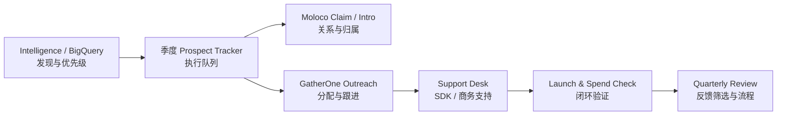

# Prospect Tracker 2.0 — Apps Script Design Specification

> 产品设计稿｜版本：v1.0｜项目：Moloco IAA SMB Expansion Plan｜产品 owner：Owen
>
> 本文档先定义 Apps Script Web App 的目的、页面、数据边界和工作流，再进入开发。它是《Moloco IAA SMB Expansion Plan》的执行工具设计，不改变 Intelligence 的数据筛选职责，也不重写已存在的 Google Sheet 人工记录。

## 1. 决策与设计原则

**决定：先按本设计实现 Prospect Tracker 2.0，不把完整 Intelligence 复制进 Apps Script。**

Intelligence 继续承担“发现、计算和判断”的职责；Apps Script 变成面向 Owen、Michael 与 GatherOne 的“执行工作台”。这样既能把 Intelligence 的关键数据带入日常协作，又不会把 BigQuery、SensorTower 逻辑、复杂分析和外部协作混在一起。



核心原则：

- **Bundle 是执行与去重的最小单位；Company 只用于归组。**
- **BigQuery 是指标事实源，Google Sheet 是协作状态事实源。** Apps Script 只读取已批准的 Intelligence 字段，不能把手工进展写回 BigQuery。
- **每次同步只追加新 Bundle 或更新系统字段，绝不覆盖人工字段。**
- **GatherOne 可以推进、提交和请求支持，但不能改写内部筛选规则、Top 2000 排除数据或 Moloco 内部备注。**
- **先用一个季度的 pilot 验证，不清理或重构全部历史 Sheet。**

## 2. 现状盘点：保留什么、必须替换什么

现有 `apps/prospect-tracker/` 已有可复用的 Web App 外壳、筛选表格、侧边详情/标注面板、BigQuery 同步入口和每周 launch check。以下能力应保留：

| 保留能力 | 2.0 中的位置 |
|---|---|
| Prospect radar、搜索、筛选、排序 | 执行队列页的基础列表能力 |
| 详情面板与手工更新 | Bundle 详情抽屉的“推进”标签 |
| BigQuery 数据读取 | Bundle Lookup 和月度同步服务 |
| 每周 Launch / spend 检查 | Command Center 结果指标与自动检查 |
| 当前人工维护的 Sheet 数据 | 原样保留；通过字段映射接入，不清表 |

以下逻辑不能继续沿用：

| 当前问题 | 2.0 设计 |
|---|---|
| 固定列序号 `C = {...}`，人工插列会错写 | 按 header 名称建立动态 field map；启动时验证必填列 |
| `syncFromBQ()` 按 company 去重 | 改为按 `quarter + bundle` 去重；同一公司可有多个 Bundle |
| BQ 同步只 append，缺少历史版本/指标更新 | 新 Bundle append；已存在 Bundle 只更新系统字段和 `latest_data_as_of`，完全保留人工字段 |
| `Agency List` 通过 clear + replace 导出，现已停用 | 改为只读的 GatherOne Action Queue 视图；永不清空人工 Sheet |
| 标注字段不足以驱动 workflow | 新增 owner、claim、next action、support、SDK/UA 状态与 blocker 字段 |
| 公司级总览混入 Bundle 级动作 | 默认展示 Bundle 行；Company 页只做聚合，不承担写入 |

## 3. 信息架构：v1 的五个页面

v1 只做五个页面，覆盖当前项目的完整执行闭环；不会在 Apps Script 中复制 Ask AI、复杂图表或全量 Intelligence 分析页。

| 页面 | 用户 | 要解决的问题 | 核心产出 |
|---|---|---|---|
| 1. Command Center | Owen、Michael、GatherOne lead | 本周该处理什么、哪里卡住 | 例外队列和项目健康度 |
| 2. Prospect Queue | 全部执行者 | 哪个 Bundle 由谁、下一步是什么 | 可执行的 Bundle 工作队列 |
| 3. Bundle Intelligence Lookup | Owen、Michael、GatherOne | 一个 Bundle 值不值得推进、已有何种信号 | 只读的标准化数据卡 |
| 4. GatherOne Intake | GatherOne | 如何提交自有线索且不污染正式名单 | 待审核 submission |
| 5. Support & Blockers | GatherOne、Michael、Supply | 技术/商务问题由谁、何时解决 | 可追踪支持工单与升级记录 |

### 3.1 页面 1：Command Center

**目的：** 让项目负责人和 GatherOne lead 在 2 分钟内看到需要行动的事项，而不是浏览整张表。

**上方 KPI 卡片：**

- 本季度 active Bundles；
- 本月新增 Bundles；
- 待 Moloco claim / intro 数；
- 待 GatherOne 接收/分配数；
- 7 天内到期的 next action 数；
- 超过 14 天未更新的 stale 数；
- Blocked 数（按 Business / SDK technical / Ownership 分组）；
- 已验证 Launched 数及最近 7 天有 spend 的 Bundle 数。

**下方四个行动队列：**

1. `Needs claim`：Sales 尚未 Claim / Introduce / Release 的 P1/P2 Bundle；
2. `Needs owner`：已释放但没有 GatherOne owner 的 Bundle；
3. `Stale / overdue`：超过 SLA 未更新或 next action 已过期；
4. `Needs support`：未关闭的支持请求，按 support owner 排序。

**允许动作：** 点击进入 Bundle 详情；管理员可运行月度同步和 launch check。页面本身不直接修改数据。

### 3.2 页面 2：Prospect Queue（现有 Radar 的升级）

**目的：** 这是 GatherOne 和 Moloco 日常工作的主页面。每一行是一个 Bundle，不是一家公司。

**默认列：**

| 分组 | 列 |
|---|---|
| 客户识别 | Company、App、Bundle、Gaming / Non-Gaming、Lead source |
| Intelligence 信号 | Priority、IAA/SDK signal、paid download share、active UA networks、最近完整月下载、MoM %、`metrics_month`、`latest_data_as_of` |
| 归属 | Claim status、Moloco relationship owner、GatherOne execution owner、route |
| 执行 | Stage、Last update、Next action、Next action due、last updated date |
| 结果/风险 | SDK status、UA status、launch evidence、blocker category、support status |

**默认视图与筛选：**

- `My Queue`：当前登录/选择的执行 owner；
- `GatherOne Queue`：`Released to GatherOne`、`Assigned`、`Contacted` 等可执行记录；
- `P1/P2`、`New this month`、`No owner`、`Blocked`、`Stale`；
- Gaming / Non-Gaming、lead source、stage、priority、support type；
- Company 搜索和 Bundle 精确搜索。

**Bundle 详情抽屉（四个 tab）：**

| Tab | 内容 | 可写字段 |
|---|---|---|
| Intelligence | 只读数据事实、数据月份、优先级原因、下载趋势、Moloco history、网站 | 无 |
| Ownership & Route | Claim 结果、Moloco relation owner、GatherOne execution owner、route、handoff 日期 | 指定角色可写 |
| Progress | Stage、last update、next action、due date、SDK status、UA status、launch evidence | 当前 execution owner 可写 |
| Support | Blocker、support request、owner、SLA、resolution | 提交/更新受角色约束 |

**保存校验：**

- 进入 `Assigned` 必须有 execution owner；
- 进入 `Contacted` 必须有有效触达说明和日期；
- `Blocked` 必须同时有 blocker category、support needed、support owner；
- 所有 active stage 必须有 next action 和 next action due；
- `Launched` 必须有 SDK live 或真实 spend evidence；不能仅凭手工下拉确认。

### 3.3 页面 3：Bundle Intelligence Lookup

**目的：** 把 Intelligence 最有价值的“单 Bundle 判断”搬到协作端，避免 GatherOne 反复询问 Owen 或查看不应暴露的原始 BigQuery 数据。

**使用方式：** 输入一个或多个 Bundle（换行或逗号分隔），返回一组标准化卡片。支持从 Prospect Queue 一键打开。

**每张卡展示：**

- Company、Publisher、App、Bundle、平台、Gaming / Non-Gaming；
- Priority 与优先级原因；
- `st_last_month_downloads`、`st_prior_month_downloads`、下载 MoM %、`metrics_month`；
- paid download fraction、active UA networks、MAU（如有）；
- IAA / IAP / Hybrid、Moloco SDK / UA / historical relationship 状态；
- China entity、website、top countries；
- `latest_data_as_of` 与数据置信提示。

**结果分类：**

- `Qualified internal prospect`：可在执行队列打开或被加入当季候选区；
- `Already in this quarter`：展示现有 owner、stage、下一步，阻止重复创建；
- `Existing Moloco relationship`：只展示可行动的关系状态，不展示内部敏感备注；
- `Not found / Needs review`：提供“Submit as GatherOne self-sourced”入口。

**边界：** 此页只读，不允许 Agency 修改 BQ 数据、优先级或 Supply Top 2000 信息。

### 3.4 页面 4：GatherOne Intake

**目的：** 给 GatherOne 一个正式入口来贡献客户，同时让 Moloco 保留审核和优先级判断权。

**表单最小字段：**

- Company、App、Bundle、OS；
- GatherOne sales owner、客户联系人/关系依据；
- 线索来源；
- IAA/UA 潜力的判断依据；
- 预期商业动作：`IAA-first / UA-first / Co-win / Unknown`；
- 当前已知 mediation（MAX / Unity LevelPlay / Other / Unknown）；
- 备注。

**提交后的状态机：**

```text
Draft → Submitted → Data Check → Internal Review
      → Approved to Quarterly Queue
      → Needs Info / Duplicate / Excluded
```

**规则：**

- 提交记录先写入独立 `GatherOne Submissions` tab，绝不直接写入当季执行队列；
- 系统先检查 Bundle 是否已经存在于当季或历史执行记录；
- 若 BQ 有匹配，展示只读数据卡供 Owen 审核；
- Owen 批准后，创建/更新季度 Bundle 行，并将 `lead_source` 标记为 `GatherOne self-sourced`；
- GatherOne 可查看自己提交记录的审核结果与需要补充的信息。

### 3.5 页面 5：Support & Blockers

**目的：** 把“在群里问问题”变成可分流、可升级、可沉淀的支持工作流，特别覆盖 GatherOne 对 Moloco IAA SDK 不熟的问题。

**页面结构：**

- `Open requests`：按 Blocker、支持 owner、SLA、严重性过滤；
- `Submit request`：从 Bundle 详情预填，或单独发起；
- `Knowledge links`：链接到 SDK Resource Center、MAX、Unity LevelPlay、FAQ；
- `Resolved patterns`：已解决的问题摘要，后续可进入知识库。

**工单必填字段：**

- Company、Bundle、提交人、客户截止时间；
- support type：`Sales intro / Business / SDK technical / Data / Other`；
- mediation、OS、接入阶段；
- 问题描述、已尝试步骤、日志/截图链接（如有）；
- 期望结果与严重性。

**分流：**

| 支持类型 | 默认 owner | SLA |
|---|---|---|
| Sales intro / Ownership | Michael | 1 个工作日确认 |
| Business | Michael + Owen | 1 个工作日确认 |
| SDK technical | Supply SME | 3 个工作日给答案或下一步 |
| Data / priority | Owen | 2 个工作日 |
| 特殊升级 | Michael 路由 | 1 个工作日确认 owner 和 ETA |

## 4. 数据模型与 Sheet 结构

### 4.1 数据所有权

| 数据类别 | 事实源 | Apps Script 权限 | 同步方式 |
|---|---|---|---|
| Intelligence 指标、优先级、公司信息 | BigQuery `supply_smb` | 只读 | 每月同步；Lookup 实时/按需读取 |
| 季度执行状态、owner、下一步、支持 | 当季 Google Sheet | 受控读写 | Web App 直接写入 |
| GatherOne 自有线索 | `GatherOne Submissions` | GatherOne 创建/更新自己的提交；Moloco 审核 | 审核后写入执行队列 |
| 支持工单 | `Support Requests` | 提交人创建；owner 更新解决过程 | 实时写入 |
| 项目配置和 access roster | `Tracker Config`（保护 tab） | 仅 Owen / 管理员 | 手动维护 |

### 4.2 建议的 Sheet tabs

| Tab | 用途 | 谁写 |
|---|---|---|
| `2026 Q3`（以及后续季度） | Bundle 级正式执行队列；每月新增进入同一季度 tab | 系统字段由同步服务；协作字段由 Web App |
| `GatherOne Submissions` | Agency 自有线索及审核状态 | GatherOne 提交；Owen 审核 |
| `Support Requests` | 支持与 blocker 工单 | 提交人和支持 owner |
| `Tracker Config` | header 名称、状态选项、角色、季度、SLA | Owen / 管理员 |
| `Change Log` | 所有 Web App 写入的审计记录 | 系统 append-only |
| `Agency List` | 保留现有人工历史；2.0 不清空、不自动覆盖 | 仅现有维护方式 |

### 4.3 当季执行队列字段

字段以 `co-win-list-field-spec.md` 为基线，并分为两类，防止同步误伤人工工作。

**系统只写字段：**

`quarter`, `bundle`, `app_name`, `company_name`, `publisher_name`, `lead_source`, `priority`, `priority_reason`, `monetization_type`, `team_routing`, `st_last_month_downloads`, `st_prior_month_downloads`, `st_downloads_mom_pct`, `metrics_month`, `paid_frac`, `active_ua_networks`, `mau_ww`, `moloco_history`, `website`, `latest_data_as_of`, `system_last_synced_at`。

**人工/工作流字段（同步绝不覆盖）：**

`claim_status`, `moloco_relationship_owner`, `gatherone_execution_owner`, `route`, `stage`, `last_update`, `next_action`, `next_action_due`, `sdk_status`, `ua_status`, `blocker_category`, `support_needed`, `support_owner`, `launch_evidence`, `last_updated_by`, `last_updated_at`。

### 4.4 同步与去重合同

```text
输入：已通过 Intelligence 质量闸门的 BigQuery 数据
唯一键：quarter + normalized_bundle

同季度不存在 → append 新 Bundle 行，默认 Pending Claim
同季度已存在 → 仅更新系统只写字段和 latest_data_as_of
不同季度存在 → 新季度允许新行，保留前季度执行历史
bundle 为空/无效 → 不进入正式队列，写入 Data Exception
```

这实现用户已确认的规则：月度给 GatherOne 的 Sheet **只增加新 Bundle**；重现的 Bundle 不添加重复行，但其 Intelligence 指标可刷新，且 GatherOne 已填 owner、进度、下一步必须原样保留。

## 5. 角色、可见性与安全

| 角色 | 可看 | 可写 | 不可做 |
|---|---|---|---|
| Owen / Admin | 全部页面和所有记录 | 审核、路由、系统同步、配置 | 无 |
| Michael | 全部执行队列和工单 | Claim/intro、路由、支持分流 | 改 BQ 评分与数据事实 |
| Growth / Sales | 被分配或需要认领的记录 | Claim / Introduce / Release 和关系备注 | 改 GatherOne 日常进展、看敏感内部数据 |
| GatherOne lead | GatherOne 执行队列、自己的 submissions、开放工单 | owner、进展、intake、support request | 看 Top 2000、内部 Sales 备注、全量 BQ 数据 |
| GatherOne sales | 分配给自己的 Bundle | 进展、下一步、支持请求 | 改 owner/claim、审核其他人线索 |
| Supply SME | 与技术相关的 Bundle 和工单 | 技术答复、resolution、知识链接 | 改销售归属和优先级 |

**部署约束：** 外部 GatherOne 用户的 Google 身份在 Apps Script Web App 中未必能通过 `Session.getActiveUser()` 稳定返回。2.0 实现前必须在测试部署中验证外部账号身份可见性；如果不可用，使用受保护 Sheet + 独立 access roster + server-side 角色选择/审批流程，不将 `Session.getActiveUser()` 当作唯一安全边界。无论部署方式，BigQuery credentials 和 Supply Top 2000 数据都只在服务端使用，永不发送到浏览器。

## 6. 自动化与质量规则

| 自动化 | 触发 | 行为 | 失败处理 |
|---|---|---|---|
| 月度 Intelligence sync | 每月 1 日、人工确认后 | 添加新 Bundle；更新现有 Bundle 的系统字段 | 记录 Run Log，不发布字段覆盖率不合格批次 |
| Claim reminder | 季度发布后第 3 / 5 工作日 | 提醒仍为 Pending Claim 的 Moloco owner / Michael | 逾期默认进入 Release review，不自动覆盖 |
| Stale check | 每天 | active record 超过 14 天未更新标记 Stale | 进入 Command Center 队列 |
| Next-action reminder | 每天 | next action 在 7 天内或已逾期 | 提醒当前 execution owner |
| Launch / spend check | 每周一 | 查询实际 spend，更新 launch evidence | 数据异常只记录错误，不将状态改为未上线 |
| Support SLA check | 每天 | 开放工单 nearing/over SLA | 提醒 support owner 与 Michael |
| Change audit | 每次 Web App 写入 | append 至 Change Log | 失败则不显示“已保存” |

## 7. 不在 v1 范围内的能力

- 不复制 Intelligence 的 Ask AI、AI weekly brief、复杂漏斗和全量图表；
- 不让 Apps Script 直接运行 SensorTower API 或改变筛选模型；
- 不把 GatherOne 的手工更新写回 BigQuery；
- 不自动清理现有历史 tabs 或 `Agency List`；
- 不自动替 Sales 发邮件、做外部联系或承诺商业条款；
- 不在没有审批的情况下开放所有客户给外部 Agency。

## 8. 实施顺序与验收标准

### Phase 0 — 数据与安全地基

1. 读取当前 Sheet 表头并建立 header-based field map；
2. 创建/确认 `Tracker Config`、`GatherOne Submissions`、`Support Requests`、`Change Log`；
3. 为当前季度建立 Bundle 级 queue；不修改历史 Sheet；
4. 建立 role/access roster 和部署测试；
5. 写 migration preview：先显示将新增/更新/跳过的行数，确认后才写入。

**验收：** 任意人工插列不影响 Web App 写入；迁移不会清空或覆盖现有人工字段。

### Phase 1 — 核心执行闭环

1. Prospect Queue + Bundle detail 四 tab；
2. Command Center 行动队列；
3. 重写月度 sync：按 `quarter + bundle` 幂等同步；
4. 保留并接入 launch/spend check；
5. Change Log 和所有保存校验。

**验收：** 同一 Bundle 当月重复出现不会新增行；更新数据后 owner、stage、next action 不变；每一条 active record 都能找出 execution owner 和 next action。

### Phase 2 — Agency 协作与支持

1. Bundle Intelligence Lookup；
2. GatherOne Intake 审核流；
3. Support & Blockers 工单流与知识链接；
4. Claim、stale、SLA 自动提醒。

**验收：** GatherOne 可独立提交线索/支持请求；Owen 能审核后进入正式队列；Supply 能在一个入口看到完整技术上下文；无任何 Agency 用户可见内部敏感字段。

### Pilot 通过条件

先用一个季度、20–50 个真实 Bundle 试运行两周。满足以下全部条件才扩展：

- 新 Bundle 同步、重现 Bundle 更新、人工字段保护均通过；
- GatherOne 100% 能看到自己负责的记录并完成一次真实更新；
- `Blocked` 工单能分配到 owner、记录 SLA 和结论；
- Command Center 能准确列出 stale / overdue / no-owner；
- 没有发生 Sheet 清空、重复 Bundle 或跨角色越权写入。

## 9. 开发前的最终交付清单

开发开始前，按本稿冻结以下内容：

1. 当前季度 tab 的实际 header 名称和状态下拉值；
2. `Tracker Config` 的访问名单、角色与可见列；
3. GatherOne 外部账号的部署/身份验证方式；
4. 哪些 Intelligence 字段可对 GatherOne 显示；
5. Supply SME 主/备 owner 与技术 SLA；
6. Pilot 的真实 Bundle 范围。

这些是一次性实现成功的前置配置，不是重新讨论项目 workflow；项目 workflow 以《Moloco IAA SMB Expansion Plan》为准。
