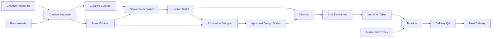

# Incept Comfy Workflow Engine — Detailed Implementation Plan

**Status:** Proposed implementation blueprint
**Date:** 2026-07-26
**Scope:** A new standalone **Comfy Workflow** product, parallel to Studio and Intelligence, that can directly author and run image, video, and writing workflows; it can also exchange work with Image Studio and Video Production.
**Supersedes:** the implementation sections of `incept-comfy-ui-creation-canvas.md`. That document remains the product-direction reference; this document defines the concrete system to build.

> **Confirmed decisions (2026-07-26):** **Comfy Workflow** is a standalone product alongside Studio and Intelligence, with route `/comfy-workflow` and its own navigation shell. It shares workspace-scoped assets and Production records with Studio but does not live in Studio's view hierarchy. The canvas uses `@xyflow/react` (React Flow). The first release includes script, image, video, and commercial workflow capability. Execution begins with a durable queue, node-level realtime events, cancellation, retry, and immutable run records.

## 1. Executive decision

Incept should add a first-class full-screen **Comfy Workflow** product alongside Studio and Intelligence. It should adopt the **workflow concepts** that make ComfyUI powerful, but it must not embed, fork, or recreate ComfyUI's local diffusion runtime or frontend.

The new system is an Incept-native, server-validated workflow engine:

```text
Comfy Workflow product ──► Versioned workflow graph ──► Validator ──► Execution planner ──► Existing provider adapters
        │                       │                   │                     │
        │                       │                   │                     ├─ Gemini Image
        │                       │                   │                     ├─ existing Veo video path
        │                       │                   │                     └─ agent / deterministic compositor / audio path
        │                       │                   ▼
        │                       └──────────────► durable run + asset lineage
        ▼
Standalone output, or an explicit handoff into Image Studio / Video Production

Existing guided production / Image Studio
        │ may import or export a linked workflow
        ▼
Same versioned workflow graph ──► same validator, planner, run history and assets
```

The guided `Direction → Script → Design → Storyboard → Generate → Edit → Deliver` experience remains available. The new Workflows area is also a direct expert creation surface: a user may start a Script, Image, Video, or Commercial workflow without first creating a guided production. When a workflow is linked to a production, both surfaces use the same canonical contracts, asset IDs, run history, and approvals; neither duplicates the other's state.

### Decisions to lock before implementation

1. **Server owns semantics.** The browser may arrange nodes but cannot decide whether an edge is legal, which node runs, or whether an approval gate is satisfied.
2. **Every execution is immutable.** “Regenerate” creates a new `workflow_run_node` and new assets. It never overwrites an approved asset or take.
3. **Nodes are allowlisted product operations.** No arbitrary Python, raw shell, user-defined HTTP request, checkpoint, latent, or sampler nodes.
4. **All media has an asset ID.** Edges pass asset/structured-result references, never browser blobs or untracked URLs.
5. **Existing provider configuration is preserved.** The engine calls existing Incept image/video/audio adapters; it does not introduce or guess new model IDs, endpoints, or cloud locations.
6. **A graph is versioned JSON plus durable execution records.** It is not inferred back from job history after the fact.
7. **No GPL frontend code or visual assets are copied.** The downloaded ComfyUI frontend is an architectural reference only. Incept implements its own React + shadcn/ui + Tailwind components and interaction model.

## 2. What the downloaded ComfyUI source actually does

### 2.1 Architectural facts observed in the local source

| ComfyUI concept | Local implementation | Lesson for Incept |
| --- | --- | --- |
| Node registry | `nodes.NODE_CLASS_MAPPINGS` maps a stable `class_type` to executable node classes; display names are separate. | Give Incept stable node type IDs such as `incept.image.generate.v1`, separate from labels shown in the UI. |
| Typed node schema | Nodes declare inputs, outputs, optional/hidden fields, widget constraints and return types. Newer nodes expose `IO.Schema`. | The palette must be generated from a server-owned catalog with typed ports and form schemas—not hard-coded UI cards. |
| Graph payload | Each prompt node has `class_type` and `inputs`; a linked input is a pair `[upstream_node_id, output_slot]`. | Persist a normalized Incept graph of nodes + edges, with an explicit output port on every edge. |
| Validation | `execution.validate_prompt()` finds output nodes, verifies node existence, required inputs, type compatibility and cycles before queueing. | Reject invalid graphs at save and run time. Return structured node-level errors the canvas can highlight. |
| Dependency scheduling | `DynamicPrompt` and `ExecutionList` resolve dependencies before execution. | Compile only the requested output/selected branch into a topologically ordered execution plan. |
| Incremental work | `CacheKeySetInputSignature` fingerprints a node from class type, inputs and ancestor shape; unchanged values can be reused. | Fingerprint deterministic and provider-safe nodes; cache only when input provenance and operation semantics allow it. |
| Queue/history | `PromptQueue` owns priority queue, currently running work, cancellation and bounded history. | Separate queued/running/cancelled/completed runs from graph definition and from provider jobs. |
| Realtime updates | `PromptServer` sends `status`, `executing`, `executed`, `progress`, and `execution_error` through WebSocket. | Push node-level lifecycle events; do not make the canvas poll an entire production repeatedly. |
| Output contract | Nodes return typed values plus UI output; jobs normalize images, video, audio, 3D and text for preview. | Every completed node must return a typed result manifest and a previewable asset list. |

### 2.2 Relevant source map

The following files were read from the local checkout at `/Users/owen.geng/Documents/comfy/ComfyUI`:

- `comfy_execution/graph.py`: dynamic graph representation and dependency primitives.
- `comfy_execution/graph_utils.py`: links, blockers, graph helpers.
- `execution.py`: input validation, output discovery, dependency execution loop, cache initialization, `PromptQueue`.
- `comfy_execution/caching.py`: input-signature cache keys and invalidation of unused entries.
- `comfy_execution/jobs.py`: normalizes queue/history into stable job statuses and preview outputs.
- `server.py`: `/prompt`, `/queue`, `/history` and `/ws` behavior.
- `nodes.py` and `comfy_api/latest/_io.py`: node registry and typed schema pattern.
- `comfy_api_nodes/nodes_gemini.py` and `comfy_api_nodes/nodes_veo2.py`: provider operations presented as typed image/video nodes.

The downloaded core repository does not contain the frontend source; it identifies `ComfyUI_frontend` as a separately released project. That frontend has now also been examined at `/Users/owen.geng/Documents/comfy/ComfyUI_frontend`. Its useful architectural patterns are documented below; its Vue/LiteGraph implementation will not be copied.

### 2.3 Frontend patterns observed in the local ComfyUI_frontend checkout

| Frontend concern | Local pattern observed | Incept implementation decision |
| --- | --- | --- |
| Canvas ownership | `canvasStore.ts` owns selection, graph/subgraph and viewport; `GraphCanvas.vue` composes canvas, overlays, toolbars and panels. | One React `WorkflowWorkbench` owns selected node(s), viewport and active workflow. Canvas rendering is isolated from inspector/palette state. |
| Dense canvas UI | The canvas uses layers: graph surface, DOM node overlays, links, selection/menu/search, minimap, sidebars and a bottom panel. | Use a React graph renderer for edges/pan/zoom, with React/shadcn panels for node content, inspector and previews. Do not build an all-SVG editor by hand. |
| Multiple documents | `workflowStore.ts` tracks open workflows and active workflow; `WorkflowTabs.vue` supports close/reorder/overflow. | The ComfyUI tab has persistent workflow tabs: users can keep a script, an image variation and a commercial open at once. |
| Extensible sidebars | Sidebar tabs are registered from typed definitions, including Node Library and Job History. | The left rail is data-driven: Templates, Nodes, Assets, Runs. A badge shows pending/running work. |
| Execution feedback | `queueStore.ts` normalizes image/video/audio/text outputs and the run button exposes explicit run modes. | Incept keeps one durable run queue and a bottom Runs drawer with per-node state, output previews, cancel/retry and human-readable errors. It does not expose automatic paid reruns by default. |
| Draft protection | `useWorkflowAutoSave.ts` debounces changed graphs; `workflowDraftStoreV2.ts` maintains local drafts with quota recovery. | Keep a local recoverable draft for transient edits, but autosave immutable server revisions with optimistic concurrency. A run always uses a named persisted revision. |
| Contextual inspection | `RightSidePanel.vue` changes its tabs based on selection and errors. | The right inspector changes between workflow overview, parameters, inputs/outputs, provenance, validation issues and run error detail. |

### 2.4 What we deliberately will not copy

ComfyUI is built to orchestrate local PyTorch models, tensors, model loading, VRAM offloading and arbitrary third-party custom nodes. Those concerns are not Incept's product need and would introduce unacceptable cost, security, support and consistency risk.

Incept must not add:

- local checkpoint/LoRA/VAE/latent/sampler nodes;
- user-supplied executable nodes or arbitrary provider HTTP nodes;
- browser-side provider calls or credentials;
- an unbounded graph that can reach any asset in any workspace;
- a raw ComfyUI prompt JSON endpoint exposed to users;
- automated reruns that spend budget without an explicit policy or confirmation.

## 3. Current Incept baseline and gap

### 3.1 Existing strengths to retain

Incept already has the correct foundational pieces:

- Durable SQLite records for `assets`, `jobs`, `threads`, `video_plans`, and `video_productions` in `apps/api/app/incept/db.py`.
- A unified `GenerationJob` lifecycle and a shared asset library.
- Existing background job handlers for image generation, video generation, production design sheets, keyframes, shots, audio, and final render.
- A guided `VideoProduction` aggregate with its contracts, direction, script, design bible, scenes, shots, audio plan and delivery state in `apps/api/app/incept/models.py`.
- Design-sheet / selected-panel / keyframe / take lineage already visible in `apps/api/app/incept/video_production_store.py`.
- Explicit agent handoffs (`Production Contract`, `Creative Contract`, `Asset Contract`) that can feed workflow template compilation.

### 3.2 Current limitations

1. Work is stored mostly as production-stage fields and bespoke jobs, not as an executable dependency graph.
2. The client polls job records rather than subscribing to node-level events.
3. The same provider operation is represented by multiple endpoint-specific handlers; there is no operation catalog shared with UI.
4. A changed upstream asset does not have one generic dependency index that marks all descendants stale.
5. A user cannot visually inspect a single shot's complete lineage or branch a valid alternative without navigating several screens.
6. `VideoProductionView.tsx` is one large stage-oriented component, unsuitable as the permanent owner of an infinite canvas and inspector.

## 4. Product model: independent Comfy Workflow product plus guided mode

### 4.1 One canonical contract, three entry points

| Guided production | Image Studio | Comfy Workflow |
| --- | --- | --- |
| Helps a non-expert move in the correct order. | Lets a user focus on one image task. | Lets an expert inspect, connect, branch and run an allowed workflow. |
| Owns stage-oriented editing forms and approval language. | Supports focused image creation and editing. | Starts from an image, video, script, or commercial template and can create work directly. |
| May compile its state to a linked graph. | May open/export a linked image graph. | Projects linked production entities as nodes and can explicitly hand a completed workflow back. |
| Uses a stage rail and clear actions. | Uses focused controls. | Uses nodes, typed ports, inspector, tabs and queue. |

Every workflow belongs to a `workspace_id`. `production_id` and `thread_id` are optional explicit links—not prerequisites. A standalone workflow can later create a new Video Production or attach its approved script, visual states, keyframes or takes to one. A production can compile/open its linked workflow without duplicating asset or contract data.

### 4.2 Two authoring levels

**Template mode (default)**

- Start from a validated template.
- Change approved widgets, attach compatible assets, create a variation, or run a selected output.
- Structural edits are limited to allowed insertion points.

**Advanced graph mode**

- Add supported nodes from the palette, connect compatible ports, group nodes, create a branch, and save a reusable subgraph.
- Still no arbitrary code, provider endpoint, or bypass of approvals/budget rules.

This distinction is important: a canvas must not turn a normal advertiser into a graph engineer.

## 5. Canonical workflow contract

### 5.1 Graph document

Use a portable, JSON-serializable document. Store it server-side; the client receives it via API. Coordinates have no execution semantics.

```json
{
  "workflow_id": "wf_01J...",
  "workspace_id": "ws_...",
  "production_id": "vprod_...",
  "title": "30s flower reward commercial",
  "kind": "video_production",
  "revision": 7,
  "status": "draft",
  "template_id": "commercial-reference-to-original.v1",
  "graph": {
    "nodes": [
      {
        "id": "node_ref",
        "type": "incept.asset.reference.v1",
        "label": "Creative reference",
        "params": { "asset_id": "asset_reference_video" },
        "position": { "x": 40, "y": 160 },
        "ui": { "collapsed": false, "group_id": "group_direction" }
      },
      {
        "id": "node_strategy",
        "type": "incept.agent.creative-strategist.v1",
        "label": "Creative Strategist",
        "params": {},
        "position": { "x": 360, "y": 160 }
      }
    ],
    "edges": [
      {
        "id": "edge_ref_strategy",
        "source_node_id": "node_ref",
        "source_port": "reference_media",
        "target_node_id": "node_strategy",
        "target_port": "reference_media"
      }
    ],
    "groups": [{ "id": "group_direction", "label": "Direction", "stage": "direction" }],
    "viewport": { "x": 0, "y": 0, "zoom": 0.75 }
  },
  "created_by": "user_...",
  "created_at": "2026-07-26T...Z",
  "updated_at": "2026-07-26T...Z"
}
```

### 5.2 Node catalog schema

The server owns a versioned catalog. The web client only renders it.

```json
{
  "type": "incept.image.generate.v1",
  "display_name": "Generate image",
  "category": "Image / Generate",
  "description": "Generates one or more image candidates from a prompt and approved references.",
  "inputs": [
    { "id": "prompt", "kind": "widget", "value_type": "text", "required": true, "multiline": true },
    { "id": "references", "kind": "port", "value_type": "asset:image", "required": false, "multiple": true },
    { "id": "output_spec", "kind": "port", "value_type": "production:output_spec", "required": true }
  ],
  "outputs": [
    { "id": "images", "value_type": "asset:image", "multiple": true },
    { "id": "generation_manifest", "value_type": "record:generation_manifest" }
  ],
  "execution": {
    "adapter": "image_generate",
    "approval_required": false,
    "cache_policy": "never",
    "cost_policy": "estimate_before_run"
  }
}
```

`value_type` is a strict, product-level type. Initial types:

```text
asset:image | asset:video | asset:audio | asset:document
asset:contact_sheet | asset:keyframe | asset:design_state
record:creative_contract | record:asset_contract | record:script | record:scene | record:shot
record:generation_manifest | record:qa_report | production:output_spec | timeline:segment | timeline:edit
```

`asset:design_state` and `asset:keyframe` are intentionally distinct. A contact sheet or generic source image cannot be connected directly to a video generation input that requires a selected shot keyframe.

### 5.3 Node instance state

Each persisted node has separate authoring and runtime state:

```text
draft → valid → blocked → queued → running → succeeded → approved
                                      │            │
                                      └→ cancelled └→ failed

succeeded / approved → stale (when a dependency changes)
```

- **draft:** incomplete parameters or links.
- **valid:** semantically executable but not yet run.
- **blocked:** requires approval, a missing asset, a locked script, or a budget confirmation.
- **succeeded:** has a run and output, but may need human selection/approval.
- **approved:** selected output is safe to consume downstream.
- **stale:** its previously selected output is no longer current because an upstream selected output, contract or settings changed.

Do not use a boolean `done`; a user needs to distinguish “made an output”, “selected an output”, and “safe to use downstream.”

## 6. Initial node catalog

The first release is intentionally small. Each type must have a named adapter, a Pydantic params model, an input validator, and a deterministic result normalizer.

### 6.1 Common nodes

| Type ID | Inputs | Outputs | Notes |
| --- | --- | --- | --- |
| `incept.asset.reference.v1` | selected asset | image/video/audio/document | Reference only; cannot become a brand asset by connection. |
| `incept.asset.brand.v1` | selected asset, role | typed asset | Preserves role: logo/product/character/background/UI. |
| `incept.prompt.v1` | text | `record:prompt` | Versioned prompt text; no provider call. |
| `incept.output-spec.v1` | duration/ratio/resolution | `production:output_spec` | Single source for 30s/9:16/720p constraints. |
| `incept.approval-gate.v1` | selected upstream output | same type | Requires explicit approval; preserves audit identity. |
| `incept.note.v1` | text | none | UI only; never enters an execution plan. |

### 6.2 Image nodes

| Type ID | Inputs | Outputs | Existing implementation to wrap |
| --- | --- | --- | --- |
| `incept.image.generate.v1` | prompt, image refs, output spec | image candidates + manifest | Existing image generation request/background runner. |
| `incept.image.edit.v1` | source image, prompt, optional mask | images + manifest | Existing edit flow. |
| `incept.image.outpaint.v1` | source image, canvas rules, prompt | image | Existing outpaint flow. |
| `incept.image.remove-bg.v1` | image | transparent image | Existing deterministic operation. |
| `incept.image.contact-sheet.v1` | pack brief, source assets, design rules | contact sheet | Existing design-sheet generation. |
| `incept.image.select-panel.v1` | contact sheet, panel A-D | `asset:design_state` | Existing panel-selection path, made explicit. |
| `incept.image.keyframe.v1` | shot, approved design states | `asset:keyframe` | Existing keyframe generation. |
| `incept.composite.end-card.v1` | approved logo/UI/mascot/background | image/video-frame | Deterministic composition; never asks an image model to invent legal copy. |

### 6.3 Video-production nodes

| Type ID | Inputs | Outputs | Policy |
| --- | --- | --- | --- |
| `incept.agent.creative-strategist.v1` | reference assets, brand assets, brief, output spec | creative + asset contracts | Creates contract revision; no direct media output. |
| `incept.agent.screenwriter.v1` | contracts, brief, output spec | script | Script must bind all required asset keys. |
| `incept.agent.designer.v1` | contracts + locked script | design bible + pack plans | May only create assets declared in asset contract. |
| `incept.agent.director.v1` | locked script + approved design states | storyboard/shot records | Every shot gets explicit asset bindings. |
| `incept.video.generate-shot.v1` | approved keyframe, optional end keyframe, shot record | video takes + manifest | One short shot operation, never a whole commercial. |
| `incept.video.trim.v1` | video, in/out | video | Deterministic server operation. |
| `incept.video.join.v1` | ordered videos + transitions | video | Deterministic render input; only accepted compatible media. |
| `incept.audio.plan.v1` | locked script + shot timing | audio plan | Existing Audio Producer. |
| `incept.audio.generate.v1` | approved audio plan | audio asset | Existing soundtrack route. |
| `incept.timeline.edit.v1` | takes, audio, overlays | timeline record | Structured timeline, no browser-only state. |
| `incept.render.delivery.v1` | approved timeline + QA result | final video + delivery manifest | Existing render route becomes an adapter. |
| `incept.qa.delivery.v1` | timeline/final media + contracts | QA report | Must block delivery where required checks fail. |

## 7. Validation and graph compilation

### 7.1 Validation must run twice

1. **Edit validation** after every structural change: immediate feedback about invalid port types, missing required widget fields, duplicate single-input edges, cycles, and invalid workspace ownership.
2. **Execution validation** immediately before enqueue: re-resolve asset existence, permissions, approvals, contract revision, budget, provider eligibility and stale dependencies. Browser state is never trusted.

### 7.2 Required validator rules

- Node `type` exists in the catalog and its version is supported.
- Every node ID and edge ID is unique.
- Every edge connects an output port to an input port.
- Source and target `value_type` are compatible; multiple input ports enforce cardinality.
- A required widget value is present and valid against its Pydantic schema.
- A required port has one compatible producer or an allowed literal/default.
- No cycle exists among execution-capable nodes.
- An output target exists. Running a selected node compiles its upstream closure; running a workflow compiles only requested output nodes.
- All input assets are readable by the workflow workspace and user.
- Contract-bound nodes consume the currently selected revisions; an outdated script/design state reports `stale`, not silently reuses old output.
- Asset pack → keyframe → video ordering cannot be bypassed: video generation requires an approved `asset:keyframe`.
- Brand/logo/UI deterministic requirements route to compositor nodes rather than free image/video generators.
- A run cannot exceed workspace budget or batch limit without explicit confirmation.

### 7.3 Execution compiler pseudocode

```python
def compile_run(workflow, target_node_ids, user):
    issues = validate_graph_and_authorization(workflow, target_node_ids, user)
    if issues:
        raise WorkflowValidationError(issues)

    reachable = upstream_closure(workflow.graph, target_node_ids)
    ordered = topological_sort(reachable)
    return ExecutionPlan(
        workflow_revision=workflow.revision,
        target_node_ids=target_node_ids,
        steps=[compile_step(node, resolved_inputs(node)) for node in ordered],
    )
```

`compile_step()` resolves an upstream node output to a **selected `workflow_run_node_output`**, not merely to the latest asset generated by that node. This prevents a candidate that was not approved from silently entering a video shot.

## 8. Persistence design

Do not put graph JSON inside `video_productions.payload_json`; graph versioning, runs and edge lineage need first-class queryable records.

### 8.1 Tables

```sql
CREATE TABLE workflows (
  workflow_id TEXT PRIMARY KEY,
  workspace_id TEXT NOT NULL,
  production_id TEXT,
  thread_id TEXT,
  title TEXT NOT NULL,
  kind TEXT NOT NULL,                 -- image_studio | video_production | template_instance
  template_id TEXT,
  active_revision INTEGER NOT NULL DEFAULT 1,
  status TEXT NOT NULL DEFAULT 'draft',
  created_by TEXT NOT NULL,
  created_at TEXT NOT NULL,
  updated_at TEXT NOT NULL
);

CREATE TABLE workflow_revisions (
  workflow_id TEXT NOT NULL,
  revision INTEGER NOT NULL,
  graph_json TEXT NOT NULL,
  change_summary TEXT NOT NULL DEFAULT '',
  created_by TEXT NOT NULL,
  created_at TEXT NOT NULL,
  PRIMARY KEY (workflow_id, revision)
);

CREATE TABLE workflow_runs (
  run_id TEXT PRIMARY KEY,
  workflow_id TEXT NOT NULL,
  workflow_revision INTEGER NOT NULL,
  requested_node_ids_json TEXT NOT NULL,
  status TEXT NOT NULL,               -- queued/running/succeeded/failed/cancelled
  requested_by TEXT NOT NULL,
  budget_estimate_usd REAL,
  budget_actual_usd REAL,
  error_json TEXT,
  created_at TEXT NOT NULL,
  started_at TEXT,
  completed_at TEXT
);

CREATE TABLE workflow_run_nodes (
  run_node_id TEXT PRIMARY KEY,
  run_id TEXT NOT NULL,
  node_id TEXT NOT NULL,
  node_type TEXT NOT NULL,
  attempt INTEGER NOT NULL DEFAULT 1,
  status TEXT NOT NULL,
  resolved_inputs_json TEXT NOT NULL,
  params_snapshot_json TEXT NOT NULL,
  fingerprint TEXT,
  provider_job_id TEXT,
  error_json TEXT,
  started_at TEXT,
  completed_at TEXT,
  UNIQUE(run_id, node_id, attempt)
);

CREATE TABLE workflow_run_node_outputs (
  output_id TEXT PRIMARY KEY,
  run_node_id TEXT NOT NULL,
  port_id TEXT NOT NULL,
  ordinal INTEGER NOT NULL DEFAULT 0,
  value_type TEXT NOT NULL,
  asset_id TEXT,
  record_json TEXT,
  selected INTEGER NOT NULL DEFAULT 0,
  created_at TEXT NOT NULL
);

CREATE TABLE workflow_dependencies (
  workflow_id TEXT NOT NULL,
  workflow_revision INTEGER NOT NULL,
  upstream_node_id TEXT NOT NULL,
  downstream_node_id TEXT NOT NULL,
  edge_id TEXT NOT NULL,
  PRIMARY KEY (workflow_id, workflow_revision, edge_id)
);

CREATE TABLE workflow_templates (
  template_id TEXT PRIMARY KEY,
  title TEXT NOT NULL,
  kind TEXT NOT NULL,
  graph_json TEXT NOT NULL,
  version INTEGER NOT NULL,
  is_official INTEGER NOT NULL DEFAULT 0,
  created_by TEXT NOT NULL,
  created_at TEXT NOT NULL,
  updated_at TEXT NOT NULL
);
```

Add indexes on `workflows(workspace_id, production_id)`, `workflow_runs(workflow_id, created_at)`, `workflow_run_nodes(run_id, status)`, `workflow_run_node_outputs(asset_id)`, and both directions of `workflow_dependencies`.

### 8.2 Migration / compatibility rules

- Existing assets, jobs, threads and video productions are not migrated destructively.
- Opening an old production first invokes a **compiler** that creates `workflow_revision=1` from current contracts, script, design sheets, shots, audio plan and final assets.
- If the compiler cannot create a valid graph, it produces a read-only graph with diagnostic “unmapped legacy state” nodes; it must not invent bindings.
- The graph revision stores canonical IDs, not copied media bytes or signed URLs.
- Deleting a workflow removes its graph/runs only according to the existing workspace retention policy; it never deletes shared assets simply because they are referenced by a workflow.

## 9. Backend module plan

Create a separate workflow package rather than adding a fourth concern to `video_production_store.py`.

```text
apps/api/app/incept/workflows/
  __init__.py
  models.py             # Pydantic API/database models
  catalog.py            # stable NodeDefinition registry
  types.py              # port value type compatibility
  validation.py         # graph + execution validators
  compiler.py           # production/image state -> graph templates
  planner.py            # upstream closure + topological plan
  executor.py           # workflow-run orchestration
  adapters/
    base.py
    assets.py
    agents.py
    image.py
    design.py
    video.py
    audio.py
    timeline.py
    delivery.py
  repository.py         # SQLite persistence
  events.py             # realtime event broker abstraction
  templates.py          # official workflow template definitions
```

### Ownership boundaries

| Layer | Owns | Must not own |
| --- | --- | --- |
| `catalog.py` | Node definition, ports, params schema, execution policy | UI layout, provider API calls |
| `validation.py` | Graph semantics and authorization checks | provider generation logic |
| `planner.py` | Closure and dependency order | persistence mutation beyond plan snapshot |
| `executor.py` | Run/node state transitions and cancellation | Gemini/Veo request construction |
| adapter | One operation's input translation and normalized outputs | graph topology or browser state |
| repository | durable SQL read/write | business validation |
| Web canvas | layout, interaction, local draft editing | final semantic validity |

### Reuse existing operations through adapters

Adapters call existing public service functions or extract narrowly scoped service functions from them. Do not duplicate provider request logic.

| New adapter | Existing starting point |
| --- | --- |
| `ImageGenerateAdapter` | `store.py`: image generation job/background handler |
| `ImageEditAdapter` | `store.py`: edit job/background handler |
| `DesignContactSheetAdapter` | `video_production_store.py`: `create_design_sheet_job()` / `run_design_sheet_background()` |
| `SelectPanelAdapter` | `video_production_store.py`: selected-panel flow |
| `KeyframeAdapter` | `video_production_store.py`: `create_keyframe_job()` / runner |
| `ShotVideoAdapter` | `video_production_store.py`: `create_shot_video_job()` / runner |
| `AudioAdapter` | production audio plan / soundtrack runner |
| `DeliveryAdapter` | production render runner |

The first refactor should extract provider-facing code into services that both the legacy stage route and the graph adapter invoke. Do not call FastAPI endpoint functions from adapters.

## 10. API contract

All endpoints remain behind the existing Next proxy and existing authentication model.

```text
GET    /workflows?workspace_id=&production_id=
POST   /workflows
GET    /workflows/{workflow_id}
PATCH  /workflows/{workflow_id}                       # metadata only
GET    /workflows/{workflow_id}/revisions/{revision}
POST   /workflows/{workflow_id}/revisions             # optimistic revision save
POST   /workflows/{workflow_id}/validate
POST   /workflows/{workflow_id}/compile-production    # production -> graph; idempotent
POST   /workflows/{workflow_id}/runs
GET    /workflow-runs/{run_id}
POST   /workflow-runs/{run_id}/cancel
POST   /workflow-runs/{run_id}/nodes/{node_id}/retry
POST   /workflow-runs/{run_id}/nodes/{node_id}/select-output
GET    /workflow-events?workspace_id=...              # SSE, or WS endpoint
GET    /workflow-templates
POST   /workflow-templates/{template_id}/instantiate
```

### Save revision request

```json
{
  "base_revision": 7,
  "graph": { "nodes": [], "edges": [], "groups": [], "viewport": { "x": 0, "y": 0, "zoom": 1 } },
  "change_summary": "Added alternate product close-up branch"
}
```

Use optimistic concurrency. A stale `base_revision` receives HTTP 409 with the current revision and a compact change summary; never silently replace another user's graph.

### Run request

```json
{
  "revision": 8,
  "target_node_ids": ["node_shot_03_video"],
  "mode": "selected_branch",
  "budget_confirmation_token": "estimate_..."
}
```

The response returns `run_id` immediately. It contains a plan summary and estimated cost. If confirmation is needed, return `needs_confirmation` rather than enqueueing.

### Node-level event envelope

```json
{
  "event_id": "wev_...",
  "workspace_id": "ws_...",
  "workflow_id": "wf_...",
  "run_id": "wr_...",
  "node_id": "node_shot_03_video",
  "type": "node.progress",
  "sequence": 42,
  "data": { "status": "running", "progress": 58, "message": "Generating shot take…" },
  "created_at": "2026-07-26T...Z"
}
```

Required types: `run.queued`, `run.started`, `node.queued`, `node.started`, `node.progress`, `node.output`, `node.failed`, `node.cancelled`, `node.stale`, `run.completed`, `run.failed`.

Use SSE first because the browser only needs server-to-client updates. Keep the event broker interface transport-neutral so a WebSocket implementation can later support collaborative cursor/presence without changing execution code.

## 11. Worker, queue, cancellation and cache

### 11.1 Do not retain FastAPI `BackgroundTasks` as the only scheduler

The existing background tasks are fine for a single endpoint call but insufficient as the workflow execution authority: server restarts lose in-memory orchestration, dependency scheduling is hard to inspect, and cancellation is not reliably propagated.

Phase 1 may invoke existing background operations behind a workflow run, but must persist each workflow run/node first. Phase 2 should move orchestration to one durable worker process (the chosen queue technology is an implementation decision, but it must support durable status, retries and cancellation). No provider/model configuration change is implied by this decision.

### 11.2 Per-workspace fairness

- A workflow run is queued by priority and creation time.
- Enforce a small per-workspace active limit, with separate limits for image, video and deterministic render work.
- A selected branch cannot starve unrelated users behind a huge batch.
- Each provider call has idempotency metadata: `run_node_id`, attempt and a request fingerprint.
- Cancellation checks occur before a step starts and after a provider result returns. A provider operation that cannot be physically stopped is marked `cancelling`; returned assets are stored but not automatically selected.

### 11.3 Cache policy

Copy the **idea**, not the exact ComfyUI tensor cache.

| Node class | Cache policy |
| --- | --- |
| Asset reference, metadata transform, panel selection, output-spec, compiler | Safe content-addressed cache |
| Deterministic image transform/compositor | Cache by implementation version + asset hashes + params |
| Agent analysis | Reuse only with explicit input contract hash and prompt-version snapshot; show it as a prior run, not as invisible fresh output |
| Gemini image/video/audio generation | Never silently cache. A user expects a new candidate unless they explicitly select “reuse existing result.” |

`fingerprint = sha256(node_type + adapter_version + canonical_params + selected_input_output_ids + source_asset_hashes + contract_revision)`.

Never fingerprint by transient signed URL or asset display title. Any fingerprint hit must preserve the original run provenance in the new node result.

## 12. Frontend implementation

### 12.1 Implemented product shell

Comfy Workflow is a separate, URL-addressable product at `/comfy-workflow`, parallel to Studio (`/incept`) and Intelligence. It has its own product sidebar in `ComfyWorkflowShell.tsx`; it does not appear in Studio's `AppView`, `Sidebar`, or `Workspace`. Do not fold a graph engine into `VideoProductionView.tsx`.

```text
apps/web/app/comfy-workflow/page.tsx
apps/web/components/incept/ComfyWorkflowShell.tsx
apps/web/components/incept/ComfyUIView.tsx
apps/web/components/incept/workflow/
  WorkflowWorkbench.tsx
  WorkflowTabs.tsx
  WorkflowCanvas.tsx
  WorkflowNode.tsx
  WorkflowEdge.tsx
  NodePalette.tsx
  WorkflowInspector.tsx
  WorkflowRunDrawer.tsx
  WorkflowOutputPanel.tsx
  OutputPicker.tsx
  TemplatePicker.tsx
  graph-layout.ts
  graph-draft-store.ts
apps/web/lib/workflow-api.ts
apps/web/lib/workflow-types.ts
```

Use a mature React graph renderer with pan/zoom, selection, handles, keyboard interaction and viewport virtualization (recommended: React Flow / `@xyflow/react`) rather than implementing SVG dragging/edge routing from scratch. This is a dependency decision that requires approval before implementation; it is not required for the backend prototype.

### 12.2 Layout and information density

```text
┌ Workflow tabs: Script draft × | Product image × | Summer campaign × | + new ┐
├ Header: title | saved revision | template | budget | Validate | Run selected   ┤
├ Palette ┬──────────────────────── Infinite canvas ───────────────────────┬ Inspector ┤
│ Templates│ Input → Agent → Prompt → Image / Video → Output               │ Overview   │
│ Nodes    │ groups, scene lanes, small status/media previews               │ parameters │
│ Assets   │                                                                 │ outputs    │
│ Runs     ├─────────────────────────────────────────────────────────────────┤ lineage    │
│           │ Bottom drawer: queue, node events, outputs, failures          │ actions    │
└───────────┴─────────────────────────────────────────────────────────────────┴────────────┘
```

Rules:

- At normal zoom a node shows only icon, title, status, small preview/count and warning badge.
- Node forms, prompts, source inputs, raw provider metadata and failure detail live in the inspector.
- Edges use neutral colors; show type pills only when selected or invalid. Do not create a rainbow spaghetti graph.
- Default graph uses stage groups and scene lanes, with automatic left-to-right placement.
- Canvas edits are debounced into a recoverable local draft, then autosaved as an optimistic-concurrency server revision. Execution uses only a persisted revision.
- Use keyboard accessibility: palette search, focusable nodes, inspector actions, Escape, Delete with confirmation, Undo/Redo for layout and draft edits.

### 12.3 Node actions

| State | Actions |
| --- | --- |
| Draft / invalid | Configure, attach asset, show validation issues |
| Valid | Run node / run downstream branch, create variation |
| Running | Progress, open provider job, cancel |
| Succeeded | Preview output, compare, choose selected output, approve |
| Approved | Open canonical entity, make a variation |
| Stale | Explain the changed ancestor, review inputs, rerun |
| Failed | Show human-readable reason + provider details, retry only if valid |

Native browser `alert`, `confirm` and `prompt` must not be used. Reuse the in-app modal/inspector patterns now used in Video Production.

### 12.4 First-class direct workflows

The new tab must not require a user to understand the full graph before producing an asset. Its New Workflow picker starts with four templates:

1. **Write a script** — brand/reference inputs → Creative Strategist → Senior Screenwriter → editable script output.
2. **Create an image** — prompt/reference/brand assets → image generation → candidate selection/export.
3. **Create a video shot** — approved keyframe/prompt/output specification → video generation → take selection/export.
4. **Create a commercial** — reference + brand assets → strategy → script → asset packs → storyboard → selected shot generation → delivery handoff.

Templates can open in a simplified “guided canvas” with only safe fields exposed. Advanced graph editing remains opt-in.

## 13. Image Studio workflows

Image Studio should become a template-first graph workbench, not a generic blank canvas.

### Initial templates

1. **Prompt + brand reference → image candidates**
2. **Product image → remove background → new styled scene → resize variants**
3. **Reference creative → creative analysis → original visual brief → candidates**
4. **Asset → edit/outpaint → deterministic copy/logo overlay → export**
5. **Character pack → select state → shot keyframe**

Each template compiles to the same graph document and uses the same Asset Library. A generated image can be promoted to `asset:design_state`, `asset:keyframe`, or ordinary generated asset only through an explicit type-changing selection/approval node.

## 14. Video Production workflows

### 14.1 Compile from current contracts

When a user opens “Advanced workflow” from a production, the compiler creates these groups:



The compiler must not simplify away character identity, culture, location, brand assets or source provenance. It reads the validated Creative/Asset Contracts and explicit scene bindings, which is why the preceding contract work remains essential.

### 14.2 Mapping rules

| Canonical production record | Graph representation |
| --- | --- |
| `asset_links` | one source node per relevant asset, with role preserved |
| Creative/Asset contracts | strategy outputs and required asset nodes |
| script scenes | scene group + script/scene record nodes |
| design sheet | contact-sheet node + selected-panel node |
| selected design state | approved `asset:design_state` output |
| shot card | shot context record node |
| keyframe | approved `asset:keyframe` output |
| video take | video-generation node output candidate |
| audio plan | audio plan node and audio track node |
| final asset | delivery node output |

### 14.3 Explicit guardrails

- A video node cannot run if its input keyframe is not approved.
- A character state node uses its immutable `character_key`; it cannot replace a Korean identity contract with a generic “female presenter” prompt.
- A scene may only bind asset keys declared by the current Asset Contract.
- A production cannot be delivered if any selected upstream output is stale or any required QA node is unresolved.
- Deterministic CTA, logo, store badges and legal copy must flow through composition/timeline nodes, never depend on a generated image containing readable text.

## 15. Dependency invalidation and lineage

When a user selects a new contact-sheet panel, replaces a character state, changes the locked script, changes the output spec, or swaps a brand asset:

1. Create a new canonical revision/selection record.
2. Locate all downstream nodes through `workflow_dependencies` for the active workflow revision.
3. Mark affected completed/approved nodes `stale`; do not delete outputs.
4. Publish `node.stale` events with the direct ancestor and reason.
5. Show the smallest downstream set requiring review; do not force rerun of unaffected branches.

Lineage needs two perspectives:

- **Provenance:** “Which source assets/contract/prompt/provider invocation produced this asset?”
- **Dependency:** “If I change this selection, what has to be reviewed or regenerated?”

Both must be queryable from the asset inspector and the canvas.

## 16. Security, permissions and cost controls

- Filter all asset selectors by workspace and user permissions server-side.
- Store provider credentials only in existing server configuration. Node parameters never contain secrets.
- Sanitize and bound free text, node counts, edge counts, prompt length, reference count, batch size and execution depth.
- Restrict template/node catalog changes to trusted product/admin code paths in V1.
- Audit every selection, approval, run, retry, cancellation, asset attachment and graph revision.
- Estimate cost before external generation; require confirmation for batch/expensive runs.
- Preserve originality/brand guardrails in contract-bound agent and generation adapters.
- Return concise user-facing failures and retain redacted technical details in the run record; never expose provider credentials, unredacted request headers or raw storage paths.

## 17. Phased delivery plan

### Phase 0 — Foundation and interface spike (1 week)

Deliver:

- Finalize `NodeDefinition`, `PortDefinition`, graph document and run/result Pydantic models.
- Implement pure graph validation/topological-sort unit tests.
- Add the standalone `/comfy-workflow` product route and a static workbench shell with workflow tabs, palette, canvas region, inspector and run drawer.
- Decide graph renderer after a short isolated frontend spike; recommended choice is React Flow / `@xyflow/react`.
- Define official template JSON fixtures.
- Write migration and rollback plan.

Exit criteria:

- A fixture graph validates/invalidates deterministically without any provider call.
- A standalone Script, Image and Video fixture each compiles to the same graph JSON across repeated runs.
- The standalone product route has no impact on existing Image Studio or Video Production behavior.

### Phase 1 — Usable standalone image and writing workflow (2 weeks)

Deliver:

- Workflow/revision schema and repository.
- Workflow/revision picker, tabs, local recovery draft, canonical server revisions, auto-layout, groups, minimap, inspector, output preview and lineage display.
- First executable templates: **Write a script** and **Create an image**, reusing existing configured Incept adapters and agent services.
- Durable run/node/output records and node event UI; no new model/provider configuration.

Exit criteria:

- A user can create a script and a generated image entirely from Comfy Workflow, select an output and find it in the Asset Library.
- Canvas layout cannot alter workflow semantics; an invalid edge cannot be persisted or run.

### Phase 2 — Video shot workflow and production handoff (2–3 weeks)

Deliver:

- Asset input, prompt, image generate/edit, contact sheet, panel selection, keyframe and video-shot nodes.
- Explicit import from / export to Video Production without duplicate assets or contracts.
- Server validation, selected-output semantics, immutable run history, cancellation and human-readable failure presentation.

Exit criteria:

- A user can create a keyframe and a video shot entirely from Comfy Workflow, select a take, and hand it to a production/storyboard when desired.
- Regenerating an upstream selected state marks only dependent workflow work stale.

### Phase 3 — Full commercial template and shared production workflow (2–3 weeks)

Deliver:

- Creative Strategist, Senior Screenwriter, Production Designer, Director, shot video, audio plan/track and delivery adapters compose one commercial graph.
- Approval/budget gates, stale propagation and selected-branch execution.
- Guided Video Production compiles/opens the shared graph and delegates only after parity tests pass.

Exit criteria:

- A commercial started in either surface traces a single contract/asset/run lineage.
- A user can rerun one shot without restarting the whole commercial.

### Phase 4 — Templates, subgraphs and collaboration (later)

Deliver:

- Reusable official/team templates; controlled subgraph insertion points.
- Candidate comparison, comments, approvals, run sharing and revision diff.
- Batch queue controls and workspace cost views.

Do not start Phase 4 until run reliability and stale-state behavior are proven in production.

## 18. Test plan and acceptance criteria

### Backend unit tests

- Every catalog node validates parameter defaults and declared ports.
- Type compatibility matrix rejects incompatible links.
- Required input/cardinality/cycle/missing-node/output discovery tests.
- Graph compiler fixture snapshots: a production maps to stable graph IDs and expected groups.
- Execution plan closure and topological order tests.
- Selected-output resolution tests: unselected candidates never flow downstream.
- Stale propagation finds descendants, not unrelated siblings.
- Run/retry/cancellation state-transition tests.
- Workspace ownership and cross-workspace asset rejection tests.
- Cache fingerprint stability and cache-policy tests.

### API integration tests

- Create → validate → save revision → run → receive events → select output → approve.
- Concurrent revision write receives 409 rather than overwriting work.
- Provider failure creates `node.failed` with a user-safe error and retry state.
- Cancelled queued/running runs do not produce selected output.
- Legacy production compiles with diagnostic unmapped nodes rather than broken links.

### Frontend tests

- Canvas opens a production graph and fits its viewport.
- Palette only offers supported nodes; incompatible handles reject drop.
- Inspector shows source, prompt snapshot, selected output, cost and error.
- Keyboard/assistive navigation reaches node actions and dialogs.
- Large 60-second graph remains responsive when panning, filtering and selecting.

### Product acceptance criteria

- From a final MP4, a user can trace selected take → keyframe → design state → pack → contract/source asset.
- From an upstream character state change, a user can see exactly which downstream nodes need review.
- A normal user can stay entirely in guided mode; graph mode never becomes a required step.
- A graph cannot use a missing, unapproved or cross-workspace asset.
- A failed node always displays a human-readable cause and a safe next action.
- No existing Studio or Video Production functionality regresses during the rollout.

## 19. Immediate next implementation slice

Start with the smallest vertical slice, not the full canvas:

1. Add the standalone `/comfy-workflow` product route and polished workbench shell; no existing Studio page behavior changes.
2. Add workflow Pydantic models, database migrations and a catalog with Asset Reference, Brand Asset, Output Spec, Prompt and Approval Gate.
3. Implement validator, graph revision repository and first standalone **Write a script** / **Create an image** template fixtures.
4. Build tabs, graph, palette, inspector, output preview and run drawer against that API.
5. Execute one configured image-generation operation, persist candidate selection and show its asset lineage.

This slice proves the hard contracts—typed edges, immutable outputs, selected state, lineage and staleness—before provider breadth, video queues or collaboration make the system larger.

## 20. Implementation file map

| Area | New / changed locations |
| --- | --- |
| Models and engine | `apps/api/app/incept/workflows/*` (new package) |
| SQLite migration/repository | `apps/api/app/incept/db.py` plus `workflows/repository.py` |
| API endpoints | `apps/api/app/routers/incept.py` or a small `routers/workflows.py` included from the same app |
| Production compiler adapters | `apps/api/app/incept/workflows/compiler.py`, `adapters/design.py`, `adapters/video.py` |
| Existing service extraction | narrow provider/service functions from `store.py`, `video_store.py`, `video_production_store.py` |
| Web API/types | `apps/web/lib/workflow-api.ts`, `apps/web/lib/workflow-types.ts` |
| Product shell | `apps/web/app/comfy-workflow/*`, `apps/web/components/incept/ComfyWorkflowShell.tsx`, `ComfyUIView.tsx` |
| Canvas UI | `apps/web/components/incept/workflow/*` |
| Guided production entry | `apps/web/components/incept/VideoProductionView.tsx` adds an optional “Open linked workflow”; it does not own the canvas |
| Documentation | this document and concise user-facing docs page update after Phase 1 |

## 21. Final recommendation

Build an **Incept Comfy Workflow product backed by an Incept Workflow Engine**, not a ComfyUI clone.

ComfyUI's enduring insight is that a generation system becomes controllable when its typed dependencies, outputs, queue and history are first-class. Incept should apply that insight to the things it already owns—brand assets, creative contracts, scripts, design states, keyframes, short video takes, deterministic end cards and delivery QA—while preserving guided templates that protect non-expert users from a blank, expensive graph.
