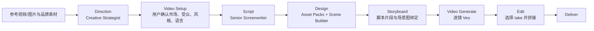

# Linglong Studio 能力说明（供 Glean 分析）

> 版本：2026-07-27
> 目的：让 Glean、管理层或产品/技术评审快速理解 Linglong Studio 已在解决什么问题、目前有哪些能力、其技术路线和下一阶段判断。
> 说明：本文刻意区分“已具备/正在使用的能力”与“仍有边界或待完善项”，不将路线图描述为已交付能力。

## 1. 一句话定义

**Linglong Studio 是一个面向商业创意生产的 AI 工作台：把参考素材、品牌素材、创意策略、剧本、可复用视觉资产、分镜和逐镜视频生成，组织成一条可审阅、可修改、可追溯的生产链路。**

它的核心不是“再做一个输入 Prompt 后出一张图/一条视频的生成器”，而是把广告创作中最容易失控的上下文、资产一致性、人工决策点和版本关系管理起来。

可以用一句话概括其差异：

> **模型负责生成像素；Studio 负责管理让这些像素可用于商业创意的决策、上下文与可复用视觉状态。**

## 2. Studio 要解决的业务问题

### 2.1 商业创意生产不是单次生成

一个可以投放的广告，通常同时要求：

- 有可验证的创意策略，而不是机械模仿参考视频；
- 人物、产品、场景、UI、品牌色和灯光在多个镜头中保持一致；
- 剧本、画面、字幕、CTA、镜头顺序彼此对齐；
- 用户能在关键决定处介入，而不是等待一个不可解释的“整片结果”；
- 某一个镜头失败后可以局部重做，而不必重做整支广告；
- 每一个输出都能追溯到源素材、Prompt、版本和生成任务。

传统“Prompt → 生成”模式难以满足这些要求：上下文会丢失、角色会漂移、品牌资产会错用、视频首尾不连续、用户无法把满意的视觉状态复用到后续镜头。

### 2.2 Studio 的解法

Studio 将工作拆成两个清晰层次：

1. **创意决策层**：从参考素材和客户品牌素材中形成方向、创意合同、剧本、资产计划与护栏。
2. **视觉生产层**：把角色、道具、环境、UI 先做成可选择、可复用的视觉状态，再组合为场景、分镜和逐镜视频。

这使用户能够在“不可逆或成本高”的节点做确认：选择资产状态、选择场景图、绑定分镜、修改视频 Prompt、选择最佳视频 take，而不是只在最后验收成片。

## 3. 产品版图与现有功能

Linglong Lab 当前包含多个相互衔接的工作区；其中 Studio/Video Production 是面向商业创意生产的核心部分。

| 工作区 | 主要能力 | 解决的问题 |
| --- | --- | --- |
| Image Studio | 图片生成、改造、尺寸适配、主题/广告素材工作流、GIF 等 | 快速制作、复用和适配投放图片素材 |
| Asset Library | 上传、浏览、选择、删除、下载、复用图片/视频素材 | 把分散的客户资产与 AI 生成素材变成可查询的资产库 |
| Video Production | 从方向、剧本、资产、场景、分镜到逐镜视频生成与编辑 | 将短广告视频制作从不透明的一次性生成，变成可控的生产流程 |
| Comfy Workflow（独立工作区） | 节点式创意/生成工作流 | 为需要自由组合节点的高级用户提供可视化工作流能力；不替代 Studio 的引导式生产流程 |

### 3.1 Image Studio

Image Studio 的目标是将图片处理从“反复手工导出”变成可复用的创意生产步骤。现有能力包括：

- 使用 AI 生成或编辑创意图片；
- 以本地上传或 Library 现有资产为输入；
- 常用广告尺寸的 Resize / Reframe，包括横版、竖版和端卡尺寸；
- 针对高分辨率 1080×1920、1920×1080 的严格保真改尺寸：要求只改变画布与边缘延展，不添加、删除、翻译或重写原图中的 Logo、文字和主体内容；
- 将生成结果自动保留在素材库，供 Video Production 和其他图片工作流复用；
- 支持图像类创意工作流，例如静态广告素材、GIF/Kakao 等场景的素材处理。

这里的关键价值是：**用户不必反复在电脑、本地文件夹和创作工具之间搬运资产；同一张可信的品牌图或角色图可以成为后续所有生成环节的输入。**

### 3.2 Video Production：一条引导式广告视频生产链路

当前视频工作区的主流程是：



这是一条“逐镜制作”而不是“直接一键整片”的流程。对 15–30 秒广告而言，系统通常会建议 6–10 个 Frame；用户可以按创意需要增加、删除或替换。

## 4. 视频生产的关键能力

### 4.1 Direction：把参考视频转成原创制作方案

Creative Strategist 的工作不是仅输出一句“高能量开场 + CTA”。它应当基于参考视频和品牌素材，形成一份可供后续 Agent 使用的创意方向。当前产品结构包含：

1. **参考视频分析**：拆解故事节奏、hook、镜头、人物关系、场景、情绪、产品证明方式、字幕/声音角色以及 CTA 的结构；参考素材只作为可迁移的创意证据，不能复制其品牌、人物肖像、文案或 UI。
2. **Recommended video direction**：说明为客户品牌制作的原创广告应该讲什么、为何这样讲、目标转化动作是什么。
3. **Designer reference frames**：从参考视频中定位关键时刻，作为语义和构图启发，不直接当成成片素材或复制对象。
4. **Confirm Asset Plan**：列出这支广告需要的视觉资产，并明确来源、用途、连续性要求和状态。
5. **Video architecture**：按时间段描述每个 Beat 的叙事功能、所需资产和与下一个 Beat 的衔接方式。
6. **Guardrails**：定义原创边界、品牌边界、文本/UI 风险和生成限制。

系统会根据用户当前输入语言输出可读报告；而视频生成 Prompt 则单独转换为适合视频模型理解的英文自然语言，台词与字幕保持目标市场的语言。

### 4.2 Video Setup：先确认“为谁做、怎么说”

仅有参考视频并不足以写出正确剧本。Video Setup 将以下信息作为生产的显式约束：

- 目标市场与目标受众；
- 广告类型（游戏广告、真人广告、产品演示、短剧等）；
- 视觉风格与投放平台；
- 视频目标（安装、购买、留资、品牌认知等）；
- 口播语言和字幕语言。

Creative Strategist 可以基于 Brief 和参考素材**自动建议**这些字段，用户只需核对和修改；一旦确认，后续 Screenwriter 不应再自行猜测市场、人物语言或广告类型。

### 4.3 Script：可编辑的广告剧本，而不是粗略 Beat 列表

Senior Screenwriter 以已确认的 Video Setup、创意方向和资产计划为输入，生成版本化的 Working Script。每个脚本段对应一个可制作的镜头/分镜时刻，并应包含：

- 时间段、场景与叙事目的；
- 画面和动作；
- 镜头语言；
- 角色、台词、语气及是否在镜头内说话；
- 字幕/屏幕文案；
- 音乐和音效方向；
- 连续性说明；
- 原创、品牌与模型生成限制。

其中一些字段在底层以结构化数据保存，例如 `spoken_language`、`dialogue[]`、`on_screen_text[]`、`camera_direction`、`sound_direction`、`continuity_notes`。这样脚本不仅供人阅读，也能为 Designer、Director 和视频生成提供稳定输入，而不是把所有逻辑塞进一段 raw text。

### 4.4 Design：先锁定视觉“原料”，再生成故事场景

Design 遵循“Ingredients before motion（先原料、后运动）”原则。它不是单纯的图片列表，而分成两步：

#### 第一步：Asset Packs

根据锁定的脚本和 Asset Plan 生成可复用视觉状态，例如：

- 角色：脸部、发型、服装、体型、表演特征；
- 环境：空间结构、镜头角度、光线、关键物件位置；
- 道具/产品：花束、手机、包装、实际商品；
- UI：游戏界面、Logo、下载按钮、CTA；
- 需要时的灯光、运动或转场视觉锚点。

每个 Pack 默认可生成 2×2 visual sheet，系统会把面板裁成独立图像并放入 Library。用户可以：

- 修改系统建议的 Pack；
- 新建完全自定义的 Pack；
- 上传 source image；
- 写完全由自己控制的 Prompt（自定义 Prompt 不应被系统强行追加无关的“中性棚拍背景”等描述）；
- 从 2×2 中选用多个状态作为后续场景的视觉原料。

#### 第二步：Scene Builder

Scene Builder 将角色、场景、道具、UI 等已生成原料组合成真正的“故事场景图”。这一步的输出才是供 Storyboard 选择的画面。

- Scene 按项目的 9:16 或 16:9 画幅生成；
- 用户可手动建立场景，选择多个素材作为 source；
- 每个场景都可绑定脚本时刻，也可在用户修改想法后独立创建；
- Scene Builder 的图像自动进入 Library，便于按 Frame 选择；
- 这避免直接把“单独的人物棚拍图”“单独的背景图”错误地当作视频首帧。

### 4.5 Storyboard：把脚本和场景图一一配对

Storyboard 是生产的控制面，而不是另一个让模型重新生图的步骤。

- **一个 Frame 对应一段锁定的 Working Script**，顺序跟随脚本；
- 用户从 Scene Builder 图库中为该 Frame 选择已经生成的 Scene image；
- Frame 会完整展示所对应的脚本内容、起始画面和可选的 End Scene；
- End Scene 是可选尾帧，用于需要明确终点状态或转场的镜头；
- 用户可以批量或逐 Frame 生成、编辑和保存 Director Veo Prompt；
- 生成后可进入 Video Generate，任何 Frame 或 End Scene 更新都应使旧视频 take 失效，避免用户误以为旧视频仍代表新分镜。

**为什么加入 End Scene：** 首尾帧相隔太远、人物位置差太大或背景透视不一致时，视频模型容易硬切、跳跃或“隐移”。Director 应阅读首帧、尾帧和脚本，明确写出中间动作路径和镜头运动；若跨度不适合在 4/6/8 秒完成，则建议拆镜或生成中间场景图。

### 4.6 Director Veo Prompt：从结构化脚本到模型可执行语言

Director 不是重新写故事，而是把某一个 Frame 的锁定脚本、起止画面和连续性要求压缩为短、清楚、可执行的 Veo Prompt。

生成规则是：

- 使用英文自然语言，避免把 XML 标签、格式说明和冗余元数据直接送入 Veo；
- 对白保留目标市场语言，并包含角色、情绪或声线提示；
- 若脚本有字幕，明确为画面底部字幕，例如白字、黑色描边；
- 描写一个主动作和一套相符的镜头运动，避免在 4–8 秒内要求过多连续动作；
- 当使用首尾帧时，显式要求单一连续镜头、可物理完成的动作路径、平滑镜头跟随和空间连续性；
- 不重复写画幅、分辨率、重复音频说明或无意义的限制标签；
- 用户能在 Storyboard 中直接编辑并保存，Video Generate 使用保存后的版本，不再回读旧 Working Script。

### 4.7 Video Generate：逐镜、可重试、可比较

视频生成阶段使用 Veo 按单个 Frame 运行，而不是整支广告一次生成。

- 每条镜头显示起始 Scene image、可选尾帧缩略图、时长和可编辑 Prompt；
- 支持 4、6、8 秒的镜头时长选择；
- 单独生成 S02 不会重做 S01；单独重生成某一镜头不会改动其他镜头；
- 修改 Prompt、起始画面或尾帧后，用户可只重生成当前镜头；
- 每个生成 take 保留关联的 Prompt、关键帧、任务和状态；
- 用户在 Edit 中选择每个镜头最终使用的 take，再按时间顺序拼接为完整视频。

## 5. 多 Agent 编排，而不是多个彼此独立的聊天机器人

Studio 的 Agent 设计重点是“职责分工 + 共享合同 + 软件校验”。

| Agent / 组件 | 主要职责 | 不应做的事 |
| --- | --- | --- |
| Creative Strategist | 深度分析参考素材，提出原创广告方向、资产计划、架构与护栏 | 直接替 Designer 写最终生图 Prompt；复制参考人物、品牌或文案 |
| Senior Screenwriter | 将已确认策略与 Video Setup 扩展为可制作、可编辑、结构化剧本 | 自行改变确认的市场、语言、受众或资产计划 |
| Production Designer | 按剧本和资产合同定义 Pack、视觉规则与 Scene Builder 的输入 | 漏掉脚本明确需要的角色/道具；把生产需求错误排除为“非设计资产” |
| Storyboard Director | 把锁定脚本与场景图配对，管理 Frame、End Scene、连续性和 Veo Prompt | 改写锁定故事或使用未选定的资产替代用户选择 |
| Prompt Reviewer | 在内部审阅 Agent/System Prompt 的冲突、信息过载、歧义和格式漏洞，最多两轮修订 | 直接替代创作 Agent 或无限叠加提示词 |
| 编排与校验代码 | 传递合同、验证必填字段、冻结资产计划、保存 lineage 与版本 | 把关键业务逻辑交给模型“猜” |

### 5.1 三类共享合同（Contracts）

为了避免“Strategist 说一套、Screenwriter 写一套、Designer 又生成另一套”的常见问题，工作流使用共享的合同思路：

| 合同 | 核心内容 | 主要消费者 |
| --- | --- | --- |
| Production Contract | 项目格式、时长、比例、平台、受众、语言、品牌输入和输出限制 | 所有阶段 |
| Creative Contract | 参考分析、创意方向、风格、叙事机制、原创边界 | Screenwriter、Designer、Director |
| Asset Contract | 资产计划、唯一 asset key、类型、来源、用途、必需状态与使用范围 | Screenwriter、Designer、Storyboard |

合同的价值不在于增加文档，而在于让后续步骤引用相同的对象和 ID。比如脚本中的角色绑定、Designer 的 Character Pack、Storyboard 的 Frame 以及视频 take 都应指向同一个资产语义，而不是分别靠自然语言猜“Friend A 是谁”。

### 5.2 人在回路中的决策点

系统不会将“确认”藏在模型内部。用户在以下位置具有明确控制权：

- 确认或修改 Video Setup；
- 确认 Asset Plan；
- 编辑并锁定剧本；
- 修改/新建 Pack Prompt，上传 source image；
- 选择可复用的 2×2 资产状态；
- 组合并选择 Scene Builder 场景图；
- 为每个 Frame 选择起始/尾帧；
- 编辑 Director Veo Prompt；
- 对每个镜头单独生成、比较和选择最终 take。

这使 Studio 更像“AI 辅助的广告制作台”，而不是只输出一个不透明的生成结果。

## 6. 技术基础

### 6.1 应用架构

- **前端**：Next.js 15 + TypeScript；
- **API**：FastAPI + Python；
- **文本/Agent 模型**：Gemini `gemini-3.6-flash`；
- **图片生成模型**：Gemini `gemini-3.1-flash-image`；
- **视频生成模型**：Veo `veo-3.1-fast-generate-001`；
- **云端素材存储**：GCS `incept-assets`；
- **生成机制**：异步 Job、单镜头状态和资产 metadata；
- **持久化方向**：媒体字节进入对象存储；Production、脚本、资产关系、任务和选择状态由数据库保存，并在推进 Cloud SQL 持久化与备份治理。

模型名、端点和云位置属于用户/基础设施配置，不由产品逻辑猜测或自动替换。

### 6.2 资产溯源与可靠性

Studio 将“媒体文件”和“媒体的制作语义”分开管理：

- GCS 保存图片、视频等文件；
- 数据库 metadata 保存 asset、任务、Prompt、Pack、脚本、Storyboard 和选择关系；
- 一个媒体文件可以在多个场景/Frame 中复用，但每次使用都保留其来源；
- 对象存储版本与定时数据库快照用于降低本地重启或错误恢复造成的资产/metadata 脱节风险；
- GCS 中只有媒体字节并不能完整恢复脚本、分镜排序和用户选择，因此 metadata 的持久化与备份是产品可靠性的关键。

这也是 Studio 不同于单纯文件夹或单次 API 调用的地方：它要保存的是**创作决策链**。

## 7. 对管理层有意义的创新点

### 7.1 从“生成内容”转向“管理创意生产状态”

单模型的优势是生成能力；Studio 的价值是将生成能力放到广告生产约束中：品牌、角色、产品、镜头、语言、审批、版本和交付。

### 7.2 视觉状态是可复用资产，而非一次性结果

2×2 状态板、独立面板裁切、Scene Builder 和 Library 共同把“满意的一次生成”变成下一支广告、下一条镜头能继续使用的视觉资产。这有助于降低重复生成，并提高系列广告的一致性。

### 7.3 面向商业化视频的逐镜控制

视频模型最容易在跨镜、角色身份、物体、UI 和空间连续性上失败。Studio 通过短镜头、首尾帧、场景图、连续性说明、局部重试和 take 选择，把风险隔离在单一镜头内，而不是让整条广告不可控。

### 7.4 人工决策与 AI 扩展的合理分工

AI 擅长提出方向、扩写剧本、生成视觉候选和做局部变体；人更适合确认品牌、目标市场、好看的角色状态、关键分镜和最终 take。Studio 将人的注意力集中在高价值选择上。

### 7.5 可演化为“创意学习闭环”

当前 Studio 已经具备从创作输入到可交付素材的生产数据基础。下一阶段可将投放表现、素材标签、受众市场和创作决策连接起来，形成：

```text
生成 → 审阅 → 投放 → 衡量 → 学习 → 刷新下一轮创意
```

这会把 Studio 从内容生产工具推进为更接近 Creative Intelligence / Creative Operations 的系统。

## 8. 当前边界与需要如实说明的风险

以下不是缺陷掩盖，而是对产品边界的清晰定义：

1. **AI 视频不保证物理连续性。** 如果首尾场景人物跨度太大、透视/光线不一致或动作过多，模型仍可能硬切、跳跃或形变。Studio 的策略是提示拆镜或加入中间场景，而不是承诺模型必然解决。
2. **台词、字幕、音画同步需要分层管理。** 视频模型可根据配置尝试生成音频/说话表演，但高保真口型、准确文案和稳定 UI 文字不应被承诺为确定性输出。字幕、Logo、CTA 与免责声明适合在 Edit 阶段确定性叠加。
3. **生成速度与成本仍受上游模型和图像尺寸影响。** 因此产品采用单镜、局部重试和可复用资产，而非默认高分辨率整片重做。
4. **可靠性取决于资产 bytes 与 metadata 同时持久化。** 只有 GCS 文件并不足以恢复完整 Production；Cloud SQL、备份、版本化和恢复演练需要持续完成与验证。
5. **Agent 提示词不能替代编排。** 输出 schema、合同验证、截图/素材提取、资产绑定和失败诊断应由代码承担；Prompt 只负责模型最适合的分析与创作任务。

## 9. 建议 Glean 重点审阅的问题

请 Glean 对以下问题给出批判性建议，而非只做摘要：

1. 对 CEO / CAIO 而言，Studio 最强、最可信的价值主张应该如何表述？
2. “多 Agent + Contracts + 可复用视觉状态”是否是足够清晰的差异化，哪里仍像普通生成工具？
3. 面向商业广告团队，最值得优先量化的指标是什么？例如首稿时间、局部重做率、素材复用率、人工审核时间、投放素材产出数等。
4. 哪些体验环节应进一步简化，避免用户在 Direction、Script、Design、Storyboard 中感到重复确认？
5. 视频链路的最大技术/产品风险是什么：一致性、速度、编辑能力、音频、品牌合规、数据持久化，还是与投放结果的闭环？
6. 如果只用 2–3 页向管理层讲述，应优先讲“商业问题”“系统性创新”还是“未来的创意学习闭环”？为什么？

## 10. 可用于管理层汇报的短版本

**问题**：AI 可以生成内容，但无法天然保证广告的品牌一致性、镜头连续性、可审阅性和可重复生产。
**方案**：Linglong Studio 将参考、策略、剧本、视觉资产、场景、分镜和逐镜生成组织为一条带人工确认的生产链路。
**差异**：我们不把模型当作黑盒导演；我们用共享合同、可复用视觉状态和逐镜控制，让 AI 输出成为可以进入商业生产的创意素材。
**下一步**：把生产链路连接到投放表现，建立“生成—衡量—学习—刷新”的创意增长闭环。
