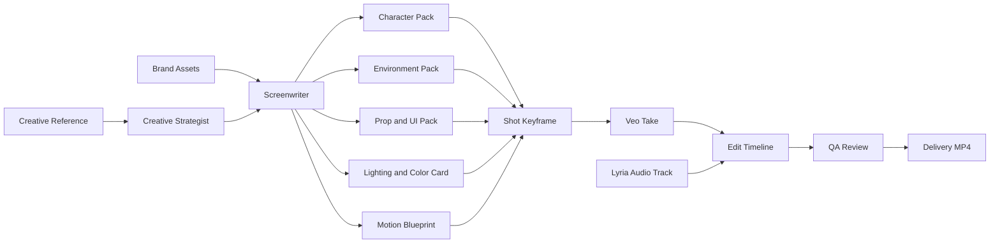

# LinglongLab Comfy UI Creation Canvas

**Status:** Product and architecture proposal  
**Date:** 2026-07-24

## 1. Decision

Add a new **Comfy UI** entry in the application sidebar. It opens an advanced, node-based infinite canvas for visual creative production.

Comfy UI does **not** replace the guided Video Production workspace. The guided workspace remains the default path for advertisers who need a clear sequence:

```text
Direction -> Script -> Design -> Storyboard -> Generate -> Edit -> Deliver
```

Comfy UI is the advanced production graph for users who need to inspect, branch, compare, and run the relationships between assets, prompts, keyframes, video takes, audio, and final outputs.

The two experiences must use the same canonical production data. The canvas is a visual projection and controlled execution surface, never a second source of truth.

## 2. Product Goal

Comfy UI makes a commercial video production understandable as a visible dependency graph:

- Show exactly which reference, brand asset, instruction, and approved keyframe produced each output.
- Let advanced users create controlled variations without losing the approved production plan.
- Make asset lineage, prompt lineage, cost, status, and failures visible at node level.
- Reuse proven production structures as templates.
- Preserve the quality principle of the Video Production workspace: **lock assets and keyframes before generating motion**.

It is not a generic prompt-chaining playground, and it is not a raw clone of ComfyUI's diffusion sampler graph.

## 3. Inspiration and Product Boundary

The product can learn from three patterns:

1. **ComfyUI:** workflows are visual graphs of modular nodes joined by typed links; reusable subgraphs make complex workflows easier to manage. [Workflow concepts](https://docs.comfy.org/development/core-concepts/workflow), [nodes](https://docs.comfy.org/development/core-concepts/nodes), and [subgraphs](https://docs.comfy.org/interface/features/subgraph).
2. **RunningHub:** creative generation can be exposed as reusable workflow and task surfaces rather than a single prompt box. [RunningHub API documentation](https://www.runninghub.cn/runninghub-api-doc-en/).
3. **LibTV-style canvas behavior:** based on the supplied product screenshots, an infinite canvas can make image, text, candidate grids, and video outputs visibly traceable. This is a UX reference only; it is not a claim about LibTV's implementation.

LinglongLab should adopt the useful behavior, not copy the visual language or implementation:

- Use a light LinglongLab-native interface by default, with a subtle grid rather than a dark Comfy clone.
- Use production-aware nodes, not raw latent, sampler, checkpoint, or arbitrary code nodes.
- Use typed ports and validated edges, not unrestricted wiring.
- Use structured production records as the source of truth, not canvas coordinates.

## 4. User Modes

### Guided Video Production

Best for most users. It guides a commercial from creative direction through final delivery, with agents and approval gates.

### Comfy UI

Best for expert users, repeat production teams, debugging, and large productions. It supports:

- Opening a graph generated from an existing production.
- Starting from a validated production template.
- Inspecting every asset, prompt, run, and output in one view.
- Running one approved node, a selected branch, or a validated batch.
- Creating variations while preserving the approved parent state.

The user can always return from Comfy UI to the structured production workspace. Both views show the same production state.

## 5. Core Canvas Model

### 5.1 Canvas Structure

The infinite canvas is organized left to right by production stage, with scene lanes and grouped subgraphs:

```text
Inputs -> Strategy -> Script -> Asset Packs -> Storyboard -> Shots -> Edit -> QA -> Deliver
```

Default placement is generated automatically. Users may reposition, collapse, annotate, and group nodes, but position never changes execution semantics.

### 5.2 Production Subgraphs

Each major stage is a collapsible subgraph:

- Direction: creative reference, brief, Creative Strategist report.
- Script: Screenwriter draft, beat sheet, locked script.
- Design: character, environment, prop, UI, lighting, motion, and transition packs.
- Storyboard: scenes, shot cards, selected keyframes, first/last-frame pairs.
- Generate: Veo requests, takes, retries, selected results.
- Edit: timeline, Lyria music, SFX, subtitles, CTA, brand overlays.
- Deliver: QA checks, exports, downloadable deliverables.

## 6. Node Taxonomy

### Inputs

- Creative Reference: a reference video or image used to learn structure, pace, camera language, and commercial mechanics.
- Brand Asset: logo, product, character, gameplay capture, copy, approved sound, or product image used to build the original ad.
- Imported Media: image, video, audio, font, or transparent PNG.
- Brief: product, audience, market, channel, goal, duration, ratio, and output resolution.

### Planning and Agent Nodes

- Creative Strategist: reference analysis, transferable strengths, originality guardrails, and asset checklist.
- Screenwriter: logline, beat sheet, script, dialogue, subtitles, and brand rules.
- Production Designer: visual bible and required asset packs.
- Director: scenes, shot cards, camera direction, continuity, and shot prompts.
- Sound Director: music direction, SFX map, voiceover requirements, and mix targets.
- QA Agent: brand, timing, continuity, rights, caption, CTA, and delivery checks.

### Asset Pack Nodes

- Character Pack: front, three-quarter, and back views; face, hair, wardrobe, body proportions, and approved character state.
- Environment Pack: establishing view, reverse-shot geometry, spatial anchors, and background object placement.
- Prop Pack: product, hero object, packaging, and object close-ups. A Prop Pack must not introduce unapproved characters.
- UI Pack: gameplay UI, device frame, logo, CTA, text treatment, and safe-area rules.
- Lighting and Color Card: color palette, color temperature, key/fill direction, contrast, focal length, and depth-of-field rules.
- Motion Blueprint: anticipation pose, subject action, micro-motion, camera movement, and physics cues.
- Transition Pair: an outgoing frame and incoming frame sharing a visual anchor for a match cut, wipe, zoom, or reveal.

### Production Nodes

- Shot Card: timecode, purpose, visual intent, dialogue, continuity, and assigned inputs.
- Keyframe: a single Veo-ready 9:16 or 16:9 image, never a contact sheet.
- First/Last Frame Pair: approved endpoints for a continuity-sensitive shot.
- Veo Take: an individual model request, result, prompt snapshot, and status.
- Candidate Set: multiple takes or image candidates tied to one immutable parent request.

### Post-production Nodes

- Lyria Audio Track: music clip or stem generated from the approved sound direction.
- SFX/Voiceover Track: approved externally supplied or generated audio element.
- Caption and CTA Overlay: deterministic typography and legal copy.
- Timeline Segment: positioned video, audio, transition, and overlay content.
- Edit Timeline: ordered final timeline.
- QA Review and Delivery MP4: final validation and export.

### Utility Nodes

- Note, Group, Divider, Template, Version Branch, and Approval Gate.

## 7. Typed Ports and Allowed Edges

Nodes expose only compatible input and output ports. Example edge types:

```text
learns_from
uses
constrains
generates
selects
first_frame_for
last_frame_for
continues_from
transitions_to
composes
validates
delivers
```

Examples:

- A Creative Reference can feed a Creative Strategist, but cannot directly feed a final delivery node.
- A Character Pack can constrain a Shot Keyframe, but cannot become a Veo prompt without a shot context.
- A Keyframe can feed a Veo Take as a first frame, and a Transition Pair can add a compatible last frame.
- A Lyria Audio Track can feed an Edit Timeline, but cannot feed a Character Pack.

The graph must reject cycles, incompatible media types, missing required inputs, unapproved dependencies, and execution requests that exceed the user budget.

## 8. Asset Consistency Workflow

The canvas must preserve the distinction between a **contact sheet** and a **Veo keyframe**.

### 8.1 Contact Sheets Are for Asset Locking

Contact sheets exist to lock a controlled visual state, not to create arbitrary candidate images:

- Character sheet: same character front, three-quarter, and back views.
- Environment sheet: establishing view, character A angle, character B reverse angle, and spatial anchor detail.
- Product sheet: hand-held, tabletop, close-up, mobile screen, and end-card presentation.
- Transition sheet: outgoing visual anchor and incoming matching visual anchor.

Contact sheets may be generated as a controlled sheet or assembled from independent approved images. They are never passed directly to Veo.

### 8.2 Veo Receives Only Shot-specific Images

Each Veo request receives one shot-specific 9:16 or 16:9 keyframe, or a valid first/last-frame pair when continuity is needed. The shot keyframe is generated from the approved Character, Environment, Prop/UI, Lighting, Motion, and Transition states.

This protects the system from the failure mode where a model interprets a grid as multiple people or crops a subject across panels.

## 9. Canvas Interactions

### Navigation

- Infinite pan and zoom.
- Minimap and fit-to-production action.
- Search by node name, asset name, shot ID, model, status, or tag.
- Filter by stage, scene, media type, approval state, owner, or failure state.
- Scene lanes and stage groups for large 30s or 60s productions.

### Node Operations

- Select a node to open a right-side inspector.
- View source assets, prompt, constraints, lineage, cost, model, run history, and outputs.
- Run selected, regenerate selected, create variation, compare candidates, approve, lock, or mark stale.
- Drag an existing asset from the Asset Library onto a compatible node port.
- Add a validated node through the plus palette; no free-form arbitrary execution node is available in the first version.

### Execution Feedback

Every run shows a visible lifecycle:

```text
draft -> ready -> queued -> running -> succeeded -> approved
```

Additional statuses:

```text
blocked | failed | stale | cancelled
```

Failures must show actionable diagnostics in the inspector, including the failed service, input summary, error text, and retry eligibility.

## 10. Data and Execution Architecture

### 10.1 Canonical Data

The existing production entities remain authoritative:

- production brief and settings
- strategy report
- script and beat sheet
- asset manifest and asset links
- design packs and approved visual states
- scenes, shots, keyframes, takes, timeline, QA, and delivery

Comfy UI stores only graph-specific presentation data separately:

```json
{
  "workflow_id": "cw_...",
  "production_id": "vp_...",
  "graph_revision": 3,
  "viewport": { "x": 0, "y": 0, "zoom": 0.8 },
  "node_layout": {
    "node_123": { "x": 320, "y": 180, "collapsed": false }
  },
  "groups": []
}
```

Each graph node holds a reference to a canonical production entity. Canvas layout changes therefore cannot accidentally rewrite a script, asset, or delivery.

### 10.2 Immutable Executions

Every execution records:

- input asset IDs and their versions
- prompt and system instruction snapshot
- selected model and user-approved generation settings
- output asset IDs
- cost estimate and actual usage when available
- status, diagnostics, timestamps, and user

`Regenerate` always creates a new child version. It never overwrites an approved asset or take.

### 10.3 Dependency Invalidation

Changing an approved upstream asset marks dependent nodes as `stale`. The user sees exactly which shots, takes, timeline segments, and delivery checks need review before rerunning.

## 11. UI Layout

```text
Header: Workflow switcher | Template | Stage filter | Search | Budget | Run selected
Left:   Node palette and saved templates
Center: Infinite production canvas
Right:  Inspector and asset library
Bottom: Execution queue; optional timeline drawer for edit-stage nodes
```

### Visual Direction

- Light default background with a low-contrast grid, aligned with the existing LinglongLab product.
- Dense information only inside selected/expanded nodes; cards remain scannable at normal zoom.
- Node type is signaled by icon, title, status, and media preview, not by a rainbow of unrelated colors.
- Edges are subtle at rest and highlighted only when selected or when a downstream dependency is stale.
- Large media previews are opened in the inspector or modal, not permanently expanded across the canvas.

## 12. Templates

Initial validated templates should include:

1. **Reference to Original 15s Ad**
   - reference analysis -> original strategy -> script -> asset packs -> 3-4 shots -> edit -> QA.
2. **Reference to Original 30s Ad**
   - same path with 6-8 shot cards and sound timeline.
3. **Character Continuity Pack to Veo**
   - Character Pack -> shot keyframes -> Veo takes -> comparison -> selected takes.
4. **Gameplay Showcase**
   - game capture + UI Pack -> gameplay shots -> CTA end-card -> delivery.
5. **Product UGC Commercial**
   - product/brand assets -> character and environment packs -> UGC scenes -> product reveal -> delivery.

Templates reduce blank-canvas anxiety and enforce valid production architecture before the user modifies the graph.

## 13. Delivery Plan

### Phase 1: Read-only Production Graph

- Add the `Comfy UI` sidebar entry.
- Open a production graph generated from existing Video Production records.
- Implement pan, zoom, minimap, auto-layout, grouping, search, filtering, and inspector.
- Display lineage, prompt snapshots, status, cost, and output previews.
- No new execution semantics and no free-form wiring.

### Phase 2: Controlled Node Execution

- Run selected valid node(s).
- Regenerate individual keyframes or Veo shots.
- Replace compatible assets through typed ports.
- Create variants and compare outputs.
- Validate dependencies, approvals, permissions, and budget before execution.

### Phase 3: Templates, Subgraphs, and Team Production

- Save and reuse production templates and subgraphs.
- Batch shot execution and queue management.
- Branch comparison, comments, approvals, and audit history.
- Optional collaboration and reviewer roles.

### Explicit Phase 1 Non-goals

- Raw diffusion sampler/checkpoint/latent nodes.
- Arbitrary user code execution.
- Unvalidated free-hand connections.
- Full autonomous generation without human approval gates.
- Replacing the existing guided Video Production workflow.

## 14. Acceptance Criteria

- A user can trace a final MP4 back to every approved source asset, keyframe, Veo prompt, audio track, and timeline segment.
- The graph cannot create a semantically invalid connection.
- Any canvas node can open its corresponding structured production record.
- Changing an upstream asset visibly marks dependent work stale.
- A user can run or regenerate a single shot without restarting the entire production.
- A user can return to the guided workspace without losing canvas context.
- Canvas rendering remains usable for a 60-second commercial with dozens of assets, packs, shots, variants, and outputs.

## 15. Risks and Mitigations

| Risk | Mitigation |
| --- | --- |
| Canvas overwhelms non-technical users | Keep Guided Video Production as the default; expose Comfy UI as an advanced sidebar. |
| Spaghetti graphs | Stage-based auto-layout, groups, subgraphs, typed ports, and templates. |
| Accidental high spend | Per-node estimate, user budget guardrails, batch confirmation, and explicit run actions. |
| Two sources of truth | Production data stays canonical; canvas stores only layout and graph presentation metadata. |
| Broken continuity after asset edits | Dependency invalidation and required re-approval of stale downstream shots. |
| Large graph performance | Viewport virtualization, thumbnail loading, minimap aggregation, and lazy inspector previews. |
| Rights or brand misuse | Carry source ownership, approved asset roles, originality rules, and QA requirements through the graph. |

## 16. Example Production Graph



## 17. Outcome

Comfy UI should make the invisible production logic visible without forcing every advertiser to become a node-graph operator. It is the expert control surface for an LinglongLab commercial production: structured enough to preserve brand, continuity, and cost safety; flexible enough to branch assets, shots, and variants when a professional team needs deeper control.
