# LinglongLab Video Production Workspace

> Current product specification  
> Updated: 2026-07-20

## Product Definition

LinglongLab Video is a **workspace-first AI commercial video production system**.

One **Video Workspace** represents one complete video production. It contains
the brief, customer assets, script, storyboard, approved keyframes, generated
shots, audio plan, edit timeline, QA results, and final deliverables.

There is no user-facing Thread or Project concept in Video.

> Conversation supports decisions. The storyboard controls production.

## Core Principle: Ingredients Before Motion

LinglongLab does not send a broad prompt directly to Veo and ask it to invent a
complete advertisement.

Before video generation, each shot must have approved visual ingredients:

- customer-owned product, game, character, UI, logo, and brand assets
- brand and visual-style rules
- an approved static keyframe generated by Gemini Image or uploaded by the user
- an optional final frame where a transition needs precise continuity
- one short, shot-specific motion brief

`gemini-3.1-flash-image` generates and iterates visual-development frames and
shot keyframes. `Veo 3.1 Fast` animates approved shots. Veo does not own the
full narrative, deterministic brand UI, CTA, legal copy, subtitles, or the
final end card.

Final logos, CTA, subtitles, disclosures, transitions, and layout are composed
deterministically during editing.

## User Workflow

```mermaid
flowchart LR
  A["Start with an idea or customer A reference video"] --> B["Upload customer B assets"]
  B --> C["Script Agent: script and asset manifest"]
  C --> D["User edits and locks script"]
  D --> E["Director Agent: scenes and Shot Cards"]
  E --> F["Create and approve keyframes"]
  F --> G["Generate selected shots with Veo Fast"]
  G --> H["Edit timeline: audio, overlays, subtitles, CTA"]
  H --> I["QA and MP4 delivery"]
```



### Start from an idea

The user provides a product, audience, campaign goal, platform, aspect ratio,
target duration, and brand assets. The Script Agent creates the first script
and asset manifest.

### Start from a reference video

The user uploads a customer A reference video and customer B assets. The
Reference Analyst extracts reusable creative structure only:

- hook, pacing, and beat rhythm
- scene progression and shot language
- gameplay or product-proof logic
- character actions, music role, dialogue role, subtitle role, and CTA role

It does not copy customer A's logo, characters, copy, or protected assets. The
Script Agent writes an original production for customer B.

## Production Stages

The workspace uses one persistent production rail:

```text
Brief -> Script -> Storyboard -> Generate -> Edit -> Deliver
```

### Brief

Collect product context, creative objective, target audience, market, delivery
platform, duration, aspect ratio, customer-owned assets, and optional reference
videos or images.

### Script

The Script Agent produces a versioned editable script with:

- creative objective and conversion event
- logline
- audience, placement, duration, and aspect-ratio constraints
- Style Bible: palette, material, environment, character treatment, and camera rules
- Brand Rules: logo, product, typography, CTA, disclosure, and prohibited changes
- Beat Sheet with time ranges
- scene actions, dialogue/voiceover, subtitles, music, and SFX requirements
- Asset Manifest: supplied assets, missing assets, and recommended assets
- Risks: rights, missing assets, continuity risks, and unsuitable model tasks

The user may revise the script through a contextual Agent conversation drawer.
The user must explicitly select `Lock script` before storyboard production.

### Storyboard

The Director Agent converts the locked script into scenes and **6-12 editable
Shot Cards** for a typical 15-30 second advertisement. The workspace uses a
structured storyboard canvas rather than an unrestricted whiteboard.

Each Shot Card includes:

| Field | Content |
| --- | --- |
| Shot and scene | Stable identifier, for example `S03` |
| Timecode and duration | Position and duration on the final timeline |
| Purpose | Hook, proof, escalation, payoff, CTA, etc. |
| Scene and action | What the viewer sees and what changes |
| Camera | Framing and motion direction |
| Inputs | Reference assets, brand assets, character/product/UI assets |
| Keyframe | Approved starting state, plus optional final frame |
| Veo Prompt | Independent English motion brief for this shot |
| Continuity | Required camera, lighting, UI, object, and character state |
| Audio cue | Music beat, SFX, dialogue, VO, or silence requirement |
| Transition | Cut, match cut, dissolve, or graphic transition |
| Status | Draft, Approved, Generating, Ready |

The user can drag cards to change order, edit shot detail, replace assets,
replace keyframes, approve selected shots, and generate selected shots only.

### Keyframes

Gemini Image is a visual-development system, not a one-off image generator.
For every shot, the user can:

- upload a customer-owned keyframe
- select an existing workspace asset
- generate a Gemini Image keyframe
- generate a 2x2 scene sheet, choose a consistent candidate, and use it as the
  shot keyframe
- replace a keyframe without rebuilding the storyboard

Only approved keyframes enter Veo generation. This preserves character,
product, UI, lighting, and composition consistency better than prompt-only
video generation.

### Generate

Veo Fast generates motion plates for approved individual shots:

- use 4, 6, or 8-second takes based on the approved Shot Card
- generate a different, shot-specific prompt for every shot
- use first/last frame conditioning only when the shot needs a continuous
  transition
- preserve continuity from the preceding shot through the approved state and
  keyframe, not by repeating a full-video prompt
- regenerate only the failed or rejected shot

The workspace stores the keyframe revision, source assets, Veo prompt, take
status, cost, and output for each shot.

### Edit

The Edit stage is a focused ad-production timeline:

- arrange, trim, and replace approved takes
- add deterministic transitions
- add exact logos, CTA, subtitles, disclosures, and end cards
- add music, SFX, and voiceover tracks
- produce alternate output ratios from the same production data

`Lyria 3 Clip Preview` provides music segments after the shot timing is stable.
The timeline is responsible for placing audio against the approved picture edit.

### Deliver

The QA Agent checks:

- duration, aspect ratio, frame rate, and valid MP4 output
- no black frames or unintended repeated shots
- shot-boundary continuity
- legible logo, CTA, subtitles, and disclosures
- correct use of customer-owned assets and brand rules
- clear audio state

The deliverable contains the final MP4, poster, selected takes, approved
keyframes, prompt manifest, and production metadata.

## Workspace Layout

```text
---------------------------------------------------------------
| Video Workspace name | Brief / Script / Storyboard / ...     |
---------------------------------------------------------------
| Script and Agent     | Storyboard Canvas          | Assets    |
| conversation drawer  | Ordered scene / Shot Cards | Library   |
|                      | keyframes and status       | drag/drop |
---------------------------------------------------------------
| Timeline: takes | transitions | audio | CTA | QA             |
---------------------------------------------------------------
```

- **Top:** current stage, total duration, aspect ratio, and budget.
- **Left:** current script and contextual Agent conversation drawer.
- **Center:** editable structured Storyboard Canvas arranged by scene and shot.
- **Right:** Assets Library, categorized as Brand, Character, Product,
  Reference, Generated, and Audio. Assets can be dragged onto a Shot Card.
- **Bottom:** Timeline for generated takes, transitions, audio, subtitles, CTA,
  and final QA.

Conversation keeps the complete workspace context, but it does not replace the
canvas. User and Agent messages are versioned in order; an uploaded asset
thumbnail appears only in the message that introduced it.

## Agents

| Agent | Responsibility | Output |
| --- | --- | --- |
| Reference Analyst | Analyze customer A references without copying protected identity or IP | Reference structure and keep/change rules |
| Script Agent | Create and revise the commercial plan | Script, Beat Sheet, Asset Manifest, risk list |
| Director Agent | Convert a locked script into a visual production plan | Scenes, Shot Cards, keyframe briefs, continuity rules |
| Visual Development Agent | Produce controlled visual candidates | Keyframes and 2x2 scene sheets |
| Production Agent | Generate approved motion plates | Per-shot Veo prompts, take status, and output metadata |
| Post-production Agent | Assemble deterministic final output | Timeline, audio plan, overlays, subtitles, CTA |
| QA Agent | Block invalid or weak deliveries | Acceptance report and required fixes |

No agent may silently change a locked brand rule, script, keyframe, or shot.

## Core Data Model

```text
VideoProduction / VideoWorkspace
  ├── BriefRevision
  ├── ScriptRevision
  ├── ReferenceAnalysis
  ├── AssetManifest
  ├── StoryboardRevision
  │   └── Scene[]
  │       └── Shot[]
  │           ├── AssetLink[]
  │           ├── KeyframeRevision[]
  │           ├── MotionPromptRevision[]
  │           └── VideoTake[]
  ├── EditTimelineRevision
  ├── AudioPlan
  ├── DeliveryAsset[]
  └── AuditEvent[]
```

The first implementation needs:

1. `video_workspace`
2. `video_script_revision`
3. `video_scene`
4. `video_storyboard_revision`
5. `video_shot`
6. `video_shot_asset_link`
7. `video_keyframe_revision`
8. `video_take`
9. `video_timeline_revision`
10. `video_audit_event`

## Build Order

1. Create independent Video Workspace / VideoProduction persistence.
2. Build Brief, Script editor, and contextual Agent drawer.
3. Build the structured Storyboard Canvas with draggable Shot Cards.
4. Add Gemini Image keyframe generation, replacement, and approval.
5. Generate Veo takes per approved shot and write each take back to its Shot Card.
6. Add the timeline, deterministic composition, Lyria audio tracks, and MP4 export.
7. Add QA, collaboration comments, version comparison, and optional freer
   moodboard capabilities.

## References

- [LTX: The Best AI Video Workflow Guide & Tool Stack](https://ltx.io/blog/ai-video-workflow)
- [Ability AI: AI Video Production Workflow](https://www.ability.ai/blog/ai-video-production-workflow)
