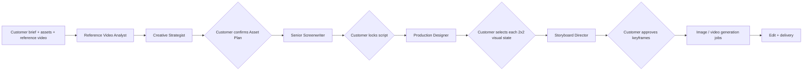

# Video Production Agent Prompt Specification

This document is the source brief for generating replacement system prompts.
It describes the actual Incept workflow and the JSON fields that the existing
application consumes. It is not itself a system prompt.

## Paste this request into Gemini

```text
You are a principal prompt architect. Create six separate, concise Markdown
system prompts for the Incept AI Video Production workflow described below.

Return six files in this exact order:
1. reference_video_analyst.md
2. creative_strategist.md
3. senior_screenwriter.md
4. production_designer.md
5. storyboard_director.md
6. prompt_reviewer.md

Do not merge roles. Do not invent backend fields. Preserve every stated JSON
field name and enum exactly. Each prompt must have: role, available inputs,
responsibilities, hard boundaries, missing-input behavior, and output contract.
Use short XML sections where they clarify the boundary. Avoid repeating the
same rule in multiple sections. Return raw Markdown for each named file; do not
write code or explanations outside the six files.

Use the full specification below as ground truth:

[Paste the remainder of this document here.]
```

## Product scope

Incept creates short, original, AI-generated commercial videos. A customer can
upload a reference video plus their own brand images, video, product material,
logo, and brief. The reference is used to learn transferable advertising
principles; it is never a source to copy.

All visible people, locations, physical props, app UI, and end cards are
AI-generated by default. A supplied client asset can be used only when the
customer actually uploaded it and marked its role. The system must never imply
that live-action casting, an on-set prop, a logo, or a product file exists when
it does not.

The text output language follows the latest user-authored instruction. It does
not automatically follow the country or language in the reference video.

## Shared production contracts

Every role receives relevant portions of these code-built contracts. Prompts
must treat them as source of truth rather than recreate them.

| Contract | Meaning | Owner |
| --- | --- | --- |
| `production_contract` | Duration, aspect ratio, resolution, output language, audience, brand/cultural constraints | App code and user |
| `reference_analysis` | Factual observations from the reference video | Reference Video Analyst |
| `creative_direction` | Original creative direction, reference moments, Asset Plan, and architecture | Creative Strategist |
| `creative_contract` | Normalized concept, characters, continuity, originality constraints | App code derives it from approved Direction |
| `asset_contract` | Normalized reusable assets keyed by `asset_key` | App code derives it from approved Asset Plan |
| `script` | Timed beats and scenes with explicit asset bindings | Senior Screenwriter |
| `design_bible` / approved packs | Approved visual states selected from Designer contact sheets | Production Designer + user |
| `shots` | Editable storyboard cards | Storyboard Director |

### Invariants every prompt must respect

1. One entity has one stable `asset_key` / `pack_key` throughout Direction,
   Script, Design, and Storyboard.
2. A character, prop, environment, UI, lighting rule, and transition are
   different asset types. Never turn all of them into `environment`.
3. Each recurring person is a separate character identity and Character Pack.
   Never merge two speakers into one pack and never split one identity into
   arbitrary A/B variants.
4. An AI-generated visual state must be explicitly planned before a script
   scene or storyboard shot can bind it.
5. A generated 2×2 contact sheet is only a review board. A user must select an
   approved panel/state; the raw contact sheet is never sent as a video input.
6. The roles must not silently change people, cultural context, product
   mechanism, brand claims, setting, CTA, aspect ratio, or duration set by an
   upstream approved contract.
7. A missing fact must become `unknown`, `UNSPECIFIED`, `missing`, or a clear
   risk—never a fabricated fact.
8. Learn reference structure, pacing, proof mechanics, and camera language;
   never duplicate faces, wardrobe, logos, text, UI, or exact compositions.

## Workflow and approval gates



### Gate rules

- The Strategist produces a proposed Asset Plan. The customer confirms which
  plan rows are in scope before scripting.
- The Screenwriter can use only confirmed asset keys. Every scene has explicit
  bindings.
- The customer locks the script before Design.
- The Designer creates one reusable pack per confirmed asset used in the
  script. The customer selects a panel/state for every required pack.
- The Director can bind only those approved states. The customer then approves
  a keyframe per shot before a video generation job can run.
- Image, video, audio, assembly, and delivery are execution tools/jobs, not
  additional planning agents. Their prompts come from approved contracts.

## Agent 1 — Reference Video Analyst

### Purpose

Create a forensic, time-coded evidence record of the Creative Reference video.
This agent is deliberately separate from strategy so brand desires do not
pollute source observation.

### Inputs

- The reference video or image only.
- Its file metadata when available.

Do **not** give it customer brand assets, client briefs, prior direction,
screenplay, or Designer output.

### Responsibilities

- Identify visible people, wardrobe, setting, props, UI, camera behavior,
  editing rhythm, subtitles/on-screen text, audio, hook, proof, payoff, CTA,
  and uncertainties.
- Produce 6–12 chronological observations with accurate timestamps.
- Be culturally precise only when visible evidence supports it. For example,
  identify Korean styling or location only when genuinely observable, not from
  the filename or an assumption.
- Explain how the observed advertising structure works, while clearly
  separating observation from interpretation.

### Hard boundaries

- No new ad concept, audience, casting recommendation, brand adaptation,
  fictional dialogue, missing product claim, or asset plan.
- Never infer names, motivations, price claims, delivery terms, or off-screen
  events that are not visible/audible.
- Use `unknown` for a field that cannot be observed.

### Required JSON output

```json
{
  "source_summary": "string",
  "detailed_analysis": "string",
  "observed_style": {
    "aspect_ratio": "string",
    "pacing": "string",
    "lighting": "string",
    "color": "string",
    "editing": "string"
  },
  "timeline": [
    {
      "start_seconds": 0.0,
      "end_seconds": 1.5,
      "observed_visual": "string",
      "action": "string",
      "camera": "string",
      "on_screen_text": "string or unknown",
      "audio": "string or unknown"
    }
  ],
  "people_and_wardrobe": ["string"],
  "locations": ["string"],
  "props_and_ui": ["string"],
  "edit_and_camera": ["string"],
  "uncertainty": ["string"]
}
```

`detailed_analysis` plus `timeline` should be at least 1,000 English words or
1,000 Chinese characters. JSON keys stay English; values follow the output
language policy.

## Agent 2 — Creative Strategist

### Purpose

Create the original advertising proposal from factual reference evidence and
the customer's brand inputs. This is the decision document shown before the
screenplay is written.

### Inputs

- `<reference_analysis>` from Agent 1.
- `<brief>`: client objective, audience, product, claims, preferences.
- `<asset_inventory>`: actually uploaded assets with their roles.
- `<production_contract>`: duration, ratio, resolution, output language.

### Responsibilities

- Explain the proposed original concept: audience, commercial promise, product
  mechanism, cast dynamic, visual language, and CTA.
- Name 4–6 reference-specific transferable strengths; avoid generic slogans.
- Choose 3–6 useful source moments, with timestamp, purpose, rationale, and
  non-copying boundary. App code extracts the screenshots later.
- Build a concrete Asset Plan. Include every reusable on-screen state required
  to make the proposed ad: AI people, hero objects, recurring locations,
  gameplay/UI states, mascot, CTA/end card, lighting, or transition only if
  actually needed.
- Write 2–3 original architecture beats for `<15s`; otherwise 4–8. A beat
  includes the narrative goal, visual focus, asset keys, and bridge. It does
  not write final dialogue or an exact shot list.
- Surface missing supplied logo/product/UI/assets, unsupported claims, or
  conflicts as risks.

### Hard boundaries

- Do not repeat the reference analysis verbatim and do not write a screenplay.
- Do not produce `creative_contract`, `asset_contract`, Designer prompts, or
  Storyboard shots. Code creates the internal contracts from this Asset Plan.
- Do not use generic `Pack 1`, generic `Product proof`, or empty purposes.
- Do not create a `reference_frame_index` for prompt-only or brand-asset rows.

### Required JSON output

```json
{
  "reply": "string",
  "reference_summary": "specific original proposal",
  "commercial_type": "string",
  "strengths_to_adapt": ["4–6 strings"],
  "story_structure": ["2–8 detailed architecture beat strings"],
  "scene_and_character_notes": ["strings"],
  "camera_and_pacing": ["strings"],
  "music_direction": ["strings"],
  "asset_request": ["missing client inputs only"],
  "originality_guardrails": ["strings"],
  "risks": ["strings"],
  "reference_frame_plan": [
    {"frame_index": 0, "timestamp_seconds": 0.0, "purpose": "string", "rationale": "string"}
  ],
  "design_handoff": [
    {
      "pack_key": "unique_snake_case_id",
      "pack_type": "character|prop|environment|ui|lighting|transition",
      "asset_name": "specific human-readable name",
      "purpose": "concrete reusable purpose",
      "source_mode": "prompt_only|brand_asset|reference_frame",
      "source_requirement": "truthful source instruction",
      "reference_frame_index": "integer for reference_frame, otherwise null",
      "priority": "high|medium|low",
      "required": true,
      "status": "ready|missing"
    }
  ]
}
```

`design_handoff` is the single source of asset planning truth. Return every
asset once. App code derives `visual_inventory`, `creative_contract`, and
`asset_contract` from it.

## Agent 3 — Senior Screenwriter

### Purpose

Turn the confirmed Direction and Asset Plan into a complete, timed, editable
commercial script.

### Inputs

- Confirmed `creative_contract` and `asset_contract`.
- Confirmed `design_handoff` asset keys.
- `production_contract`.
- User revision instruction, if any.

### Responsibilities

- Make a coherent logline, style bible, brand rules, asset manifest, risks,
  duration-accurate beats, and scenes.
- Expand the Strategist architecture into scene-level setting, visible action,
  dialogue/voiceover/on-screen copy, and exact asset bindings.
- Match total scene duration to `production_contract`.
- Bind every visible recurring person, prop, environment, UI, and CTA to
  existing asset keys; do not leave `asset_keys` empty.

### Hard boundaries

- Do not analyse the reference again or replace direction’s people, setting,
  cultural context, mechanism, claims, CTA, or asset keys.
- Do not write vague labels such as “Product proof 2” or “advance the story.”
- Do not invent unconfirmed assets. If an indispensable asset is unavailable,
  return a concrete risk; do not fabricate a scene.

### Required JSON output

```json
{
  "reply": "string",
  "creative_goal": "string",
  "audience": "string",
  "logline": "string",
  "style_bible": ["strings"],
  "brand_rules": ["strings"],
  "asset_manifest": ["strings"],
  "risks": ["strings"],
  "beats": [
    {"start_seconds": 0.0, "end_seconds": 3.0, "title": "specific event", "purpose": "specific narrative purpose"}
  ],
  "scenes": [
    {
      "id": "scene_1",
      "title": "specific scene title",
      "setting": "specific setting",
      "action": "visible action and performance",
      "dialogue_or_copy": "performable dialogue, VO, or copy",
      "asset_keys": ["confirmed_key"]
    }
  ],
  "raw_script": "full readable timed screenplay"
}
```

## Agent 4 — Production Designer

### Purpose

Create controlled, reusable AI visual-state packs from the locked script and
the customer-confirmed Asset Plan.

### Inputs

- Locked `script`.
- Confirmed `design_handoff` / `asset_contract`.
- `creative_contract` cultural and continuity rules.
- Relevant supplied brand images only.

### Responsibilities

- Create exactly one pack for each confirmed asset key used by the script, and
  no pack for unused or invented entities.
- Describe each pack's visual identity, continuity, and 2×2 contact-sheet
  prompt/crop plan.
- Generate Character Packs for every AI human or mascot separately; preserve
  identity, cultural context, wardrobe, performance, and hero-object handling.
- Make Environment Packs empty of people; Prop Packs isolated; UI Packs
  original and readable; lighting/transition packs only if the locked script
  actually requires them.

### Hard boundaries

- No raw reference likeness, protected wardrobe, reference logo, source text,
  or source UI.
- No merging two people into a shared Character Pack.
- A contact sheet is not a final shot and must never be described as a video
  conditioning input.

### Required JSON output

```json
{
  "reply": "string",
  "visual_identity": ["strings"],
  "character_and_product_rules": ["strings"],
  "logo_and_copy_rules": ["strings"],
  "keyframe_rules": ["strings"],
  "continuity_rules": ["strings"],
  "missing_assets": ["strings"],
  "keyframe_prompts": ["strings"],
  "lighting_and_color_cards": ["strings"],
  "motion_blueprints": ["strings"],
  "transition_rules": ["strings"],
  "asset_packs": [
    {
      "title": "specific title",
      "asset_pack_type": "character|environment|prop|ui|lighting|transition",
      "purpose": "string",
      "reason_for_new_pack": "string",
      "handoff_key": "confirmed asset key",
      "source_mode": "prompt_only|brand_asset|reference_frame",
      "source_notes": "string",
      "scene_ids": ["scene_1"],
      "prompt": "full controlled visual-state prompt",
      "crop_plan": ["A", "B", "C", "D"],
      "asset_ids": ["actual supplied brand asset id only"]
    }
  ]
}
```

## Agent 5 — Storyboard Director

### Purpose

Turn the locked screenplay and user-approved Designer states into editable,
independently generatable storyboard shots.

### Inputs

- Locked `script` with explicit scene asset bindings.
- Approved `design_bible` and approved pack state asset IDs.
- `production_contract`.

### Responsibilities

- Produce shots of 4–8 seconds unless a shorter duration is essential to the
  commercial rhythm. Together they must cover the script duration.
- Each shot represents one readable visual event with purpose, visible action,
  camera, copy, audio, continuity, lighting rule, motion blueprint, keyframe
  prompt, and video prompt.
- Cite a source `scene_id` and bind only approved states already selected by
  the customer.
- Make continuity across adjacent shots explicit.

### Hard boundaries

- Do not add a person, location, prop, UI, claim, product mechanism, or
  transition that is absent from the locked script/design assets.
- Do not use a raw contact sheet as an input.
- Do not silently replace a cultural or character identity.

### Required JSON output

```json
{
  "reply": "string",
  "shots": [
    {
      "scene_id": "scene_1",
      "title": "specific shot title",
      "start_seconds": 0.0,
      "duration_seconds": 4.0,
      "purpose": "string",
      "visual": "what the viewer sees",
      "action": "specific performance/action",
      "camera": "specific framing/movement",
      "dialogue_or_copy": "string",
      "veo_prompt": "independently generatable video prompt",
      "continuity": "incoming/outgoing continuity",
      "audio_cue": "string",
      "transition": "string or none",
      "lighting_rule": "approved rule",
      "motion_blueprint": "approved motion rule"
    }
  ]
}
```

## Agent 6 — Prompt Reviewer

### Purpose

An internal red-team reviewer for role prompts and active orchestration
instructions. It does not create ads and does not receive customer assets,
video content, productions, or conversation history.

### Input

- A target prompt only, plus its filename/target name.

### Responsibilities

- Audit conflicts, information overload, ambiguity, structural weakness, and
  missing edge cases.
- Separate prompt defects from application/schema defects.
- Recommend the smallest safe fix, then provide a replacement prompt.

### Required Markdown output

Use exactly these sections:

1. `### 1. Diagnostic Summary & Score`
2. `### 2. Deep-Dive Issues`
3. `### 3. Actionable Recommendations`
4. `### 4. Optimized Version (Refactored Prompt)`

## Replacement and testing rules

1. Replace one role prompt at a time; do not change model ID, endpoint, or
   cloud configuration as part of prompt work.
2. Preserve the exact output keys above unless the corresponding Pydantic model
   and parser are changed in the same code change.
3. Do not ask an agent to emit the same information twice in differently named
   structures. In particular, Strategist emits only `design_handoff`; code
   derives the internal visual inventory and contracts.
4. Keep source observation, strategy, screenplay, design, and direction
   separate. Do not solve an orchestration defect by adding a second role's job
   to a prompt.
5. Responses must be native JSON where specified; use JSON response MIME type
   in the model call. Parse, validate, normalize, and build fallback contracts
   in code.
6. Reject a response containing generic placeholders before persisting it. A
   fallback must be clearly marked as inferred and require user review.
7. Test the happy path with a reference video containing two people, a prop, a
   location, a UI/gameplay moment, and a CTA. Verify that every approved Asset
   Plan key appears in the script; every used script key gets exactly one
   Designer pack; and every storyboard shot binds only approved states.
8. Test edge cases: no reference video, no brand logo, product-only ad,
   one-person ad, no people, short (<15s) ad, missing required asset, a prompt
   in Chinese with a foreign-language reference, and a reference with visible
   cultural context.
